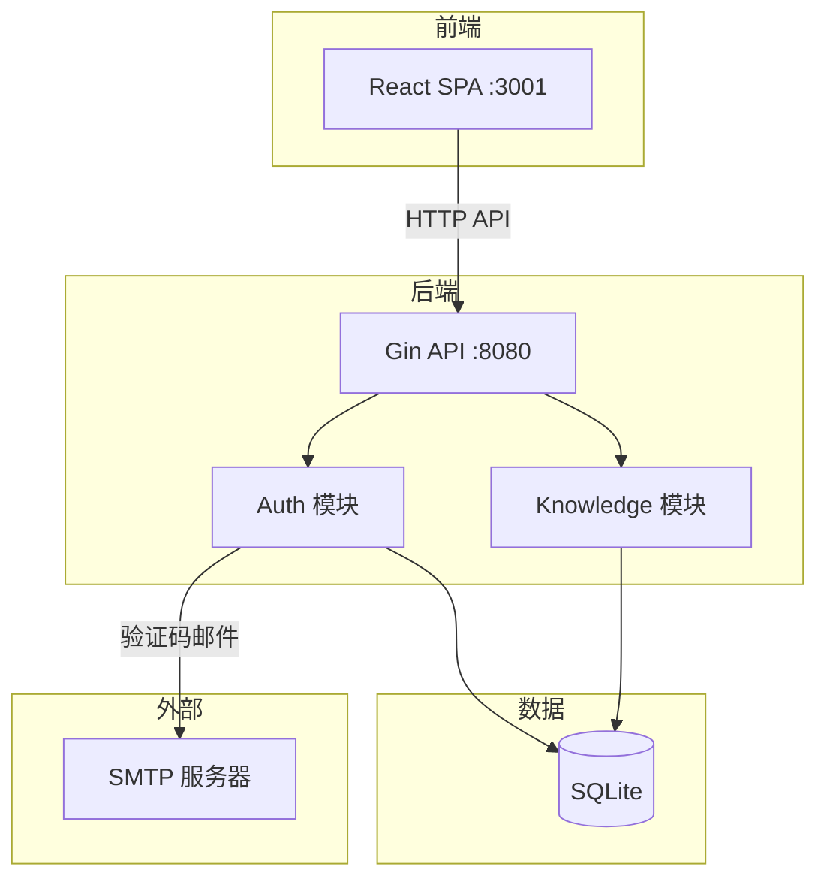
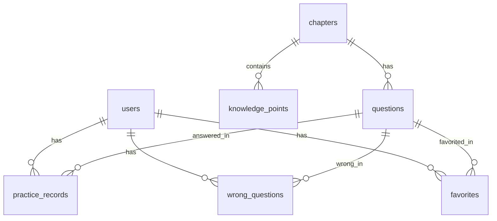
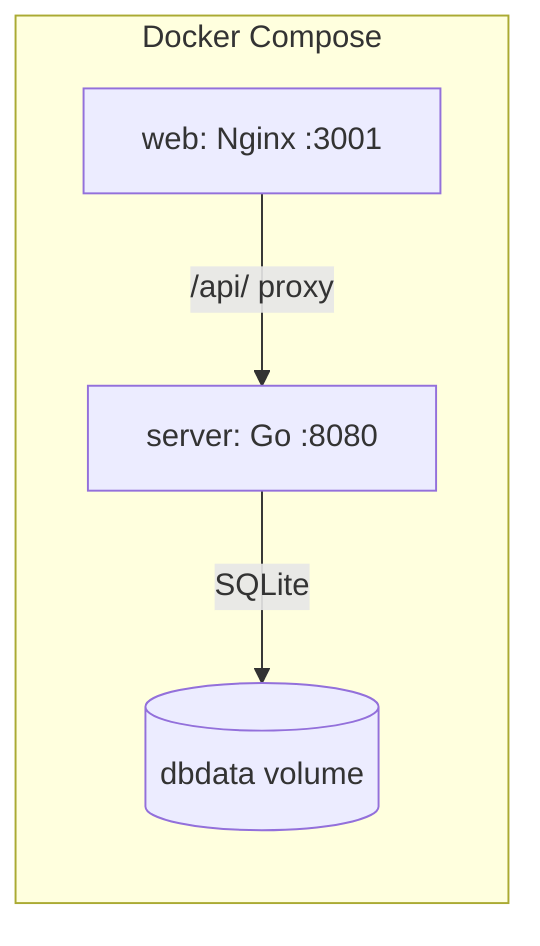

# 架构总览

> 修改记录：执行 `lore log docs/architecture/overview.md`

## 1. 系统定位

系统架构师备考平台：将教材知识体系与 GitHub 开源题库整合的 Web 应用，提供知识浏览 + 刷题 + 错题管理的一体化备考体验。

## 2. 架构原则

- **单仓库单部署**：前端 SPA + 后端 API + SQLite 在一个 Docker Compose 中
- **嵌入式数据库**：SQLite 纯 Go 驱动，无需独立数据库服务
- **无密码认证**：邮箱验证码 + JWT，简化用户流程
- **Design Token 驱动**：间距/圆角/字号/颜色统一 token，黑白主题自动切换

## 3. 系统架构

### 3.1 架构全景图



### 3.2 技术栈

| 层级     | 技术选型                    | 版本       | 说明                |
| -------- | --------------------------- | ---------- | ------------------- |
| 前端框架 | React                       | 19.x       | SPA                 |
| 类型系统 | TypeScript                  | 7.0.2      |                     |
| 路由     | TanStack Router             | 1.x        | file-based          |
| 状态     | TanStack Query + Zustand    | 5.x / 5.x  |                     |
| UI 原语  | @base-ui/react              | 1.x        | Button/Input/Dialog |
| 样式     | Tailwind CSS v4 + CVA       | 4.x        | oklch token         |
| HTTP     | axios                       | 1.x        | token 注入+401拦截  |
| i18n     | i18next                     | 26.x       | zh-CN/en-US         |
| 工具链   | vp (Vite+)                  | 0.2.x      |                     |
| 后端     | Go + Gin                    | 1.26 / 1.x |                     |
| 数据库   | SQLite (modernc.org/sqlite) | 1.x        | 纯 Go 驱动          |
| 认证     | JWT + SMTP                  | -          | 邮箱验证码          |

## 4. 核心模块

### 4.1 模块清单

| 模块名称   | 职责                           | 位置                        |
| ---------- | ------------------------------ | --------------------------- |
| config     | 环境变量配置                   | server/internal/config/     |
| db         | SQLite 连接 + 自动建表         | server/internal/db/         |
| middleware | CORS + JWT + 统一响应          | server/internal/middleware/ |
| auth       | 验证码发送/校验 + JWT 签发     | server/internal/auth/       |
| user       | 用户 CRUD                      | server/internal/user/       |
| knowledge  | 章节/知识点 CRUD               | server/internal/knowledge/  |
| UI 组件库  | Button/Input/Card/Badge/Dialog | web/src/components/ui/      |

## 5. 数据架构

### 5.1 数据模型



### 5.2 数据存储

| 数据类型       | 存储方案     | 说明                         |
| -------------- | ------------ | ---------------------------- |
| 用户/题库/记录 | SQLite       | 嵌入式，Docker volume 持久化 |
| 验证码         | 内存 map     | 60s TTL，进程重启失效        |
| 前端会话       | localStorage | JWT token + auth state       |

## 6. API 架构

### 6.1 统一响应格式

```json
{ "code": 0, "message": "success", "data": {} }
```

### 6.2 接口清单

| 接口       | 方法 | 路径                                  | 认证 |
| ---------- | ---- | ------------------------------------- | ---- |
| 健康检查   | GET  | /health                               | ❌   |
| 发送验证码 | POST | /api/v1/auth/send-code                | ❌   |
| 验证码登录 | POST | /api/v1/auth/verify-login             | ❌   |
| 当前用户   | GET  | /api/v1/auth/me                       | ✅   |
| 章节列表   | GET  | /api/v1/knowledge/chapters            | ✅   |
| 章节详情   | GET  | /api/v1/knowledge/chapters/:id        | ✅   |
| 知识点列表 | GET  | /api/v1/knowledge/chapters/:id/points | ✅   |
| 搜索知识点 | GET  | /api/v1/knowledge/search?q=           | ✅   |

## 7. 部署架构

### 7.1 部署拓扑



### 7.2 环境规划

| 环境   | 配置              | 访问方式               |
| ------ | ----------------- | ---------------------- |
| 开发   | vp dev + go run   | localhost:5173 + :8080 |
| Docker | docker compose up | localhost:3001         |

## 8. 安全架构

### 8.1 认证流程

邮箱验证码(60s TTL) → JWT(7天) → Bearer token → JWTAuth 中间件

### 8.2 数据安全

- 验证码一次性使用，60s 过期
- JWT 密钥通过环境变量配置
- SQLite 文件权限 755

## 9. 架构决策记录

| 决策项     | 决策内容                 | 原因                   |
| ---------- | ------------------------ | ---------------------- |
| 数据库     | SQLite (非 PostgreSQL)   | 用户指定，简化部署     |
| 前端工具链 | vp (Vite+)               | 用户指定               |
| UI 原语    | @base-ui/react           | 用户指定               |
| 认证       | 邮箱验证码 (无密码)      | 用户指定               |
| 色彩空间   | oklch                    | 感知均匀，自动适配主题 |
| 判分       | answer_keys 数组集合比对 | 避免 "AB" vs "BA" 问题 |

## 10. 架构演进

### 10.1 当前版本

- 版本号：1.0.0
- 发布日期：2026-07-13

### 10.2 演进路线

- [ ] 题库导入管道（Markdown 解析器）
- [ ] 刷题核心功能（做题/判分/错题本）
- [ ] 学习进度追踪
- [ ] 模考计时模式
