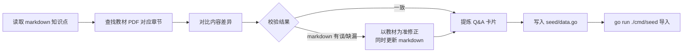

# Phase 3: FSRS 遗忘曲线复习系统

> 状态：已完成（Sprint 3.1-3.4）
> 修改记录：执行 `lore log docs/phase/2026-07-14-fsrs-review-system.md`
> 对应 PRD：[FSRS 遗忘曲线复习系统 PRD](../prd/2026-07-14-fsrs-review-system.md)

## 1. 阶段目标

### 1.1 阶段定位

Phase 1 搭建骨架，Phase 2 填充知识体系和刷题功能。Phase 3 的目标是**引入 FSRS6 间隔重复算法，让错题和知识点支持遗忘曲线复习调度**。

### 1.2 阶段目标

1. 集成 FSRS6 调度引擎（imxw/go-fsrs）
2. 创建统一调度表 review_items，错题和知识卡片共用
3. 改造错题本：答对不删除，走 FSRS 调度更新
4. 创建 knowledge_cards 表，生成 40 张 MVP 知识卡片（每章 2 张，教材交叉校验）
5. 新增"今日复习"前端页面
6. 错题迁移：已有 wrong_questions 补建 review_items
7. 全量知识卡片补全（336 知识点细化，预计 500-800 张）

### 1.3 完成标准

- [x] go build + go vet 通过
- [x] vp check + vp build 通过
- [x] review_items 表 + knowledge_cards 表自动建表
- [x] 答错题目时创建 review_items 记录（item_type=wrong_question）
- [x] 答对错题时更新 FSRS 参数（不删除 wrong_questions 记录）
- [x] 错题本列表按 due 排序
- [x] 40 张知识卡片入库
- [x] 今日复习页面可展示到期知识卡片 + 翻面 + 4 级评分
- [x] GET /api/v1/review/due 返回 due <= now() 的列表，按 due ASC 排序
- [x] POST /api/v1/review/grade 更新 FSRS 调度，返回新 due/state/stability/difficulty
- [x] 已有 wrong_questions 数据迁移完成（幂等）
- [ ] 全量知识卡片入库（500-800 张，覆盖 336 知识点）— Sprint 3.5 待办
- [ ] 随机抽查 20 张卡片与教材原文一致 — Sprint 3.5 待办

## 2. 任务分解

### Sprint 3.1: FSRS 引擎 + 数据层

| 任务 ID | 任务名称 | 说明 | 状态 |
| ------- | -------- | ---- | ---- |
| T501 | 引入 go-fsrs 依赖 | `go get github.com/imxw/go-fsrs`，验证可编译 | ✅ |
| T502 | review_items 表 DDL | db.go 新增建表：字段 + UNIQUE(user_id, item_type, item_id) + idx_review_due + idx_review_user_type | ✅ |
| T503 | knowledge_cards 表 DDL | db.go 新增建表：id/knowledge_point_id/chapter_id/front/back/sort_order | ✅ |
| T504 | 数据迁移逻辑 | db.go 建表后执行 INSERT OR IGNORE 补建 review_items，幂等 | ✅ |
| T505 | review 模块骨架 | model.go / repository.go / service.go / handler.go 四文件骨架 | ✅ |
| T506 | FSRS 调度器封装 | service.go：NewScheduler(desired_retention=0.9) + ReviewCard 封装 | ✅ |
| T507 | review_items CRUD | repository.go：GetDue / GetByItem / Create / Update / 迁移查询 | ✅ |
| T508 | 错题判分改造 | practice/service.go Submit：答错创建 review_items(state=1, rating=Again)，答对更新 FSRS(rating=Good) | ✅ |
| T509 | GET /review/due API | handler.go：按 type 筛选 due<=now()，PaginatedResponse，due ASC | ✅ |
| T510 | POST /review/grade API | handler.go：接收 {item_type, item_id, rating(int 1-4)}，调用 FSRS 更新，返回 {due, state, stability, difficulty} | ✅ |
| T511 | GET /review/stats API | handler.go：返回 {due_count, reviewed_today, total_items} | ✅ |
| T512 | 路由注册 | router.go 注册 /api/v1/review 组，JWTAuth 守卫 | ✅ |
| T513 | MVP 卡片生成（最高优先级） | ch5 软件工程 / ch7 系统架构设计 / ch8 质量属性与架构评估 / ch20 论文写作 | ✅ |
| T514 | MVP 卡片生成（高优先级） | ch4 信息安全 / ch6 数据库 / ch9 软件可靠性 / ch12 信息系统架构 / ch13 层次式架构 / ch14 云原生架构 / ch15 SOA / ch18 安全架构 / ch19 大数据架构 | ✅ |
| T515 | MVP 卡片生成（中优先级） | ch1 绪论 / ch2 计算机系统 / ch3 信息系统 / ch10 架构演化 / ch11 未来信息技术 / ch16 嵌入式系统 / ch17 通信系统 | ✅ |
| T516 | MVP 卡片 seed 脚本 | seed/data.go 新增 KnowledgeCards 数据，cmd/seed 导入 knowledge_cards 表 | ✅ |
| T517 | 今日复习页面 | 新建 review/ 页面：卡片翻面 + 4 级评分按钮 + 评分后淡出 | ✅ |
| T518 | 侧边栏导航 | sidebar.tsx 新增"今日复习"导航项 | ✅ |
| T519 | 错题本页面改造 | wrong-questions.tsx：排序改 due ASC，列表项加 due 时间 + state 标签 | ✅ (P2: due 显示为最小改动 Badge，全量改造 Sprint 3.5) |
| T520 | review API hooks | queries.ts 新增 useReviewDue / useReviewGrade / useReviewStats | ✅ |
| T521 | 路由注册 | routeTree 新增 /review/ 路由 | ✅ |

### Sprint 3.5: 全量知识卡片补全（按考试优先级）

在 MVP 40 张基础上，覆盖全部 20 章 336 个知识点的细化拆分，按考试优先级分三批执行。

| 任务 ID | 任务名称 | 覆盖章节 | 优先级 | 状态 |
| ------- | -------- | -------- | ------ | ---- |
| T522 | 全量卡片补全（最高优先级） | ch5 / ch7 / ch8 / ch20 细化所有考点 | 最高 | ⬜ |
| T523 | 全量卡片补全（高优先级） | ch4 / ch6 / ch9 / ch12-15 / ch18-19 细化所有考点 | 高 | ⬜ |
| T524 | 全量卡片补全（中优先级） | ch1-3 / ch10-11 / ch16-17 细化所有考点 | 中 | ⬜ |
| T525 | 全量卡片 seed 脚本 | 更新 seed/data.go，重新导入 knowledge_cards 表 | - | ⬜ |
| T526 | 卡片质量抽查 | 随机抽 20 张卡片校验与教材原文一致性 | - | ⬜ |

### Sprint 3.6: 端到端验证

| 任务 ID | 任务名称 | 说明 | 状态 |
| ------- | -------- | ---- | ---- |
| T527 | 后端启动验证 | review_items + knowledge_cards 表自动建表 + 迁移执行 | ⬜ |
| T528 | API E2E 测试 | curl 验证 due/grade/stats 全链路 | ⬜ |
| T529 | 前后端联调 | vp dev + go run，浏览器验证今日复习 + 错题本改造 | ⬜ |
| T530 | 代码评审 + lore commit | reviewer 审查 + 提交 | ⬜ |

## 3. 技术方案

### 3.1 FSRS 调度器封装

```go
// server/internal/review/service.go
import fsrs "github.com/imxw/go-fsrs"

// NewScheduler 返回 *Scheduler，默认 DesiredRetention=0.9，EnableFuzzing=true
// 使用 functional options 覆盖默认值
func NewReviewService(repo *Repository) *ReviewService {
    scheduler := fsrs.NewScheduler()  // 默认参数，desired_retention 已是 0.9
    return &ReviewService{repo: repo, scheduler: scheduler}
}

// GradeCard 处理用户评分，返回更新后的 FSRS 状态
// 注意：方法名故意不叫 ReviewCard，避免与 fsrs.Scheduler.ReviewCard 混淆
// fsrs.Scheduler.ReviewCard 签名：ReviewCard(card *Card, rating Rating, reviewDatetime *time.Time, reviewDuration *int) (*Card, *ReviewLog)
func (s *ReviewService) GradeCard(userID int, itemType string, itemID int, rating int) (*ReviewResult, error) {
    // 1. 从 DB 读取 review_items 当前状态（state/stability/difficulty/step/due/last_review_at）
    // 2. 构造 go-fsrs Card 结构体：
    //    - State: fsrs.State(ri.State)        // 1=Learning 2=Review 3=Relearning
    //    - Stability: ptr or nil              // nil 表示未复习过（首次评分）
    //    - Difficulty: ptr or nil             // nil 表示未复习过
    //    - Step: 永远传值指针（go-fsrs v0.2.0 对 Learning/Relearning 状态会直接 *c.Step 解引用，nil 会 panic）。Review 状态也传 0。
    //    - Due: 解析为 time.Time（存储格式 UTC "2006-01-02 15:04:05"）
    //    - LastReview: ri.LastReviewAt        // nil 表示首次
    // 3. 记录 prevState 用于检测 lapses（Review → Relearning 转换时 ri.Lapses++）
    // 4. 调用 s.scheduler.ReviewCard(card, fsrs.Rating(rating), nil, nil)
    //    reviewDatetime=nil → 用 time.Now()，reviewDuration=nil → 不记录
    // 5. 将返回的 *Card 的 stability/difficulty/step/due/state 写回 review_items
    //    将返回的 *ReviewLog 可选持久化（P2 参数优化需要）
    // 6. 返回 {due, state, stability, difficulty}
    // 注意：所有时间字段存储使用 UTC + "2006-01-02 15:04:05" 格式，使 SQL 字典序比较与时间顺序一致。
}

### 3.2 review_items 表 DDL

```sql
CREATE TABLE IF NOT EXISTS review_items (
    id INTEGER PRIMARY KEY AUTOINCREMENT,
    user_id INTEGER NOT NULL,
    item_type TEXT NOT NULL,        -- 'wrong_question' | 'knowledge_card'
    item_id INTEGER NOT NULL,
    stability REAL,
    difficulty REAL,
    step INTEGER NOT NULL DEFAULT 0,  -- go-fsrs Step 字段（学习/再学习步进）
    due DATETIME NOT NULL DEFAULT CURRENT_TIMESTAMP,
    reps INTEGER NOT NULL DEFAULT 0,
    lapses INTEGER NOT NULL DEFAULT 0,
    state INTEGER NOT NULL DEFAULT 1,  -- 1=Learning 2=Review 3=Relearning
    last_review_at DATETIME,
    created_at DATETIME NOT NULL DEFAULT CURRENT_TIMESTAMP,
    UNIQUE (user_id, item_type, item_id),
    FOREIGN KEY (user_id) REFERENCES users(id) ON DELETE CASCADE
);
CREATE INDEX IF NOT EXISTS idx_review_due ON review_items(user_id, due);
CREATE INDEX IF NOT EXISTS idx_review_user_type ON review_items(user_id, item_type);
```

### 3.3 knowledge_cards 表 DDL

```sql
CREATE TABLE IF NOT EXISTS knowledge_cards (
    id INTEGER PRIMARY KEY AUTOINCREMENT,
    knowledge_point_id INTEGER NOT NULL,
    chapter_id INTEGER NOT NULL,
    front TEXT NOT NULL,
    back TEXT NOT NULL,
    sort_order INTEGER NOT NULL DEFAULT 0,
    FOREIGN KEY (knowledge_point_id) REFERENCES knowledge_points(id) ON DELETE CASCADE,
    FOREIGN KEY (chapter_id) REFERENCES chapters(id) ON DELETE CASCADE
);
```

### 3.4 错题判分改造

```go
// server/internal/practice/service.go Submit 方法改造
func (s *Service) Submit(ctx context.Context, userID, questionID int, answerKeys []string) (*SubmitResult, error) {
    correct := isCorrect(answerKeys, question.AnswerKeys)

    if !correct {
        // 答错：写入 wrong_questions + 创建 review_items
        s.repo.InsertWrongQuestion(ctx, userID, questionID)
        s.reviewRepo.CreateReviewItem(ctx, userID, "wrong_question", questionID)
    } else {
        // 答对：如果 review_items 存在，更新 FSRS；不存在则不创建
        if exists := s.reviewRepo.Exists(ctx, userID, "wrong_question", questionID); exists {
            if _, err := s.reviewService.GradeCard(userID, "wrong_question", questionID, 3 /* Good */); err != nil {
                return nil, fmt.Errorf("grade wrong question: %w", err)
            }
        }
    }
    // ... practice_records 写入不变
}
```

### 3.5 知识卡片生成流程



## 4. 里程碑

| 里程碑 | 交付物 | 验收标准 |
| --- | --- | --- |
| FSRS 引擎就绪 | go-fsrs 集成 + review 模块 + 表建表 | go build 通过，表自动创建 |
| 后端 API 就绪 | due/grade/stats 三个 API | curl E2E 返回正确 |
| 知识卡片就绪 | 40 张卡片入库 | 每章 2 张，经教材校验 |
| 前端改造完成 | 今日复习页 + 错题本改造 | 浏览器验证完整流程 |
| 全量知识卡片 | 500-800 张卡片入库 | 覆盖 336 知识点，抽查 20 张校验通过 |
| 端到端验证 | E2E 全链路 | 代码评审 + lore commit |

## 5. 风险

| 风险 | 影响 | 应对 |
| --- | --- | --- |
| go-fsrs 0 star 社区风险 | 维护中断 | FSRS6 算法已稳定，纯 Go 可 fork |
| 卡片交叉校验耗时长 | 40 张卡片生成慢 | 分两批 ch01-ch10 / ch11-ch20 并行 |
| 错题迁移幂等性 | 重复执行 | UNIQUE 约束 + INSERT OR IGNORE |
| FSRS state 枚举不匹配 | 映射错误 | PRD 已明确映射表，int 存储 |
| FSRS Card.Step nil panic | P0 阻塞：go-fsrs v0.2.0 对 Learning/Relearning 状态直接解引用 c.Step，必须持久化 step 列 | review_items 表加 step INTEGER NOT NULL DEFAULT 0 列，GradeCard 始终传值指针 |
