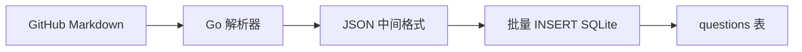

# Phase 2: 知识体系入库与刷题核心

> 状态：进行中
> 修改记录：执行 `lore log docs/phase/2026-07-14-knowledge-and-practice.md`
> 对应 PRD：[系统架构师备考平台 PRD](../prd/2026-07-13-architect-prep-platform.md)

## 1. 阶段目标

### 1.1 阶段定位

Phase 1 搭建了空壳骨架（前后端+Docker），但数据库无内容、刷题功能未实现。Phase 2 的目标是**让平台有内容可用、有题目可刷**。

### 1.2 阶段目标

1. 20 章知识体系结构化入库（章->节->知识点）
2. 题库导入管道（Markdown -> SQLite）
3. 刷题核心功能（做题->判分->错题本）
4. 端到端运行验证

### 1.3 完成标准

- [ ] chapters 表有 20 条记录
- [ ] knowledge_points 表有 ≥100 条记录
- [ ] questions 表有 ≥200 条记录
- [ ] 前端可浏览章节+知识点
- [ ] 前端可做题+查看解析
- [ ] 错题本自动收集
- [ ] go build + go vet 通过
- [ ] vp check + vp build 通过
- [ ] 后端启动 + 前端 dev 可联通

## 2. 任务分解

### Sprint 2.1: 知识体系入库（数据填充）

| 任务 ID | 任务名称 | 说明 |
| ------- | -------- | ---- |
| T101 | 20 章章节数据入库 | 从 knowledge-framework.md 提取，编写 Go seed 脚本或 SQL INSERT |
| T102 | 知识点内容结构化 | 从 PDF 教材提取每章关键知识点摘要（≥100 条） |
| T103 | 知识体系前端页面完善 | 章节卡片 -> 知识点详情页（支持 Markdown 渲染） |
| T104 | 知识点搜索功能验证 | 前端搜索框 + 后端 LIKE 查询 |

### Sprint 2.2: 题库导入管道

| 任务 ID | 任务名称 | 说明 |
| ------- | -------- | ---- |
| T201 | Markdown 题库解析器 | Go 脚本解析 louxj424/awesome-ruankao Markdown 题库 -> JSON |
| T202 | 题目批量导入 API | POST /api/v1/admin/questions/import (JWT + admin 角色) |
| T203 | 导入 awesome-ruankao 真题 | 解析 2020-2025 年真题 Markdown -> 入库 |
| T204 | 导入 PeterGuy326 自主命题 | 解析 320+ 题 Markdown -> 入库 |

### Sprint 2.3: 刷题核心功能

| 任务 ID | 任务名称 | 说明 |
| ------- | -------- | ---- |
| T301 | 题目列表 API | GET /api/v1/practice/questions?chapter=&type=&page= |
| T302 | 提交答案 API | POST /api/v1/practice/submit { question_id, answer_keys } |
| T303 | 判分逻辑 | answer_keys 集合比对，写入 practice_records + wrong_questions |
| T304 | 错题本 API | GET /api/v1/practice/wrong-questions |
| T305 | 收藏 API | POST/DELETE /api/v1/practice/favorites/:question_id |
| T306 | 前端做题页面 | 题目卡片 + 选项 + 提交 + 解析展示 |
| T307 | 前端错题本页面 | 错题列表 + 重做入口 |

### Sprint 2.4: 端到端验证

| 任务 ID | 任务名称 | 说明 |
| ------- | -------- | ---- |
| T401 | 后端启动验证 | go run + SQLite 自动建表 + 健康检查 |
| T402 | API 端到端测试 | curl 验证知识体系 + 刷题 API 全链路 |
| T403 | 前后端联调 | vp dev + go run，浏览器验证完整流程 |
| T404 | 代码评审 + lore commit | reviewer 审查 + 提交 |

## 3. 技术方案

### 3.1 知识体系入库方案

**方案**：编写 Go seed 命令 `go run ./cmd/seed`，从内嵌的 JSON 数据批量插入 chapters + knowledge_points。

**数据来源**：
- 章节结构：knowledge-framework.md 已有完整 20 章目录
- 知识点摘要：从 PDF 教材提取每章核心概念（1-2 句话）

**数据格式**：
```json
[
  {
    "chapter_no": 1,
    "title": "绪论",
    "summary": "系统架构基本概念、架构设计师职责",
    "knowledge_points": [
      { "title": "系统架构的定义", "content": "架构是体现在组件中的系统的基本组织..." },
      { "title": "架构设计师的职责", "content": "确认评估系统需求、搭建核心构架..." }
    ]
  }
]
```

### 3.2 题库导入管道方案



**解析目标**：
- louxj424/system-architect-exam：Markdown 格式，题目版/解析版分离
- wujiaming88/awesome-ruankao：Markdown 格式，字段规律明显

**解析规则**：
- 识别题号 + 题干 + 选项(A/B/C/D) + 答案 + 解析
- 关联到对应章节（通过关键词匹配或手动标注）

### 3.3 刷题判分方案

```go
// 集合比对判分
func isCorrect(userAnswer, correctAnswer []string) bool {
    if len(userAnswer) != len(correctAnswer) {
        return false
    }
    userSet := make(map[string]bool)
    for _, a := range userAnswer {
        userSet[a] = true
    }
    for _, a := range correctAnswer {
        if !userSet[a] {
            return false
        }
    }
    return true
}
```

## 4. 里程碑

| 里程碑 | 交付物 | 验收标准 |
| ---------- | -------- | -------- |
| 知识体系入库 | chapters(20) + knowledge_points(100+) | 前端可浏览 |
| 题库导入 | questions(200+) | 前端可练习 |
| 刷题核心功能 | 做题+判分+错题本 | 端到端可用 |
| 端到端验证 | E2E 测试通过 | 代码评审+提交 |

## 5. 风险

| 风险 | 影响 | 应对 |
| -------- | ------ | ------ |
| Markdown 题库格式不统一 | 解析器需多版本适配 | 先做 louxj424 一个仓库，验证管道 |
| PDF 知识点提取质量 | 需人工校对 | 先用章节摘要，后续逐步细化 |
| 题目-章节关联困难 | 需关键词匹配 | 先按年份导入，关联后续补充 |
