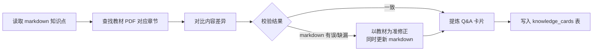
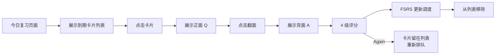
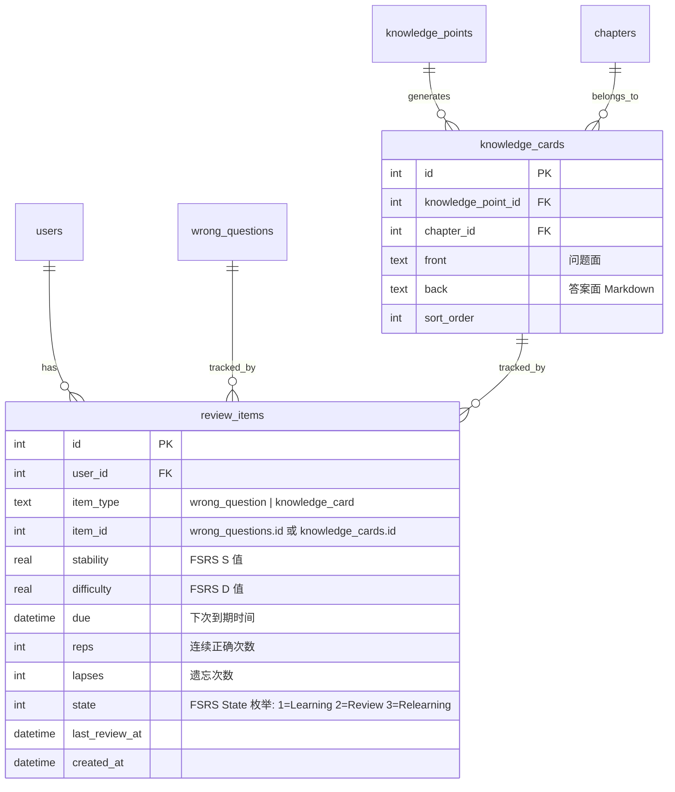
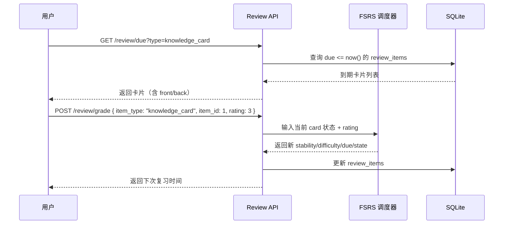

# FSRS 遗忘曲线复习系统 PRD

> 状态：活跃 | 创建日期：2026-07-14
>
> 对应 Spec：[系统架构师备考平台 Spec](../spec/2026-07-13-architect-prep.md)
>
> 前序 PRD：[备考平台 PRD（已归档）](prd/archive/2026-07-13-architect-prep-platform.md)

## 1. 背景与目标

### 1.1 业务背景

当前平台已完成知识体系浏览 + 刷题 + 错题本的基础功能，但错题管理和知识复习存在明显缺陷：

- **错题本**：答错进入、答对直接删除，无记忆强度追踪，无复习间隔调度，纯堆放式
- **知识点**：仅支持浏览阅读，无主动回忆机制，无遗忘曲线追踪
- **缺少间隔重复**：没有"该复习了"的推送，用户无法高效安排复习

### 1.2 产品目标

引入 FSRS6（Free Spaced Repetition Scheduler）算法，构建两条独立的遗忘曲线复习轨道：

1. **错题复习**：错题本升级为 FSRS 调度，答对不再删除，按记忆强度安排下次复习
2. **知识卡片复习**：从教材内容提炼 Q&A 知识卡片，按 FSRS 调度推送"今日复习"

### 1.3 成功指标

- FSRS6 调度引擎集成并可用
- 错题本按 FSRS 调度排序，答对后更新记忆参数而非删除
- 知识卡片"今日复习"入口可用，支持翻面评分
- MVP 阶段 40 张知识卡片（每章 2 张）经教材交叉校验

### 1.4 MVP 范围

| 范围 | 说明 |
| --- | --- |
| MVP 包含 | FSRS 引擎 + 统一调度表 + 错题本改造 + 40 张知识卡片 + 今日复习页面 |
| 后续补全 | 全量知识卡片（300+ 知识点细化提炼）|
| 不做 | FSRS 参数个性化优化（先用默认参数，积累数据后评估）|

## 2. 用户与场景

### 2.1 目标用户

| 用户角色 | 描述 | 核心诉求 |
| --- | --- | --- |
| 备考考生 | 已使用平台刷题的工程师 | 高效复习错题 + 主动回忆知识点 |

### 2.2 使用场景

1. **错题复习**：打开错题本 → 查看到期错题 → 重做 → 评分（Again/Good）→ 系统安排下次复习
2. **知识卡片复习**：打开"今日复习" → 翻看到期卡片正面（问题）→ 翻面看答案 → 评分（Again/Hard/Good/Easy）→ 系统安排下次复习
3. **复习概览**：查看今日待复习数量、记忆稳定性趋势

## 3. 功能需求

### 3.1 功能清单

| 功能模块 | 功能点 | 优先级 | 说明 |
| --- | --- | --- | --- |
| FSRS 引擎 | 调度器集成 | P0 | 集成 imxw/go-fsrs (FSRS6) |
| FSRS 引擎 | 统一调度表 | P0 | review_items 表，错题和知识卡片共用 |
| 错题复习 | 错题本 FSRS 改造 | P0 | 答对更新参数，不删除 |
| 错题复习 | 错题评分 | P0 | 答对映射 Good，答错映射 Again |
| 知识卡片 | 卡片数据表 | P0 | knowledge_cards 表 |
| 知识卡片 | 40 张 MVP 卡片 | P0 | 每章 2 张，教材交叉校验 |
| 知识卡片 | 今日复习页面 | P0 | 卡片翻面 + 4 级评分 |
| 复习 API | 到期列表 | P0 | GET /api/v1/review/due |
| 复习 API | 提交评分 | P0 | POST /api/v1/review/grade |
| 知识卡片 | 全量卡片补全 | P2 | 后续逐步补全 300+ 知识点 |
| FSRS 优化 | 参数个性化 | P2 | 积累数据后按用户优化参数 |

### 3.2 详细功能描述

#### 3.2.1 FSRS6 调度引擎

**算法选型**：FSRS6（Free Spaced Repetition Scheduler v6），替代过时的 SM-2。

**选型理由**：

- SM-2（1987）已被 Anki 官方标记为 legacy
- FSRS6 基于 DSR 三因素模型（Difficulty/Stability/Retrievability），用真实遗忘曲线建模
- 同等保留率下比 SM-2 少 15-30% 复习量
- 21 个参数（$w_0$–$w_{20}$），可通过用户数据 ML 优化

**Go 库**：`github.com/imxw/go-fsrs`

- 纯 Go 零依赖，FSRS6（py-fsrs v6.3.1 移植）
- 94% 测试覆盖，含参数优化器
- MIT 协议

**MVP 参数策略**：使用 FSRS6 默认参数，`desired_retention = 0.9`。不做用户级参数优化。

#### 3.2.2 统一调度表（review_items）

错题和知识卡片共用一张 FSRS 调度表，通过 `item_type` 区分：

```
review_items
├── item_type: 'wrong_question' | 'knowledge_card'
├── item_id: 指向 wrong_questions.id 或 knowledge_cards.id
├── stability: 记忆稳定性（FSRS S 值，float）
├── difficulty: 难度（FSRS D 值，float）
├── due: 下次到期时间
├── reps: 连续正确次数
├── lapses: 遗忘次数
├── state: FSRS 状态（int，映射 go-fsrs State 枚举）
├── last_review_at: 上次复习时间
└── created_at

索引：
├── UNIQUE(user_id, item_type, item_id)  -- 防止同一用户同一题目/卡片重复创建
├── idx_review_due(user_id, due)          -- 到期查询核心路径索引
└── idx_review_user_type(user_id, item_type) -- 按类型筛选索引
```

**state 枚举映射**：

| PRD state | go-fsrs State 枚举 | 值 | 说明 |
| --- | --- | --- | --- |
| - | StateLearning | 1 | 新卡片/学习中（go-fsrs 无 New 状态，新建卡片默认 Learning） |
| - | StateReview | 2 | 复习中 |
| - | StateRelearning | 3 | 重学习中（遗忘后重新学习） |

存储使用 int 类型，直接存 go-fsrs 枚举值。迁移已有错题时 state=1（StateLearning）。

**设计理由**：FSRS 调度逻辑只写一次，两条轨道共享同一调度器，`item_type` 路由到对应内容。

#### 3.2.3 错题本 FSRS 改造

**当前逻辑**（需改造）：

- 答错 → `INSERT OR IGNORE INTO wrong_questions`
- 答对 → `DELETE FROM wrong_questions`
- 列表 → 按 `created_at DESC` 排序

**改造后逻辑**：

```mermaid
graph TD
    A[用户提交答案] --> B{判分}
    B -->|答错| C[写入 wrong_questions<br/>创建 review_items 记录<br/>state=Learning(1), rating=Again]
    B -->|答对| D{review_items 是否存在?}
    D -->|不存在| E[不创建记录<br/>该题已掌握]
    D -->|存在| F[FSRS 调度更新<br/>rating=Good<br/>更新 stability/difficulty/due]
    C --> G[FSRS 计算下次复习时间]
    F --> G
```

**关键变化**：

- 答对不再 `DELETE`，而是通过 FSRS 更新记忆参数
- 错题列表按 `due` 排序（到期的排前面），而非 `created_at`
- 错题评分简化为 2 级：答对 → Good，答错 → Again

#### 3.2.4 知识卡片系统

**卡片形态**：Q&A 正反面（方案 B）

| 字段 | 说明 |
| --- | --- |
| front | 问题面（Q），如"IEEE 1471-2000 标准对系统架构的定义是什么？" |
| back | 答案面（A），支持 Markdown，如"架构是体现在组件中的一个系统的基本组织..." |

**卡片来源**：agent 手动生成，markdown 内容与教材原文交叉校验。

**交叉校验流程**：



**MVP 卡片数量**：40 张（20 章 × 2 张/章）

**卡片评分**：4 级（Again / Hard / Good / Easy），直接映射 FSRS6 rating。

#### 3.2.5 今日复习页面

**页面入口**：侧边栏新增"今日复习"导航项

**交互流程**：



**复习队列数据源**：`GET /api/v1/review/due?type=knowledge_card`，按 `due` 升序排列。

#### 3.2.6 错题本页面改造

**列表排序**：按 FSRS `due` 升序（到期的排前面）

**展示信息**：每道错题显示：
- 题目内容 + 选项
- 下次复习时间（如"3 天后" / "今日到期"）
- 记忆状态标签（新/学习中/复习中/重学习中）

**重做交互**：保持现有做题流程，提交后后端根据判分结果更新 FSRS 状态。

## 4. 非功能需求

| 维度 | 需求 | 备注 |
| --- | --- | --- |
| 性能 | 复习列表 API <200ms | SQLite 索引优化 |
| 兼容 | 现有错题数据迁移 | 已有 wrong_questions 记录补建 review_items |
| 部署 | imxw/go-fsrs 纯 Go 零依赖 | 不引入 CGO |
| 前端 | 复习页面移动端适配 | 参考移动端学习体验设计 |

## 5. 数据需求

### 5.1 新增数据模型



### 5.2 修改的现有表

`wrong_questions` 表结构不变，保留 `UNIQUE(user_id, question_id)` 约束。FSRS 状态由 `review_items` 表承载，通过 `item_type='wrong_question'` + `item_id` 关联。

### 5.3 数据迁移

已有 `wrong_questions` 记录需补建 `review_items`：

| 字段 | 值 |
| --- | --- |
| item_type | `'wrong_question'` |
| item_id | wrong_questions.id |
| user_id | wrong_questions.user_id |
| state | 1（StateLearning） |
| due | now() |
| stability | NULL |
| difficulty | NULL |
| reps | 0 |
| lapses | 0 |

**迁移逻辑**：独立于 `auto_init.go` 的 seed 流程。在服务启动时执行：

```sql
INSERT OR IGNORE INTO review_items (user_id, item_type, item_id, state, due, reps, lapses)
SELECT wq.user_id, 'wrong_question', wq.id, 1, datetime('now'), 0, 0
FROM wrong_questions wq
WHERE NOT EXISTS (
    SELECT 1 FROM review_items ri
    WHERE ri.user_id = wq.user_id
      AND ri.item_type = 'wrong_question'
      AND ri.item_id = wq.id
);
```

**幂等性**：`UNIQUE(user_id, item_type, item_id)` + `INSERT OR IGNORE` 保证重复执行不重复插入。

**触发时机**：放在 `db.go` 建表之后、服务就绪之前，每次启动执行（幂等）。

## 6. 界面需求

### 6.1 页面结构变更

| 页面 | 变更 |
| --- | --- |
| 侧边栏 | 新增"今日复习"导航项 |
| 今日复习 | 新页面：知识卡片翻面 + 4 级评分 |
| 错题本 | 改造：按 due 排序 + 记忆状态标签 + 下次复习时间 |
| 学习统计 | 扩展：复习统计（今日复习数/累计复习数/记忆稳定性趋势）|

### 6.2 今日复习页面交互

- 卡片正面展示问题，点击"显示答案"翻面
- 背面展示答案（Markdown 渲染）+ 4 个评分按钮
- 评分后卡片淡出，自动加载下一张
- 无到期卡片时展示空状态："今日暂无复习卡片"

### 6.3 错题本页面交互变更

- 列表项增加：下次复习时间、记忆状态标签
- 排序从 `created_at DESC` 改为 `due ASC`
- 重做流程不变，评分由后端自动映射

## 7. 技术架构

### 7.1 新增后端模块

| 模块 | 职责 | 位置 |
| --- | --- | --- |
| review | FSRS 调度 + 复习 API | server/internal/review/ |
| review/model.go | FSRS card / review log 模型 | |
| review/repository.go | review_items CRUD + due 查询 | |
| review/service.go | FSRS 调度逻辑 + 评分处理 | |
| review/handler.go | HTTP handler | |

### 7.2 新增 API

> 所有 API 遵循现有统一响应格式 `{ code: 0, message: "success", data: {} }`，需 JWT 认证。

| 接口 | 方法 | 路径 | 请求/查询参数 | 响应 data |
| --- | --- | --- | --- | --- |
| 到期复习列表 | GET | /api/v1/review/due | `type`（wrong_question/knowledge_card）、`page`、`page_size` | PaginatedResponse，按 due ASC 排序 |
| 提交评分 | POST | /api/v1/review/grade | `{ item_type, item_id, rating }` | `{ due, state, stability, difficulty }` |
| 复习统计 | GET | /api/v1/review/stats | 无 | `{ due_count, reviewed_today, total_items }` |

**rating 字段格式**：int 类型，直接使用 go-fsrs Rating 枚举值。

| 值 | 枚举 | 错题映射 | 卡片使用 |
| --- | --- | --- | --- |
| 1 | RatingAgain | 答错 | Again |
| 2 | RatingHard | - | Hard |
| 3 | RatingGood | 答对 | Good |
| 4 | RatingEasy | - | Easy |

> 错题评分只有 2 级（1=Again, 3=Good），知识卡片使用全部 4 级。

### 7.3 FSRS 调度流程



### 7.4 依赖变更

| 依赖 | 版本 | 用途 |
| --- | --- | --- |
| github.com/imxw/go-fsrs | latest | FSRS6 调度算法 |

### 7.5 技术决策记录

| 决策项 | 决策内容 | 原因 |
| --- | --- | --- |
| 间隔重复算法 | FSRS6（非 SM-2） | SM-2 已过时，FSRS6 是 2025-2026 主流替代 |
| Go 库 | imxw/go-fsrs（非官方 go-fsrs/v4） | FSRS6 最新，零依赖，官方仓库停留在 FSRS5 rc1 |
| 调度表设计 | 统一 review_items 表（方案 A） | FSRS 逻辑只写一次，item_type 区分轨道 |
| 知识卡片形态 | Q&A 正反面（方案 B） | 记忆效果优于知识点原文搬运 |
| 卡片来源 | agent 手动生成 + 教材交叉校验 | 保证准确性，不自动提炼 |
| FSRS 参数 | 默认参数，不做用户级优化 | MVP 先验证流程，积累数据后再优化 |
| 两条轨道 FSRS 参数 | 共享一套默认参数 | 前期不分开调优 |
| 错题评分 | 2 级（Again/Good）后端映射 | 错题重做是对/错二元结果 |
| 知识卡片评分 | 4 级（Again/Hard/Good/Easy） | 主动回忆需要更细粒度反馈 |
| state 存储 | int 类型，直接存 go-fsrs 枚举值（1/2/3） | 避免字符串映射开销，go-fsrs 无 New 状态，新建卡片默认 Learning(1) |
| rating 格式 | int 类型，直接使用 go-fsrs Rating 枚举值（1/2/3/4） | 前后端统一，避免字符串大小写不一致问题 |
| 迁移策略 | 独立于 auto_init.go，每次启动幂等执行 | auto_init.go 仅空库触发 seed，迁移需在已有库上运行 |

## 8. 验收标准

### 8.1 功能验收

- [ ] FSRS6 引擎集成，可计算 stability/difficulty/due
- [ ] review_items 表自动建表
- [ ] 答错题目时创建 review_items 记录（item_type=wrong_question）
- [ ] 答对错题时更新 FSRS 参数（不删除 wrong_questions 记录）
- [ ] 错题本列表按 due 排序
- [ ] 40 张知识卡片入库（每章 2 张，经教材交叉校验）
- [ ] 今日复习页面可展示到期知识卡片
- [ ] 卡片翻面 + 4 级评分可用
- [ ] GET /api/v1/review/due 返回到期项
- [ ] POST /api/v1/review/grade 更新 FSRS 调度
- [ ] 已有 wrong_questions 数据迁移完成

### 8.2 非功能验收

- [ ] go build + go vet 通过
- [ ] vp check + vp build 通过
- [ ] 后端启动后 review_items 表自动创建
- [ ] 数据迁移后已有错题可正常复习

### 8.3 卡片质量验收

- [ ] 40 张卡片内容与教材原文一致
- [ ] 卡片 Q&A 覆盖各章核心考点
- [ ] 卡片答案面 Markdown 格式正确

## 9. 风险与约束

### 9.1 已知风险

| 风险 | 影响 | 概率 | 应对 |
| --- | --- | --- | --- |
| imxw/go-fsrs 0 star 社区风险 | 维护中断、无社区验证 | 中 | FSRS6 算法已稳定，纯 Go 可 fork，94% 测试覆盖 |
| 全量卡片工作量大 | 300+ 知识点 × 校验 | 高 | MVP 先 40 张验证流程，后续逐步补全 |
| FSRS 默认参数不适用 | 调度不够精准 | 中 | 积累数据后启用参数优化 |
| 错题迁移不完整 | 已有错题无 FSRS 状态 | 低 | 每次启动幂等执行 INSERT OR IGNORE 补建 |

### 9.2 约束条件

- 后端 Go + SQLite，不引入外部服务
- 前端工具链用 vp
- 知识卡片必须经过教材交叉校验，不自动提炼
- 两条 FSRS 轨道独立管理，共享默认参数

## 10. 附录

### 10.1 参考资料

- [FSRS 算法 Wiki](https://github.com/open-spaced-repetition/awesome-fsrs/wiki/The-Algorithm)
- [imxw/go-fsrs](https://github.com/imxw/go-fsrs)
- [架构总览](../architecture/overview.md)
- [系统架构设计师教程第2版](../reference/)

### 10.2 术语表

| 术语 | 说明 |
| --- | --- |
| FSRS | Free Spaced Repetition Scheduler，开源间隔重复调度器 |
| SM-2 | SuperMemo 2，1987 年的间隔重复算法，已被 FSRS 替代 |
| Stability (S) | 记忆稳定性，表示记忆衰减速度，值越大遗忘越慢 |
| Difficulty (D) | 难度，取值 1-10，反映卡片难度 |
| Retrievability (R) | 可提取度，当前时刻能回忆起的概率，$R = (1 + t/S)^{-d}$ |
| due | 下次到期复习时间 |
| rating | 用户评分：Again / Hard / Good / Easy |
| card | FSRS 调度单元，对应一道错题或一张知识卡片 |
