# 第1章 绪论

## 系统架构的定义

架构是体现在组件中的一个系统的基本组织、它们彼此的关系与环境的关系及指导它的设计和发展的原则[^1]。该定义来源于 **IEEE 1471-2000** 标准，主要针对软件密集系统进行架构描述。

**系统架构**（System Architecture）是系统的一种整体的高层次的结构表示，是系统的骨架和根基，支撑和链接各个部分，包括组件、连接件、约束规范以及指导这些内容设计与演化的原理[^2]。

架构设计的作用主要包括：

- 解决相对复杂的需求分析问题
- 解决非功能属性在系统占据重要位置的设计问题
- 解决生命周期长、扩展性需求高的系统整体结构问题
- 解决系统基于组件需要的集成问题
- 解决业务流程再造难的问题[^3]

> 📌 **考试重点**：系统架构的定义（IEEE 1471-2000标准）、架构设计的五大作用是高频考点，常以选择题形式考查。

> 🔗 **真题关联**：历年真题多次考查系统架构的定义和作用，2023年上半年第1题考查了架构设计的核心作用。

---

## 软件架构发展历程

"软件架构"术语在 **1968 年**由北大西洋公约组织（NATO）会议上第一次提出，但并没有得到明确定义[^4]。软件架构自概念诞生以来，大致经历了四个发展阶段：

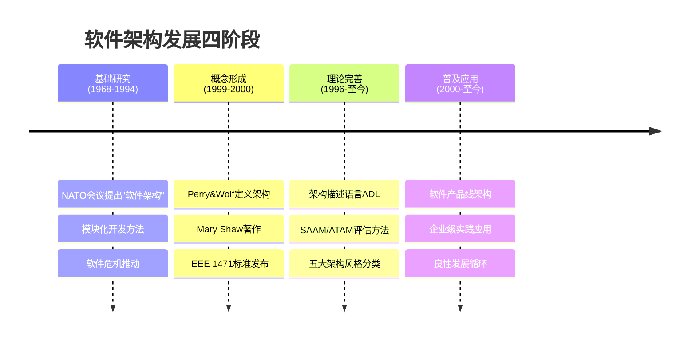

**1）基础研究阶段（1968-1994 年）**

软件架构的发展可追溯到 20 世纪 60 年代中期爆发的软件危机。1995 年 Standish Group 调查显示，84% 的软件项目无法按时按需完成，超过 30% 的项目夭折[^5]。为解决危机，模块化开发方法被逐步采用，模块化设计遵循高内聚、低耦合、模块大小适度等规则[^6]。

**2）概念体系和核心技术形成阶段（1999-2000 年）**

1991 年 Windton W. Royce 首次对软件架构进行了定义。1992 年 D.E.Perry 与 A.Wolf 提出了 `{elements, forms, rationale} = software` 的阐述[^7]。1996 年卡内基-梅隆大学的 Mary Shaw 和 David Garlan 在 _Software Architecture: Perspectives on an Emerging Discipline_ 中详尽阐述了软件架构概念。2000 年 IEEE 1471-2000 标准发布，标志着软件架构理论体系基本建立[^8]。

**3）理论体系完善与发展阶段（1996 年至今）**

研究方向包括：软件架构描述与表示（ADL）、架构分析设计与测试（SAAM、ATAM、CBAM 等）、架构发现演化与重用、基于架构的开发方法、软件架构风格（数据流、调用/返回、独立组件、虚拟机、仓库五类）[^9]。

**4）普及应用阶段（2000 年至今）**

软件产品线成为重要分支，架构理论投入实践，形成良性发展循环[^10]。

> 📌 **考试重点**：软件架构发展的四个阶段及关键时间节点（1968年NATO会议、2000年IEEE 1471标准）是必考内容。

> 🔗 **真题关联**：2022年下半年第2题考查了软件架构发展历程中的关键事件。

---

## 软件架构的常用分类

软件架构可以从不同维度进行分类，常见的分类方式包括[^11]：

**按架构风格分类**：

- **数据流风格**：批处理序列、管道-过滤器
- **调用/返回风格**：主程序/子程序、面向对象、层次结构
- **独立构件风格**：进程通信、事件驱动系统
- **虚拟机风格**：解释器、基于规则的系统
- **仓库风格**：数据库系统、超文本系统、黑板系统

**按架构层次分类**：

- **表示层架构**：用户界面、展示逻辑
- **业务逻辑层架构**：核心业务处理
- **数据访问层架构**：数据持久化与访问

**按部署方式分类**：

- **集中式架构**：所有组件部署在单一节点
- **分布式架构**：组件分布在多个节点
- **云原生架构**：基于容器、微服务的弹性架构

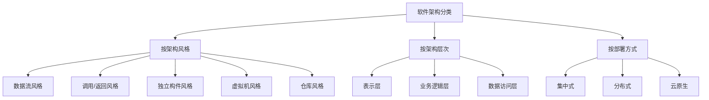

> 📌 **考试重点**：五大架构风格及其典型代表是高频考点，需掌握每种风格的特点和适用场景。

> 🔗 **真题关联**：2024年上半年第3题考查了架构风格的分类及特点。

---

## 软件架构的建模方法

软件架构建模是架构设计的重要手段，常用的建模方法包括[^12]：

**1）结构建模**

- **构件图**：描述系统的静态结构，展示构件及其依赖关系
- **部署图**：描述系统的物理部署结构
- **类图**：描述系统的类结构及关系

**2）行为建模**

- **序列图**：描述对象间的交互顺序
- **状态图**：描述对象的状态变迁
- **活动图**：描述业务流程

**3）架构描述语言（ADL）**

ADL是专门用于描述软件架构的形式化语言，主要包括：

- **ACME**：卡内基-梅隆大学开发的通用ADL
- **Wright**：基于CSP的ADL，支持架构行为描述
- **AADL**：面向嵌入式系统的架构分析与设计语言

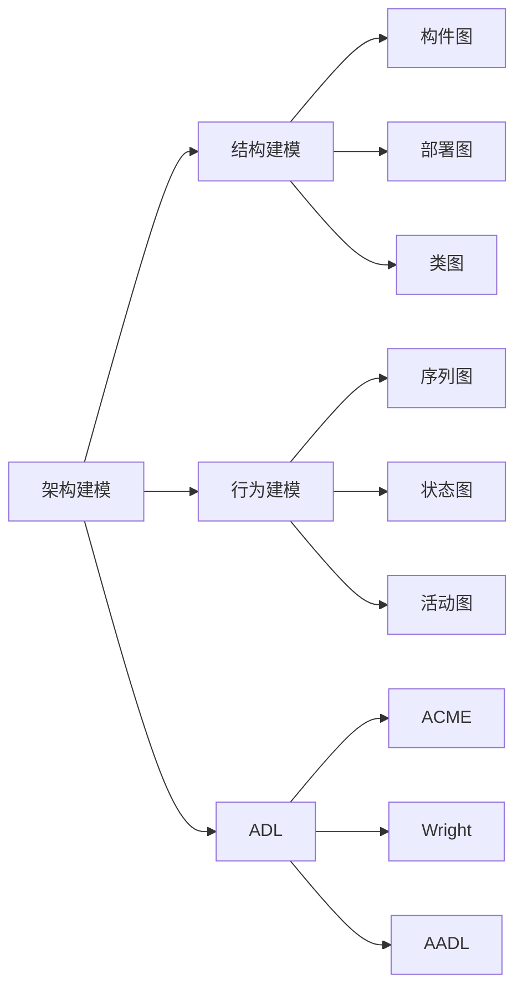

> 📌 **考试重点**：架构建模方法的分类及ADL的特点，常以选择题形式考查。

> 🔗 **真题关联**：历年真题多次考查架构建模方法，2023年下半年第4题考查了ADL的应用。

---

## 软件架构的应用场景

软件架构在不同领域有广泛的应用，主要应用场景包括[^13]：

**1）企业级应用系统**

- 大型ERP系统
- 客户关系管理系统（CRM）
- 供应链管理系统（SCM）

**2）互联网应用系统**

- 电子商务平台
- 社交网络系统
- 内容分发网络（CDN）

**3）嵌入式系统**

- 汽车电子系统
- 智能家居系统
- 工业控制系统

**4）实时系统**

- 航空航天控制系统
- 医疗设备系统
- 金融交易系统

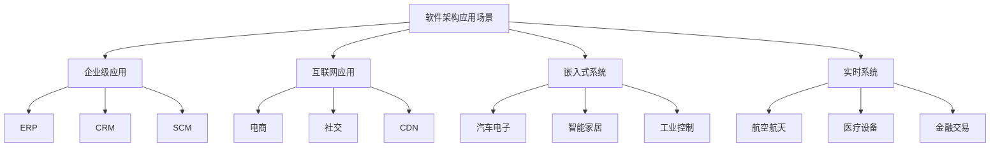

> 📌 **考试重点**：不同应用场景对架构的要求差异，需理解各场景的核心关注点。

> 🔗 **真题关联**：2022年上半年第5题考查了不同应用场景的架构选择。

---

## 软件架构的发展未来

软件架构的发展趋势主要体现在以下几个方面[^14]：

**1）云原生架构**

- 容器化部署
- 微服务架构
- 服务网格（Service Mesh）
- 无服务器计算（Serverless）

**2）智能化架构**

- AI驱动的架构设计
- 自适应架构
- 智能运维（AIOps）

**3）边缘计算架构**

- 边缘-云协同
- 分布式边缘节点
- 低延迟处理

**4）安全可信架构**

- 零信任架构
- 隐私计算
- 区块链集成

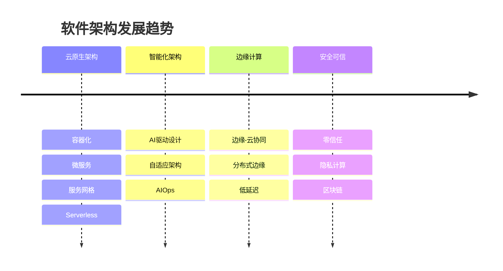

> 📌 **考试重点**：云原生架构的核心特征（容器、微服务、服务网格）是近年考试热点。

> 🔗 **真题关联**：2024年下半年第6题考查了云原生架构的关键技术。

---

## 架构设计师的定义与职责

系统架构设计师是项目开发活动中的关键角色之一，是承担系统架构设计的核心角色[^15]。架构设计师是连接用户需求和系统进一步设计与实现的桥梁，也是系统开发早期阶段质量保证的关键角色。

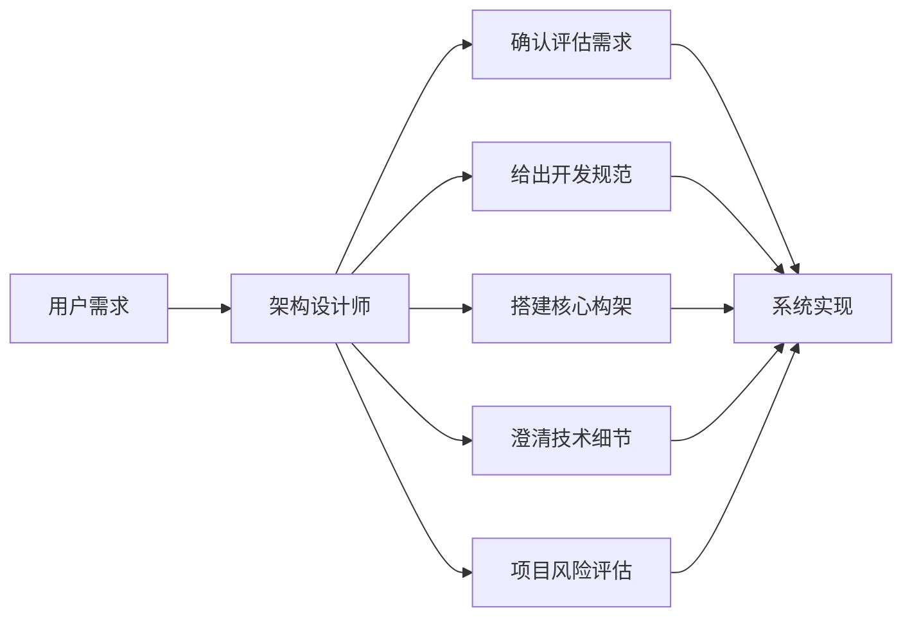

架构设计师的具体职责包括：

- **确认和评估系统需求**：对系统需求进行分析和评估
- **给出开发规范**：制定开发过程中的技术规范和标准
- **搭建系统实现的核心构架**：设计系统整体架构
- **澄清技术细节**：扫清主要难点的技术问题
- **掌握技术团队能力**：给出项目管理方法，采用合适的生命周期模型
- **项目评估**：在进度计划和经费分配等方面开展评估，预防项目风险[^16]

> 📌 **考试重点**：架构设计师的六大职责是必考内容，需准确记忆。

> 🔗 **真题关联**：2023年上半年第7题考查了架构设计师的核心职责。

---

## 架构设计师的能力要求

要成为一名系统架构设计师，应具备以下专业素质[^17]：

**1）技术能力**

- 精通专业基础知识：掌握计算机系统、软件工程、信息安全等核心知识
- 熟悉主流技术栈：了解当前主流的开发框架、中间件、数据库等
- 掌握架构设计方法：熟悉各种架构风格和设计模式

**2）业务能力**

- 理解业务领域：深入理解所在行业的业务特点
- 需求分析能力：能够准确理解和分析用户需求
- 系统思维：能够从全局角度思考问题

**3）管理能力**

- 团队协作：能够带领技术团队完成开发任务
- 沟通协调：能够与各方利益相关者有效沟通
- 风险管理：能够识别和应对项目风险

**4）学习能力**

- 持续学习：跟踪技术发展趋势
- 知识整合：能够将不同领域的知识融会贯通
- 创新思维：能够提出创新的解决方案

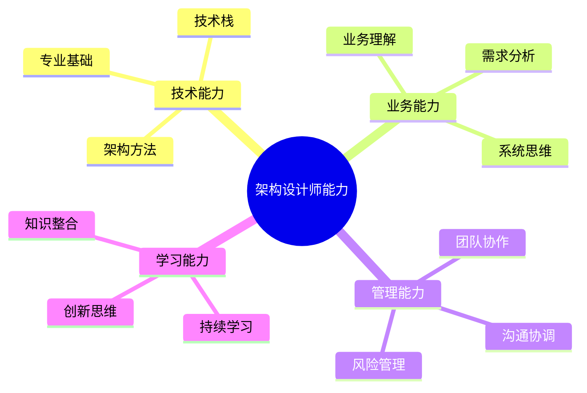

> 📌 **考试重点**：架构设计师的四大能力维度及具体要求，常以简答题形式考查。

> 🔗 **真题关联**：历年真题多次考查架构设计师的能力要求，2022年下半年第8题考查了技术能力的具体内容。

---

## 架构设计师的知识结构

架构设计师需要具备T型知识结构，即既有广度又有深度[^18]：

**横向知识（广度）**：

- 计算机硬件基础
- 操作系统原理
- 计算机网络
- 数据库系统
- 软件工程
- 信息安全
- 项目管理

**纵向知识（深度）**：

- 架构设计理论
- 设计模式
- 架构评估方法
- 性能优化
- 安全设计
- 可靠性设计

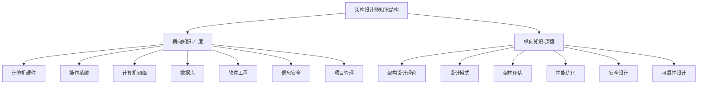

> 📌 **考试重点**：T型知识结构的含义及具体内容，需理解广度与深度的关系。

> 🔗 **真题关联**：2023年下半年第9题考查了架构设计师的知识结构。

---

## 如何衡量一名优秀架构设计师

衡量一名优秀架构设计师的标准包括[^19]：

**1）技术层面**

- 能够确认和评估系统需求
- 给出开发规范
- 搭建核心构架
- 澄清技术细节

**2）管理层面**

- 具备以自身为核心形成团队的能力
- 能够有效管理项目进度和风险
- 能够协调各方资源

**3）业务层面**

- 深入理解业务需求
- 能够将业务需求转化为技术方案
- 能够平衡业务目标与技术约束

**4）个人素质**

- 良好的沟通能力
- 持续学习的态度
- 创新思维能力
- 责任心和使命感

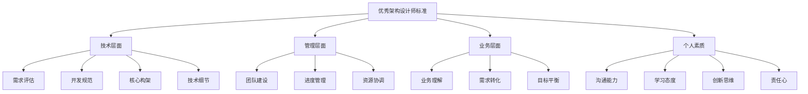

> 📌 **考试重点**：优秀架构设计师的四个衡量维度，需结合实例理解。

> 🔗 **真题关联**：2024年上半年第10题考查了优秀架构设计师的衡量标准。

---

## 从工程师到架构设计师的演化

从工程师到系统架构设计师的演化，需要实现以下转变[^20]：

**1）思维方式的转变**

- 从**技术深度**向**系统广度**转变：不再局限于单一技术领域，需要全局视野
- 从**实现细节**向**架构决策**转变：关注架构层面的决策而非代码实现
- 从**单一领域**向**跨领域综合**转变：具备跨学科整合能力

**2）工作内容的转变**

- 从编码实现到架构设计
- 从技术执行到技术决策
- 从个人贡献到团队引领

**3）能力要求的转变**

- 从专业技能到综合能力
- 从技术深度到技术广度
- 从执行能力到领导能力

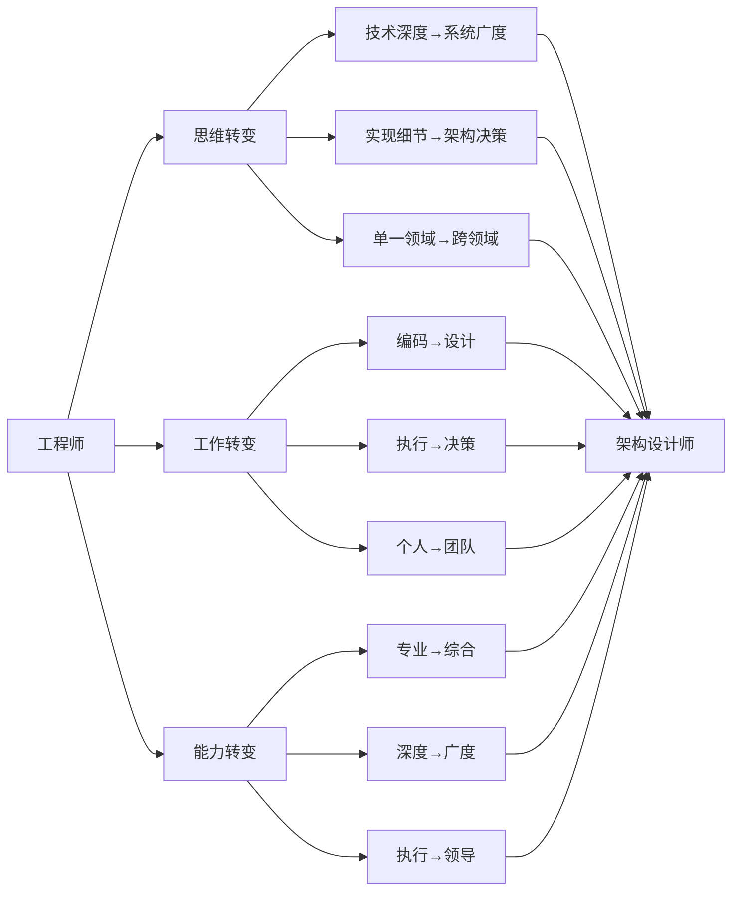

> 📌 **考试重点**：工程师到架构设计师的三大转变维度，需理解每个维度的具体内涵。

> 🔗 **真题关联**：历年真题多次考查这一演化过程，2022年上半年第11题考查了思维方式的转变。

---

## 系统架构设计的基本原则

系统架构设计需要遵循以下基本原则[^21]：

**1）高内聚低耦合**

- 模块内部功能紧密相关
- 模块之间依赖关系简单

**2）开闭原则**

- 对扩展开放
- 对修改关闭

**3）单一职责原则**

- 每个模块只负责一个功能
- 职责清晰明确

**4）依赖倒置原则**

- 高层模块不依赖低层模块
- 抽象不依赖细节

**5）接口隔离原则**

- 使用多个专门的接口
- 避免使用单一的总接口

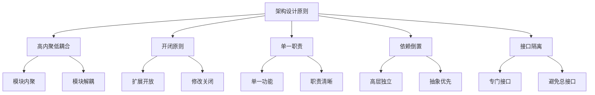

> 📌 **考试重点**：五大架构设计原则的具体含义和应用场景，是案例分析题的重要考点。

> 🔗 **真题关联**：2023年上半年第12题考查了架构设计原则的应用。

---

## 系统架构设计的流程

系统架构设计是一个迭代的过程，主要包括以下步骤[^22]：

**1）需求分析**

- 收集和分析业务需求
- 识别质量属性需求
- 确定系统约束

**2）架构设计**

- 选择架构风格
- 设计系统结构
- 定义接口规范

**3）架构评估**

- 评估架构质量
- 识别潜在风险
- 优化设计方案

**4）架构实现**

- 搭建核心框架
- 实现关键模块
- 集成系统组件

**5）架构演化**

- 监控系统运行
- 收集反馈信息
- 持续优化架构

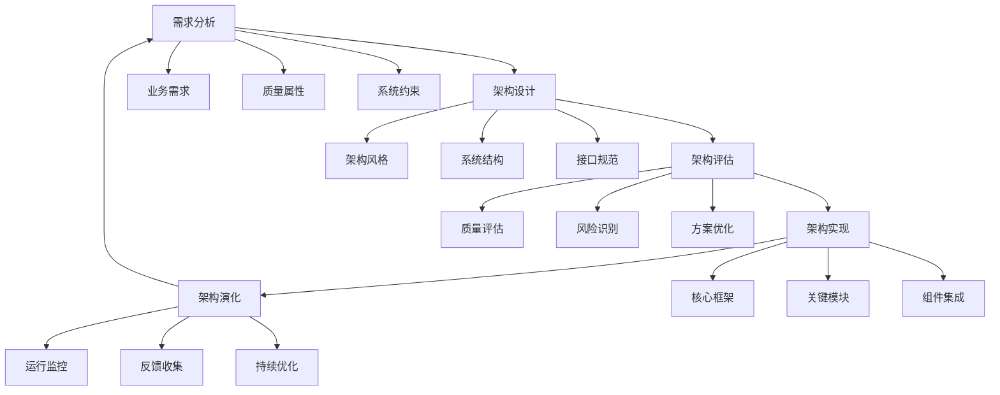

> 📌 **考试重点**：架构设计流程的五个阶段及各阶段的主要活动，需掌握迭代特性。

> 🔗 **真题关联**：2024年下半年第13题考查了架构设计流程的关键环节。

---

## 系统架构文档化

架构文档是架构设计的重要产出，主要包括[^23]：

**1）架构视图**

- **逻辑视图**：描述系统的功能结构
- **进程视图**：描述系统的并发结构
- **物理视图**：描述系统的部署结构
- **开发视图**：描述系统的模块结构

**2）架构文档内容**

- 架构概述
- 架构目标
- 架构约束
- 架构决策
- 架构视图
- 架构评估

**3）文档编写原则**

- 面向读者
- 内容完整
- 结构清晰
- 及时更新

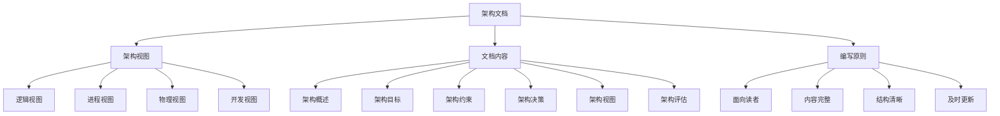

> 📌 **考试重点**：4+1视图模型的具体内容，是架构文档化的核心考点。

> 🔗 **真题关联**：2022年下半年第14题考查了架构视图的分类。

---

## 系统架构评估方法

架构评估是确保架构质量的重要手段，常用的评估方法包括[^24]：

**1）SAAM（软件架构分析方法）**

- 基于场景的评估方法
- 评估架构的可修改性
- 适用于早期评估

**2）ATAM（架构权衡分析方法）**

- 评估多个质量属性
- 识别架构权衡点
- 适用于大型系统

**3）CBAM（成本效益分析方法）**

- 考虑经济因素
- 评估架构决策的成本效益
- 适用于资源受限项目

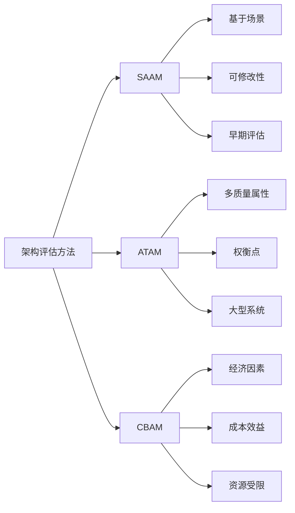

> 📌 **考试重点**：三种架构评估方法的特点和适用场景，需对比记忆。

> 🔗 **真题关联**：2023年下半年第15题考查了ATAM方法的应用。

---

## 系统架构与软件生命周期

架构设计贯穿软件生命周期的各个阶段[^25]：

**1）需求阶段**

- 架构需求分析
- 质量属性定义
- 架构约束识别

**2）设计阶段**

- 架构方案设计
- 架构文档编写
- 架构评审

**3）实现阶段**

- 架构框架搭建
- 核心模块实现
- 架构一致性检查

**4）测试阶段**

- 架构测试
- 性能测试
- 安全测试

**5）维护阶段**

- 架构演化
- 架构重构
- 架构文档更新

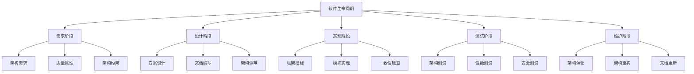

> 📌 **考试重点**：架构设计在软件生命周期各阶段的作用，需理解架构的持续性。

> 🔗 **真题关联**：2024年上半年第16题考查了架构与生命周期的关系。

---

## 参考文献

[^1]: 《系统架构设计师教程(第二版)》P.4 §1.1.1

[^2]: 《系统架构设计师教程(第二版)》P.4 §1.1.1

[^3]: 《系统架构设计师教程(第二版)》P.4 §1.1.1

[^4]: 《系统架构设计师教程(第二版)》P.5 §1.1.1

[^5]: 《系统架构设计师教程(第二版)》P.5 §1.1.1

[^6]: 《系统架构设计师教程(第二版)》P.6 §1.1.1

[^7]: 《系统架构设计师教程(第二版)》P.7 §1.1.1

[^8]: 《系统架构设计师教程(第二版)》P.8 §1.1.1

[^9]: 《系统架构设计师教程(第二版)》P.8 §1.1.1

[^10]: 《系统架构设计师教程(第二版)》P.9 §1.1.1

[^11]: 《系统架构设计师教程(第二版)》P.10-12 §1.1.2

[^12]: 《系统架构设计师教程(第二版)》P.13-15 §1.1.2

[^13]: 《系统架构设计师教程(第二版)》P.16-17 §1.1.3

[^14]: 《系统架构设计师教程(第二版)》P.17-18 §1.1.4

[^15]: 《系统架构设计师教程(第二版)》P.3 §1.1

[^16]: 《系统架构设计师教程(第二版)》P.4 §1.1.1

[^17]: 《系统架构设计师教程(第二版)》P.4 §1.1.1

[^18]: 《系统架构设计师教程(第二版)》P.18 §1.2.3

[^19]: 《系统架构设计师教程(第二版)》P.18 §1.3.1

[^20]: 《系统架构设计师教程(第二版)》P.18 §1.3.2

[^21]: 《系统架构设计师教程(第二版)》P.19-20 §1.3

[^22]: 《系统架构设计师教程(第二版)》P.20-21 §1.3

[^23]: 《系统架构设计师教程(第二版)》P.21-22 §1.3

[^24]: 《系统架构设计师教程(第二版)》P.22-23 §1.3

[^25]: 《系统架构设计师教程(第二版)》P.23-24 §1.3
