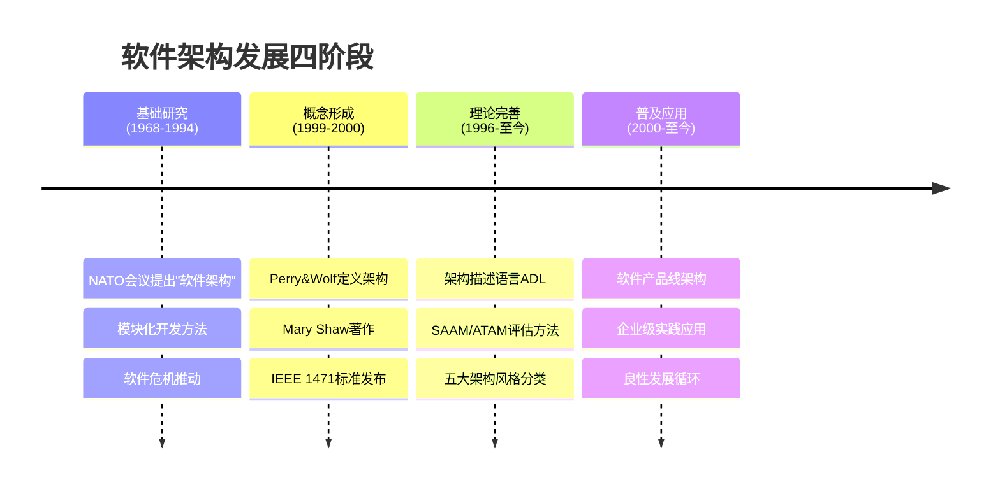
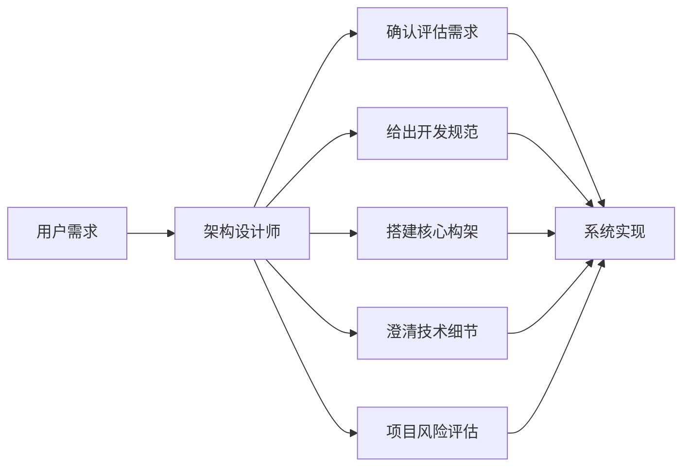

## 系统架构的定义

架构是体现在组件中的一个系统的基本组织、它们彼此的关系与环境的关系及指导它的设计和发展的原则[^1]。该定义来源于 **IEEE 1471-2000** 标准，主要针对软件密集系统进行架构描述。

**系统架构**（System Architecture）是系统的一种整体的高层次的结构表示，是系统的骨架和根基，支撑和链接各个部分，包括组件、连接件、约束规范以及指导这些内容设计与演化的原理[^2]。

架构设计的作用主要包括：

- 解决相对复杂的需求分析问题
- 解决非功能属性在系统占据重要位置的设计问题
- 解决生命周期长、扩展性需求高的系统整体结构问题
- 解决系统基于组件需要的集成问题
- 解决业务流程再造难的问题[^3]

---

## 软件架构发展历程

"软件架构"术语在 **1968 年**由北大西洋公约组织（NATO）会议上第一次提出，但并没有得到明确定义[^4]。软件架构自概念诞生以来，大致经历了四个发展阶段：

**1）基础研究阶段（1968-1994 年）**

软件架构的发展可追溯到 20 世纪 60 年代中期爆发的软件危机。1995 年 Standish Group 调查显示，84% 的软件项目无法按时按需完成，超过 30% 的项目夭折[^5]。为解决危机，模块化开发方法被逐步采用，模块化设计遵循高内聚、低耦合、模块大小适度等规则[^6]。

**2）概念体系和核心技术形成阶段（1999-2000 年）**

1991 年 Windton W. Royce 首次对软件架构进行了定义。1992 年 D.E.Perry 与 A.Wolf 提出了 `{elements, forms, rationale} = software` 的阐述[^7]。1996 年卡内基-梅隆大学的 Mary Shaw 和 David Garlan 在 _Software Architecture: Perspectives on an Emerging Discipline_ 中详尽阐述了软件架构概念。2000 年 IEEE 1471-2000 标准发布，标志着软件架构理论体系基本建立[^8]。

**3）理论体系完善与发展阶段（1996 年至今）**

研究方向包括：软件架构描述与表示（ADL）、架构分析设计与测试（SAAM、ATAM、CBAM 等）、架构发现演化与重用、基于架构的开发方法、软件架构风格（数据流、调用/返回、独立组件、虚拟机、仓库五类）[^9]。

**4）普及应用阶段（2000 年至今）**

软件产品线成为重要分支，架构理论投入实践，形成良性发展循环[^10]。

---

## 架构设计师的定义与职责

系统架构设计师是项目开发活动中的关键角色之一，是承担系统架构设计的核心角色[^11]。架构设计师是连接用户需求和系统进一步设计与实现的桥梁，也是系统开发早期阶段质量保证的关键角色。

架构设计师的具体职责包括：

- **确认和评估系统需求**：对系统需求进行分析和评估
- **给出开发规范**：制定开发过程中的技术规范和标准
- **搭建系统实现的核心构架**：设计系统整体架构
- **澄清技术细节**：扫清主要难点的技术问题
- **掌握技术团队能力**：给出项目管理方法，采用合适的生命周期模型
- **项目评估**：在进度计划和经费分配等方面开展评估，预防项目风险[^12]

---

## 架构设计师的能力要求

要成为一名系统架构设计师，应具备以下专业素质：

- **精通专业基础知识**：掌握计算机系统、软件工程、信息安全等核心知识
- **丰富的实际工作经验**：具有多个项目的实战经历
- **跨学科能力**：能够理解和整合不同技术领域知识
- **把握系统整体设计的能力**：既能掌控整体，又能洞悉局部瓶颈[^13]

架构设计师在项目研制过程中起到承上启下的作用，是项目的总设计师，需要依据具体业务场景给出解决方案[^14]。

---

## 从工程师到架构设计师的演化

从工程师到系统架构设计师的演化，需要实现以下转变：

- 从**技术深度**向**系统广度**转变：不再局限于单一技术领域，需要全局视野
- 从**实现细节**向**架构决策**转变：关注架构层面的决策而非代码实现
- 从**单一领域**向**跨领域综合**转变：具备跨学科整合能力[^15]

衡量一名优秀架构设计师的标准包括：能够确认和评估系统需求、给出开发规范、搭建核心构架、澄清技术细节，并具备以自身为核心形成团队的能力[^16]。

---

## 参考文献

[^1]: 《系统架构设计师教程(第二版)》P.4 §1.1.1

[^2]: 《系统架构设计师教程(第二版)》P.4 §1.1.1

[^3]: 《系统架构设计师教程(第二版)》P.4 §1.1.1

[^4]: 《系统架构设计师教程(第二版)》P.5 §1.1.1

[^5]: 《系统架构设计师教程(第二版)》P.5 §1.1.1

[^6]: 《系统架构设计师教程(第二版)》P.6 §1.1.1

[^7]: 《系统架构设计师教程(第二版)》P.7 §1.1.1

[^8]: 《系统架构设计师教程(第二版)》P.8 §1.1.1

[^9]: 《系统架构设计师教程(第二版)》P.8 §1.1.1

[^10]: 《系统架构设计师教程(第二版)》P.9 §1.1.1

[^11]: 《系统架构设计师教程(第二版)》P.3 §1.1

[^12]: 《系统架构设计师教程(第二版)》P.4 §1.1.1

[^13]: 《系统架构设计师教程(第二版)》P.4 §1.1.1

[^14]: 《系统架构设计师教程(第二版)》P.4 §1.1.1

[^15]: 《系统架构设计师教程(第二版)》P.18 §1.3

[^16]: 《系统架构设计师教程(第二版)》P.18 §1.3.1
