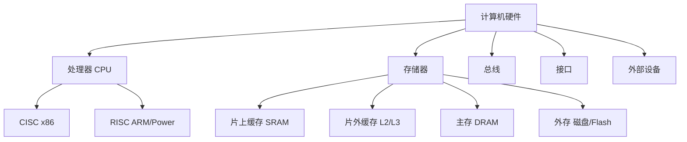

## 计算机硬件组成

计算机组成结构源于**冯·诺依曼计算机结构**，该结构将计算机硬件划分为五大部分：运算器、控制器、存储器、输入设备和输出设备[^1]。在现代硬件实现中，控制单元和运算单元通常被集成为处理器（CPU），输入/输出设备则通过总线、接口与主机连接[^2]。

计算机系统中的存储器采用分层体系结构（Memory Hierarchy），按与处理器的物理距离可分为四个层次：

- **片上缓存**：集成在处理器核心中，一般为SRAM结构，容量16kB~512kB
- **片外缓存**：位于处理器核心外，容量256kB~4MB，称为L2/L3 Cache
- **主存（内存）**：采用DRAM结构，容量数百MB至数十GB
- **外存**：包括磁盘、Flash、光盘等，掉电后数据可保持[^3]

处理器经历了从4位到64位、从单核到多核/众核的发展。指令集按复杂程度分为**CISC**（复杂指令集，以Intel x86为代表）与**RISC**（精简指令集，以ARM、Power为代表），RISC已成为发展趋势[^4]。

---

## 操作系统

操作系统是计算机系统的资源管理者，配置在计算机硬件上的第一层软件，向下管理裸机，向上为其他系统软件和应用软件提供支持[^5]。其核心功能包括处理器管理、存储管理、文件管理和I/O设备管理。

操作系统具有四大特征：

- **并发性**：宏观上多个程序同时运行，微观上交替执行
- **共享性**：资源可被多个并发进程共同使用，分为同时共享和互斥共享
- **虚拟性**：将物理实体变为逻辑上的多个对应物
- **不确定性**：进程执行"走走停停"，执行结果可能不唯一[^6]

操作系统可分为批处理、分时、实时、网络、分布式、微型计算机和嵌入式等类型。其中分时系统具有多路性、独立性、交互性和及时性四个特点；实时系统则强调在指定时间内完成响应，分为实时控制系统和实时信息处理系统[^7]。

操作系统内核提供进程管理、存储管理、文件管理和设备管理等功能，以CPU最高优先级运行，能执行特权指令，为应用程序提供统一的系统调用接口[^8]。

---

## 计算机网络技术

计算机网络是利用通信线路将地理上分散的、具有独立功能的计算机系统和通信设备连接起来，依靠网络软件及通信协议实现资源共享和信息传递的系统[^9]。其发展大致经历了四个阶段：

1. **诞生阶段**（20世纪60年代中期前）：以单个计算机为中心的远程联机系统
2. **形成阶段**（60-70年代）：ARPANET兴起，形成通信子网与资源子网
3. **互联互通阶段**（70-90年代）：TCP/IP与OSI体系结构确立
4. **高速发展阶段**（90年代至今）：以Internet为代表的全球网络[^10]

网络性能指标包括速率（b/s）、带宽、吞吐量、时延和往返时间（RTT）等。网络按覆盖范围可分为局域网（LAN）、城域网（MAN）和广域网（WAN）[^11]。

通信技术中，信道容量可通过**香农公式**计算：$C = B \times \log_2(1 + S/N)$，其中C为信道容量，B为带宽，S/N为信噪比[^12]。5G通信采用OFDM优化波形、大规模MIMO、毫米波和LDPC/Polar编码等关键技术[^13]。

---

## 嵌入式系统

嵌入式系统是为特定应用而专门构建的计算机系统，具有**专用性强、技术融合、软硬一体、资源受限、程序固化、需专门开发工具、体积小性价比高**等特点[^14]。

嵌入式系统软件采用层次化架构，分为五个层次：

- **硬件层**：微处理器、存储器、I/O接口等
- **抽象层**：硬件抽象层（HAL）、板级支持包（BSP）
- **操作系统层**：嵌入式操作系统、文件系统、网络系统等
- **中间件层**：嵌入式数据库、OpenGL、Java虚拟机等
- **应用层**：面向特定领域的应用软件[^15]

嵌入式软件具有可剪裁性、可配置性、强实时性、安全性、可靠性和高确定性等特点。在安全攸关领域（如航空航天），DO-178B/C标准将软件安全等级分为A~E五级，A级为灾难性失效状态[^16]。

嵌入式系统开发采用"宿主机-目标机"模式，在宿主机上使用专用工具开发，生成二进制代码后下载到目标机运行[^17]。

---

## 系统性能评估

系统性能包含**性能指标、性能计算、性能设计和性能评估**四个方面[^18]。评价计算机的主要性能指标有时钟频率（主频）、运算速度、内存容量、存取周期、吞吐率、响应时间以及RASIS特性（可靠性、可用性、可维护性、完整性和安全性）等[^19]。

性能计算的主要方法包括定义法、公式法、程序检测法和仪器检测法。常用的性能指标计算有MIPS（每秒百万条指令）、峰值计算和等效指令速度（吉普森法）[^20]。

**阿姆达尔定律**定义了采用增强部件所获得的加速比：

$$\text{加速比} = \frac{1}{(1 - \text{增强比例}) + \frac{\text{增强比例}}{\text{增强加速比}}}$$

该定律表明，系统性能提升程度取决于被改进部分在总执行时间中所占的比例[^21]。

性能评估方法包括基准测试程序（真实程序、核心程序、小型基准程序、合成基准程序），常见基准测试有Dhrystone、Linpack、SPEC和TPC等[^22]。

---

## 参考文献

[^1]: 《系统架构设计师教程(第二版)》P.25 §2.2.1

[^2]: 《系统架构设计师教程(第二版)》P.25 §2.2.1

[^3]: 《系统架构设计师教程(第二版)》P.26 §2.2.3

[^4]: 《系统架构设计师教程(第二版)》P.25 §2.2.2

[^5]: 《系统架构设计师教程(第二版)》P.28 §2.3.2

[^6]: 《系统架构设计师教程(第二版)》P.29-30 §2.3.2

[^7]: 《系统架构设计师教程(第二版)》P.30-31 §2.3.2

[^8]: 《系统架构设计师教程(第二版)》P.29 §2.3.2

[^9]: 《系统架构设计师教程(第二版)》P.56 §2.5

[^10]: 《系统架构设计师教程(第二版)》P.56-57 §2.5.1

[^11]: 《系统架构设计师教程(第二版)》P.58 §2.5.1

[^12]: 《系统架构设计师教程(第二版)》P.60 §2.5.2

[^13]: 《系统架构设计师教程(第二版)》P.61-62 §2.5.2

[^14]: 《系统架构设计师教程(第二版)》P.47-48 §2.4.1

[^15]: 《系统架构设计师教程(第二版)》P.49-50 §2.4.3

[^16]: 《系统架构设计师教程(第二版)》P.52-53 §2.4.4

[^17]: 《系统架构设计师教程(第二版)》P.51 §2.4.3

[^18]: 《系统架构设计师教程(第二版)》P.101 §2.9

[^19]: 《系统架构设计师教程(第二版)》P.101 §2.9.1

[^20]: 《系统架构设计师教程(第二版)》P.102 §2.9.2

[^21]: 《系统架构设计师教程(第二版)》P.102-103 §2.9.3

[^22]: 《系统架构设计师教程(第二版)》P.103 §2.9.4
