# 第2章 计算机系统基础知识

## 计算机系统概述

计算机系统是由硬件系统和软件系统组成的复杂系统，硬件是计算机系统的物质基础，软件是计算机系统的灵魂[^1]。计算机系统的发展经历了从大型机到微型机、从单机到网络、从集中式到分布式的演变过程。

**计算机系统的层次结构**：

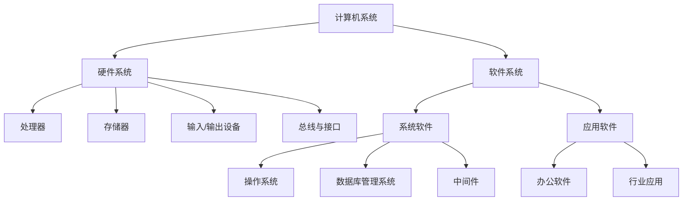

**计算机系统的分类**：

- **按规模分类**：巨型机、大型机、小型机、微型机、嵌入式系统
- **按用途分类**：通用计算机、专用计算机
- **按处理方式分类**：批处理系统、分时系统、实时系统
- **按体系结构分类**：冯·诺依曼结构、哈佛结构

> 📌 **考试重点**：计算机系统的层次结构和分类方式是基础考点，需掌握各层次的功能和相互关系。

> 🔗 **真题关联**：历年真题多次考查计算机系统的组成和分类，2023年上半年第1题考查了系统层次结构。

---

## 计算机硬件组成

计算机组成结构源于**冯·诺依曼计算机结构**，该结构将计算机硬件划分为五大部分：运算器、控制器、存储器、输入设备和输出设备[^2]。在现代硬件实现中，控制单元和运算单元通常被集成为处理器（CPU），输入/输出设备则通过总线、接口与主机连接[^3]。

**冯·诺依曼结构的特点**：

- 采用存储程序方式，指令和数据不加区别混合存储在同一个存储器中
- 指令和数据都可以送到运算器进行运算
- 由运算器、控制器、存储器、输入设备和输出设备五大部件组成
- 指令由操作码和地址码组成
- 以运算器为中心

**现代计算机硬件结构**：

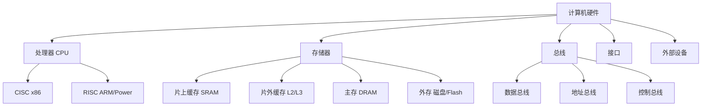

> 📌 **考试重点**：冯·诺依曼结构的五大部件和特点是必考内容，需理解存储程序原理。

> 🔗 **真题关联**：2022年下半年第2题考查了冯·诺依曼结构的特点。

---

## 处理器技术

处理器是计算机系统的核心部件，负责执行指令和处理数据[^4]。

**处理器的发展历程**：

- **4位处理器**：Intel 4004（1971年）
- **8位处理器**：Intel 8080、Zilog Z80
- **16位处理器**：Intel 8086/8088
- **32位处理器**：Intel 80386、Motorola 68000
- **64位处理器**：Intel Core系列、AMD Ryzen、ARM Cortex-A系列

**指令集架构（ISA）**：

| 特性 | CISC | RISC |
|------|------|------|
| 指令数量 | 多（几百条） | 少（几十条） |
| 指令长度 | 可变 | 固定 |
| 寻址方式 | 复杂多样 | 简单 |
| 执行周期 | 多周期 | 单周期 |
| 代表产品 | Intel x86 | ARM、Power、MIPS |
| 编译器复杂度 | 低 | 高 |
| 硬件复杂度 | 高 | 低 |

**多核处理器技术**：

- **对称多处理（SMP）**：多个处理器共享内存和总线
- **非对称多处理（AMP）**：各处理器有独立内存
- **众核处理器**：集成大量简单核心（如GPU）

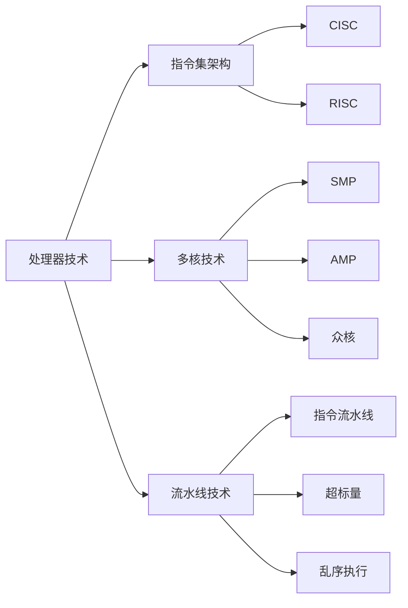

> 📌 **考试重点**：CISC与RISC的区别是高频考点，需从指令数量、长度、寻址方式等多维度对比。

> 🔗 **真题关联**：2024年上半年第3题考查了CISC和RISC的特点对比。

---

## 存储器系统

计算机系统中的存储器采用分层体系结构（Memory Hierarchy），按与处理器的物理距离可分为四个层次[^5]：

**存储器层次结构**：

| 层次 | 类型 | 容量 | 速度 | 成本 |
|------|------|------|------|------|
| 寄存器 | SRAM | 几十~几百字节 | 最快 | 最高 |
| 片上缓存 | SRAM | 16KB~512KB | 很快 | 高 |
| 片外缓存 | SRAM | 256KB~4MB | 快 | 较高 |
| 主存 | DRAM | 数百MB~数十GB | 中等 | 中等 |
| 外存 | 磁盘/Flash | 数百GB~数TB | 慢 | 低 |

**存储器分类**：

- **按存取方式**：随机存取存储器（RAM）、只读存储器（ROM）、顺序存取存储器（SAM）、直接存取存储器（DAM）
- **按信息保存**：易失性存储器（RAM）、非易失性存储器（ROM、Flash）
- **按功能**：主存储器、辅助存储器、高速缓冲存储器

**Cache工作原理**：

Cache利用程序的局部性原理（时间局部性和空间局部性），将频繁访问的数据存储在高速缓存中，提高访问速度[^6]。

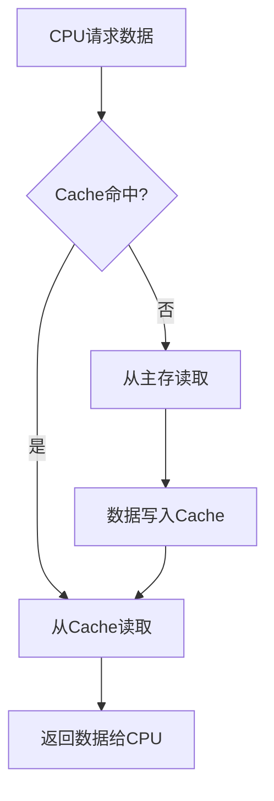

> 📌 **考试重点**：存储器层次结构、Cache工作原理和局部性原理是核心考点。

> 🔗 **真题关联**：2023年下半年第4题考查了Cache的局部性原理。

---

## 总线与接口

总线是计算机系统中各部件之间传输信息的公共通道[^7]。

**总线分类**：

- **按功能**：数据总线、地址总线、控制总线
- **按位置**：片内总线、系统总线、外部总线
- **按传输方式**：并行总线、串行总线

**常见总线标准**：

| 总线类型 | 特点 | 应用场景 |
|----------|------|----------|
| PCI | 并行、高带宽 | 显卡、网卡 |
| PCIe | 串行、点对点 | 现代显卡、SSD |
| USB | 串行、热插拔 | 外设连接 |
| SATA | 串行、高速 | 硬盘、SSD |
| I2C | 两线制、低速 | 传感器、EEPROM |

**接口技术**：

- **并行接口**：同时传输多位数据，速度快但距离短
- **串行接口**：逐位传输数据，距离远但速度相对慢
- **USB接口**：通用串行总线，支持热插拔和即插即用
- **网络接口**：以太网接口、WiFi接口

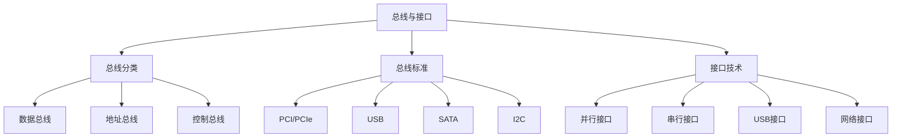

> 📌 **考试重点**：总线的分类和常见总线标准的特点，需理解并行与串行的区别。

> 🔗 **真题关联**：2022年上半年第5题考查了总线的分类。

---

## 输入/输出设备

输入/输出设备是计算机与外部世界交互的桥梁[^8]。

**输入设备**：

- **键盘**：最常用的字符输入设备
- **鼠标**：图形界面下的定位设备
- **扫描仪**：图像输入设备
- **摄像头**：视频输入设备
- **传感器**：物联网中的数据采集设备

**输出设备**：

- **显示器**：视觉输出设备（LCD、LED、OLED）
- **打印机**：硬拷贝输出设备（激光、喷墨、针式）
- **音箱**：音频输出设备
- **投影仪**：大屏幕显示设备

**I/O控制方式**：

| 方式 | 特点 | CPU参与度 |
|------|------|-----------|
| 程序查询 | CPU轮询设备状态 | 高 |
| 中断驱动 | 设备就绪时中断CPU | 中 |
| DMA | 直接内存访问 | 低 |
| 通道 | 专用I/O处理器 | 最低 |

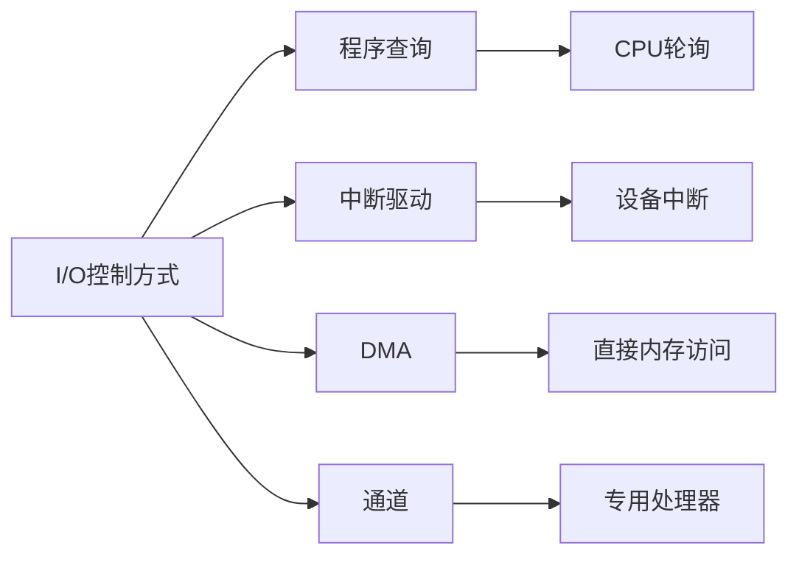

> 📌 **考试重点**：四种I/O控制方式的特点和CPU参与度对比，是常考知识点。

> 🔗 **真题关联**：2023年上半年第6题考查了DMA方式的特点。

---

## 操作系统

操作系统是计算机系统的资源管理者，配置在计算机硬件上的第一层软件，向下管理裸机，向上为其他系统软件和应用软件提供支持[^9]。其核心功能包括处理器管理、存储管理、文件管理和I/O设备管理。

**操作系统的四大特征**：

- **并发性**：宏观上多个程序同时运行，微观上交替执行
- **共享性**：资源可被多个并发进程共同使用，分为同时共享和互斥共享
- **虚拟性**：将物理实体变为逻辑上的多个对应物
- **不确定性**：进程执行"走走停停"，执行结果可能不唯一[^10]

**操作系统分类**：

| 类型 | 特点 | 应用场景 |
|------|------|----------|
| 批处理系统 | 自动处理一批作业 | 大型计算中心 |
| 分时系统 | 多用户交互式使用 | 服务器、主机 |
| 实时系统 | 及时响应外部事件 | 工业控制、航空航天 |
| 网络操作系统 | 网络资源共享 | 企业网络 |
| 分布式操作系统 | 多机协同工作 | 云计算平台 |
| 嵌入式操作系统 | 资源受限、专用 | 智能设备 |

**分时系统的特点**：

- **多路性**：多个用户同时使用
- **独立性**：各用户独立操作
- **交互性**：用户与系统交互
- **及时性**：快速响应用户请求

**实时系统的分类**：

- **实时控制系统**：工业控制、武器控制
- **实时信息处理系统**：机票预订、银行系统

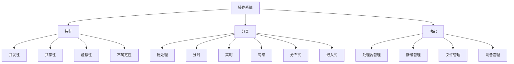

> 📌 **考试重点**：操作系统的四大特征、分类及分时/实时系统的特点是必考内容。

> 🔗 **真题关联**：2024年下半年第7题考查了操作系统的特征。

---

## 进程管理

进程是操作系统进行资源分配和调度的基本单位[^11]。

**进程的状态**：

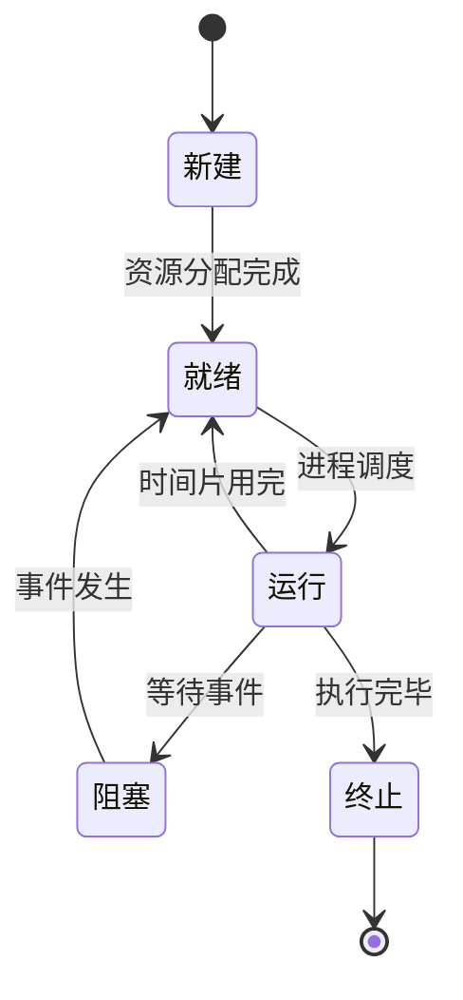

**进程控制块（PCB）**：

PCB是进程存在的唯一标志，包含：

- 进程标识符（PID）
- 进程状态
- 程序计数器
- 寄存器内容
- 内存管理信息
- I/O状态信息
- 会计信息

**进程调度算法**：

| 算法 | 特点 | 适用场景 |
|------|------|----------|
| 先来先服务（FCFS） | 按到达顺序调度 | 批处理系统 |
| 短作业优先（SJF） | 优先调度短作业 | 批处理系统 |
| 时间片轮转（RR） | 每个进程分配时间片 | 分时系统 |
| 优先级调度 | 按优先级调度 | 实时系统 |
| 多级反馈队列 | 综合多种算法 | 通用系统 |

> 📌 **考试重点**：进程状态转换、PCB内容和调度算法是核心考点。

> 🔗 **真题关联**：2022年下半年第8题考查了进程调度算法。

---

## 存储管理

存储管理负责内存的分配、回收、保护和扩充[^12]。

**存储管理方式**：

- **连续分配**：单一连续分配、固定分区分配、动态分区分配
- **离散分配**：分页存储管理、分段存储管理、段页式存储管理

**分页存储管理**：

- 将内存划分为固定大小的页框
- 将进程划分为与页框相同大小的页
- 通过页表实现地址映射

**分段存储管理**：

- 按程序逻辑结构划分段
- 每段有独立的地址空间
- 便于共享和保护

**虚拟存储器**：

- 基于局部性原理
- 将部分外存作为内存的扩展
- 实现请求分页、请求分段

**页面置换算法**：

| 算法 | 原理 | 特点 |
|------|------|------|
| 最佳置换（OPT） | 置换最长时间不用的页 | 理论最优，不可实现 |
| 先进先出（FIFO） | 置换最早进入的页 | 可能产生Belady异常 |
| 最近最少使用（LRU） | 置换最长时间未用的页 | 性能好，实现复杂 |
| 时钟置换（CLOCK） | LRU的近似实现 | 实现简单，性能较好 |

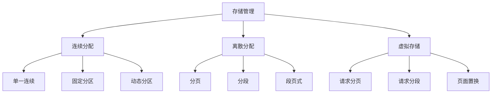

> 📌 **考试重点**：分页与分段的区别、虚拟存储器原理和页面置换算法是高频考点。

> 🔗 **真题关联**：2023年上半年第9题考查了LRU页面置换算法。

---

## 文件系统

文件系统负责文件的存储、检索、共享和保护[^13]。

**文件的概念**：

- 文件是具有符号名的、在逻辑上具有完整意义的一组相关信息项的集合
- 文件由文件体和文件说明组成

**文件结构**：

- **逻辑结构**：流式文件、记录式文件
- **物理结构**：连续结构、链接结构、索引结构

**目录结构**：

- **单级目录**：所有文件在一个目录下
- **两级目录**：分为主文件目录和用户文件目录
- **多级目录（树形目录）**：层次化的目录结构
- **图形目录**：支持文件共享的目录结构

**文件存取方法**：

- **顺序存取**：按文件逻辑顺序依次存取
- **随机存取**：直接存取文件的任意位置
- **按键存取**：根据关键字存取记录

**文件保护**：

- **访问控制**：通过访问控制表（ACL）控制文件访问
- **口令保护**：设置文件访问口令
- **加密保护**：对文件内容进行加密

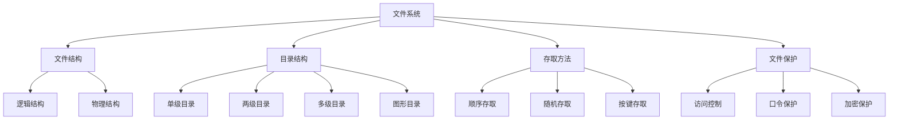

> 📌 **考试重点**：文件的物理结构、目录结构和存取方法是常考知识点。

> 🔗 **真题关联**：2024年上半年第10题考查了文件的物理结构。

---

## 数据库系统

数据库系统是由数据库、数据库管理系统、应用程序和数据库管理员组成的系统[^14]。

**数据库系统的特点**：

- **数据结构化**：数据按一定结构组织
- **数据共享性高**：多个用户可同时访问
- **数据独立性高**：逻辑独立性和物理独立性
- **数据冗余度低**：减少数据重复存储
- **数据统一控制**：安全性、完整性、并发控制

**数据库管理系统（DBMS）的功能**：

- 数据定义功能（DDL）
- 数据操纵功能（DML）
- 数据控制功能（DCL）
- 数据库的建立和维护功能

**数据库系统的三级模式结构**：

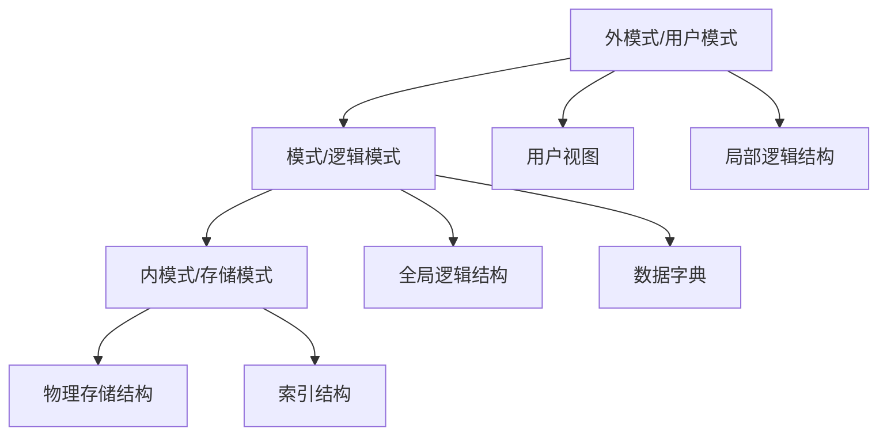

**数据库模型**：

- **层次模型**：树形结构，一对多关系
- **网状模型**：图结构，多对多关系
- **关系模型**：二维表结构，目前最流行
- **面向对象模型**：对象和类的组织方式

> 📌 **考试重点**：数据库系统的三级模式结构和数据独立性是核心考点。

> 🔗 **真题关联**：2022年上半年第11题考查了数据库的三级模式。

---

## 中间件技术

中间件是位于操作系统和应用程序之间的软件层，为应用程序提供通用的服务[^15]。

**中间件的特点**：

- **屏蔽异构性**：隐藏底层硬件和操作系统的差异
- **提供通用服务**：通信、事务、安全等
- **简化开发**：提供标准接口和协议
- **支持分布式**：支持分布式应用的开发和运行

**中间件的分类**：

| 类型 | 功能 | 代表产品 |
|------|------|----------|
| 消息中间件 | 异步消息传递 | RabbitMQ、Kafka |
| 交易中间件 | 事务处理 | Tuxedo、CICS |
| 对象中间件 | 分布式对象调用 | CORBA、DCOM |
| 应用服务器 | Web应用运行环境 | Tomcat、WebLogic |
| 数据访问中间件 | 数据库访问 | ODBC、JDBC |

**中间件的作用**：

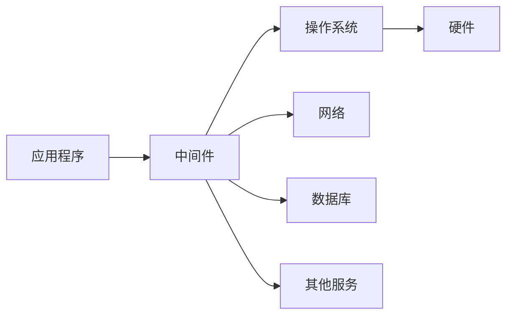

> 📌 **考试重点**：中间件的分类和作用，需理解各类中间件的特点。

> 🔗 **真题关联**：2023年下半年第12题考查了中间件的分类。

---

## 嵌入式系统

嵌入式系统是为特定应用而专门构建的计算机系统，具有**专用性强、技术融合、软硬一体、资源受限、程序固化、需专门开发工具、体积小性价比高**等特点[^16]。

**嵌入式系统的组成**：

- **硬件层**：微处理器、存储器、I/O接口等
- **抽象层**：硬件抽象层（HAL）、板级支持包（BSP）
- **操作系统层**：嵌入式操作系统、文件系统、网络系统等
- **中间件层**：嵌入式数据库、OpenGL、Java虚拟机等
- **应用层**：面向特定领域的应用软件[^17]

**嵌入式系统的分类**：

- **按实时性**：硬实时系统、软实时系统
- **按复杂度**：简单嵌入式系统、复杂嵌入式系统
- **按应用领域**：消费电子、工业控制、汽车电子、医疗设备

**嵌入式软件的特点**：

- **可剪裁性**：根据需求裁剪功能
- **可配置性**：支持多种配置选项
- **强实时性**：满足严格的时间约束
- **安全性**：确保系统安全可靠
- **可靠性**：长时间稳定运行
- **高确定性**：行为可预测

**安全攸关软件**：

在安全攸关领域（如航空航天），DO-178B/C标准将软件安全等级分为A~E五级，A级为灾难性失效状态[^18]。

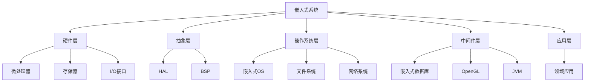

> 📌 **考试重点**：嵌入式系统的层次结构、特点和安全等级是常考知识点。

> 🔗 **真题关联**：2024年下半年第13题考查了嵌入式系统的特点。

---

## 计算机网络技术

计算机网络是利用通信线路将地理上分散的、具有独立功能的计算机系统和通信设备连接起来，依靠网络软件及通信协议实现资源共享和信息传递的系统[^19]。

**网络发展四阶段**：

1. **诞生阶段**（20世纪60年代中期前）：以单个计算机为中心的远程联机系统
2. **形成阶段**（60-70年代）：ARPANET兴起，形成通信子网与资源子网
3. **互联互通阶段**（70-90年代）：TCP/IP与OSI体系结构确立
4. **高速发展阶段**（90年代至今）：以Internet为代表的全球网络[^20]

**网络性能指标**：

- **速率**：数据传输速率，单位b/s
- **带宽**：网络的最大传输速率
- **吞吐量**：实际传输速率
- **时延**：数据从发送到接收的时间
- **往返时间（RTT）**：数据往返一次的时间

**网络分类**：

| 类型 | 覆盖范围 | 典型技术 |
|------|----------|----------|
| 局域网（LAN） | 几公里内 | 以太网、WiFi |
| 城域网（MAN） | 城市范围 | 光纤、WiMAX |
| 广域网（WAN） | 国家/全球 | Internet、SDH |

**通信技术**：

信道容量可通过**香农公式**计算：$C = B \times \log_2(1 + S/N)$，其中C为信道容量，B为带宽，S/N为信噪比[^21]。

**5G关键技术**：

- **OFDM优化波形**：提高频谱效率
- **大规模MIMO**：多天线技术
- **毫米波**：高频段通信
- **LDPC/Polar编码**：高效信道编码[^22]

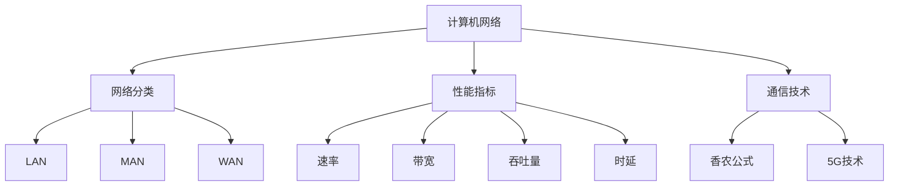

> 📌 **考试重点**：网络分类、性能指标和香农公式是核心考点。

> 🔗 **真题关联**：2022年下半年第14题考查了香农公式的应用。

---

## 计算机语言

计算机语言是人与计算机交流的工具，经历了从机器语言到高级语言的发展过程[^23]。

**计算机语言的分类**：

- **机器语言**：二进制代码，计算机直接执行
- **汇编语言**：符号化的机器语言，需要汇编
- **高级语言**：接近自然语言，需要编译或解释

**高级语言的特点**：

- **可移植性**：与硬件无关
- **可读性**：接近自然语言
- **可维护性**：易于修改和调试
- **高效性**：开发效率高

**程序设计语言的处理方式**：

| 方式 | 过程 | 特点 |
|------|------|------|
| 编译 | 源程序→目标程序→可执行程序 | 执行效率高 |
| 解释 | 逐条解释执行 | 开发调试方便 |
| 混合 | 编译+解释 | 兼顾效率和灵活性 |

**常见编程语言**：

- **过程式语言**：C、Pascal、Fortran
- **面向对象语言**：Java、C++、Python
- **函数式语言**：Lisp、Haskell
- **脚本语言**：JavaScript、Python、Shell

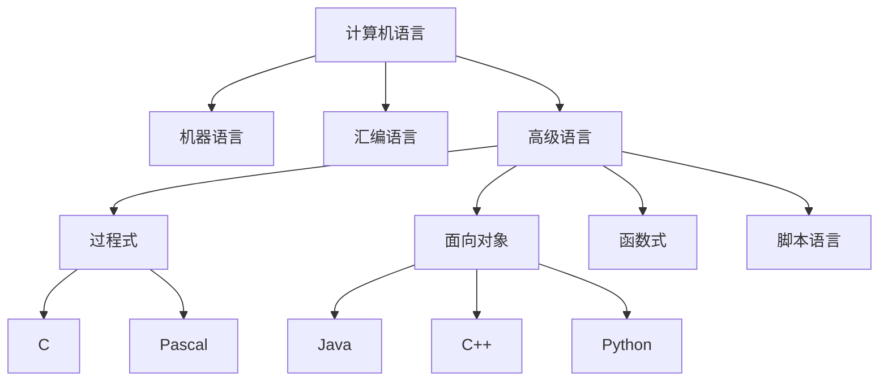

> 📌 **考试重点**：计算机语言的分类和高级语言的特点是基础考点。

> 🔗 **真题关联**：2023年上半年第15题考查了编程语言的分类。

---

## 多媒体技术

多媒体技术是指能够同时处理文本、图形、图像、音频、视频等多种媒体信息的技术[^24]。

**多媒体的特征**：

- **多样性**：多种媒体信息
- **集成性**：多种媒体集成处理
- **交互性**：用户与系统交互
- **实时性**：实时处理和传输

**多媒体关键技术**：

- **数据压缩技术**：JPEG、MPEG、H.264
- **存储技术**：CD、DVD、蓝光
- **传输技术**：流媒体、实时传输协议
- **显示技术**：LCD、LED、OLED

**多媒体数据压缩**：

| 标准 | 类型 | 应用 |
|------|------|------|
| JPEG | 图像压缩 | 静态图像 |
| MPEG-1 | 视频压缩 | VCD |
| MPEG-2 | 视频压缩 | DVD、数字电视 |
| MPEG-4 | 视频压缩 | 网络视频 |
| H.264 | 视频压缩 | 高清视频 |
| MP3 | 音频压缩 | 音乐 |

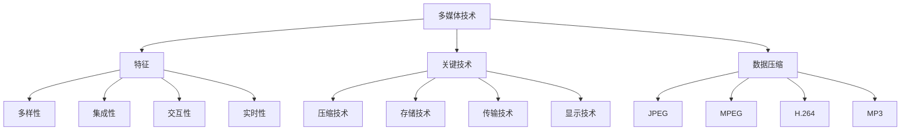

> 📌 **考试重点**：多媒体的特征和数据压缩标准是常考知识点。

> 🔗 **真题关联**：2024年上半年第16题考查了多媒体数据压缩标准。

---

## 系统工程

系统工程是组织管理系统的规划、研究、设计、制造、试验和使用的科学方法[^25]。

**系统工程的特点**：

- **整体性**：从整体角度考虑问题
- **综合性**：综合运用多种学科知识
- **最优性**：追求系统整体最优
- **实践性**：面向实际应用

**系统工程的方法**：

- **霍尔三维结构**：时间维、逻辑维、知识维
- **切克兰德方法论**：软系统方法论
- **并行工程**：并行设计、并行开发

**系统生命周期**：

**基于模型的系统工程（MBSE）**：

- 使用模型代替文档
- 支持系统全生命周期
- 提高设计质量和效率

> 📌 **考试重点**：系统工程的特点、方法和生命周期是常考知识点。

> 🔗 **真题关联**：2022年上半年第17题考查了系统工程的方法。

---

## 系统性能评估

系统性能包含**性能指标、性能计算、性能设计和性能评估**四个方面[^26]。

**主要性能指标**：

- **时钟频率（主频）**：CPU的工作频率
- **运算速度**：每秒执行的指令数
- **内存容量**：主存的存储容量
- **存取周期**：存储器完成一次读写的时间
- **吞吐率**：单位时间内处理的任务数
- **响应时间**：从请求到响应的时间
- **RASIS特性**：可靠性、可用性、可维护性、完整性和安全性[^27]

**性能计算方法**：

- **定义法**：根据定义直接计算
- **公式法**：使用公式计算
- **程序检测法**：通过程序测量
- **仪器检测法**：使用仪器测量

**常用性能指标**：

- **MIPS**：每秒百万条指令
- **MFLOPS**：每秒百万次浮点运算
- **峰值计算**：理论最大性能
- **等效指令速度**：吉普森法计算

**阿姆达尔定律**：

$$\text{加速比} = \frac{1}{(1 - \text{增强比例}) + \frac{\text{增强比例}}{\text{增强加速比}}}$$

该定律表明，系统性能提升程度取决于被改进部分在总执行时间中所占的比例[^28]。

**性能评估方法**：

- **基准测试程序**：真实程序、核心程序、小型基准程序、合成基准程序
- **常见基准测试**：Dhrystone、Linpack、SPEC、TPC

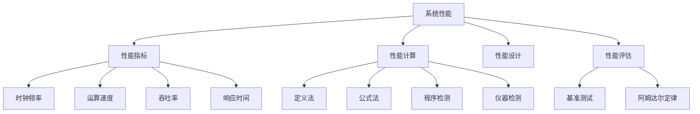

> 📌 **考试重点**：阿姆达尔定律、性能指标和基准测试是高频考点。

> 🔗 **真题关联**：2023年下半年第18题考查了阿姆达尔定律的应用。

---

## 参考文献

[^1]: 《系统架构设计师教程(第二版)》P.25 §2.1

[^2]: 《系统架构设计师教程(第二版)》P.25 §2.2.1

[^3]: 《系统架构设计师教程(第二版)》P.25 §2.2.1

[^4]: 《系统架构设计师教程(第二版)》P.25 §2.2.2

[^5]: 《系统架构设计师教程(第二版)》P.26 §2.2.3

[^6]: 《系统架构设计师教程(第二版)》P.27 §2.2.3

[^7]: 《系统架构设计师教程(第二版)》P.28 §2.2.4

[^8]: 《系统架构设计师教程(第二版)》P.29 §2.2.5

[^9]: 《系统架构设计师教程(第二版)》P.28 §2.3.2

[^10]: 《系统架构设计师教程(第二版)》P.29-30 §2.3.2

[^11]: 《系统架构设计师教程(第二版)》P.30 §2.3.2

[^12]: 《系统架构设计师教程(第二版)》P.31 §2.3.2

[^13]: 《系统架构设计师教程(第二版)》P.32 §2.3.2

[^14]: 《系统架构设计师教程(第二版)》P.33 §2.3.3

[^15]: 《系统架构设计师教程(第二版)》P.34 §2.3.4

[^16]: 《系统架构设计师教程(第二版)》P.47-48 §2.4.1

[^17]: 《系统架构设计师教程(第二版)》P.49-50 §2.4.3

[^18]: 《系统架构设计师教程(第二版)》P.52-53 §2.4.4

[^19]: 《系统架构设计师教程(第二版)》P.56 §2.5

[^20]: 《系统架构设计师教程(第二版)》P.56-57 §2.5.1

[^21]: 《系统架构设计师教程(第二版)》P.60 §2.5.2

[^22]: 《系统架构设计师教程(第二版)》P.61-62 §2.5.2

[^23]: 《系统架构设计师教程(第二版)》P.63 §2.6

[^24]: 《系统架构设计师教程(第二版)》P.65 §2.7

[^25]: 《系统架构设计师教程(第二版)》P.67 §2.8

[^26]: 《系统架构设计师教程(第二版)》P.101 §2.9

[^27]: 《系统架构设计师教程(第二版)》P.101 §2.9.1

[^28]: 《系统架构设计师教程(第二版)》P.102-103 §2.9.3
