# 第3章 信息系统基础知识

本章涵盖信息系统的基础理论、主要类型、生命周期、开发方法及典型架构模型，是系统架构设计师考试综合知识部分的重要章节。

---

## 信息系统定义与组成

信息系统（Information System, IS）是由**计算机硬件、网络和通信设备、计算机软件、信息资源、信息用户和规章制度**组成的，以处理信息流为目的的人机一体化系统[^1]。现代信息系统总是与计算机技术和互联网技术的应用联系在一起。

信息系统具有五个基本功能：

- **输入功能**：决定于系统所要达到的目的及系统的能力
- **存储功能**：系统存储各种信息资料和数据的能力
- **处理功能**：基于数据仓库技术的联机分析处理（OLAP）和数据挖掘（DM）
- **输出功能**：保证最终实现最佳的输出效果
- **控制功能**：对信息处理设备进行控制和管理[^2]

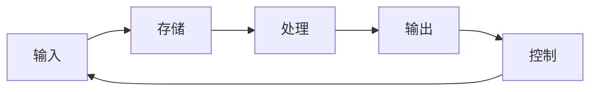

> 📌 **考试重点**：牢记信息系统的五个基本功能（输入、存储、处理、输出、控制），常考多选题。

> 🔗 **真题关联**：2021年综合知识第12题考查信息系统基本功能组成。

---

## 诺兰模型

1979年，美国专家诺兰（Richard L. Nolan）提出了著名的**诺兰模型**，将计算机信息系统的发展划分为六个阶段[^3]：

| 阶段 | 名称 | 特征 |
|------|------|------|
| 1 | 初始阶段 | 初步引入计算机，应用单一 |
| 2 | 传播阶段 | 应用推广，但缺乏规划 |
| 3 | 控制阶段 | 开始控制，出现瓶颈 |
| 4 | 集成阶段 | 统一规划，数据共享 |
| 5 | 数据管理阶段 | 数据成为企业资源 |
| 6 | 成熟阶段 | 信息系统与业务完全融合 |

前三个阶段具有**计算机时代**的特征，后三个阶段具有**信息时代**的特征。

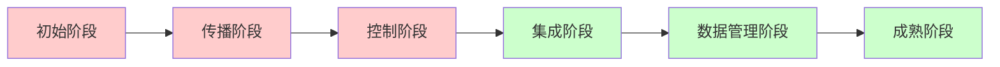

> 📌 **考试重点**：诺兰六阶段的顺序和划分（前三阶段为计算机时代，后三阶段为信息时代），是高频考点。

> 🔗 **真题关联**：2022年综合知识第15题考查诺兰模型阶段划分；2020年考查诺兰模型中"控制阶段"的特征描述。

---

## 信息系统分类

信息系统按发展特点可分为五大类[^4]：

1. **业务处理系统（TPS）**：处理日常事务
2. **管理信息系统（MIS）**：面向管理决策
3. **决策支持系统（DSS）**：辅助半结构化/非结构化决策
4. **专家系统（ES）**：模拟专家知识推理
5. **办公自动化系统（OAS）**：支持日常办公活动

此外，企业资源规划（ERP）是集成化的企业级信息系统，涵盖了上述多种系统的功能。

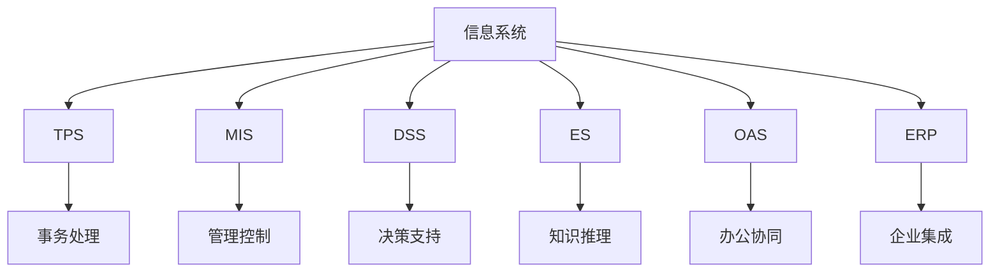

> 📌 **考试重点**：五种信息系统类型的英文缩写和核心功能区分，ERP是集成化系统而非独立类型。

> 🔗 **真题关联**：2023年综合知识考查MIS与DSS的功能区别；2021年考查TPS的数据处理周期。

---

## 业务处理系统（TPS）

业务处理系统（Transaction Processing System, TPS）是计算机在管理方面早期应用的最初级形式的信息系统，自20世纪50至60年代开始获得广泛应用[^5]。TPS针对管理中具体的事务（如财会、销售、库存等）辅助管理人员进行数据记录、传票、记账、统计和分类，并制成报表。

TPS的数据处理周期由五个阶段构成[^6]：

1. **数据输入**：常见方式有人工输入、自动输入（POS终端、OCR、ATM、扫描仪等）及二者结合
2. **数据处理**：分为**批处理（Batch Processing）**和**联机事务处理（OLTP）**
3. **数据库维护**：确保数据及时正确反映经营状况
4. **文件报表生成**：包括行动文件、信息文件和周转文件
5. **查询处理**：支持批次查询或联机实时查询

批处理方式适合大量事务的定期处理，经济高效但无法满足实时查询；OLTP能即时更新数据库并响应查询，但成本较高且需要容错机制[^7]。

TPS是其他类型信息系统的信息产生器，是连接企业与外部环境的"桥梁"[^8]。

> 📌 **考试重点**：TPS数据处理周期的五个阶段，批处理与OLTP的优缺点对比。

> 🔗 **真题关联**：2022年综合知识考查批处理与OLTP的适用场景；2020年考查TPS作为"信息产生器"的定位。

---

## 管理信息系统（MIS）

管理信息系统（Management Information System, MIS）是在TPS基础上引进大量管理方法对企业整体信息进行处理，并利用信息进行预测、控制、计划，辅助企业全面管理的信息系统[^9]。MIS是一个高度集成化的人机信息系统，是企业信息系统中应用最为成功的分支。

MIS由四大部件组成：

- **信息源**
- **信息处理器**
- **信息用户**
- **信息管理者**

根据各部件联系可分为**开环结构**（执行决策过程中不收集外部信息）和**闭环结构**（决策过程中不断收集信息并调整决策）[^10]。

从管理层次看，MIS呈现金字塔式结构：

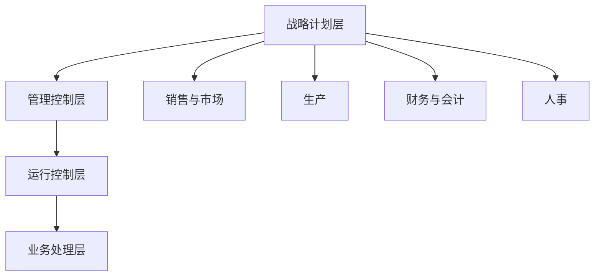

MIS包含多个职能子系统[^11]：

- 销售市场子系统
- 生产子系统
- 后勤子系统
- 人事子系统
- 财务和会计子系统
- 信息处理子系统
- 高层管理子系统

> 📌 **考试重点**：MIS的四大组成部件、开环/闭环结构区别、金字塔式管理层次结构。

> 🔗 **真题关联**：2023年综合知识考查MIS开环结构与闭环结构的区别；2021年考查MIS职能子系统组成。

---

## 决策支持系统（DSS）

决策支持系统（Decision Support System, DSS）是能帮助决策者利用数据和模型去解决**半结构化问题和非结构化问题**的交互式系统[^12]。DSS的概念于20世纪70年代中期首次提出，80年代增加了知识库与方法库，90年代后与人工智能技术结合形成智能决策支持系统。

DSS的基本特征包括[^13]：

- 数据和模型是DSS的主要资源
- DSS用来**支援**用户作决策，而不是**代替**用户作决策
- 主要用于解决**半结构化及非结构化问题**
- 作用在于提高决策的**有效性**

DSS的基本结构形式包括**两库结构**（数据库子系统、模型库子系统和对话子系统）和基于知识的结构。其功能包括[^14]：

- 整理和提供与决策问题相关的数据
- 收集外部信息
- 提供反馈信息
- 存储和管理决策模型
- 支持数据加工和预测
- 提供人机对话接口

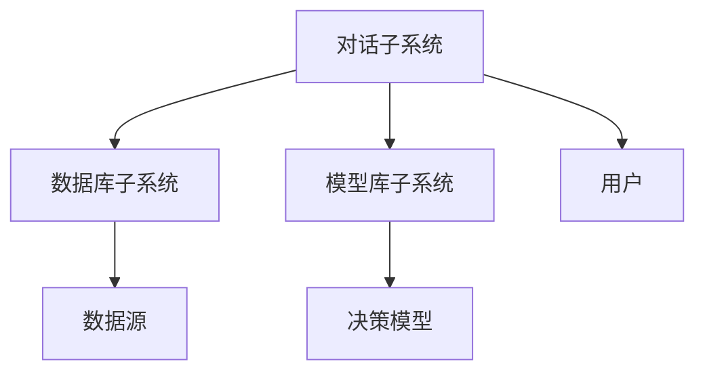

数据仓库和数据挖掘技术是DSS的重要组成部分。数据挖掘的结果类型包括联合、定序、分类和聚类等[^15]。

> 📌 **考试重点**：DSS的核心特征——"支援而非代替"决策、解决半结构化/非结构化问题、两库结构组成。

> 🔗 **真题关联**：2022年综合知识第18题考查DSS基本特征；2021年考查DSS与MIS的功能区别；2020年考查数据挖掘结果类型。

---

## 专家系统（ES）

专家系统（Expert System, ES）是一种模拟人类专家知识和推理过程的智能计算机程序系统[^16]。ES能够利用专家的知识和经验，通过推理来解决复杂问题。

ES的基本组成包括：

- **知识库**：存储领域专家的知识和经验
- **推理机**：负责知识推理和问题解决
- **综合数据库**：存放推理过程中的事实和中间结果
- **知识获取模块**：支持知识的获取和更新
- **解释模块**：解释推理过程和结论
- **人机接口**：提供用户交互界面

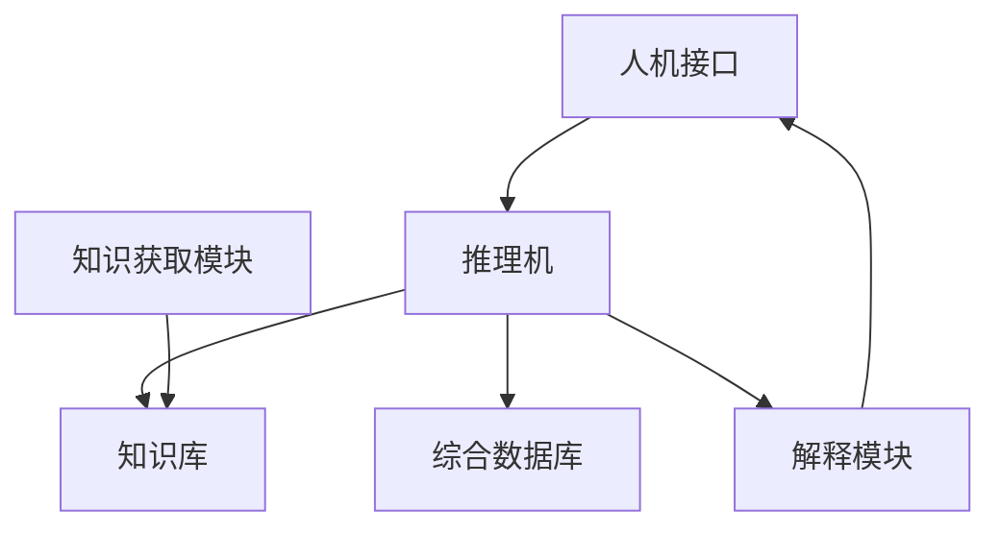

ES与DSS的区别：ES主要解决需要专家知识的**定性问题**，而DSS主要解决需要数据和模型的**定量问题**。

> 📌 **考试重点**：ES的六大组成部分，ES与DSS的核心区别（定性vs定量）。

> 🔗 **真题关联**：2023年综合知识考查ES与DSS的区别；2021年考查专家系统知识库的作用。

---

## 办公自动化系统（OAS）

办公自动化系统（Office Automation System, OAS）是支持日常办公活动的信息系统，主要功能包括[^17]：

- **文字处理**：文档编辑、排版、打印
- **电子表格**：数据统计、计算、分析
- **电子邮件**：信息传递和沟通
- **日程管理**：会议安排、任务提醒
- **文档管理**：文件存储、检索、共享
- **工作流管理**：审批流程、协同办公

OAS的发展趋势是从传统的单机办公向**网络化协同办公**演进，支持移动办公和远程协作。

> 📌 **考试重点**：OAS的基本功能模块，网络化协同办公的发展趋势。

> 🔗 **真题关联**：2020年综合知识考查OAS的主要功能组成。

---

## 企业资源规划（ERP）

企业资源规划（Enterprise Resource Planning, ERP）由美国Gartner Group公司于1990年提出，是企业在生产制造过程中普遍使用的信息系统，是企业制造资源规划（MRP II）的下一代系统[^18]。

ERP的核心是对企业的**"三流"资源**——**物流、资金流和信息流**进行全面集成管理。ERP建立在信息技术基础上，利用现代企业的先进管理思想，全面集成企业的所有资源信息，为企业提供决策、计划、控制与经营业绩评估的全方位管理平台[^19]。

ERP主要包括11个基本模块[^20]：

1. 生产预测
2. 销售管理
3. 经营计划
4. 主生产计划
5. 物料需求计划
6. 能力需求计划
7. 车间作业计划
8. 采购与库存管理
9. 质量与设备管理
10. 财务管理
11. 扩展应用模块（客户关系管理、供应链管理、电子商务等）

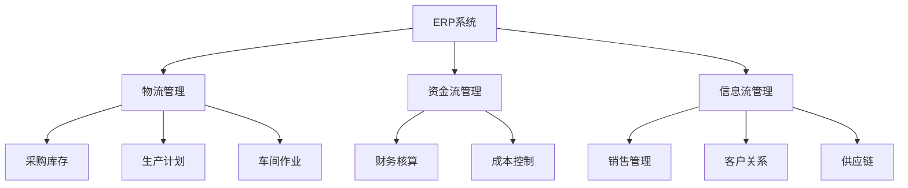

ERP的功能包括[^21]：

- 支持决策（实现全球多工厂跨国经营运作）
- 为不同行业提供针对性IT解决方案
- 从企业内部供应链发展为全行业和跨行业供应链

> 📌 **考试重点**：ERP的"三流"核心概念（物流、资金流、信息流），ERP与MRP II的演进关系，11个基本模块。

> 🔗 **真题关联**：2023年综合知识第20题考查ERP核心管理对象；2022年考查ERP与MRP II的关系；2021年考查ERP三大流的具体内容。

---

## 信息系统生命周期

信息系统的生命周期通常划分为五个阶段[^22]：

1. **系统规划阶段**：确定系统目标、范围和可行性
2. **系统分析阶段**：需求分析、功能分析、数据分析
3. **系统设计阶段**：总体设计、详细设计、数据库设计
4. **系统实施阶段**：编程、测试、数据转换、人员培训
5. **系统运行和维护阶段**：日常运行、系统维护、评价改进

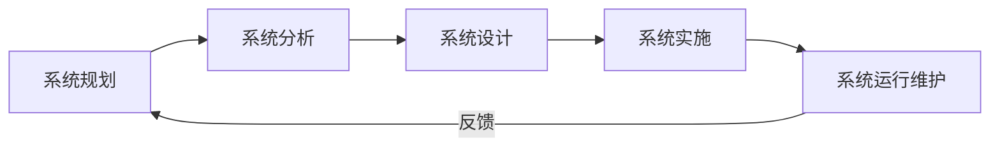

> 📌 **考试重点**：信息系统生命周期的五个阶段及其顺序，各阶段的主要任务。

> 🔗 **真题关联**：2022年综合知识考查信息系统生命周期各阶段任务划分；2020年考查系统分析阶段的主要工作内容。

---

## 信息系统开发方法

信息系统的主要开发方法包括[^23]：

### 结构化方法

- 强调**自顶向下**、逐步求精
- 面向**功能**进行分解
- 阶段清晰、文档规范
- 适合需求明确的大型系统

### 面向对象方法

- 以**对象**为基本单位
- 强调封装、继承、多态
- 适合复杂、易变的系统
- 主流方法包括UML建模

### 原型化方法

- 快速构建**原型**系统
- 用户参与、迭代完善
- 适合需求不明确的系统
- 分为抛弃式原型和演化式原型

### 敏捷开发方法

- 强调**迭代**、增量交付
- 以人为本、拥抱变化
- 适合需求变化快的项目
- 包括Scrum、XP等方法

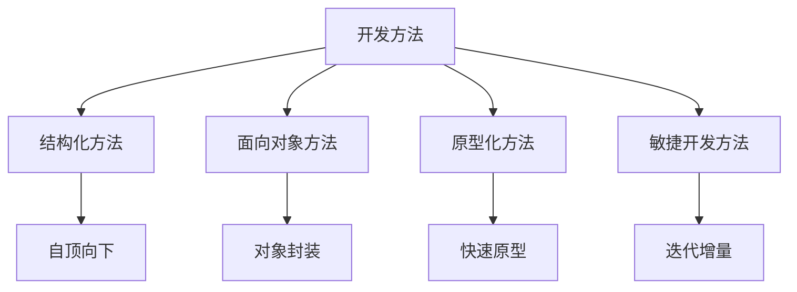

> 📌 **考试重点**：四种开发方法的核心特征和适用场景，结构化方法的"自顶向下"特征，原型化方法的分类。

> 🔗 **真题关联**：2023年综合知识考查原型化方法的适用场景；2022年考查结构化方法的特点；2021年考查敏捷开发方法的核心价值观。

---

## 信息系统建设原则

信息系统建设应遵循以下基本原则[^24]：

- **高层管理人员介入原则**：高层领导参与是系统成功的关键
- **用户参与开发原则**：用户是系统的最终使用者，应全程参与
- **自顶向下规划原则**：先进行总体规划，再逐步实施
- **工程化原则**：采用工程化的方法进行开发和管理
- **创新性原则**：鼓励技术创新和管理创新
- **整体性原则**：系统各部分协调一致，整体最优
- **发展性原则**：系统应具有可扩展性和可维护性
- **经济性原则**：追求投入产出比最大化
- **开放性原则**：系统应具有开放性和标准化接口

> 📌 **考试重点**：高层管理人员介入和用户参与是系统成功的两个关键原则。

> 🔗 **真题关联**：2022年综合知识考查信息系统建设的首要原则；2020年考查用户参与开发的重要性。

---

## 电子政务

电子政务是指政府机构利用信息技术手段，实现政府管理和服务的电子化、网络化[^25]。电子政务的主要类型包括：

| 类型 | 英文缩写 | 描述 |
|------|----------|------|
| 政府间电子政务 | G2G | 政府与政府之间的电子政务 |
| 政府对公务员 | G2E | 政府对政府雇员的管理 |
| 政府对公民 | G2C | 政府为公民提供的服务 |
| 政府对企业 | G2B | 政府为企业提供的监管和服务 |

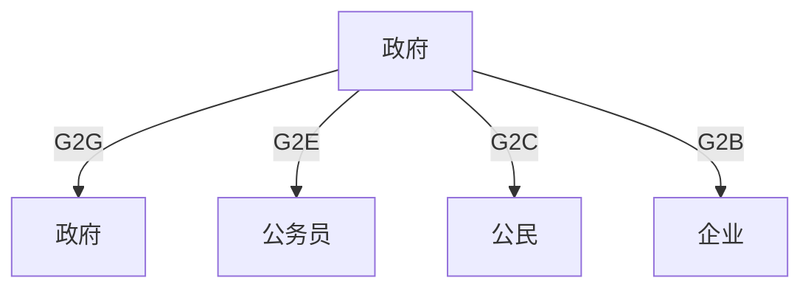

电子政务的发展阶段包括：

1. **起步阶段**：政府信息发布
2. **单向互动阶段**：提供下载服务
3. **双向互动阶段**：在线表单提交
4. **在线处理阶段**：事务在线办理
5. **无缝集成阶段**：跨部门协同服务

> 📌 **考试重点**：电子政务四种类型（G2G/G2E/G2C/G2B）的英文缩写和含义，发展阶段划分。

> 🔗 **真题关联**：2023年综合知识考查G2C的具体应用场景；2022年考查电子政务发展阶段的特征。

---

## 电子商务

电子商务是指利用互联网等电子手段进行的商务活动[^26]。电子商务的主要类型包括：

| 类型 | 英文缩写 | 描述 |
|------|----------|------|
| 企业对企业 | B2B | 企业之间的电子商务交易 |
| 企业对消费者 | B2C | 企业直接面向消费者的销售 |
| 消费者对消费者 | C2C | 消费者之间的交易（如拍卖平台） |
| 企业对政府 | B2G | 企业与政府之间的电子商务 |
| 消费者对政府 | C2G | 消费者与政府之间的电子政务 |

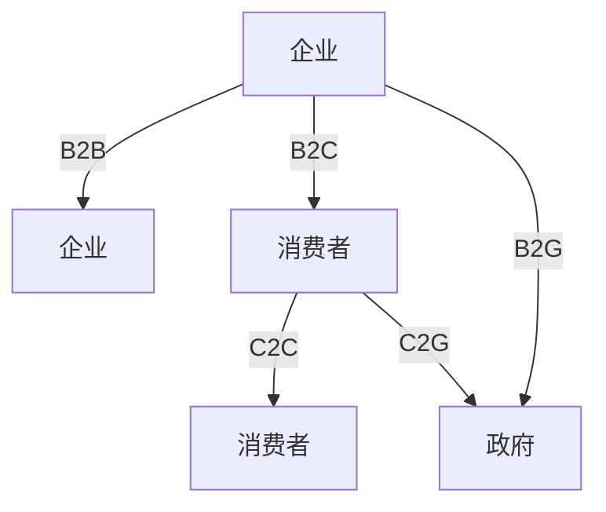

电子商务系统的基本组成包括：

- **网络平台**：互联网、内联网、外联网
- **支付系统**：电子支付、网上银行
- **安全认证**：数字证书、加密技术
- **物流配送**：仓储、运输、配送
- **法律法规**：电子签名法、消费者权益保护

> 📌 **考试重点**：电子商务五种类型（B2B/B2C/C2C/B2G/C2G）的区分，电子商务系统的基本组成。

> 🔗 **真题关联**：2022年综合知识考查B2B与B2C的区别；2021年考查电子商务系统的安全认证机制。

---

## 客户关系管理（CRM）

客户关系管理（Customer Relationship Management, CRM）是一种以客户为中心的企业管理理念和信息系统[^27]。CRM的核心目标是通过提高客户满意度和忠诚度，实现企业利润最大化。

CRM系统的主要功能模块包括：

- **销售自动化（SFA）**：管理销售流程、机会跟踪
- **营销自动化**：营销活动管理、线索培育
- **客户服务与支持**：呼叫中心、服务工单管理
- **客户数据分析**：客户细分、价值分析、预测模型

CRM与ERP的关系：ERP主要关注**企业内部资源**的管理，CRM主要关注**企业外部客户**的关系管理。两者相互补充，共同构成企业信息化的核心系统。

> 📌 **考试重点**：CRM的核心功能模块，CRM与ERP的区别和互补关系。

> 🔗 **真题关联**：2021年综合知识考查CRM系统的功能模块；2020年考查CRM与ERP的集成关系。

---

## 供应链管理（SCM）

供应链管理（Supply Chain Management, SCM）是对从原材料采购到产品交付给最终用户的全过程进行计划、协调、执行和控制的管理方法[^28]。

SCM的核心流程包括：

- **计划**：需求预测、供应计划
- **采购**：供应商选择、采购执行
- **制造**：生产计划、质量控制
- **配送**：仓储管理、物流运输
- **退货**：退货处理、售后服务

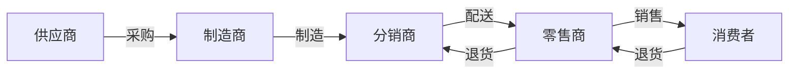

SCM与ERP的关系：ERP是SCM的**信息基础**，SCM是ERP在**供应链领域**的延伸和深化。

> 📌 **考试重点**：SCM的五大核心流程，SCM与ERP的关系。

> 🔗 **真题关联**：2022年综合知识考查SCM的核心流程；2020年考查供应链管理的信息化支撑系统。

---

## 信息系统典型架构模型

信息系统的典型架构模型包括[^29]：

### 主机/终端架构

- 早期集中式架构
- 所有计算在主机完成
- 终端仅负责输入输出
- 维护简单但扩展性差

### 客户机/服务器架构（C/S）

- 客户端负责界面和部分逻辑
- 服务器负责数据存储和核心业务
- 分为两层C/S和三层C/S
- 适合局域网环境

### 浏览器/服务器架构（B/S）

- 客户端只需浏览器
- 应用逻辑集中在服务器
- 维护成本低、扩展性好
- 适合互联网应用

### 多层分布式架构

- 表现层、业务层、数据层分离
- 支持负载均衡和集群部署
- 适合大规模企业应用
- 微服务架构是其演进形式

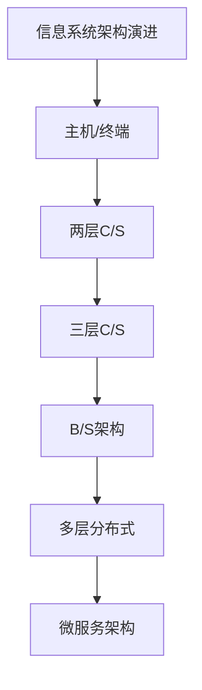

> 📌 **考试重点**：四种架构模型的特点和演进关系，C/S与B/S架构的区别和适用场景。

> 🔗 **真题关联**：2023年综合知识考查B/S架构的特点；2022年考查三层C/S架构的层次划分；2021年考查信息系统架构的演进趋势。

---

## 信息系统安全与可靠性

信息系统安全是指保护信息系统及其资源免受未经授权的访问、使用、披露、破坏、修改或销毁[^30]。

信息系统安全的主要目标包括：

- **机密性（Confidentiality）**：防止未授权的信息泄露
- **完整性（Integrity）**：防止未授权的数据修改
- **可用性（Availability）**：确保系统及时可靠地提供服务
- **可控性（Controllability）**：对信息和系统的安全可控
- **不可否认性（Non-repudiation）**：防止通信双方否认其行为

信息系统可靠性是指系统在规定的条件下和规定的时间内完成规定功能的能力。提高信息系统可靠性的主要措施包括：

- **冗余设计**：硬件冗余、数据冗余、通信冗余
- **容错技术**：故障检测、故障恢复、故障隔离
- **备份恢复**：定期备份、灾难恢复计划
- **安全审计**：日志记录、行为分析

> 📌 **考试重点**：信息系统安全的五大目标（机密性、完整性、可用性、可控性、不可否认性），可靠性保障措施。

> 🔗 **真题关联**：2023年综合知识考查信息系统安全目标；2022年考查冗余设计在可靠性保障中的作用。

---

## 参考文献

[^1]: 《系统架构设计师教程(第二版)》P.105 §3.1.1

[^2]: 《系统架构设计师教程(第二版)》P.105 §3.1.1

[^3]: 《系统架构设计师教程(第二版)》P.106-107 §3.1.2

[^4]: 《系统架构设计师教程(第二版)》P.107-108 §3.1.3

[^5]: 《系统架构设计师教程(第二版)》P.114 §3.2

[^6]: 《系统架构设计师教程(第二版)》P.115-116 §3.2.2

[^7]: 《系统架构设计师教程(第二版)》P.117 §3.2.2

[^8]: 《系统架构设计师教程(第二版)》P.118 §3.2.3

[^9]: 《系统架构设计师教程(第二版)》P.119 §3.3

[^10]: 《系统架构设计师教程(第二版)》P.119-120 §3.3.1

[^11]: 《系统架构设计师教程(第二版)》P.121-122 §3.3.3

[^12]: 《系统架构设计师教程(第二版)》P.123 §3.4

[^13]: 《系统架构设计师教程(第二版)》P.124 §3.4.1

[^14]: 《系统架构设计师教程(第二版)》P.125 §3.4.2

[^15]: 《系统架构设计师教程(第二版)》P.126-127 §3.4.4

[^16]: 《系统架构设计师教程(第二版)》P.128-129 §3.5

[^17]: 《系统架构设计师教程(第二版)》P.130-131 §3.6

[^18]: 《系统架构设计师教程(第二版)》P.136 §3.7

[^19]: 《系统架构设计师教程(第二版)》P.136 §3.7.1

[^20]: 《系统架构设计师教程(第二版)》P.136-138 §3.7.2

[^21]: 《系统架构设计师教程(第二版)》P.139 §3.7.3

[^22]: 《系统架构设计师教程(第二版)》P.140-142 §3.8

[^23]: 《系统架构设计师教程(第二版)》P.142-145 §3.8.1

[^24]: 《系统架构设计师教程(第二版)》P.145-146 §3.8.2

[^25]: 《系统架构设计师教程(第二版)》P.147-149 §3.8.3

[^26]: 《系统架构设计师教程(第二版)》P.149-151 §3.8.4

[^27]: 《系统架构设计师教程(第二版)》P.151-152 §3.8.5

[^28]: 《系统架构设计师教程(第二版)》P.152-153 §3.8.6

[^29]: 《系统架构设计师教程(第二版)》P.153-155 §3.8.7

[^30]: 《系统架构设计师教程(第二版)》P.155-157 §3.8.8
