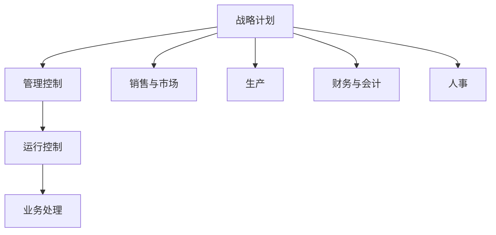

## 信息系统定义

信息系统（Information System, IS）是由计算机硬件、网络和通信设备、计算机软件、信息资源、信息用户和规章制度组成的，以处理信息流为目的的人机一体化系统[^1]。现代信息系统总是与计算机技术和互联网技术的应用联系在一起。

信息系统具有五个基本功能：

- **输入功能**：决定于系统所要达到的目的及系统的能力
- **存储功能**：系统存储各种信息资料和数据的能力
- **处理功能**：基于数据仓库技术的联机分析处理（OLAP）和数据挖掘（DM）
- **输出功能**：保证最终实现最佳的输出效果
- **控制功能**：对信息处理设备进行控制和管理[^2]

1979年，美国专家诺兰（Richard L. Nolan）提出了著名的**诺兰模型**，将计算机信息系统的发展划分为六个阶段：初始阶段、传播阶段、控制阶段、集成阶段、数据管理阶段和成熟阶段。前三个阶段具有计算机时代的特征，后三个阶段具有信息时代的特征[^3]。

信息系统按发展特点可分为业务处理系统（TPS）、管理信息系统（MIS）、决策支持系统（DSS）、专家系统（ES）和办公自动化系统（OAS）等五类[^4]。

---

## 业务处理系统(TPS)

业务处理系统（Transaction Processing System, TPS）是计算机在管理方面早期应用的最初级形式的信息系统，自20世纪50至60年代开始获得广泛应用[^5]。TPS针对管理中具体的事务（如财会、销售、库存等）辅助管理人员进行数据记录、传票、记账、统计和分类，并制成报表。

TPS的数据处理周期由五个阶段构成：

1. **数据输入**：常见方式有人工输入、自动输入（POS终端、OCR、ATM、扫描仪等）及二者结合
2. **数据处理**：分为批处理（Batch Processing）和联机事务处理（OLTP）
3. **数据库维护**：确保数据及时正确反映经营状况
4. **文件报表生成**：包括行动文件、信息文件和周转文件
5. **查询处理**：支持批次查询或联机实时查询[^6]

批处理方式适合大量事务的定期处理，经济高效但无法满足实时查询；OLTP能即时更新数据库并响应查询，但成本较高且需要容错机制[^7]。

TPS是其他类型信息系统的信息产生器，是连接企业与外部环境的"桥梁"[^8]。

---

## 管理信息系统(MIS)

管理信息系统（Management Information System, MIS）是在TPS基础上引进大量管理方法对企业整体信息进行处理，并利用信息进行预测、控制、计划，辅助企业全面管理的信息系统[^9]。MIS是一个高度集成化的人机信息系统，是企业信息系统中应用最为成功的分支。

MIS由四大部件组成：信息源、信息处理器、信息用户和信息管理者。根据各部件联系可分为**开环结构**（执行决策过程中不收集外部信息）和**闭环结构**（决策过程中不断收集信息并调整决策）[^10]。

从管理层次看，MIS呈现金字塔式结构：

MIS包含多个职能子系统：销售市场子系统、生产子系统、后勤子系统、人事子系统、财务和会计子系统、信息处理子系统和高层管理子系统[^11]。

---

## 决策支持系统(DSS)

决策支持系统（Decision Support System, DSS）是能帮助决策者利用数据和模型去解决**半结构化问题和非结构化问题**的交互式系统[^12]。DSS的概念于20世纪70年代中期首次提出，80年代增加了知识库与方法库，90年代后与人工智能技术结合形成智能决策支持系统。

DSS的基本特征包括：

- 数据和模型是DSS的主要资源
- DSS用来支援用户作决策，而不是代替用户作决策
- 主要用于解决半结构化及非结构化问题
- 作用在于提高决策的有效性[^13]

DSS的基本结构形式包括**两库结构**（数据库子系统、模型库子系统和对话子系统）和基于知识的结构。其功能包括：整理和提供与决策问题相关的数据、收集外部信息、提供反馈信息、存储和管理决策模型、支持数据加工和预测、提供人机对话接口等[^14]。

数据仓库和数据挖掘技术是DSS的重要组成部分。数据挖掘的结果类型包括联合、定序、分类和聚类等[^15]。

---

## 企业资源规划(ERP)

企业资源规划（Enterprise Resource Planning, ERP）由美国Gartner Group公司于1990年提出，是企业在生产制造过程中普遍使用的信息系统，是企业制造资源规划（MRP II）的下一代系统[^16]。

ERP的核心是对企业的"三流"资源——**物流、资金流和信息流**进行全面集成管理。ERP建立在信息技术基础上，利用现代企业的先进管理思想，全面集成企业的所有资源信息，为企业提供决策、计划、控制与经营业绩评估的全方位管理平台[^17]。

ERP主要包括11个基本模块：生产预测、销售管理、经营计划、主生产计划、物料需求计划、能力需求计划、车间作业计划、采购与库存管理、质量与设备管理、财务管理以及扩展应用模块（客户关系管理、供应链管理、电子商务等）[^18]。

ERP的功能包括：支持决策（实现全球多工厂跨国经营运作）、为不同行业提供针对性IT解决方案、从企业内部供应链发展为全行业和跨行业供应链[^19]。

---

## 参考文献

[^1]: 《系统架构设计师教程(第二版)》P.105 §3.1.1

[^2]: 《系统架构设计师教程(第二版)》P.105 §3.1.1

[^3]: 《系统架构设计师教程(第二版)》P.106-107 §3.1.2

[^4]: 《系统架构设计师教程(第二版)》P.107-108 §3.1.3

[^5]: 《系统架构设计师教程(第二版)》P.114 §3.2

[^6]: 《系统架构设计师教程(第二版)》P.115-116 §3.2.2

[^7]: 《系统架构设计师教程(第二版)》P.117 §3.2.2

[^8]: 《系统架构设计师教程(第二版)》P.118 §3.2.3

[^9]: 《系统架构设计师教程(第二版)》P.119 §3.3

[^10]: 《系统架构设计师教程(第二版)》P.119-120 §3.3.1

[^11]: 《系统架构设计师教程(第二版)》P.121-122 §3.3.3

[^12]: 《系统架构设计师教程(第二版)》P.123 §3.4

[^13]: 《系统架构设计师教程(第二版)》P.124 §3.4.1

[^14]: 《系统架构设计师教程(第二版)》P.125 §3.4.2

[^15]: 《系统架构设计师教程(第二版)》P.126-127 §3.4.4

[^16]: 《系统架构设计师教程(第二版)》P.136 §3.7

[^17]: 《系统架构设计师教程(第二版)》P.136 §3.7.1

[^18]: 《系统架构设计师教程(第二版)》P.136-138 §3.7.2

[^19]: 《系统架构设计师教程(第二版)》P.139 §3.7.3
