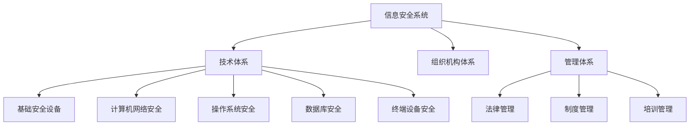
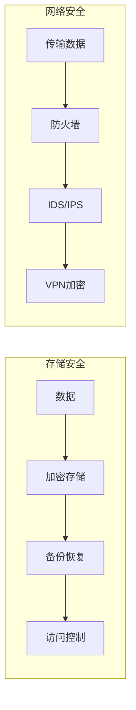
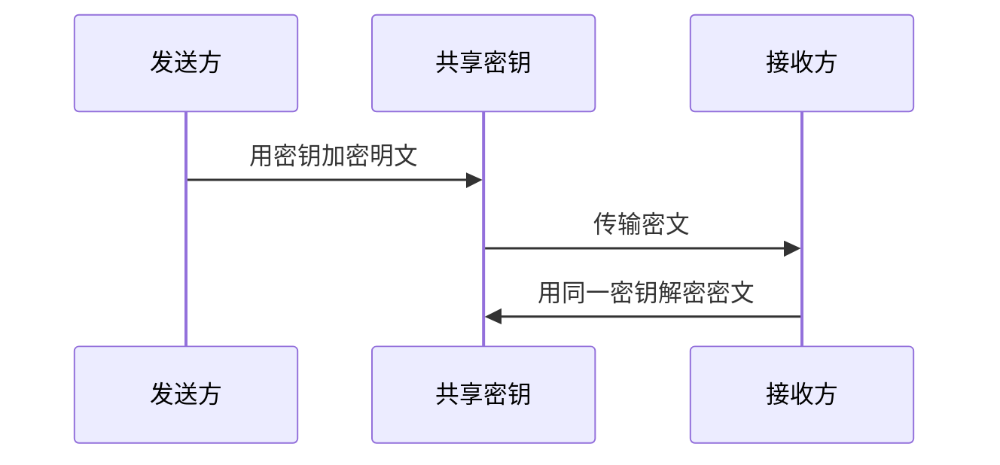
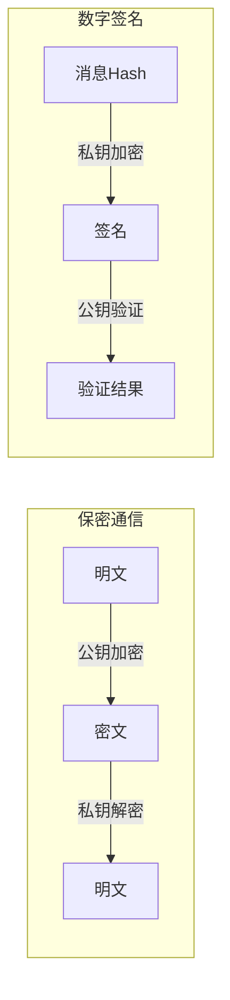
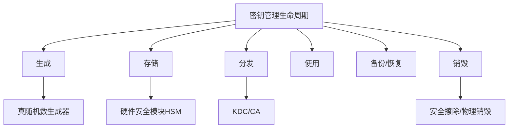
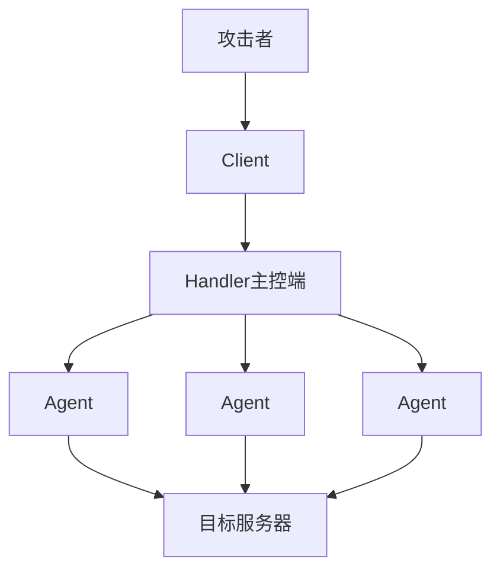
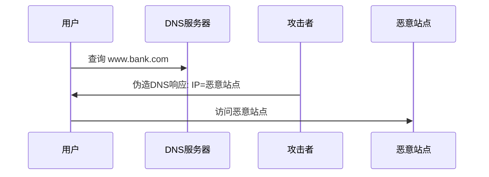
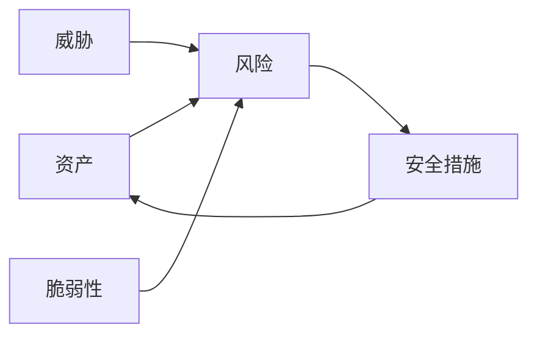
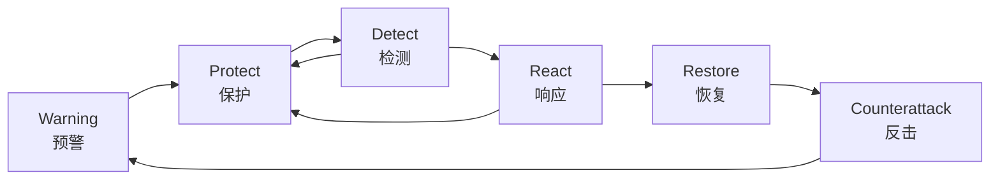
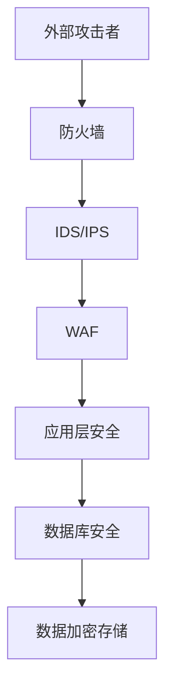

# 第4章 信息安全技术基础知识

本章涵盖信息安全的基本概念、密码学技术、访问控制、数字签名、安全攻击与防御、以及信息安全保障体系等核心内容。在系统架构设计师考试中，信息安全是综合知识和案例分析的高频考点，分值权重较高。

---

## 信息安全五要素与基本概念

信息安全包括**五个基本要素**：机密性、完整性、可用性、可控性与可审查性[^1]。

- **机密性**：确保信息不暴露给未授权的实体或进程。通过加密、访问控制等技术实现。
- **完整性**：只有得到允许的人才能修改数据，并且能够判别出数据是否已被篡改。通过哈希、数字签名等技术实现。
- **可用性**：得到授权的实体在需要时可访问数据。通过冗余、备份、容灾等技术实现。
- **可控性**：可以控制授权范围内的信息流向及行为方式。通过审计、监控等技术实现。
- **可审查性**：对出现的信息安全问题提供调查的依据和手段。通过日志、审计追踪等技术实现。

信息安全的范围包括**设备安全、数据安全、内容安全和行为安全**。其中数据安全又包括数据的秘密性、完整性和可用性三个方面。

> 📌 **考试重点**：五要素（CIA+可控性+可审查性）是必考内容，常与系统质量属性（可靠性、可维护性等）混淆考查。注意区分：CIA 是安全三要素，加上可控性和可审查性构成五要素。
>
> 🔗 **真题关联**：2022年综合知识第15题考查"信息安全的基本要素不包括哪一项"；2021年案例分析要求分析某系统的安全架构缺陷。

---

## 信息安全系统的组成框架

信息安全系统的组成框架通常由**技术体系、组织机构体系和管理体系**共同构建[^2]。

技术体系涉及基础安全设备、计算机网络安全、操作系统安全、数据库安全和终端设备安全等多方面技术。管理体系由法律管理、制度管理和培训管理三部分组成，所谓"三分技术，七分管理"。

> 📌 **考试重点**："三分技术，七分管理"是经典表述，常出现在选择题中。三个体系的名称和组成必须准确记忆。
>
> 🔗 **真题关联**：2023年综合知识考查"信息安全管理体系不包括以下哪项"；案例分析中常要求从三个维度分析安全架构设计。

---

## 信息存储与网络安全

信息存储安全是指信息在静态存放状态下的安全，包括存储介质安全、存储访问安全、存储内容安全等。信息网络安全是指信息在传输过程中的安全，包括传输安全、网络边界安全、网络设备安全等。

数据存储安全的关键技术包括：
- **数据加密存储**：防止非授权访问存储介质，即使物理介质被盗也无法读取数据
- **数据备份与恢复**：定期备份数据，确保在灾难或攻击后能够恢复业务
- **存储访问控制**：限制对存储资源的访问，只有授权用户才能访问特定数据
- **数据完整性校验**：通过哈希或校验和检测数据是否被篡改

网络安全的关键技术包括：
- **防火墙技术**：控制网络流量进出，基于规则过滤数据包
- **入侵检测系统（IDS）**：监测网络流量中的异常行为和攻击特征
- **入侵防御系统（IPS）**：在检测到攻击时主动阻断恶意流量
- **虚拟专用网（VPN）**：通过加密隧道保护远程通信安全

> 📌 **考试重点**：存储安全与网络安全的区分——存储安全关注静态数据，网络安全关注传输中的数据。两者技术手段不同但目标一致。防火墙、IDS、IPS、VPN 是网络安全的核心技术组件。
>
> 🔗 **真题关联**：2020年综合知识考查"以下哪项属于信息存储安全的技术措施"；2022年案例分析要求分析某系统的网络安全架构设计。

---

## 对称密钥加密技术

对称密钥加密算法中加密密钥和解密密钥相同，称为共享密钥算法。主要代表算法包括[^3]：

**DES（Data Encryption Standard）**：1977年由美国NSA制定，明文分成64位块，进行16次变换，使用56位密钥。由于密钥长度较短，存在安全争议。三重DES（Triple-DES）使用两把密钥进行三次DES加密，有效密钥长度112位。DES已被认为不安全，不应在新系统中使用。

**IDEA**：1990年由来学嘉和Massey提出，使用128位密钥，把明文分成64位块进行8轮迭代加密，加密速率高且对密码分析具有很强的抵抗能力。曾是PGP的默认加密算法。

**AES（Advanced Encryption Standard）**：2000年NIST选定Rijndael算法为正式标准，支持128、192和256位三种密钥长度，能够在世界范围内免版税使用。AES是目前应用最广泛的对称加密标准，取代了DES。

对称加密的优点是**加密解密速度快**，适合大量数据加密；缺点是**密钥分发困难**，N个用户需要 N(N-1)/2 个密钥。

> 📌 **考试重点**：对称加密算法的特点（速度快、密钥分发困难）与典型算法（DES/IDEA/AES）是高频考点。注意DES密钥长度56位、AES三种密钥长度（128/192/256）的数值记忆。
>
> 🔗 **真题关联**：2023年综合知识第18题考查"AES算法支持的密钥长度"；2022年考查"对称加密相比非对称加密的优势"。

---

## 非对称密钥加密技术

非对称加密算法中加密密钥和解密密钥不同，称为公钥加密算法。1976年，斯坦福大学的Diffie和Hellman提出了使用不同密钥进行加密和解密的公钥加密思想[^4]。

**RSA算法**：由Rivest、Shamir和Adleman提出，其安全性基于**大素数分解的困难性**。算法选择两个大素数 p 和 q，令 n=pq，公钥为 (e,n)，私钥为 (d,n)。加密时计算 $C = P^e \pmod{n}$，解密时计算 $P = C^d \pmod{n}$。分解200位的数需要40亿年，分解500位的数需要 $10^{25}$ 年。RSA密钥长度通常为2048位或更高。

**Diffie-Hellman密钥交换**：允许双方在不安全的信道上协商共享密钥，安全性基于离散对数问题的困难性。是SSL/TLS等协议中密钥交换的基础。

**ECC（椭圆曲线密码学）**：使用椭圆曲线数学结构，在更短的密钥长度下提供与RSA相当的安全性。256位ECC密钥的安全性约等于3072位RSA密钥，适合资源受限的移动设备和物联网设备。

非对称加密解决了密钥分发问题，可实现：
- **保密通信**：用公钥加密，私钥解密
- **数字签名**：用私钥加密，公钥解密

由于公钥加密速度较慢，实际应用中常采用**公钥加密分配单钥密码体制的密钥**：先用公钥密码建立安全信道，再通过对称密码进行大量数据加密。

> 📌 **考试重点**：RSA基于大素数分解困难性（不是离散对数！）；公钥加密的两个应用方向（保密通信 vs 数字签名）的密钥使用方式相反。混合加密（公钥+对称）是实际应用的标准做法。
>
> 🔗 **真题关联**：2023年综合知识考查"RSA算法的安全性基于什么数学难题"；2021年案例分析要求设计混合加密方案。

---

## 密钥管理技术

密钥管理是密码学系统中最重要的环节，包括密钥的生成、存储、分发、使用、备份、恢复、销毁等全生命周期管理[^5]。

**密钥分类**：
- **主密钥（Master Key）**：最高层密钥，用于加密其他密钥
- **密钥加密密钥（Key Encryption Key）**：用于加密会话密钥
- **会话密钥（Session Key）**：用于加密实际通信数据，生命周期短

**密钥分发方法**：
- 人工分发：安全性高但效率低，适用于主密钥的初始分发
- 自动分发：通过密钥分发中心（KDC）或公钥证书实现，适合大规模系统
- 公钥基础设施（PKI）：通过数字证书绑定公钥与身份，是互联网安全通信的基础

**PKI核心组件**：
- **认证机构（CA）**：签发和管理数字证书
- **注册机构（RA）**：验证用户身份，向CA提交证书申请
- **证书库**：存储和发布证书及证书撤销列表（CRL）
- **密钥备份与恢复系统**：防止密钥丢失导致数据无法解密

> 📌 **考试重点**：密钥管理的三个层次（主密钥/密钥加密密钥/会话密钥）及其对应的生命周期管理要求。密钥分发中心（KDC）和公钥基础设施（PKI）是两种主要的分发机制。
>
> 🔗 **真题关联**：2022年综合知识考查"密钥管理的核心问题是什么"；案例分析中常涉及PKI架构设计。

---

## 数字签名技术

数字签名与人们手写签名的作用一样，向通信双方提供服务，使得A向B发送签名的消息P时达到以下目标[^6]：B可以验证消息P确实来源于A；A以后不能否认发送过P；B不能编造或改变消息P。

可用的数字签名应保证五个条件：签名是可信的、不可伪造、不可重用、签名的文件不可改变、签名不可抵赖。

**基于公钥的数字签名**是最常用的实现方式：
- 发送方A使用自己的**私钥**对消息（或消息的Hash值）进行签名
- 接收方B使用A的**公钥**验证签名
- 如果A方否认，B可以出示签名并用A的公钥解密验证
- 如果B篡改消息，A可要求B出示原签名，B无法提供

对长文件签名时，通常和**单向Hash函数**一起使用，只对文件的Hash值签名，大大提高计算速度，且签名和文件可以分开保存。

> 📌 **考试重点**：数字签名使用私钥签名、公钥验证，与保密通信的密钥使用方式相反。Hash函数在签名中的作用（提高效率、支持分离保存）是常考点。
>
> 🔗 **真题关联**：2023年综合知识考查"数字签名使用的密钥对中，签名用哪个密钥"；2020年案例分析要求分析数字签名在电子合同中的应用。

---

## 访问控制模型与技术

访问控制是指主体依据某些控制策略或权限对客体本身或其资源进行的不同授权访问，包括三个要素：主体（Subject）、客体（Object）和控制策略[^7]。

访问控制的实现技术包括：

| 技术 | 描述 | 特点 |
|------|------|------|
| **访问控制矩阵（ACM）** | 以主体为行、客体为列的矩阵 | 实现简单但存储开销大 |
| **访问控制表（ACLs）** | 按列保存访问矩阵，每个客体一个ACL | 最流行、使用最多 |
| **能力表（Capabilities）** | 按行保存访问矩阵，每个主体一个能力表 | 适合分布式系统 |
| **授权关系表** | 对应访问矩阵中每一个非空元素 | 安全数据库系统常用 |

**访问控制模型**：
- **自主访问控制（DAC）**：资源所有者决定谁可以访问，灵活性高但安全性相对较低。典型实现如Linux文件权限。
- **强制访问控制（MAC）**：系统根据安全标签强制实施访问策略，安全性高但灵活性差。如Bell-LaPadula模型用于军事系统。
- **基于角色的访问控制（RBAC）**：通过角色分配权限，用户通过角色获得权限。RBAC是目前企业应用最广泛的模型，便于权限管理和审计。

**RBAC模型层次**：
- **RBAC0**：基础模型，用户-角色-权限的基本关系
- **RBAC1**：增加角色继承层次，支持角色间的继承关系
- **RBAC2**：增加约束条件，如互斥角色（一个用户不能同时拥有互斥角色）
- **RBAC3**：结合RBAC1和RBAC2，包含继承和约束的完整模型

> 📌 **考试重点**：四种访问控制实现技术的对比（ACL最常用）；三种访问控制模型（DAC/MAC/RBAC）的特点和适用场景。RBAC是目前企业应用最广泛的模型。
>
> 🔗 **真题关联**：2023年综合知识考查"目前最流行的访问控制实现技术"；2022年案例分析要求为某系统设计访问控制方案。

---

## 计算机系统安全保护等级

《计算机信息系统安全保护等级划分准则》（GB 17859-1999）规定了计算机系统安全保护能力的**五个等级**[^8]：

| 等级 | 名称 | 核心特征 |
|------|------|----------|
| **第一级** | 用户自主保护级 | 自主访问控制 |
| **第二级** | 系统审计保护级 | 增加审计功能 |
| **第三级** | 安全标记保护级 | 强制访问控制 |
| **第四级** | 结构化保护级 | 形式化安全策略 |
| **第五级** | 访问验证保护级 | 访问监控器，最高安全等级 |

等保2.0（GB/T 22239-2019）在等保1.0基础上进行了扩展，将保护对象从信息系统扩展到**云计算、移动互联、物联网、工业控制系统**等新技术新应用领域。

> 📌 **考试重点**：五个等级的名称和顺序必须准确记忆（自审标结访）。等保2.0的扩展范围（云计算、物联网、工控）是近年新增考点。
>
> 🔗 **真题关联**：2023年综合知识考查"安全标记保护级对应等保第几级"；2021年案例分析要求根据系统特点确定等保等级。

---

## 拒绝服务攻击与防御

拒绝服务攻击（DoS/DDoS）是人为或非人为发起的行动，使主机硬件、软件或两者同时失去工作能力。分布式拒绝服务攻击（DDoS）采用三级结构：Client（客户端）、Handler（主控端）和Agent（代理端），克服了传统DoS受网络资源限制和隐蔽性差的弱点[^9]。

**SYN Flooding** 攻击原理：利用TCP三次握手，发送大量伪造SYN包填满半连接队列，导致正常连接无法建立。防御措施包括修改注册表SynAttackProtect等键值、缩短SYN超时时间、增大半连接队列、启用SYN Cookies等。

**其他常见DDoS攻击类型**：
- **UDP Flood**：向目标发送大量UDP数据包，耗尽带宽和处理资源
- **ICMP Flood（Ping of Death）**：发送大量ICMP请求或超大ICMP包，导致系统崩溃
- **HTTP Flood**：发送大量看似合法的HTTP请求，耗尽Web服务器资源
- **Slowloris**：以极慢速度发送HTTP请求头，保持连接不释放，耗尽服务器连接池

**DDoS防御架构**：
- **流量清洗**：通过专业清洗中心过滤恶意流量，只放行正常流量
- **CDN分发**：利用内容分发网络分散攻击流量，提高系统抗攻击能力
- **Anycast路由**：将流量分散到多个数据中心，避免单点被攻击
- **速率限制**：对单IP或单用户的请求速率进行限制，防止资源耗尽

> 📌 **考试重点**：DDoS三级结构（Client-Handler-Agent）和SYN Flooding攻击原理（TCP三次握手漏洞）是高频考点。防御措施需理解原理而非死记。
>
> 🔗 **真题关联**：2023年综合知识考查"SYN Flooding攻击利用的是TCP协议的哪个特性"；2022年案例分析要求分析DDoS防御架构。

---

## 网络欺骗攻击与防御

**ARP欺骗**：伪造ARP应答，将目标MAC地址改为攻击者地址，导致流量被截获。防御措施包括固化ARP表、使用ARP防护软件、部署动态ARP检测（DAI）等。

**DNS欺骗**：冒充DNS服务器回复虚假IP地址，将用户引导至恶意网站。防御措施包括被动监听检测、虚假报文探测、交叉检查查询、部署DNSSEC等。

**IP欺骗**：伪造源IP地址，利用TCP三次握手漏洞，绕过基于IP的访问控制。防御措施包括删除hosts.equiv文件、设置防火墙过滤、启用反向路径验证（uRPF）等。

> 📌 **考试重点**：三种欺骗攻击的原理和防御措施常成对考查。注意区分ARP（数据链路层）、DNS（应用层）、IP（网络层）欺骗的不同层次。
>
> 🔗 **真题关联**：2022年综合知识考查"ARP欺骗攻击的原理"；2021年案例分析要求设计网络层安全防护方案。

---

## 端口扫描与系统漏洞扫描

**端口扫描**：尝试与目标主机端口建立连接探测开放端口，是攻击者信息收集的重要手段。常见扫描技术包括：
- **TCP Connect扫描**：完成完整的三次握手，准确但易被记录
- **SYN扫描**：只发送SYN包，不完成握手，速度快且隐蔽
- **FIN/NULL/Xmas扫描**：利用TCP协议特性，发送异常标志位探测端口状态
- **UDP扫描**：探测UDP端口开放情况，速度较慢

防御措施包括加强数据包特征识别、设置防火墙监视、部署入侵检测系统（IDS）、关闭不必要的服务端口等。

**系统漏洞扫描**分为两类[^10]：
- **基于网络的扫描**：通过网络远程扫描目标系统，无需在目标安装代理，适合大规模网络扫描
- **基于主机的扫描**：在目标系统安装代理程序，进行深度检查，可发现配置错误和补丁缺失

**风险评估的基本要素**：脆弱性、资产、威胁、风险和安全措施。风险评估流程包括资产识别、威胁识别、脆弱性识别、风险计算和风险处置。

> 📌 **考试重点**：风险评估五要素（资产、威胁、脆弱性、风险、安全措施）及其相互关系。漏洞扫描的两种类型（基于网络/基于主机）的适用场景。
>
> 🔗 **真题关联**：2023年综合知识考查"风险评估的基本要素不包括哪项"；2020年案例分析要求进行风险评估并制定处置方案。

---

## 强化TCP/IP堆栈安全

强化TCP/IP堆栈安全是操作系统层面的防御措施，主要技术包括[^11]：

- **SYN Cookies**：在SYN队列满时，服务器不分配资源，而是将连接信息编码到SYN-ACK的序列号中，收到ACK后再重建连接状态
- **TCP窗口缩放**：防止窗口缩放选项被滥用
- **ICMP限制**：限制ICMP重定向、不可达等报文的处理
- **IP源路由禁用**：禁止IP源路由选项，防止IP欺骗
- **反向路径过滤（uRPF）**：检查数据包源地址是否可从接收接口到达，防止IP欺骗

> 📌 **考试重点**：SYN Cookies的工作原理（不分配资源、编码到序列号）是常考点。uRPF的作用和原理也需理解。
>
> 🔗 **真题关联**：2022年综合知识考查"SYN Cookies技术的主要作用"；案例分析中常涉及操作系统安全加固。

---

## 信息安全保障体系

信息安全保障体系是一个复杂的系统工程，包括**技术保障、管理保障、人员保障和法律保障**等多个维度。

**WPDRRC模型**是我国提出的信息安全保障体系模型，包括六个环节：
- **W（Warning）预警**：安全态势感知和威胁预警
- **P（Protect）保护**：安全防护措施
- **D（Detect）检测**：安全事件检测
- **R（React）响应**：安全事件响应
- **R（Restore）恢复**：系统和数据恢复
- **C（Counterattack）反击**：追踪和反击攻击者

> 📌 **考试重点**：WPDRRC六个环节的名称和顺序（预警-保护-检测-响应-恢复-反击）。该模型是我国提出的，与P2DR等国外模型区分。
>
> 🔗 **真题关联**：2023年综合知识考查"WPDRRC模型中R代表什么"；2021年案例分析要求根据WPDRRC模型分析安全体系设计。

---

## 信息安全评估方法

信息安全评估包括风险评估、安全测评、等级保护测评等多种类型。

**风险评估方法**：
- **定性评估**：基于专家经验和判断，使用高/中/低等等级描述风险
- **定量评估**：使用数学模型和统计数据，计算风险的具体数值（如ALE = SLE × ARO）
- **半定量评估**：结合定性和定量方法

**安全测评标准**：
- **TCSEC（橙皮书）**：美国可信计算机系统评估准则，分为D、C1、C2、B1、B2、B3、A1七个等级。D级最低，A1级最高
- **ITSEC**：欧洲信息技术安全性评估准则，将安全目标分为功能和保证两部分
- **CC（通用准则）**：国际标准ISO/IEC 15408，将安全要求分为功能要求和保证要求，评估等级为EAL1-EAL7

**CC评估保证等级（EAL）**：
| 等级 | 名称 | 适用场景 |
|------|------|----------|
| EAL1 | 功能测试 | 低风险环境 |
| EAL2 | 结构测试 | 需要独立评估的低风险场景 |
| EAL3 | 系统测试 | 中等风险，需要彻底调查 |
| EAL4 | 系统设计测试 | 高风险，如商业系统 |
| EAL5 | 半形式化设计验证 | 高安全需求，如金融系统 |
| EAL6 | 半形式化验证 | 极高安全需求，如军事系统 |
| EAL7 | 形式化验证 | 最高安全级别，如核武器控制系统 |
> 📌 **考试重点**：CC（通用准则）是国际标准，将安全要求分为功能要求和保证要求，评估等级为EAL1-EAL7。TCSEC的七个等级（D/C1/C2/B1/B2/B3/A1）与我国等保五级的对应关系。
>
> 🔗 **真题关联**：2022年综合知识考查"CC评估等级EAL7对应什么安全级别"；2020年案例分析要求选择合适的安全评估标准。

---

## 网络安全体系架构设计

网络安全体系架构设计遵循**OSI安全体系结构**，在OSI七层模型的每一层提供安全服务[^12]：

| OSI层次 | 安全服务 | 安全机制 |
|---------|----------|----------|
| 应用层 | 认证、访问控制、完整性、机密性、抗抵赖 | 加密、数字签名、认证交换 |
| 表示层 | 数据加密、数据完整性 | 加密、完整性校验 |
| 会话层 | 认证、访问控制 | 认证交换 |
| 传输层 | 端到端加密、完整性 | SSL/TLS、加密 |
| 网络层 | 源路由验证、流量分析保护 | IPSec、防火墙 |
| 数据链路层 | 链路加密 | 加密 |
| 物理层 | 物理安全 | 物理隔离 |

网络安全设计原则包括：**纵深防御（Defense in Depth）**、**最小权限原则**、**默认拒绝**、**安全分区**等。

**纵深防御架构示例**：

**SSL/TLS协议**：工作在传输层，提供加密、认证和完整性保护。TLS 1.3是目前最新版本，握手过程更快更安全。HTTPS = HTTP + TLS。

> 📌 **考试重点**：OSI安全体系在各层的安全服务和机制是高频考点。纵深防御原则（多层防护、层层设防）是安全架构设计的核心思想。
>
> 🔗 **真题关联**：2023年综合知识考查"SSL/TLS协议工作在哪一层"；2022年案例分析要求设计分层安全架构。

---

## 数据库系统安全设计

数据库系统安全包括**身份认证、访问控制、数据加密、审计、备份恢复**等多个方面。

**数据库安全机制**：
- **视图机制**：通过视图限制用户可见的数据范围
- **存储过程**：封装业务逻辑，限制直接表访问
- **触发器**：实现自动化的安全策略执行
- **审计机制**：记录数据库操作日志，支持事后追溯

**数据库加密**：
- **传输层加密**：使用SSL/TLS保护数据传输
- **存储层加密**：透明数据加密（TDE），保护静态数据
- **列级加密**：对敏感列单独加密，如密码、身份证号等

> 📌 **考试重点**：数据库安全的多层防护（传输层/存储层/应用层）。视图机制在数据库安全中的作用（实现行级/列级访问控制）是常考点。
>
> 🔗 **真题关联**：2021年综合知识考查"数据库透明数据加密（TDE）保护的是哪类数据"；案例分析中常涉及数据库安全架构设计。

---

## 安全架构脆弱性分析

系统架构的脆弱性分析是安全架构设计的重要环节，目的是识别架构中可能被攻击者利用的弱点。

**脆弱性分析步骤**：
1. **资产识别**：识别系统中需要保护的资产
2. **威胁建模**：识别潜在的威胁来源和攻击路径
3. **脆弱性识别**：分析架构中存在的安全弱点
4. **风险分析**：评估脆弱性被利用的可能性和影响
5. **安全加固**：针对识别的脆弱性制定加固措施

**常见架构脆弱性**：
- **单点故障**：关键组件缺乏冗余，一处故障导致整个系统不可用
- **信任边界不清**：未明确划分安全域，导致攻击者横向移动
- **过度授权**：用户/服务权限超过实际需要，违反最小权限原则
- **敏感数据暴露**：日志、配置文件中泄露敏感信息，如密码、密钥
- **不安全的通信**：未加密或弱加密的通信通道，易被窃听和篡改
- **不安全的依赖**：使用存在已知漏洞的第三方组件
- **安全配置错误**：使用默认配置、未关闭调试模式等

**STRIDE威胁建模方法**：
- **S（Spoofing）欺骗**：冒充他人身份
- **T（Tampering）篡改**：未经授权修改数据
- **R（Repudiation）否认**：否认执行过的操作
- **I（Information Disclosure）信息泄露**：敏感信息被未授权访问
- **D（Denial of Service）拒绝服务**：使系统不可用
- **E（Elevation of Privilege）权限提升**：获得超出授权的权限

> 📌 **考试重点**：脆弱性分析的五步骤（资产识别→威胁建模→脆弱性识别→风险分析→安全加固）。STRIDE威胁建模方法（欺骗、篡改、否认、信息泄露、拒绝服务、权限提升）是架构安全分析的常用框架。
>
> 🔗 **真题关联**：2023年案例分析要求分析某系统架构的安全脆弱性并提出改进方案；2022年综合知识考查"STRIDE威胁模型中R代表什么威胁"。

---

## 参考文献

[^1]: 《系统架构设计师教程(第二版)》P.145 §4.1.1

[^2]: 《系统架构设计师教程(第二版)》P.149-150 §4.3

[^3]: 《系统架构设计师教程(第二版)》P.151-153 §4.4.2

[^4]: 《系统架构设计师教程(第二版)》P.152-155 §4.4.3

[^5]: 《系统架构设计师教程(第二版)》P.155 §4.5

[^6]: 《系统架构设计师教程(第二版)》P.158-160 §4.6.2

[^7]: 《系统架构设计师教程(第二版)》P.156-158 §4.6.1

[^8]: 《系统架构设计师教程(第二版)》P.170 §4.8.1

[^9]: 《系统架构设计师教程(第二版)》P.161-162 §4.7.2

[^10]: 《系统架构设计师教程(第二版)》P.168-170 §4.7.6

[^11]: 《系统架构设计师教程(第二版)》P.163-165 §4.7.4

[^12]: 《系统架构设计师教程(第二版)》P.171-173 §4.8.2
