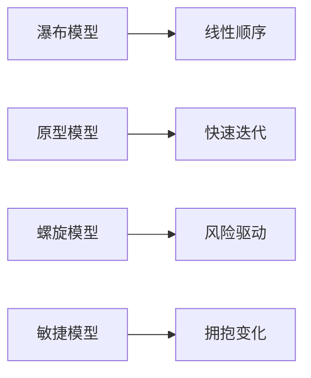

## 软件过程模型

软件过程模型是对软件生命周期各项任务给予规程约束的工作模型。主要过程模型包括：

**瀑布模型**：最早使用的软件过程模型之一，工作流程从一个阶段到另一个阶段逐次下降，因果关系紧密相连。主要缺点是需求完整性难以确定、严格串行化导致用户长时间看不到可运行系统、每个阶段一次性完全解决工作不现实[^1]。

**原型模型**：又称快速原型，在需求确认阶段快速开发一个原型，征求用户意见后修改完善。分为抛弃型原型（需求确认后废弃）和演化性原型（不断补充完善直至形成完整产品）[^2]。

**螺旋模型**：在快速原型基础上扩展而成，每个阶段由目标设定、风险分析、开发和有效性验证、评审四部分组成。每迭代一次软件系统生成一个新版本，支持大型软件开发[^3]。

**敏捷模型**：2001年17位软件专家签署敏捷宣言，核心思想是适应性（拥抱变化）和以人为本（充分发挥人的创造能力）。主要方法包括极限编程（XP）、Scrum、水晶系列方法和特征驱动开发（FDD）[^4]。

---

## 统一过程(RUP)

统一过程（Rational Unified Process, RUP）是Rational软件公司创造的软件工程方法，是一种重量级过程。RUP中有9个核心工作流：业务建模、需求、分析与设计、实现、测试、部署、配置与变更管理、项目管理和环境[^5]。

RUP把软件开发生命周期划分为四个连续阶段：

- **初始（Inception）**：定义最终产品视图和业务模型，确定系统范围
- **细化（Elaboration）**：设计及确定系统的体系结构，制订工作计划
- **构造（Construction）**：构造产品并继续演进需求、体系结构、计划
- **移交（Transition）**：把产品提交给用户使用[^6]

RUP的核心特点：

- **用例驱动**：需求分析、设计、实现和测试等活动都是用例驱动的
- **以体系结构为中心**：采用"4+1"视图模型（逻辑视图、实现视图、进程视图、部署视图、用例视图）
- **迭代与增量**：把整个项目分为多个迭代过程，每次迭代增加新功能[^7]

---

## 能力成熟度模型(CMM/CMMI)

软件能力成熟度模型（CMM）是1994年由美国国防部与卡内基-梅隆大学软件工程研究中心共同开发的，目的是帮助软件企业对软件工程过程进行管理和改进。CMMI（Capability Maturity Model Integration）是在CMM基础上发展而来的集成框架[^8]。

CMMI将软件过程改进组织成**五个成熟度等级**：

| 等级 | 名称       | 特征                                                     |
| ---- | ---------- | -------------------------------------------------------- |
| 1级  | 初始级     | 过程随意且混乱，成功依赖个人英雄主义                     |
| 2级  | 已管理级   | 确保策划、文档化、执行、监督和控制项目级过程             |
| 3级  | 已定义级   | 企业根据自身情况定义适合的标准流程并制度化               |
| 4级  | 量化管理级 | 建立产品质量、服务质量和过程性能的定量目标               |
| 5级  | 优化级     | 通过增量式与创新式的过程与技术改进，不断优化过程性能[^9] |

CMMI共包括18个关键过程域、52个过程目标，为软件过程不断改进奠定了循序渐进的基础[^10]。

---

## 需求工程

需求工程是应用已证实有效的原理、方法，通过合适的工具和记号，系统地描述待开发系统及其行为特征和相关约束。需求覆盖了体系结构设计之前的各项开发活动[^11]。

软件需求包括三个不同层次：

- **业务需求**：反映组织机构或客户对系统高层次的目标要求
- **用户需求**：描述用户使用产品必须要完成的任务
- **功能需求**：定义开发人员必须实现的软件功能[^12]

需求工程的活动主要划分为五个阶段：

1. **需求获取**：通过与用户交流、观察现有系统、分析任务来捕获需求
2. **需求分析**：为系统建立概念模型，作为对需求的抽象描述
3. **形成需求规格**：按照标准生成需求文档
4. **需求确认与验证**：通过用户确认、复审会议、符号执行、模拟仿真等验证需求
5. **需求管理**：包括变更控制、版本控制、需求跟踪和需求状态跟踪[^13]

需求获取方法包括用户面谈、需求专题讨论会、问卷调查、现场观察、原型化方法和头脑风暴法。变更控制委员会（CCB）负责裁定接受哪些变更[^14]。

---

## 软件测试方法

软件测试是使用人工或自动的手段来运行或测定某个软件系统的过程，其目的在于检验它是否满足规定的需求或弄清预期结果与实际结果之间的差别[^15]。

测试方法分类：

- **静态测试**：被测程序不运行，依靠分析或检查源程序来找出错误
- **动态测试**：通过运行被测试程序，将运行结果与预期结果比较
- **黑盒测试**：不考虑程序内部结构，根据需求规格设计测试用例，检查功能是否按规范运行
- **白盒测试**：借助程序内部逻辑，检测内部动作是否按设计规格设定进行，包括语句覆盖、判定覆盖、分支覆盖和路径覆盖等
- **灰盒测试**：介于黑盒与白盒之间，重视输出正确性也看重内部程序逻辑[^16]

测试阶段划分：

1. **单元测试**：对软件模块进行测试，结合静态分析和白盒/黑盒方法
2. **集成测试**：对组装起来的模块进行测试，验证接口和结构设计
3. **系统测试**：采用黑盒测试，检查系统是否符合需求，包括功能、性能、压力、可靠性等测试
4. **验收测试**：由用户对要交付软件开展的测试，验证软件符合预定要求[^17]

---

## 软件项目管理

软件项目管理是为了使软件项目能够按照预定的成本、进度、质量顺利完成，而对人员（People）、产品（Product）、过程（Process）和项目（Project）进行分析和管理的活动。美国国防部研究发现，70%的项目失败是因为管理不善而非技术原因[^18]。

**进度管理**包括活动定义、活动排序、活动资源估计、活动历时估计、制定进度计划和进度控制。工作分解结构（WBS）将项目按原则分解为任务、工作和日常活动，树形结构一般不超过6层[^19]。

**配置管理（SCM）**是一种标识、组织和控制修改的技术，核心内容包括：

- **版本控制**：追踪文件变更，支持并行开发中的分支与合并
- **变更控制**：对变更进行管理，确保变更有序进行[^20]

**质量管理**从管理角度将影响软件质量的因素分为三组：产品运行（正确性、健壮性、效率、完整性、可用性）、产品修改（可理解性、可维修性、灵活性、可测试性）和产品转移（可移植性、可再用性、互运行性）[^21]。

---

## 参考文献

[^1]: 《系统架构设计师教程(第二版)》P.176-177 §5.1.2

[^2]: 《系统架构设计师教程(第二版)》P.177-178 §5.1.2

[^3]: 《系统架构设计师教程(第二版)》P.178 §5.1.2

[^4]: 《系统架构设计师教程(第二版)》P.179-181 §5.1.3

[^5]: 《系统架构设计师教程(第二版)》P.182 §5.1.4

[^6]: 《系统架构设计师教程(第二版)》P.182-183 §5.1.4

[^7]: 《系统架构设计师教程(第二版)》P.183-184 §5.1.4

[^8]: 《系统架构设计师教程(第二版)》P.184 §5.1.5

[^9]: 《系统架构设计师教程(第二版)》P.184-185 §5.1.5

[^10]: 《系统架构设计师教程(第二版)》P.184 §5.1.5

[^11]: 《系统架构设计师教程(第二版)》P.185-186 §5.2

[^12]: 《系统架构设计师教程(第二版)》P.186 §5.2

[^13]: 《系统架构设计师教程(第二版)》P.186-187 §5.2

[^14]: 《系统架构设计师教程(第二版)》P.189-191 §5.2.2

[^15]: 《系统架构设计师教程(第二版)》P.205 §5.4

[^16]: 《系统架构设计师教程(第二版)》P.205-206 §5.4.1

[^17]: 《系统架构设计师教程(第二版)》P.206-207 §5.4.2

[^18]: 《系统架构设计师教程(第二版)》P.213 §5.7.1

[^19]: 《系统架构设计师教程(第二版)》P.213-215 §5.7.2

[^20]: 《系统架构设计师教程(第二版)》P.215 §5.7.3

[^21]: 《系统架构设计师教程(第二版)》P.216 §5.7.4
