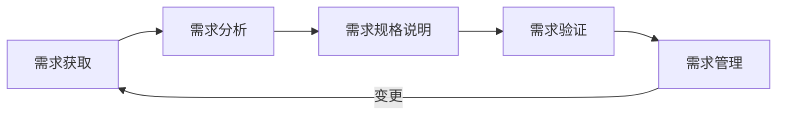
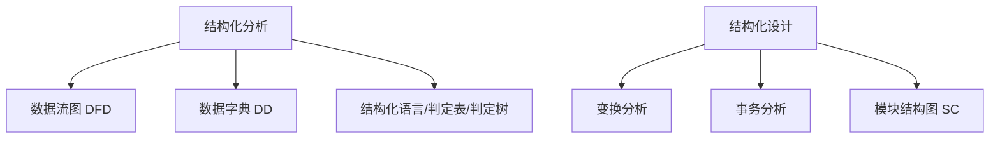

## 1. 软件工程概述

软件工程是将系统化的、规范化的、可量化的方法应用于软件的开发、运行和维护。1968年NATO会议上首次提出"软件工程"概念，旨在解决当时日益严重的"软件危机"[^1]。

软件危机主要表现在：软件开发成本和进度估计不准确；用户对已完成系统不满意；软件质量难以保证；软件不可维护；软件成本逐年上升；开发生产率提高速度跟不上计算机应用需求增长[^2]。

软件工程三要素：

- **方法**：完成软件开发各项任务的技术方法
- **工具**：为方法提供自动或半自动的支撑环境
- **过程**：将方法和工具结合起来以达到合理、及时地进行软件开发的目的[^3]

> 📌 **考试重点**：软件工程三要素（方法、工具、过程）的定义与关系，软件危机的主要表现。
>
> 🔗 **真题关联**：2022年综合知识第21题考查软件工程三要素；案例分析多次要求分析项目中软件工程方法应用问题。

---

## 2. 瀑布模型与原型模型

**瀑布模型**是最早出现的软件过程模型，将软件生命周期划分为可行性分析、需求分析、系统设计、编码、测试、运行维护等阶段，各阶段按固定顺序连接，如同瀑布流水逐级下落[^4]。

瀑布模型的特点：

- 阶段间具有顺序性和依赖性
- 推迟实现观点（先设计后编码）
- 质量保证观点（每个阶段结束需通过评审）

瀑布模型的主要缺点：

- 需求完整性难以确定
- 严格串行化导致用户长时间看不到可运行系统
- 每个阶段一次性完全解决工作不现实
- 后期变更代价高昂[^5]

**原型模型**又称快速原型，在需求确认阶段快速开发一个可运行的原型系统，征求用户意见后反复修改完善。分为两类：

- **抛弃型原型**：需求确认后废弃，用于正式开发前的需求验证
- **演化性原型**：不断补充完善直至形成完整产品[^6]


> 📌 **考试重点**：瀑布模型的6个阶段及顺序；瀑布模型与原型模型的适用场景对比；抛弃型与演化型原型的区别。
>
> 🔗 **真题关联**：2021年案例分析题要求对比瀑布模型与原型模型在需求不明确项目中的适用性；2020年综合知识考查瀑布模型最大缺点。

---

## 3. 螺旋模型与敏捷模型

**螺旋模型**由Boehm于1988年提出，在快速原型基础上扩展而成，将瀑布模型与快速原型模型结合，并加入风险分析。每个迭代周期由四个象限组成：

1. **目标设定**：确定该周期的目标、备选方案和约束
2. **风险分析**：评估备选方案，识别和解决风险
3. **开发和验证**：开发并验证本周期产品
4. **评审**：评价本周期结果，计划下一个周期[^7]

螺旋模型强调风险驱动，适合大型、复杂、高风险项目，但模型复杂，对风险评估能力要求高。

**敏捷模型**源于2001年17位软件专家签署的《敏捷宣言》，核心思想是适应性（拥抱变化）和以人为本。敏捷宣言四大价值观：

- 个体和互动高于流程和工具
- 可工作的软件高于详尽的文档
- 客户合作高于合同谈判
- 响应变化高于遵循计划[^8]

主要敏捷方法：

| 方法 | 核心特点 |
|------|----------|
| **极限编程(XP)** | 结对编程、测试驱动开发、持续集成、小版本发布 |
| **Scrum** | Sprint迭代、产品待办列表、每日站会、燃尽图 |
| **水晶系列** | 根据项目规模选择不同颜色（透明→黄→橙→红）的方法 |
| **特征驱动开发(FDD)** | 以特征为中心，短迭代周期（2周），强调设计与构建 |
| **自适应软件开发(ASD)** | 预测、协作、学习三个生命周期 |
| **敏捷统一过程(AUP)** | 采用UP迭代思想，但简化文档和建模[^9] |


> 📌 **考试重点**：螺旋模型四个象限的活动内容；敏捷宣言四大价值观（常考顺序）；Scrum的Sprint周期、三种角色（产品负责人/Scrum Master/开发团队）。
>
> 🔗 **真题关联**：2023年综合知识考查螺旋模型每个迭代包含的活动；2022年案例分析要求分析Scrum实施中的问题；论文多次出现"论敏捷开发方法在企业中的应用"。

---

## 4. 统一过程(RUP)

统一过程（Rational Unified Process, RUP）是Rational公司创造的重量级软件工程方法，是一种用例驱动、以架构为中心、迭代和增量的软件开发过程[^10]。

RUP包含**9个核心工作流**：

1. **业务建模**：理解待开发系统所在的机构及其商业运作
2. **需求**：捕获系统应该做什么的需求
3. **分析与设计**：将需求转化为系统设计
4. **实现**：编码实现并单元测试
5. **测试**：验证系统各部分是否协同工作
6. **部署**：生成目标系统的可运行版本
7. **配置与变更管理**：跟踪并维护开发过程中制品的完整性和一致性
8. **项目管理**：平衡各种可能产生冲突的目标，管理风险
9. **环境**：向软件开发组织提供软件开发环境[^11]

RUP把软件开发生命周期划分为**四个连续阶段**：

| 阶段 | 主要目标 | 关键里程碑 |
|------|----------|------------|
| **初始(Inception)** | 定义最终产品视图和业务模型，确定系统范围 | 生命周期目标 |
| **细化(Elaboration)** | 设计及确定系统体系结构，制订工作计划 | 生命周期架构 |
| **构造(Construction)** | 构造产品并继续演进需求、体系结构、计划 | 初始运作能力 |
| **移交(Transition)** | 把产品提交给用户使用 | 产品发布[^12] |

RUP的"4+1"视图模型：

- **逻辑视图**：面向最终用户，展示系统功能需求
- **实现视图**：面向程序员，展示软件静态结构（组件、模块）
- **进程视图**：面向系统集成者，展示并发与同步
- **部署视图**：面向系统工程师，展示硬件拓扑与软件部署
- **用例视图**：面向分析师和测试人员，描述系统行为，驱动其他视图[^13]


> 📌 **考试重点**：RUP三大核心特征（用例驱动、以架构为中心、迭代增量）；四个阶段名称及里程碑；9个工作流中前6个为工程活动、后3个为支持活动；4+1视图各自面向的涉众。
>
> 🔗 **真题关联**：2023年综合知识考查RUP四个阶段顺序；2021年案例分析要求用RUP分析项目问题；4+1视图是论文高频考点。

---

## 5. 能力成熟度模型(CMM/CMMI)

软件能力成熟度模型（CMM）由美国国防部与卡内基-梅隆大学软件工程研究中心于1994年共同开发。CMMI（Capability Maturity Model Integration）是在CMM基础上发展而来的集成框架，涵盖软件工程、系统工程、采购和人力资源等多个领域[^14]。

CMMI将软件过程改进组织成**五个成熟度等级**：

| 等级 | 名称 | 特征 | 关键过程域 |
|------|------|------|------------|
| **1级** | 初始级 | 过程随意且混乱，成功依赖个人英雄主义 | 无 |
| **2级** | 已管理级 | 确保策划、文档化、执行、监督和控制项目级过程 | 需求管理、项目计划、配置管理等 |
| **3级** | 已定义级 | 企业根据自身情况定义适合的标准流程并制度化 | 组织过程焦点、组织过程定义、培训等 |
| **4级** | 量化管理级 | 建立产品质量、服务质量和过程性能的定量目标 | 组织过程绩效、定量项目管理 |
| **5级** | 优化级 | 通过增量式与创新式的过程与技术改进，不断优化 | 组织创新与部署、因果分析与解决方案[^15] |

CMMI两种表示法：

- **阶段式表示法**：对应上述5个成熟度等级，用于组织整体评估
- **连续式表示法**：按过程域能力等级（0-3级）评估单个过程域[^16]

CMMI共包括18个关键过程域、52个过程目标。与ISO 9001相比，CMMI更关注软件开发过程改进，而ISO 9001是通用的质量管理体系标准[^17]。

> 📌 **考试重点**：CMMI五个等级的名称、特征及关键过程域；阶段式与连续式表示法的区别；CMMI与ISO 9001的区别。
>
> 🔗 **真题关联**：2023年综合知识考查CMMI第3级特征；2022年案例分析要求根据项目现状判断CMMI等级并给出改进建议；论文"论软件过程改进"需结合CMMI展开。

---

## 6. 需求工程概述

需求工程是应用已证实有效的原理、方法，通过合适的工具和记号，系统地描述待开发系统及其行为特征和相关约束。需求覆盖了体系结构设计之前的各项开发活动[^18]。

软件需求包括三个不同层次：

- **业务需求**：反映组织机构或客户对系统高层次的目标要求，通常由项目投资人提出
- **用户需求**：描述用户使用产品必须要完成的任务，通常由用户代表提出
- **功能需求**：定义开发人员必须实现的软件功能，是需求规格说明的核心
- **非功能需求**：包括性能、可靠性、安全性、可用性等质量属性需求[^19]

需求工程的活动主要划分为五个阶段：

1. **需求获取**：通过与用户交流、观察现有系统、分析任务来捕获需求
2. **需求分析**：为系统建立概念模型，作为对需求的抽象描述
3. **形成需求规格**：按照标准生成需求文档（SRS）
4. **需求确认与验证**：通过用户确认、复审会议、符号执行、模拟仿真等验证需求
5. **需求管理**：包括变更控制、版本控制、需求跟踪和需求状态跟踪[^20]



> 📌 **考试重点**：需求的四个层次（业务/用户/功能/非功能）；需求工程五个活动的顺序和内容；需求规格说明书(SRS)的作用。
>
> 🔗 **真题关联**：2022年综合知识考查需求层次定义；2021年案例分析要求分析需求变更失控的原因；论文"论需求工程在软件开发中的应用"为高频题目。

---

## 7. 需求获取与分析

**需求获取方法**：

- **用户面谈**：最直接有效，但耗时且可能存在偏见
- **需求专题讨论会(JAD)**：召集关键涉众集中讨论，效率高
- **问卷调查**：适用于涉众分散或数量众多的情况
- **现场观察**：观察用户实际工作流程，发现隐性需求
- **原型化方法**：通过原型激发用户反馈
- **头脑风暴法**：激发创造性需求
- **文档分析**：分析现有系统文档和业务流程文档[^21]

**需求分析技术**：

- **结构化分析**：使用数据流图(DFD)、数据字典(DD)、结构化语言、判定表/判定树
- **面向对象分析**：使用用例图、类图、活动图、状态图等UML模型
- **需求建模**：建立概念模型，包括功能模型、数据模型和行为模型[^22]

**需求变更管理**：

- 变更控制委员会（CCB）负责裁定接受哪些变更
- 变更流程：提出变更请求 → 评估影响 → CCB审批 → 实施变更 → 验证
- 需求跟踪矩阵（RTM）用于跟踪需求从来源到实现的全过程[^23]

> 📌 **考试重点**：需求获取六种方法的适用场景；CCB的职责；需求跟踪矩阵的作用；变更控制流程。
>
> 🔗 **真题关联**：2023年综合知识考查需求获取方法选择；案例分析多次要求分析需求变更频繁的原因及解决措施。

---

## 8. 结构化分析方法

结构化分析方法（SA）是面向数据流的需求分析方法，由Yourdon和Constantine提出，核心思想是"自顶向下、逐层分解"。主要工具包括[^24]：

**数据流图(DFD)**：

- 四种基本元素：加工（圆圈）、数据流（箭头）、数据存储（双横线）、外部实体（矩形）
- 分层绘制：顶层上下文图（0层）→ 一层DFD → 二层DFD → ...
- 顶层图只有一个加工（代表整个系统），与外部实体交互
- 父图与子图平衡：子图输入输出数据流必须与父图对应加工一致[^25]

**数据字典(DD)**：

- 对DFD中所有元素进行定义和描述
- 包括数据项、数据结构、数据流、数据存储、加工逻辑
- 加工逻辑描述工具：结构化语言、判定表、判定树[^26]

**结构化设计(SD)**：

- 将DFD映射为软件结构图（SC图）
- 变换分析：用于传入路径-变换中心-传出路径类型的DFD
- 事务分析：用于事务型DFD（一个加工发散出多个处理路径）
- 模块设计原则：高内聚、低耦合[^27]



> 📌 **考试重点**：DFD四种元素的画法；分层DFD的绘制规则（父图子图平衡）；数据字典内容；变换分析与事务分析的适用场景；模块设计的高内聚低耦合原则。
>
> 🔗 **真题关联**：2022年综合知识考查DFD元素识别；案例分析多次要求根据描述绘制或补充DFD；论文"论结构化方法在软件开发中的应用"。
---

## 9. 面向对象分析方法

面向对象分析(OOA)运用面向对象方法，对问题域和系统责任进行分析和理解，找出描述问题域及系统责任所需的对象，定义对象的属性、服务以及它们之间的关系。目标是建立一个符合问题域、满足用户需求的OOA模型[^28]。

**UML 2.0包含14种图**，分为两大类：

**结构图（静态图）6种**：

- **类图**：描述系统中类的静态结构，是最常用的UML图
- **对象图**：类图的实例，展示某一时刻对象及其关系
- **包图**：描述系统的分层结构
- **组合结构图**：展示类或组件的内部结构
- **构件图**：描述软件构件的组织和依赖
- **部署图**：描述硬件节点和软件构件的部署关系[^29]

**行为图（动态图）8种**：

- **用例图**：描述系统功能和外部参与者交互
- **序列图**：按时间顺序展示对象间消息交互
- **通信图**：强调对象间的组织结构关系
- **状态图**：描述对象在其生命周期内的状态变化
- **活动图**：描述业务流程或操作的控制流
- **定时图**：展示状态变化随时间的变化
- **交互概览图**：活动图与交互图的结合
- **制品图**：描述系统物理结构[^30]


> 📌 **考试重点**：UML 14种图的分类（结构图vs行为图）；类图、用例图、序列图、状态图、活动图的画法和应用场景；类之间的关系（关联/聚合/组合/依赖/泛化/实现）。
>
> 🔗 **真题关联**：UML图几乎是每年综合知识必考内容；案例分析要求根据场景选择合适UML图并绘制；论文"论面向对象建模在软件开发中的应用"为高频题目。

---

## 10. 面向对象设计原则

面向对象设计(OOD)在OOA基础上，针对实现相关的因素引入各类对象并建立关系，产生一个符合具体实现条件、可运行的设计模型[^31]。

**SOLID设计原则**：

| 原则 | 英文 | 核心思想 |
|------|------|----------|
| **单一职责原则(SRP)** | Single Responsibility | 一个类只负责一个功能领域 |
| **开闭原则(OCP)** | Open/Closed | 对扩展开放，对修改关闭 |
| **里氏替换原则(LSP)** | Liskov Substitution | 子类可以替换父类而不影响程序正确性 |
| **接口隔离原则(ISP)** | Interface Segregation | 客户端不应依赖它不需要的接口 |
| **依赖倒置原则(DIP)** | Dependency Inversion | 高层模块不依赖低层模块，二者都依赖抽象[^32] |

**其他重要设计原则**：

- **迪米特法则（最少知识原则）**：一个对象应当对其他对象有尽可能少的了解
- **合成复用原则**：优先使用对象组合，而不是类继承
- **封装变化点**：识别变化并封装，减少变化对系统的影响[^33]

**设计模式分类（GoF 23种）**：

- **创建型模式（5种）**：工厂方法、抽象工厂、单例、建造者、原型
- **结构型模式（7种）**：适配器、桥接、组合、装饰、外观、享元、代理
- **行为型模式（11种）**：职责链、命令、解释器、迭代器、中介者、备忘录、观察者、状态、策略、模板方法、访问者[^34]

> 📌 **考试重点**：SOLID五个原则的名称、含义和应用场景；设计模式三类（创建型/结构型/行为型）及典型模式识别；开闭原则和依赖倒置原则最常考。
>
> 🔗 **真题关联**：2023年综合知识考查里氏替换原则；2022年考查开闭原则；案例分析要求识别场景中应用的设计模式并分析优缺点。

---

## 11. 软件测试基础

软件测试是使用人工或自动的手段来运行或测定某个软件系统的过程，其目的在于检验它是否满足规定的需求或弄清预期结果与实际结果之间的差别。测试只能证明软件存在错误，不能证明软件没有错误[^35]。

**测试方法分类**：

- **静态测试**：被测程序不运行，依靠分析或检查源程序来找出错误
  - 桌前检查、代码审查、代码走查
- **动态测试**：通过运行被测试程序，将运行结果与预期结果比较
  - 黑盒测试、白盒测试、灰盒测试[^36]

- **黑盒测试**：不考虑程序内部结构，根据需求规格设计测试用例
  - 等价类划分、边界值分析、错误推测法、因果图、判定表驱动
- **白盒测试**：借助程序内部逻辑，检测内部动作是否按设计规格进行
  - 语句覆盖、判定覆盖（分支覆盖）、条件覆盖、判定-条件覆盖、条件组合覆盖、路径覆盖
- **灰盒测试**：介于黑盒与白盒之间，既关注输出正确性也关注内部程序逻辑[^37]

**白盒测试覆盖标准（由弱到强）**：

```
语句覆盖 < 判定覆盖 < 条件覆盖 < 判定-条件覆盖 < 条件组合覆盖 < 路径覆盖
```

- **语句覆盖**：每个语句至少执行一次（最弱）
- **判定覆盖**：每个判定的真/假分支至少执行一次
- **条件覆盖**：每个条件的所有可能取值至少满足一次
- **条件组合覆盖**：每个判定中条件的各种组合至少出现一次（最强之一）[^38]

> 📌 **考试重点**：黑盒测试方法（等价类划分、边界值分析最常用）；白盒测试六种覆盖标准及其强弱关系；语句覆盖与判定覆盖的区别。
>
> 🔗 **真题关联**：每年综合知识必考测试方法；2023年考查白盒覆盖标准强弱排序；案例分析要求设计测试用例。

---

## 12. 软件测试阶段

软件测试按阶段划分，与开发阶段对应[^39]：

**单元测试**：

- 对软件最小可测试单元（模块/类/函数）进行测试
- 通常由开发人员完成，采用白盒测试为主
- 需要驱动模块（调用被测模块）和桩模块（模拟被测模块调用的下级模块）
- 测试内容：模块接口、局部数据结构、重要执行路径、错误处理、边界条件[^40]

**集成测试**：

- 对组装起来的模块进行测试，验证接口和结构设计
- **自顶向下集成**：从主控模块开始，逐步加入下级模块，需要桩模块
- **自底向上集成**：从底层模块开始，逐步向上组装，需要驱动模块
- **三明治集成（混合式）**：结合自顶向下和自底向上
- **大爆炸集成**：一次性组装所有模块[^41]

**系统测试**：

- 采用黑盒测试，检查系统是否符合需求
- 包括：功能测试、性能测试、压力测试、可靠性测试、安全性测试、兼容性测试、易用性测试等[^42]

**验收测试**：

- 由用户对要交付软件开展的测试，验证软件符合预定要求
- **α测试**：在开发环境下由用户进行
- **β测试**：在实际使用环境下由最终用户进行[^43]


> 📌 **考试重点**：四个测试阶段的顺序、测试对象、测试方法；单元测试的驱动模块和桩模块概念；集成测试四种策略的特点；α测试与β测试的区别。
>
> 🔗 **真题关联**：2022年综合知识考查集成测试策略选择；2021年案例分析要求分析测试阶段缺失导致的问题。

---

## 13. 净室软件工程

净室软件工程（Cleanroom Software Engineering）由Harlan Mills于20世纪80年代提出，是一种形式化软件开发方法，核心思想是通过严格的数学验证来保证软件正确性，避免传统测试方法的局限性[^44]。

净室软件工程的三大核心要素：

1. **增量式开发**：将软件划分为一系列增量，每个增量经过规范、开发、认证三个阶段
2. **基于盒结构的功能规约**：使用盒子（黑盒/状态盒/清晰盒）逐步精化规约
   - **黑盒**：描述外部行为（输入→输出映射）
   - **状态盒**：引入状态转换，封装数据
   - **清晰盒**：包含过程设计，实现状态盒规约
3. **统计质量控制**：通过统计抽样测试验证软件可靠性，而非穷尽测试[^45]

净室软件工程的过程模型：

```
需求收集 → 盒结构规约 → 形式化设计 → 正确性验证 → 统计测试 → 认证
```

净室方法的特点：

- 不进行单元测试（通过数学验证替代）
- 强调统计使用测试（基于用户使用剖面）
- 小组评审和验证替代传统调试
- 适用于高可靠性要求的系统（如航空航天、医疗设备）[^46]

> 📌 **考试重点**：净室工程三大要素；三种盒结构（黑盒/状态盒/清晰盒）的定义和关系；净室方法不进行单元测试的特点。
>
> 🔗 **真题关联**：2021年综合知识考查净室软件工程核心思想；2020年考查盒结构类型。

---

## 14. 基于构件的软件工程

基于构件的软件工程（Component-Based Software Engineering, CBSE）是一种基于分布对象技术、强调通过可复用构件设计与构造软件系统的软件复用途径。构件是系统中可替换的物理部分，封装了实现体并提供了接口[^47]。

**构件的基本特征**：

- **独立部署单元**：可独立安装、升级、替换
- **作为第三方组装单元**：由不同厂商开发，通过接口组装
- **没有外部可见状态**：构件内部状态不暴露给外部[^48]

**主流构件标准**：

| 标准 | 组织 | 核心特点 |
|------|------|----------|
| **CORBA** | OMG | 公共对象请求代理体系结构，语言无关，ORB作为中间件 |
| **EJB** | Sun/Oracle | 企业JavaBeans，运行在J2EE容器中 |
| **COM/DCOM** | Microsoft | 组件对象模型，Windows平台 |
| **Web Services** | W3C | 基于SOAP/UDDI/WSDL，跨平台互操作[^49] |

**CBSE过程**：

1. **系统需求概览**：定义系统整体需求
2. **识别候选构件**：从构件库或市场寻找可用构件
3. **针对需求进行构件的特性和适配**：评估构件是否满足需求
4. **组装构件**：将选定的构件集成到系统中
5. **集成与测试**：验证组装后的系统[^50]


> 📌 **考试重点**：构件的三个基本特征；四种主流构件标准（CORBA/EJB/COM/Web Services）的特点；CBSE的基本过程。
>
> 🔗 **真题关联**：2022年综合知识考查构件特征；案例分析要求分析构件化开发的优势和适用场景。

---

## 15. 软件项目管理概述

软件项目管理是为了使软件项目能够按照预定的成本、进度、质量顺利完成，而对人员（People）、产品（Product）、过程（Process）和项目（Project）进行分析和管理的活动。美国国防部研究发现，70%的项目失败是因为管理不善而非技术原因[^51]。

软件项目管理的主要活动：

- **进度管理**：活动定义、排序、资源估计、历时估计、制定进度计划、进度控制
- **成本管理**：成本估算、成本预算、成本控制
- **质量管理**：质量计划、质量保证、质量控制
- **配置管理**：版本控制、变更控制
- **风险管理**：风险识别、分析、应对、监控
- **人力资源管理**：团队组建、建设、管理
- **沟通管理**：沟通计划、信息分发、绩效报告[^52]

**工作分解结构(WBS)**：

- 将项目按原则分解为任务、工作和日常活动
- 树形结构一般不超过6层
- 分解方式：按功能、按阶段、按地理位置、按组织单位
- WBS是成本估算、进度安排、资源分配的基础[^53]

> 📌 **考试重点**：软件项目管理的4P（People/Product/Process/Project）；WBS的作用和分解原则；项目管理主要活动领域。
>
> 🔗 **真题关联**：案例分析几乎每年必考项目管理问题，要求分析进度延误、成本超支、质量失控的原因及改进措施。

---

## 16. 进度与成本管理

**进度管理工具技术**：

- **甘特图（Gantt Chart）**：横轴表示时间，纵轴表示活动，直观展示活动进度和并行关系
- **PERT图（计划评审技术）**：有向图表示活动依赖关系，可计算关键路径
- **关键路径法(CPM)**：确定项目中最长的活动路径，该路径上的任何延误都会导致项目延期
- **关键链法**：考虑资源约束的关键路径方法[^54]

**PERT时间估算**：

- 乐观时间(O)、最可能时间(M)、悲观时间(P)
- 期望工期：$TE = (O + 4M + P) / 6$
- 标准差：$σ = (P - O) / 6$
- 方差：$σ² = [(P - O) / 6]²$

**成本估算方法**：

- **类比估算法**：根据类似项目历史数据进行估算
- **自下而上估算法**：先估算各工作包成本，再汇总
- **参数估算法**：利用历史数据与项目参数建立数学模型
- **三点估算法**：考虑乐观、最可能、悲观三种情况[^55]

**挣值管理(EVM)**：

| 指标 | 公式 | 含义 |
|------|------|------|
| **PV**（计划值） | 计划完成工作的预算成本 | 应该完成多少 |
| **EV**（挣值） | 实际完成工作的预算成本 | 实际完成多少 |
| **AC**（实际成本） | 实际完成工作的实际成本 | 实际花了多少 |
| **SV**（进度偏差）| $EV - PV$ | SV>0进度超前 |
| **CV**（成本偏差）| $EV - AC$ | CV>0成本节约 |
| **SPI**（进度绩效）| $EV / PV$ | SPI>1进度超前 |
| **CPI**（成本绩效）| $EV / AC$ | CPI>1成本节约[^56] |

> 📌 **考试重点**：关键路径的计算（最早/最晚开始时间、总时差）；PERT三点估算公式；挣值管理7个指标的计算和判断（几乎每年必考）。
>
> 🔗 **真题关联**：2023年综合知识计算关键路径和总工期；2022年挣值计算题；案例分析要求根据挣值分析项目状态。

---

## 17. 配置管理与质量管理

**软件配置管理(SCM)**是一种标识、组织和控制修改的技术，目的是使错误降为最小并最有效地提高生产效率。核心内容包括[^57]：

- **版本控制**：追踪文件变更历史，支持并行开发中的分支与合并
- **变更控制**：对变更进行管理，确保变更有序进行（CCB审批）
- **配置审计**：验证配置项的完整性和一致性
- **配置状态报告**：记录和报告配置管理信息
- **发行管理**：管理软件版本的发布[^58]

**软件质量管理**：

从管理角度将影响软件质量的因素分为三组（McCall质量模型）：

- **产品运行**：正确性、健壮性、效率、完整性、可用性、可靠性
- **产品修改**：可理解性、可维修性、灵活性、可测试性
- **产品转移**：可移植性、可再用性、互运行性[^59]

**ISO/IEC 9126软件质量特性**（后演进为ISO/IEC 25010）：

- **功能性**：适合性、准确性、互操作性、安全保密性
- **可靠性**：成熟性、容错性、易恢复性
- **易用性**：易理解性、易学性、易操作性、吸引性
- **效率**：时间特性、资源利用性
- **可维护性**：易分析性、易改变性、稳定性、易测试性
- **可移植性**：适应性、易安装性、共存性、易替换性[^60]

> 📌 **考试重点**：配置管理四大活动；McCall质量模型三组成特性；ISO/IEC 9126六大质量特性及其子特性。
>
> 🔗 **真题关联**：2022年综合知识考查ISO 9126质量特性；案例分析要求分析配置管理缺失导致的问题。

---

## 18. 风险管理

软件风险是指软件开发过程中及软件产品本身可能造成的伤害或损失。风险管理的目标是识别、分析、应对和监控风险，以最小化风险对项目的负面影响[^61]。

**风险分类**：

- **项目风险**：威胁项目计划，如预算、进度、人员、资源等
- **技术风险**：威胁软件质量和交付时间，如设计、实现、接口、维护等
- **商业风险**：威胁软件生存能力，如市场、策略、销售、管理等[^62]

**风险管理过程**：

1. **风险识别**：识别可能影响项目的风险，建立风险清单
2. **风险分析**：评估风险发生的概率和影响
   - 定性分析：高/中/低等级划分
   - 定量分析：决策树分析、蒙特卡洛模拟
3. **风险应对**：制定风险应对策略
4. **风险监控**：跟踪已识别风险，识别新风险[^63]

**风险应对策略**：

| 策略 | 适用情况 | 说明 |
|------|----------|------|
| **规避** | 高概率高影响 | 改变项目计划消除风险或条件 |
| **转移** | 高影响 | 将风险后果转移给第三方（如保险、外包） |
| **减轻** | 高概率 | 降低风险发生的概率或影响 |
| **接受** | 低概率低影响 | 主动接受（建立应急储备）或被动接受[^64] |

> 📌 **考试重点**：风险三类（项目/技术/商业）；风险管理四过程；四种风险应对策略的适用场景。
>
> 🔗 **真题关联**：2021年综合知识考查风险应对策略选择；案例分析要求识别项目风险并提出应对措施。

---

## 19. 软件过程改进

软件过程改进(SPI)是为了提高软件过程的效果和效率，通过持续评估和改进软件开发过程，使组织能够更有效地开发和维护软件[^65]。

**主要过程改进框架**：

- **CMMI**：前面已详述，最主流的改进框架
- **ISO/IEC 15504 (SPICE)**：软件过程改进和能力测定国际标准
- **ISO 9001**：通用的质量管理体系标准
- **六西格玛(6σ)**：以数据为基础的质量管理方法，追求每百万机会缺陷数不超过3.4[^66]

**PDCA循环（戴明环）**：

- **Plan（计划）**：确定改进目标，制定行动计划
- **Do（执行）**：实施计划
- **Check（检查）**：评估执行结果
- **Act（处理）**：标准化成功经验，遗留问题进入下一循环[^67]

**过程改进的关键成功因素**：

- 高层管理者的支持和参与
- 明确的改进目标和度量体系
- 过程改进与业务目标对齐
- 全员参与和培训
- 持续改进文化[^68]

> 📌 **考试重点**：PDCA循环四个阶段；CMMI与ISO 9001的区别；过程改进的关键成功因素。
>
> 🔗 **真题关联**：论文"论软件过程改进在软件开发中的应用"为高频题目；案例分析要求分析组织过程改进措施。

---

## 20. 软件复用与逆向工程

**软件复用**是指在两次或多次不同的软件开发过程中重复使用相同或相似软件元素的过程。复用级别包括[^69]：

- **代码复用**：最低级别，复制粘贴或调用已有代码
- **设计复用**：复用已有的系统设计方案
- **分析复用**：复用领域分析结果（如领域模型）
- **测试复用**：复用测试用例和测试数据

**逆向工程与再工程**：

- **逆向工程(Reverse Engineering)**：分析已有程序，提取设计信息（恢复设计）
  - 实现级逆向：从源代码恢复结构（如调用图、控制流图）
  - 结构级逆向：恢复程序体系结构
  - 功能级逆向：恢复规格说明
- **再工程(Re-engineering)**：在逆向工程基础上，修改或重构已有系统以提高可维护性
  - 包括：代码重构、数据结构重构、正向工程[^70]

**遗留系统演化策略**：

| 策略 | 说明 | 适用场景 |
|------|------|----------|
| **完全淘汰** | 彻底替换旧系统 | 系统无价值且维护成本高 |
| **继承集成** | 新系统与遗留系统共存，通过集成访问 | 部分功能仍有价值 |
| **改造封装** | 封装遗留系统接口，提供新服务 | 需要与其他系统集成 |
| **集成** | 将遗留系统作为整体集成到新环境 | 系统功能完整但平台过时 |
| **继续维护** | 保持现状，仅做必要维护 | 系统稳定且满足需求[^71] |

> 📌 **考试重点**：软件复用的四个级别；逆向工程与再工程的区别；遗留系统五种演化策略的适用场景。
>
> 🔗 **真题关联**：2020年综合知识考查逆向工程定义；案例分析要求分析遗留系统改造策略选择。

---

## 参考文献

[^1]: 《系统架构设计师教程(第二版)》P.174 §5.1

[^2]: 《系统架构设计师教程(第二版)》P.174-175 §5.1

[^3]: 《系统架构设计师教程(第二版)》P.175 §5.1.1

[^4]: 《系统架构设计师教程(第二版)》P.176 §5.1.2

[^5]: 《系统架构设计师教程(第二版)》P.176-177 §5.1.2

[^6]: 《系统架构设计师教程(第二版)》P.177-178 §5.1.2

[^7]: 《系统架构设计师教程(第二版)》P.178 §5.1.2

[^8]: 《系统架构设计师教程(第二版)》P.179-180 §5.1.3

[^9]: 《系统架构设计师教程(第二版)》P.180-181 §5.1.3

[^10]: 《系统架构设计师教程(第二版)》P.182 §5.1.4

[^11]: 《系统架构设计师教程(第二版)》P.182 §5.1.4

[^12]: 《系统架构设计师教程(第二版)》P.182-183 §5.1.4

[^13]: 《系统架构设计师教程(第二版)》P.183-184 §5.1.4

[^14]: 《系统架构设计师教程(第二版)》P.184 §5.1.5

[^15]: 《系统架构设计师教程(第二版)》P.184-185 §5.1.5

[^16]: 《系统架构设计师教程(第二版)》P.185 §5.1.5

[^17]: 《系统架构设计师教程(第二版)》P.185 §5.1.5

[^18]: 《系统架构设计师教程(第二版)》P.185-186 §5.2

[^19]: 《系统架构设计师教程(第二版)》P.186 §5.2

[^20]: 《系统架构设计师教程(第二版)》P.186-187 §5.2

[^21]: 《系统架构设计师教程(第二版)》P.187-189 §5.2.1

[^22]: 《系统架构设计师教程(第二版)》P.189 §5.2.1

[^23]: 《系统架构设计师教程(第二版)》P.189-191 §5.2.2

[^24]: 《系统架构设计师教程(第二版)》P.191-193 §5.3.1

[^25]: 《系统架构设计师教程(第二版)》P.192 §5.3.1

[^26]: 《系统架构设计师教程(第二版)》P.193 §5.3.1

[^27]: 《系统架构设计师教程(第二版)》P.194-195 §5.3.1

[^28]: 《系统架构设计师教程(第二版)》P.195 §5.3.2

[^29]: 《系统架构设计师教程(第二版)》P.196-198 §5.3.2

[^30]: 《系统架构设计师教程(第二版)》P.198-199 §5.3.2

[^31]: 《系统架构设计师教程(第二版)》P.200 §5.3.2

[^32]: 《系统架构设计师教程(第二版)》P.200-202 §5.3.2

[^33]: 《系统架构设计师教程(第二版)》P.202 §5.3.2

[^34]: 《系统架构设计师教程(第二版)》P.202-204 §5.3.2

[^35]: 《系统架构设计师教程(第二版)》P.205 §5.4

[^36]: 《系统架构设计师教程(第二版)》P.205-206 §5.4.1

[^37]: 《系统架构设计师教程(第二版)》P.206 §5.4.1

[^38]: 《系统架构设计师教程(第二版)》P.206 §5.4.1

[^39]: 《系统架构设计师教程(第二版)》P.206-207 §5.4.2

[^40]: 《系统架构设计师教程(第二版)》P.207 §5.4.2

[^41]: 《系统架构设计师教程(第二版)》P.207-208 §5.4.2

[^42]: 《系统架构设计师教程(第二版)》P.208 §5.4.2

[^43]: 《系统架构设计师教程(第二版)》P.208 §5.4.2

[^44]: 《系统架构设计师教程(第二版)》P.209-210 §5.5

[^45]: 《系统架构设计师教程(第二版)》P.210 §5.5

[^46]: 《系统架构设计师教程(第二版)》P.210-211 §5.5

[^47]: 《系统架构设计师教程(第二版)》P.211 §5.6

[^48]: 《系统架构设计师教程(第二版)》P.211-212 §5.6

[^49]: 《系统架构设计师教程(第二版)》P.212 §5.6

[^50]: 《系统架构设计师教程(第二版)》P.212-213 §5.6

[^51]: 《系统架构设计师教程(第二版)》P.213 §5.7.1

[^52]: 《系统架构设计师教程(第二版)》P.213-214 §5.7.1

[^53]: 《系统架构设计师教程(第二版)》P.214-215 §5.7.2

[^54]: 《系统架构设计师教程(第二版)》P.215 §5.7.2

[^55]: 《系统架构设计师教程(第二版)》P.215-216 §5.7.2

[^56]: 《系统架构设计师教程(第二版)》P.216 §5.7.2

[^57]: 《系统架构设计师教程(第二版)》P.215 §5.7.3

[^58]: 《系统架构设计师教程(第二版)》P.215-216 §5.7.3

[^59]: 《系统架构设计师教程(第二版)》P.216 §5.7.4

[^60]: 《系统架构设计师教程(第二版)》P.216-217 §5.7.4

[^61]: 《系统架构设计师教程(第二版)》P.217 §5.7.5

[^62]: 《系统架构设计师教程(第二版)》P.217 §5.7.5

[^63]: 《系统架构设计师教程(第二版)》P.217-218 §5.7.5

[^64]: 《系统架构设计师教程(第二版)》P.218 §5.7.5

[^65]: 《系统架构设计师教程(第二版)》P.218 §5.7.6

[^66]: 《系统架构设计师教程(第二版)》P.218-219 §5.7.6

[^67]: 《系统架构设计师教程(第二版)》P.219 §5.7.6

[^68]: 《系统架构设计师教程(第二版)》P.219 §5.7.6

[^69]: 《系统架构设计师教程(第二版)》P.219-220 §5.7.7

[^70]: 《系统架构设计师教程(第二版)》P.220 §5.7.7

[^71]: 《系统架构设计师教程(第二版)》P.220-221 §5.7.7
