# 第6章 数据库设计基础知识

> 本章分值权重：综合知识 ★★ / 案例分析 ★★ / 论文 -，优先级：**高**
> 核心内容：数据库三级模式、关系模型与运算、函数依赖与范式、数据库设计六阶段、事务与并发控制、应用程序与数据库交互、NoSQL 数据库

---

## 数据库技术发展与基本概念

数据库技术经历了从人工管理、文件系统到数据库系统的三个发展阶段。数据库系统（DBS）由数据库（DB）、数据库管理系统（DBMS）、应用程序、数据库管理员（DBA）和用户组成[^1]。

> 📌 **考试重点**：掌握 DBS 的组成要素，区分 DB、DBMS 和 DBS 三个概念层次。
> 🔗 **真题关联**：常考选择题，如"数据库系统的核心是（ ）"，正确答案为 DBMS。

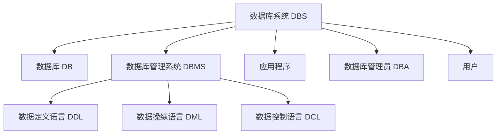

DBMS 的主要功能包括：数据定义（DDL）、数据操纵（DML）、数据库运行管理、数据组织存储管理、数据库建立与维护、数据通信接口[^2]。

---

## 数据模型

数据模型是对现实世界数据特征的抽象，分为三个层次：**概念模型**（E-R 模型）、**逻辑模型**（关系/层次/网状/面向对象）和 **物理模型**（存储结构）[^3]。

> 📌 **考试重点**：理解三个抽象层次的对应关系——概念模型面向用户和设计师，逻辑模型面向 DBMS，物理模型面向存储。
> 🔗 **真题关联**：案例分析中常要求根据需求绘制 E-R 图并转换为关系模式。

数据模型的三要素：

- **数据结构**：描述系统的静态特性，包括数据对象及其联系
- **数据操作**：描述系统的动态特性，包括查询和更新
- **数据约束**：完整性规则的集合，保证数据的正确性和一致性[^4]

---

## 数据库三级模式结构

数据库系统通常采用 **三级模式结构**，通过视图层、逻辑层和物理层三个抽象层次屏蔽系统复杂性，简化用户与系统的交互[^5]。

> 📌 **考试重点**：三级模式的定义、两级映像的作用、逻辑独立性与物理独立性的含义是必考内容。
> 🔗 **真题关联**：几乎每年综合知识必考 1-2 题，如"外模式/概念模式映像保证了什么独立性"。

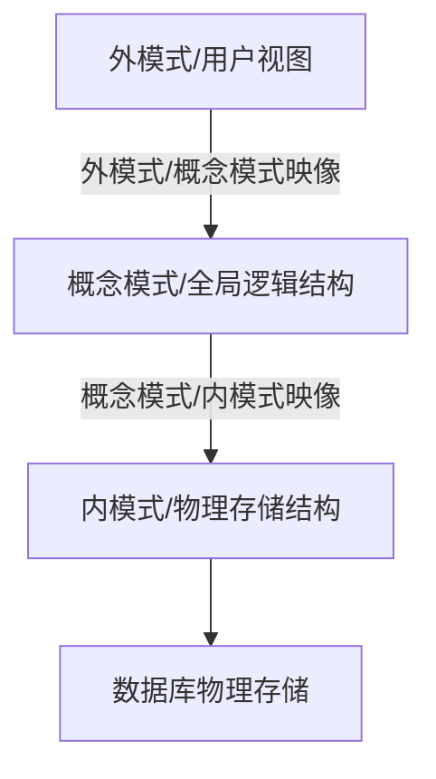

三级模式定义如下：

- **外模式**：也称用户模式或子模式，是用户与数据库系统的接口，描述用户需要使用的部分数据。一个数据库可以有多个外模式[^6]。
- **概念模式**：也称模式，是数据库中全部数据的逻辑结构和特征的描述，不涉及具体值和存储细节。一个数据库只有一个概念模式[^7]。
- **内模式**：也称存储模式，描述数据物理结构和存储方式，包括索引、文件组织、数据压缩/加密等。一个数据库只有一个内模式[^8]。

两级映像保证数据的独立性：

| 映像类型 | 修改场景 | 保证的独立性 |
|---------|---------|------------|
| 外模式/概念模式映像 | 概念模式改变（如增加字段） | **逻辑独立性**：外模式不变，应用程序不变 |
| 概念模式/内模式映像 | 内模式改变（如更换存储设备） | **物理独立性**：概念模式不变，应用程序不变 |

---

## 关系数据库基本概念

关系数据库基于 **关系模型**，由 IBM 研究员 E.F.Codd 于 1970 年提出。关系模型的数据结构是一张规范化的二维表[^9]。

> 📌 **考试重点**：掌握关系模型的基本术语对照——关系/表、元组/行、属性/列、主键/外键。
> 🔗 **真题关联**：常考关系模型术语辨析，如"关系中的行称为（ ）"。

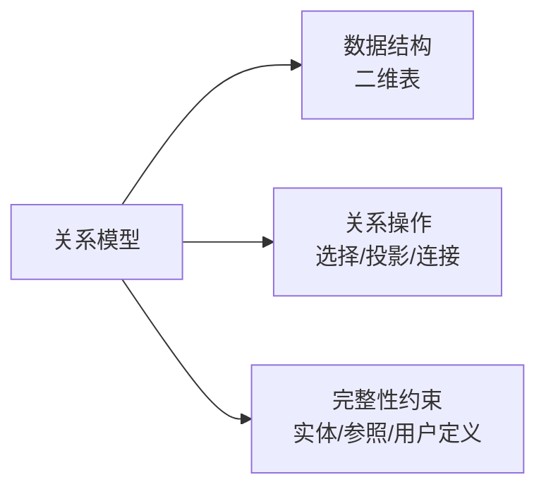

核心术语：

- **关系（Relation）**：一张二维表，对应一个实体集
- **元组（Tuple）**：表中的一行，对应一个实体
- **属性（Attribute）**：表中的一列，对应实体的一个特性
- **域（Domain）**：属性的取值范围
- **候选码（Candidate Key）**：能唯一标识元组的最小属性集
- **主键（Primary Key）**：从候选码中选定的一个
- **外键（Foreign Key）**：一个关系中的属性集是另一个关系的主键[^10]

关系的性质：

1. 列是同质的，即每列中的值来自同一域
2. 不同的列可以出自同一域，但列名不同
3. 列的顺序无关紧要
4. 行的顺序无关紧要
5. 关系中不存在完全相同的两个元组
6. 每个分量必须是不可分的数据项（1NF 要求）[^11]

---

## 关系代数运算

关系代数是一种抽象的查询语言，通过对关系的运算来表达查询。运算按运算符不同分为 **集合运算** 和 **专门的关系运算**[^12]。

> 📌 **考试重点**：掌握选择、投影、连接、并、差、交、笛卡尔积的运算含义和符号表示，能用关系代数表达查询。
> 🔗 **真题关联**：常考关系代数表达式分析，如"σ 表示什么运算"或给定查询写关系代数表达式。

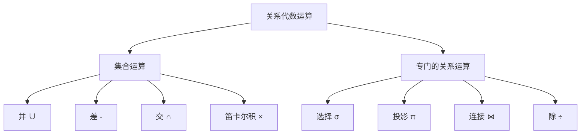

**基本运算详解**：

| 运算 | 符号 | 说明 | 示例 |
|-----|------|------|------|
| 选择 | σ | 按条件筛选行 | σ年龄>20(学生) |
| 投影 | π | 选择列并去重 | π姓名,年龄(学生) |
| 并 | ∪ | 合并两个同类关系，去重 | R ∪ S |
| 差 | - | R 中有 S 中没有的元组 | R - S |
| 笛卡尔积 | × | 所有可能的元组组合 | R × S |
| 连接 | ⋈ | 按条件组合两个关系 | R ⋈R.A=S.B S |

连接运算的分类：

- **θ 连接**：按任意条件连接
- **等值连接**：θ 为"="的连接
- **自然连接**：等值连接后去掉重复列
- **外连接**：保留悬浮元组，分为左外连接、右外连接、全外连接[^13]

---

## 函数依赖与 Armstrong 公理

函数依赖是关系数据库设计理论的核心概念，描述了属性间的约束关系[^14]。

> 📌 **考试重点**：函数依赖的定义、Armstrong 公理系统、属性集闭包的计算是范式分析的基础。
> 🔗 **真题关联**：案例分析中常要求分析给定关系模式的函数依赖并判断范式级别。

**函数依赖定义**：设 R(U) 是属性集 U 上的关系模式，X、Y ⊆ U。若对于 R(U) 的任意一个可能的关系 r，r 中不可能存在两个元组在 X 上的属性值相等而在 Y 上的属性值不等，则称 **X 函数决定 Y** 或 **Y 函数依赖于 X**，记作 X → Y[^15]。

函数依赖的分类：

- **完全函数依赖**：X → Y，且对 X 的任意真子集 X'，X' ↛ Y
- **部分函数依赖**：X → Y，但 Y 不完全依赖于 X
- **传递函数依赖**：X → Y，Y → Z，且 Y ↛ X，则 X → Z 为传递依赖[^16]

**Armstrong 公理系统**（推理规则）：

1. **自反律**：若 Y ⊆ X，则 X → Y
2. **增广律**：若 X → Y，则 XZ → YZ
3. **传递律**：若 X → Y 且 Y → Z，则 X → Z

由 Armstrong 公理可推导出三条有用的规则：

- **合并规则**：若 X → Y 且 X → Z，则 X → YZ
- **伪传递规则**：若 X → Y 且 WY → Z，则 WX → Z
- **分解规则**：若 X → Y 且 Z ⊆ Y，则 X → Z[^17]

---

## 关系数据库范式

范式（Normal Form）是关系模式满足的一定级别的约束条件，目的是消除数据冗余和更新异常[^18]。

> 📌 **考试重点**：1NF/2NF/3NF/BCNF 的定义和判定是每年必考内容，必须熟练掌握。
> 🔗 **真题关联**：综合知识常考范式判定（给定关系模式判断属于第几范式），案例分析常考规范化过程。

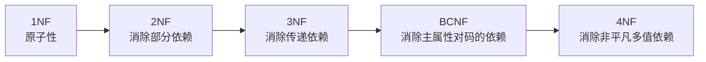

各范式定义：

| 范式 | 定义 | 解决的问题 |
|-----|------|-----------|
| **1NF** | 所有属性值都是不可分的原子值 | 消除重复组和复合属性 |
| **2NF** | 满足 1NF，且每个非主属性完全函数依赖于候选码 | 消除部分依赖 |
| **3NF** | 满足 2NF，且不存在非主属性对候选码的传递依赖 | 消除传递依赖 |
| **BCNF** | 满足 3NF，且每个决定因素都包含候选码 | 消除主属性对码的部分/传递依赖 |
| **4NF** | 满足 BCNF，且不存在非平凡多值依赖 | 消除多值依赖 |

**规范化过程示例**：

假设有关系模式 R(学号, 姓名, 课程号, 课程名, 成绩)，函数依赖为：
- 学号 → 姓名
- 课程号 → 课程名
- (学号, 课程号) → 成绩

分析：候选码为 (学号, 课程号)。姓名 部分依赖于候选码（只依赖学号），课程名 部分依赖于候选码（只依赖课程号），因此该关系模式属于 **1NF**。

规范化到 3NF：
- R1(学号, 姓名)
- R2(课程号, 课程名)
- R3(学号, 课程号, 成绩)[^19]

设计时通常将关系模式规范化到 **3NF 或 BCNF**，以兼顾性能与冗余控制。过度规范化可能导致连接操作增多，影响查询性能[^20]。

---

## 数据库设计基本步骤

数据库设计分为 **6 个阶段**，从需求分析到运行维护，是一个迭代完善的过程[^21]。

> 📌 **考试重点**：六个阶段的顺序、各阶段的主要任务和产出物是高频考点。
> 🔗 **真题关联**：案例分析中常要求根据给定需求完成数据库设计的部分阶段，如绘制 E-R 图并转换为关系模式。

各阶段要点：

| 阶段 | 主要任务 | 产出物 |
|-----|---------|--------|
| **需求分析** | 收集数据、处理、安全性与完整性要求 | 数据流图、数据字典、需求说明书 |
| **概念结构设计** | 建立独立于 DBMS 的概念模型 | E-R 图 |
| **逻辑结构设计** | E-R 图转关系模式，规范化，设计视图 | 关系模式、视图定义 |
| **物理结构设计** | 确定存储结构、索引、分区、集群 | 存储安排、索引设计 |
| **数据库实施** | 建立数据库、加载数据、编制与调试应用程序 | 实际数据库、应用程序 |
| **运行维护** | 性能监测、备份恢复、重组重构 | 维护文档 |

---

## 需求分析与数据字典

需求分析是数据库设计的起点，目标是准确了解并分析用户对系统的数据要求和处理要求[^22]。

> 📌 **考试重点**：需求分析的方法（访谈、调查、观察）、数据字典的内容和作用。
> 🔗 **真题关联**：案例分析中需求分析阶段常作为背景信息给出，需从中提取实体和联系。

需求分析的方法：

- **结构化分析方法**：自顶向下逐层分解，使用数据流图（DFD）和数据字典（DD）
- **面向对象分析方法**：使用用例图、类图等 UML 图

**数据字典**（Data Dictionary）是系统中各类数据描述的集合，是进行详细的数据收集和数据分析所获得的主要成果。数据字典通常包括：

- **数据项**：不可再分的数据单位
- **数据结构**：由若干数据项组成
- **数据流**：数据结构在系统内传输的路径
- **数据存储**：数据结构停留或保存的地方
- **处理过程**：处理逻辑的描述[^23]

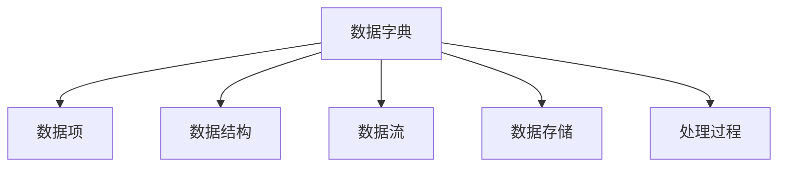

---

## 概念结构设计（E-R 模型）

概念结构设计是将需求分析得到的用户需求抽象为信息结构（概念模型）的过程，最常用的方法是 **E-R 模型**（实体-联系模型）[^24]。

> 📌 **考试重点**：E-R 图的三个基本元素（实体、属性、联系）、联系的三种类型（1:1、1:n、m:n）、E-R 图合并时的冲突处理。
> 🔗 **真题关联**：案例分析几乎必考，要求根据需求描述绘制 E-R 图或补充缺失的联系。

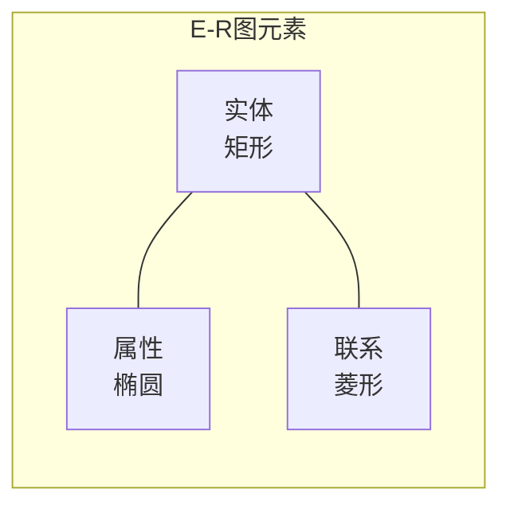

E-R 模型的基本元素：

- **实体（Entity）**：客观存在并可相互区别的事物，用矩形表示
- **属性（Attribute）**：实体的特性，用椭圆表示
- **联系（Relationship）**：实体之间的关联，用菱形表示

联系的三种类型：

| 联系类型 | 图示 | 示例 |
|---------|------|------|
| 一对一（1:1） | A ─── B | 班级与班长 |
| 一对多（1:n） | A ─┬─ B | 班级与学生 |
| 多对多（m:n） | A ─┼─ B | 学生与课程 |

**E-R 图合并时的冲突**：

1. **属性冲突**：同一属性在不同局部 E-R 图中有不同的类型、取值范围或单位
2. **命名冲突**：同名异义或异名同义
3. **结构冲突**：同一对象在不同局部 E-R 图中作为实体或属性[^25]

---

## 逻辑结构设计

逻辑结构设计是将概念结构（E-R 图）转换为某个 DBMS 所支持的 **数据模型**（主要是关系模型），并对其进行优化的过程[^26]。

> 📌 **考试重点**：E-R 图向关系模式的转换规则、规范化处理、视图设计。
> 🔗 **真题关联**：案例分析高频考点，给定 E-R 图要求写出关系模式并标注主键外键。

**E-R 图向关系模型的转换规则**：

1. **实体转关系**：每个实体型转换为一个关系模式，实体的属性成为关系的属性，实体的码成为关系的码
2. **1:1 联系**：可以独立转换为一个关系模式，也可以与任意一端的关系模式合并
3. **1:n 联系**：可以独立转换为一个关系模式，也可以与 n 端的关系模式合并（推荐）
4. **m:n 联系**：必须转换为一个独立的关系模式，联系本身的属性也要纳入该关系模式
5. **多元联系**：转换为一个关系模式，各实体的码组成关系的码或关系码的一部分[^27]

转换示例：

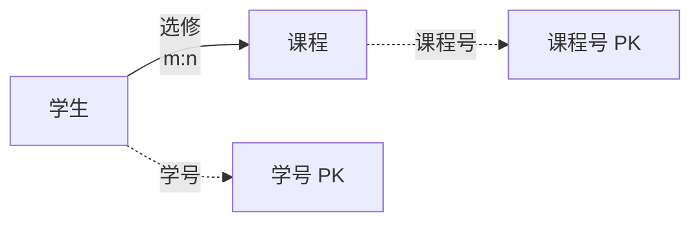

转换为关系模式：
- 学生(<u>学号</u>, 姓名, 性别)
- 课程(<u>课程号</u>, 课程名, 学分)
- 选修(<u>学号</u>, <u>课程号</u>, 成绩)，其中学号引用学生，课程号引用课程

---

## 物理结构设计

物理结构设计是为逻辑数据模型选取一个最适合应用环境的物理结构，包括确定数据的存储结构和存取方法[^28]。

> 📌 **考试重点**：物理设计的主要内容、索引的类型和选择策略。
> 🔗 **真题关联**：综合知识中常考索引相关概念，如 B+ 树索引、聚簇索引等。

物理设计的主要内容：

1. **确定数据的存储结构**：如行存储 vs 列存储、堆文件 vs 顺序文件
2. **设计索引**：提高数据存取效率
3. **设计存储路径**：如分区、分片策略
4. **确定数据存放位置**：磁盘布局、RAID 配置
5. **评估存储空间**：估算数据量和增长趋势[^29]

**索引类型**：

| 索引类型 | 特点 | 适用场景 |
|---------|------|---------|
| B+ 树索引 | 平衡树结构，支持范围查询 | 等值查询和范围查询 |
| 哈希索引 | 精确匹配，O(1) 查找 | 等值查询 |
| 位图索引 | 用位图表示列值 | 低基数列（如性别、状态） |
| 全文索引 | 针对文本内容 | 文本搜索 |
| 聚簇索引 | 数据按索引键顺序存储 | 范围查询频繁的场景 |

---

## 事务与并发控制

事务是数据库操作的基本逻辑单位，具有 **ACID 特性**。并发控制保证多个事务同时执行时数据库的一致性[^30]。

> 📌 **考试重点**：ACID 四个特性的含义、并发操作带来的三类数据不一致、封锁协议（三级封锁协议）。
> 🔗 **真题关联**：综合知识必考内容，如"事务的隔离性是指什么"、"三级封锁协议解决了什么问题"。

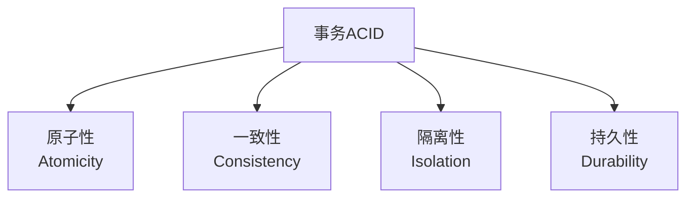

**ACID 特性**：

| 特性 | 含义 | 实现机制 |
|-----|------|---------|
| **原子性** | 事务中的所有操作要么全做，要么全不做 | 日志（Undo/Redo） |
| **一致性** | 事务执行结果使数据库从一个一致性状态变为另一个一致性状态 | 完整性约束、触发器 |
| **隔离性** | 并发事务的执行互不干扰 | 封锁、时间戳、乐观控制 |
| **持久性** | 事务一旦提交，对数据库的改变是永久的 | 日志、备份 |

**并发操作带来的数据不一致**：

1. **丢失修改**：两个事务同时修改同一数据，后提交的事务覆盖了先提交的事务的修改
2. **不可重复读**：同一事务内两次读取同一数据，结果不同（因为另一个事务修改了该数据）
3. **读脏数据**：读取了另一个事务未提交的修改数据，而该事务后来回滚了[^31]

**封锁协议**：

| 协议级别 | 要求 | 解决的问题 |
|---------|------|-----------|
| **一级封锁协议** | 修改前加 X 锁，事务结束释放 | 丢失修改 |
| **二级封锁协议** | 一级 + 读取前加 S 锁，读完后释放 | 丢失修改、读脏数据 |
| **三级封锁协议** | 一级 + 读取前加 S 锁，事务结束释放 | 丢失修改、读脏数据、不可重复读 |

> 📌 **考试重点**：三级封锁协议与隔离级别的对应关系是重要考点。三级封锁协议等价于可重复读隔离级别。

---

## 数据库完整性约束

数据库完整性是指数据的正确性和相容性，防止不合语义的数据进入数据库。完整性约束包括 **实体完整性**、**参照完整性** 和 **用户定义完整性**[^32]。

> 📌 **考试重点**：三类完整性约束的定义和作用，触发器与约束的区别。
> 🔗 **真题关联**：常考选择题，如"外键约束属于哪种完整性"。

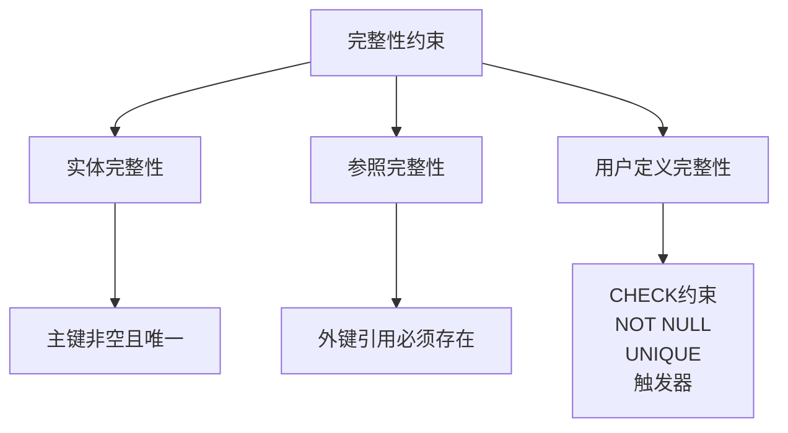

**三类完整性约束**：

| 约束类型 | 定义 | 实现方式 |
|---------|------|---------|
| **实体完整性** | 主键的值不能为空且必须唯一 | PRIMARY KEY 约束 |
| **参照完整性** | 外键的值必须是被引用关系主键的有效值或空值 | FOREIGN KEY 约束 |
| **用户定义完整性** | 针对某一具体应用的约束条件 | CHECK、NOT NULL、UNIQUE、触发器 |

**触发器（Trigger）**：是一种特殊的存储过程，在特定事件（INSERT、UPDATE、DELETE）发生时自动执行。触发器可以实现复杂的完整性约束和业务规则[^33]。

---

## 应用程序与数据库的交互

应用程序与数据库的交互方式包括库函数接口、嵌入式 SQL、通用数据接口标准和 **ORM**[^34]。

> 📌 **考试重点**：四种交互方式的特点、ODBC/JDBC 的体系结构、ORM 的优缺点。
> 🔗 **真题关联**：常考选择题，如"ODBC 的作用是什么"、"ORM 的主要优点"。

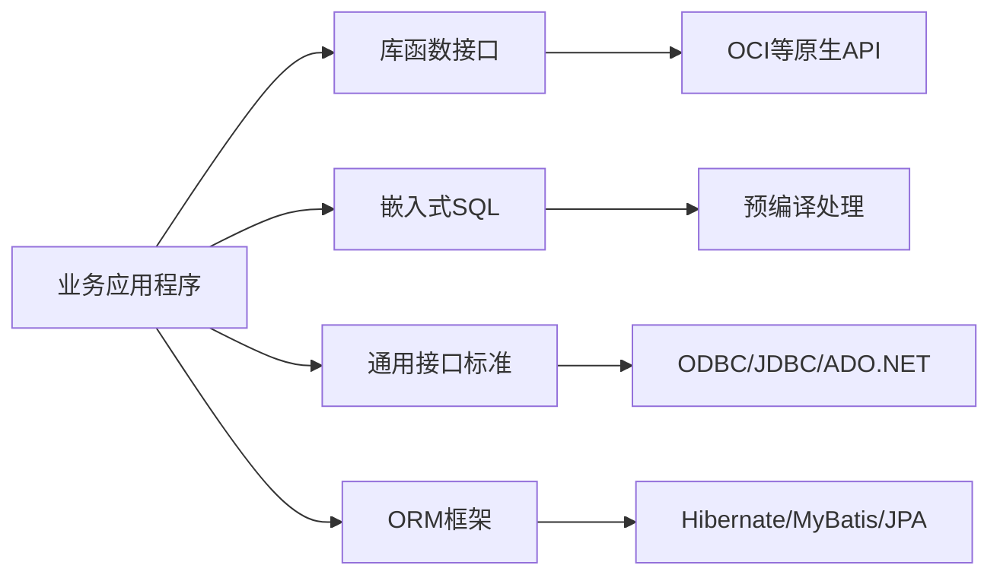

**四种交互方式**：

| 方式 | 特点 | 代表技术 |
|-----|------|---------|
| **库函数接口** | 直接调用 DBMS 提供的 API，效率高但可移植性差 | Oracle OCI、MySQL C API |
| **嵌入式 SQL** | 将 SQL 语句嵌入宿主语言，通过预编译器处理 | Pro*C、ESQL/C |
| **通用接口标准** | 统一的 API 屏蔽不同 DBMS 的差异，提高可移植性 | ODBC、JDBC、ADO.NET |
| **ORM** | 对象与关系表的自动映射，面向对象操作数据库 | Hibernate、MyBatis、Entity Framework |

**ODBC 体系结构**：

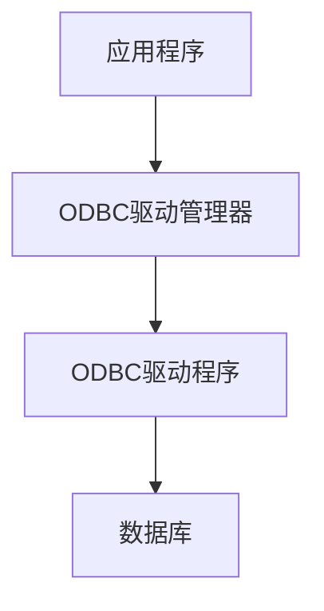

- **应用程序**：调用 ODBC API 提交 SQL 语句
- **ODBC 驱动管理器**：加载驱动程序，管理连接
- **ODBC 驱动程序**：将 ODBC 调用转换为特定 DBMS 的调用
- **数据源（DSN）**：包含数据库位置、驱动程序等连接信息[^35]

**ORM（对象关系映射）**：

- 通过描述对象与数据库之间映射的元数据，将程序对象与关系表相互转换
- 优势：屏蔽 SQL 细节、提高开发效率、增强可移植性、减少样板代码
- 劣势：复杂查询性能可能不如手写 SQL、增加学习成本、可能产生 N+1 查询问题[^36]

---

## NoSQL 数据库

NoSQL 泛指非关系型数据库，不保证完整的 ACID 特性，适用于海量数据、高并发、灵活 schema 的场景[^37]。

> 📌 **考试重点**：NoSQL 的四种类型及其特点、CAP 定理、NoSQL 与关系数据库的适用场景对比。
> 🔗 **真题关联**：常考选择题，如"Redis 属于哪种类型的 NoSQL 数据库"、"CAP 定理中分区容错性与一致性的权衡"。

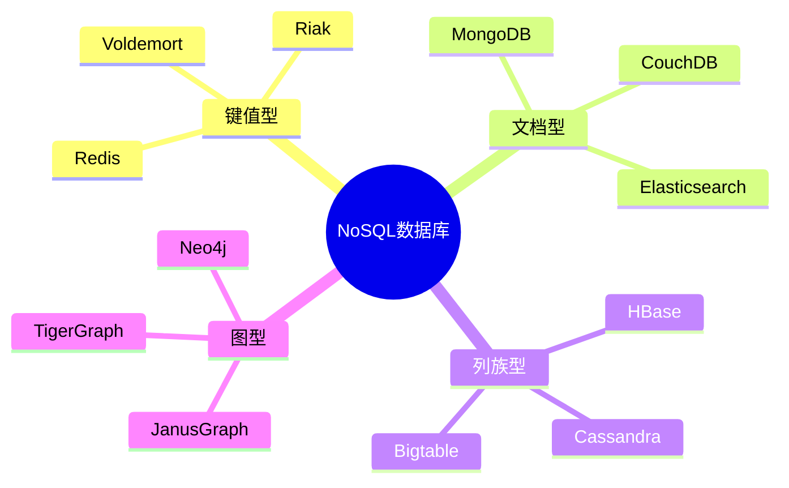

**四种主要类型**：

| 类型 | 数据模型 | 特点 | 适用场景 | 代表产品 |
|-----|---------|------|---------|---------|
| **键值型** | 简单的 key-value 对 | 结构简单，读写极快 | 缓存、会话存储、配置中心 | Redis、Riak |
| **文档型** | JSON/BSON 等半结构化文档 | 支持嵌套，Schema 灵活 | 内容管理、Web 应用、日志 | MongoDB、CouchDB |
| **列族型** | 按列存储的稀疏矩阵 | 高扩展性，适合分布式 | 海量数据分析、时序数据 | HBase、Cassandra |
| **图型** | 节点和边的图结构 | 擅长关系遍历和查询 | 社交网络、推荐系统、知识图谱 | Neo4j、JanusGraph |

**CAP 定理**：分布式系统最多同时满足以下两项：

- **一致性（Consistency）**：所有节点在同一时间看到相同的数据
- **可用性（Availability）**：每个请求都能收到非错误的响应
- **分区容错性（Partition Tolerance）**：系统在网络分区时仍能继续运行[^38]

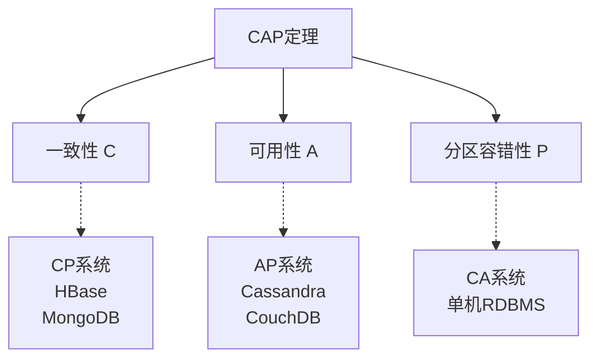

NoSQL 的共同特点：易扩展、大数据量高性能、灵活数据模型、高可用。通常采用 **最终一致性** 而非强一致性[^39]。

---

## 数据库安全与备份恢复

数据库安全是指保护数据库以防止不合法的使用所造成的数据泄露、更改或破坏。备份恢复是保障数据持久性和业务连续性的重要手段[^40]。

> 📌 **考试重点**：数据库安全机制（用户认证、权限控制、审计、加密）、备份策略（全量/增量/差异）。
> 🔗 **真题关联**：常与信息安全章节结合考查，如"数据库加密的方式有哪些"。

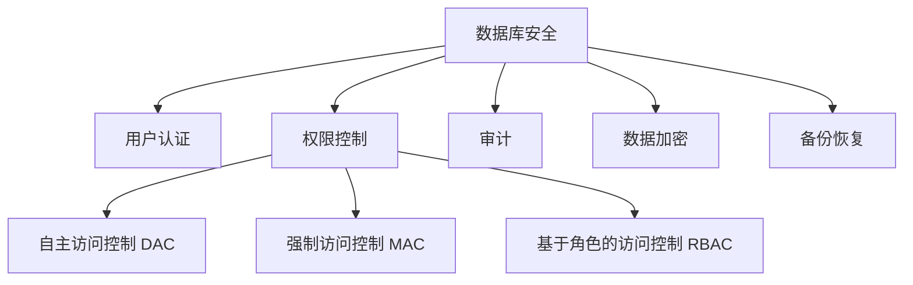

**数据库安全机制**：

| 机制 | 说明 |
|-----|------|
| **用户认证** | 验证用户身份，如用户名/密码、生物特征、数字证书 |
| **权限控制** | 控制用户对数据的访问权限，包括 DAC、MAC、RBAC |
| **审计** | 记录用户对数据库的所有操作，用于事后追溯 |
| **数据加密** | 对敏感数据进行加密存储和传输 |
| **视图机制** | 通过视图限制用户只能看到授权的数据 |

**备份策略**：

| 备份类型 | 说明 | 恢复速度 | 空间占用 |
|---------|------|---------|---------|
| **全量备份** | 备份整个数据库 | 快 | 大 |
| **增量备份** | 备份自上次备份以来变化的数据 | 慢（需依次恢复） | 小 |
| **差异备份** | 备份自上次全量备份以来变化的数据 | 较快 | 中等 |

**数据库故障类型**：

1. **事务故障**：事务内部逻辑错误或系统错误，通过 Undo 日志恢复
2. **系统故障**：CPU 故障、断电等，通过 Redo/Undo 日志恢复
3. **介质故障**：磁盘损坏，通过备份和日志恢复[^41]

---

## 数据库新技术与发展趋势

数据库技术持续发展，出现了分布式数据库、云数据库、NewSQL、时序数据库、图数据库等新技术[^42]。

> 📌 **考试重点**：了解分布式数据库的特点、NewSQL 的定位（结合 NoSQL 的可扩展性和关系数据库的 ACID）。
> 🔗 **真题关联**：第11章"未来信息技术"中可能涉及，综合知识偶尔考查。

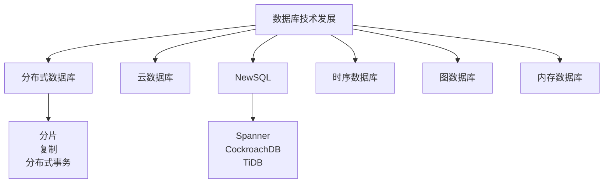

**NewSQL**：

NewSQL 是一类现代关系数据库系统，旨在为在线事务处理（OLTP）工作负载提供与 NoSQL 系统相同的可扩展性能，同时保持传统关系数据库的 ACID 保证和 SQL 接口[^43]。

代表产品：Google Spanner、CockroachDB、TiDB、OceanBase。

**分布式数据库的核心问题**：

1. **数据分片（Sharding）**：将数据分布到多个节点
2. **数据复制（Replication）**：提高可用性和读取性能
3. **分布式事务**：保证跨节点事务的 ACID 特性
4. **一致性协议**：如 Paxos、Raft[^44]

---

## 参考文献

[^1]: 《系统架构设计师教程(第二版)》P.222 §6.1.1

[^2]: 《系统架构设计师教程(第二版)》P.222 §6.1.2

[^3]: 《系统架构设计师教程(第二版)》P.223 §6.1.3

[^4]: 《系统架构设计师教程(第二版)》P.223 §6.1.3

[^5]: 《系统架构设计师教程(第二版)》P.223 §6.1.4

[^6]: 《系统架构设计师教程(第二版)》P.224 §6.1.4

[^7]: 《系统架构设计师教程(第二版)》P.224 §6.1.4

[^8]: 《系统架构设计师教程(第二版)》P.224 §6.1.4

[^9]: 《系统架构设计师教程(第二版)》P.225 §6.2.1

[^10]: 《系统架构设计师教程(第二版)》P.225 §6.2.1

[^11]: 《系统架构设计师教程(第二版)》P.226 §6.2.1

[^12]: 《系统架构设计师教程(第二版)》P.227 §6.2.2

[^13]: 《系统架构设计师教程(第二版)》P.228-229 §6.2.2

[^14]: 《系统架构设计师教程(第二版)》P.231 §6.2.3

[^15]: 《系统架构设计师教程(第二版)》P.231 §6.2.3

[^16]: 《系统架构设计师教程(第二版)》P.231 §6.2.3

[^17]: 《系统架构设计师教程(第二版)》P.232 §6.2.3

[^18]: 《系统架构设计师教程(第二版)》P.232 §6.2.3

[^19]: 《系统架构设计师教程(第二版)》P.232-233 §6.2.3

[^20]: 《系统架构设计师教程(第二版)》P.233 §6.2.3

[^21]: 《系统架构设计师教程(第二版)》P.234 §6.3.1

[^22]: 《系统架构设计师教程(第二版)》P.235 §6.3.2

[^23]: 《系统架构设计师教程(第二版)》P.235 §6.3.2

[^24]: 《系统架构设计师教程(第二版)》P.235 §6.3.3

[^25]: 《系统架构设计师教程(第二版)》P.236 §6.3.3

[^26]: 《系统架构设计师教程(第二版)》P.237 §6.3.4

[^27]: 《系统架构设计师教程(第二版)》P.237-238 §6.3.4

[^28]: 《系统架构设计师教程(第二版)》P.239 §6.3.5

[^29]: 《系统架构设计师教程(第二版)》P.239-240 §6.3.5

[^30]: 《系统架构设计师教程(第二版)》P.240 §6.3.5

[^31]: 《系统架构设计师教程(第二版)》P.240 §6.3.5

[^32]: 《系统架构设计师教程(第二版)》P.238 §6.3.4

[^33]: 《系统架构设计师教程(第二版)》P.238 §6.3.4

[^34]: 《系统架构设计师教程(第二版)》P.243 §6.4

[^35]: 《系统架构设计师教程(第二版)》P.243-244 §6.4.1-6.4.3

[^36]: 《系统架构设计师教程(第二版)》P.245 §6.4.4

[^37]: 《系统架构设计师教程(第二版)》P.246 §6.5

[^38]: 《系统架构设计师教程(第二版)》P.247 §6.5.2

[^39]: 《系统架构设计师教程(第二版)》P.247 §6.5.2

[^40]: 《系统架构设计师教程(第二版)》P.242 §6.3.7

[^41]: 《系统架构设计师教程(第二版)》P.242 §6.3.7

[^42]: 《系统架构设计师教程(第二版)》P.247 §6.5.2

[^43]: 《系统架构设计师教程(第二版)》P.247 §6.5.2

[^44]: 《系统架构设计师教程(第二版)》P.247 §6.5.2
