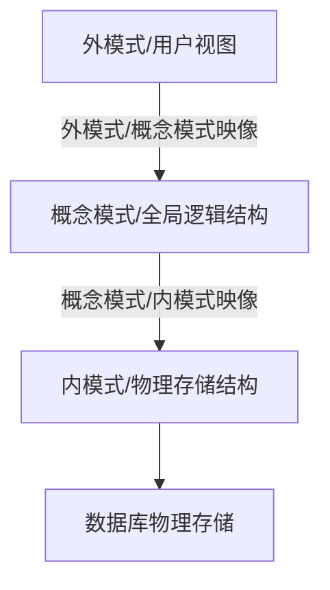
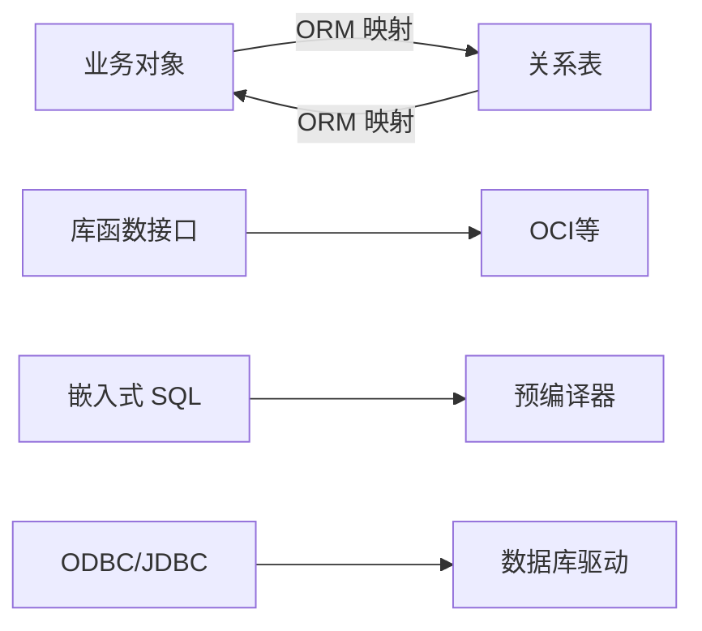
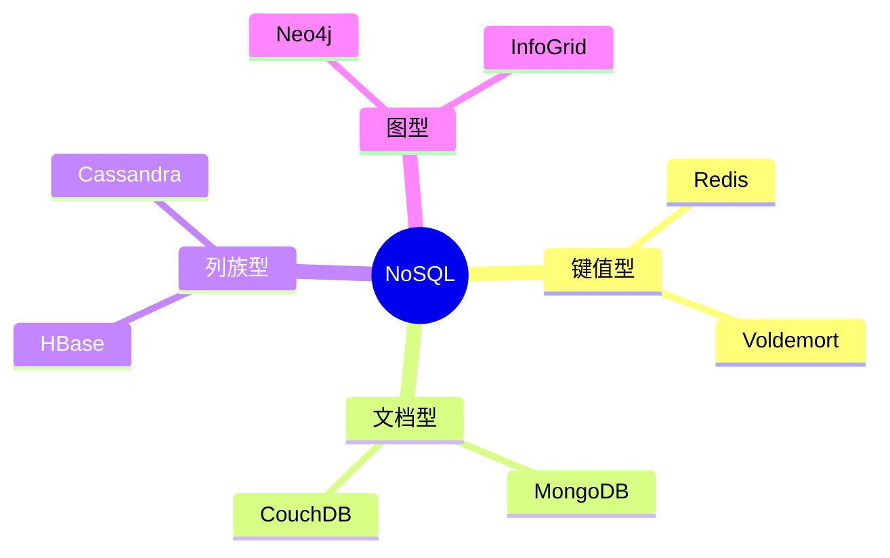

## 数据库三级模式

数据库系统通常采用 **三级模式结构**，通过视图层、逻辑层和物理层三个抽象层次屏蔽系统复杂性，简化用户与系统的交互[^1]。

三级模式定义如下：

- **外模式**：也称用户模式或子模式，是用户与数据库系统的接口，描述用户需要使用的部分数据[^2]。
- **概念模式**：也称模式，是数据库中全部数据的逻辑结构和特征的描述，不涉及具体值和存储细节[^3]。
- **内模式**：也称存储模式，描述数据物理结构和存储方式，包括索引、文件组织等[^4]。

两级映像（外模式/概念模式、概念模式/内模式）保证数据的 **逻辑独立性** 和 **物理独立性**，使某一层的修改不影响其他层[^5]。

---

## 关系数据库设计理论

关系数据库设计理论的核心是 **函数依赖** 和 **范式规范化**，目标是减少冗余、避免更新异常[^6]。

主要概念包括：

- **函数依赖**：属性间的约束关系，如 X→Y 表示 X 决定 Y[^7]。
- **部分依赖**：非主属性依赖于候选码的一部分。
- **传递依赖**：非主属性通过其他非主属性依赖于候选码。
- **范式**：1NF 要求属性原子；2NF 消除部分依赖；3NF 消除传递依赖；BCNF 要求所有决定因素都含候选码；4NF 处理多值依赖[^8]。

设计时通常将关系模式规范化到 **3NF 或 BCNF**，以兼顾性能与冗余控制[^9]。

---

## 数据库设计步骤

数据库设计分为 **6 个阶段**，从需求分析到运行维护，是一个迭代完善的过程[^10]。

各阶段要点：

- **需求分析**：收集数据、处理、系统要求，使用数据流图和数据字典[^11]。
- **概念结构设计**：使用 E-R 图建立独立于 DBMS 的概念模型，包括实体、属性和联系[^12]。
- **逻辑结构设计**：将 E-R 图转换为关系模式，进行规范化、确定完整性约束和用户视图[^13]。
- **物理结构设计**：确定数据分布、存储结构、索引和访问方式[^14]。
- **数据库实施**：使用 DDL 建立数据库结构、加载数据、试运行[^15]。
- **运行维护**：性能监测、备份恢复、重组重构[^16]。

---

## ORM 与数据交互

应用程序与数据库的交互方式包括库函数、嵌入式 SQL、通用数据接口标准和 **ORM**[^17]。

- **ORM（对象关系映射）**：通过描述对象与数据库之间映射的元数据，将程序对象与关系表相互转换，降低数据库访问复杂度[^18]。
- 常见框架：Java 生态中的 **Hibernate**（全自动）、**MyBatis**（半自动）、**JPA**；其他语言有 GORM、Entity Framework 等[^19]。
- ORM 的优势：屏蔽 SQL 细节、提高开发效率、增强可移植性；劣势：复杂查询性能可能不如手写 SQL[^20]。

---

## NoSQL 数据库分类

NoSQL 泛指非关系型数据库，不保证 ACID 特性，适用于海量数据、高并发、灵活 schema 的场景[^21]。

四种主要类型：

- **键值型**：结构简单，通过 Hash 表快速存取，适合缓存和会话存储[^22]。
- **文档型**：以 JSON 等半结构化文档存储，支持嵌套，适合内容管理和 Web 应用[^23]。
- **列族型**：按列存储，适合分布式海量数据，如 HBase、Cassandra[^24]。
- **图型**：使用图模型存储节点和边，适合社交网络、推荐系统等复杂关系数据[^25]。

NoSQL 的共同特点包括：易扩展、大数据量高性能、灵活数据模型、高可用，通常采用最终一致性而非强一致性[^26]。

---

## 参考文献

[^1]: 《系统架构设计师教程(第二版)》P.223 §6.1.4

[^2]: 《系统架构设计师教程(第二版)》P.224 §6.1.4

[^3]: 《系统架构设计师教程(第二版)》P.224 §6.1.4

[^4]: 《系统架构设计师教程(第二版)》P.224 §6.1.4

[^5]: 《系统架构设计师教程(第二版)》P.224 §6.1.4

[^6]: 《系统架构设计师教程(第二版)》P.231 §6.2.3

[^7]: 《系统架构设计师教程(第二版)》P.231 §6.2.3

[^8]: 《系统架构设计师教程(第二版)》P.232-233 §6.2.3

[^9]: 《系统架构设计师教程(第二版)》P.233 §6.2.3

[^10]: 《系统架构设计师教程(第二版)》P.234 §6.3.1

[^11]: 《系统架构设计师教程(第二版)》P.235 §6.3.2

[^12]: 《系统架构设计师教程(第二版)》P.235 §6.3.3

[^13]: 《系统架构设计师教程(第二版)》P.237 §6.3.4

[^14]: 《系统架构设计师教程(第二版)》P.239 §6.3.5

[^15]: 《系统架构设计师教程(第二版)》P.241 §6.3.6

[^16]: 《系统架构设计师教程(第二版)》P.242 §6.3.7

[^17]: 《系统架构设计师教程(第二版)》P.243 §6.4

[^18]: 《系统架构设计师教程(第二版)》P.245 §6.4.4

[^19]: 《系统架构设计师教程(第二版)》P.245 §6.4.4

[^20]: 《系统架构设计师教程(第二版)》P.245 §6.4.4

[^21]: 《系统架构设计师教程(第二版)》P.246 §6.5

[^22]: 《系统架构设计师教程(第二版)》P.246 §6.5.1

[^23]: 《系统架构设计师教程(第二版)》P.246 §6.5.1

[^24]: 《系统架构设计师教程(第二版)》P.246 §6.5.1

[^25]: 《系统架构设计师教程(第二版)》P.246 §6.5.1

[^26]: 《系统架构设计师教程(第二版)》P.247 §6.5.2
