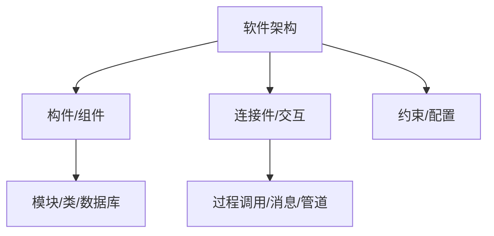
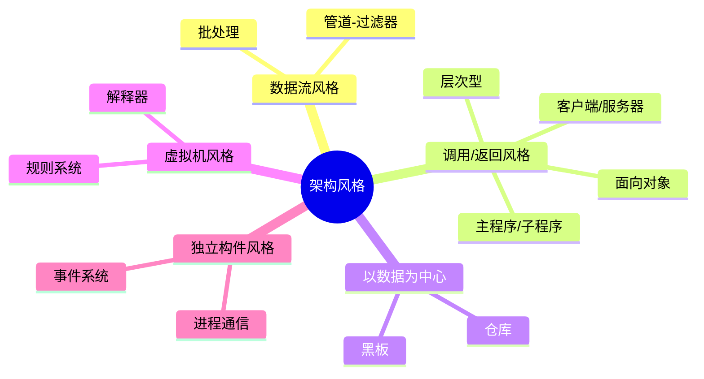
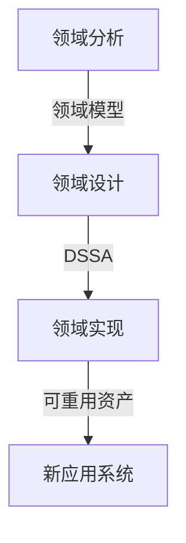

## 软件架构定义

软件架构是系统的一个或多个结构，包含 **软件构件、构件的外部可见属性以及它们之间的相互关系**[^1]。架构设计关注软件构件的结构、属性和交互作用，是构建软件的初始蓝图[^2]。

软件架构的重要性体现在：满足系统品质、使受益人达成一致、支持计划编制、指导系统开发、有效管理复杂性、为复用奠定基础、降低维护费用、支持冲突分析[^3]。

架构设计贯穿软件全生命周期，从需求分析到后开发阶段（动态演化、恢复重建）均发挥关键作用[^4]。

---

## 基于架构的软件开发（ABSD）

ABSD（Architecture-Based Software Design）是一种以架构为核心驱动的软件开发方法，设计活动可从项目总体功能框架明确时就开始，与需求分析并行[^5]。

ABSD 的三个基础：

- **功能分解**：使用模块内聚和耦合技术[^6]。
- **架构风格选择**：通过选择风格实现质量和商业需求[^7]。
- **软件模板**：利用已有系统结构[^8]。

设计元素自顶向下递归细化：系统 → 概念子系统 → 概念构件 → 实际构件。每个阶段都有评审和迭代[^9]。

---

## 架构风格分类

架构风格是描述特定应用领域中系统组织方式的惯用模式，定义了构件和连接件的词汇表及约束[^10]。

主要架构风格：

- **数据流风格**：批处理（独立程序顺序执行）、管道-过滤器（数据流驱动，过滤器处理、管道传输）[^11]。
- **调用/返回风格**：主程序/子程序、面向对象、层次型（每层为上层服务、下层客户）、C/S 和三层 C/S[^12]。
- **以数据为中心**：仓库（中央数据+独立构件）、黑板（知识源+共享黑板，适合复杂问题求解）[^13]。
- **虚拟机风格**：解释器、规则系统（增加灵活性，但执行效率较低）[^14]。
- **独立构件风格**：进程通信、事件系统（隐式调用，构件不直接调用过程，通过事件触发）[^15]。

---

## 软件架构复用

软件架构复用是指系统化地识别、开发、获取和修改软件资产，以便在不同开发过程中重复使用[^16]。

复用类型包括 **机会复用**（发现即复用）和 **系统复用**（开发前规划复用策略）[^17]。

可复用的资产包括：需求、架构设计、元素、建模与分析、测试、项目规划、过程方法和工具、人员、样本系统、缺陷消除经验[^18]。

复用过程三阶段：

1. **获取可复用资产**：构造可靠、易理解的构件[^19]。
2. **管理可复用资产**：构件库存储、分类、检索[^20]。
3. **使用可复用资产**：选择、定制、组装[^21]。

---

## 特定领域软件架构（DSSA）

DSSA（Domain Specific Software Architecture）是在一个特定应用领域中为一组应用提供组织结构参考的标准软件架构[^22]。

DSSA 的三个基本活动：

- **领域分析**：获得领域模型，描述系统中共同需求，定义领域边界[^23]。
- **领域设计**：获得 DSSA，描述满足领域需求的解决方案，具有适应变化的能力[^24]。
- **领域实现**：开发和组织可重用信息，依据领域模型和 DSSA 进行[^25]。

DSSA 的必备特征：严格定义的问题域和解域、具有普遍性、领域构件组织模型的恰当抽象、固定的可重用元素[^26]。

参与人员包括：领域专家、领域分析人员、领域设计人员、领域实现人员[^27]。

---

## 参考文献

[^1]: 《系统架构设计师教程(第二版)》P.248 §7.1.1

[^2]: 《系统架构设计师教程(第二版)》P.248 §7.1.1

[^3]: 《系统架构设计师教程(第二版)》P.252-253 §7.1.3

[^4]: 《系统架构设计师教程(第二版)》P.248-252 §7.1.2

[^5]: 《系统架构设计师教程(第二版)》P.254 §7.2.1

[^6]: 《系统架构设计师教程(第二版)》P.254 §7.2.2

[^7]: 《系统架构设计师教程(第二版)》P.254 §7.2.2

[^8]: 《系统架构设计师教程(第二版)》P.254 §7.2.2

[^9]: 《系统架构设计师教程(第二版)》P.255 §7.2.3

[^10]: 《系统架构设计师教程(第二版)》P.259 §7.3.1

[^11]: 《系统架构设计师教程(第二版)》P.259-260 §7.3.2

[^12]: 《系统架构设计师教程(第二版)》P.260-262 §7.3.3

[^13]: 《系统架构设计师教程(第二版)》P.262-263 §7.3.4

[^14]: 《系统架构设计师教程(第二版)》P.263-264 §7.3.5

[^15]: 《系统架构设计师教程(第二版)》P.264-265 §7.3.6

[^16]: 《系统架构设计师教程(第二版)》P.265 §7.4.1

[^17]: 《系统架构设计师教程(第二版)》P.265 §7.4.1

[^18]: 《系统架构设计师教程(第二版)》P.266 §7.4.3

[^19]: 《系统架构设计师教程(第二版)》P.267 §7.4.4

[^20]: 《系统架构设计师教程(第二版)》P.267 §7.4.4

[^21]: 《系统架构设计师教程(第二版)》P.267 §7.4.4

[^22]: 《系统架构设计师教程(第二版)》P.267 §7.5.1

[^23]: 《系统架构设计师教程(第二版)》P.268 §7.5.2

[^24]: 《系统架构设计师教程(第二版)》P.268 §7.5.2

[^25]: 《系统架构设计师教程(第二版)》P.268 §7.5.2

[^26]: 《系统架构设计师教程(第二版)》P.267 §7.5.1

[^27]: 《系统架构设计师教程(第二版)》P.269 §7.5.3
