## 软件架构定义

软件架构是系统的一个或多个结构，包含 **软件构件、构件的外部可见属性以及它们之间的相互关系**[^1]。架构设计关注软件构件的结构、属性和交互作用，是构建软件的初始蓝图[^2]。

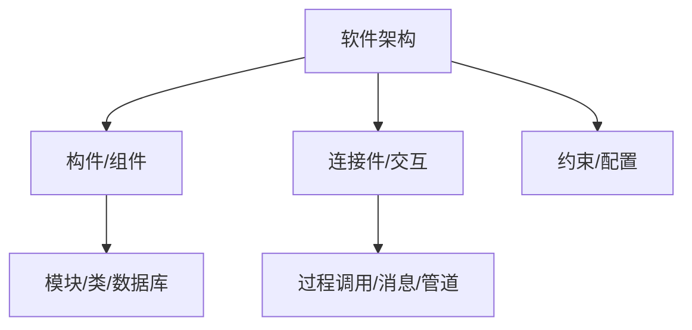

软件架构的重要性体现在：满足系统品质、使受益人达成一致、支持计划编制、指导系统开发、有效管理复杂性、为复用奠定基础、降低维护费用、支持冲突分析[^3]。

架构设计贯穿软件全生命周期，从需求分析到后开发阶段（动态演化、恢复重建）均发挥关键作用[^4]。

> 📌 **考试重点**：软件架构三要素（构件、连接件、约束）是高频考点，常以选择题形式考查定义和组成。

> 🔗 **真题关联**：历年真题多次考查软件架构定义及三要素，如2023年上半年第5题、2022年下半年第8题。

---

## 基于架构的软件开发（ABSD）

ABSD（Architecture-Based Software Design）是一种以架构为核心驱动的软件开发方法，设计活动可从项目总体功能框架明确时就开始，与需求分析并行[^5]。

ABSD 的三个基础：

- **功能分解**：使用模块内聚和耦合技术[^6]。
- **架构风格选择**：通过选择风格实现质量和商业需求[^7]。
- **软件模板**：利用已有系统结构[^8]。

设计元素自顶向下递归细化：系统 → 概念子系统 → 概念构件 → 实际构件。每个阶段都有评审和迭代[^9]。

> 📌 **考试重点**：ABSD的三个基础（功能分解、架构风格选择、软件模板）和递归细化过程是常考内容。

> 🔗 **真题关联**：2024年上半年第12题考查了ABSD的三个基础；2023年下半年第15题考查了ABSD开发模型。

---

## 架构需求

架构需求是指用户对目标软件系统在功能、行为、性能、设计约束等方面的期望[^10]。架构需求受技术环境和架构设计师经验影响，需求过程主要是获取用户需求，标识系统中所要用到的构件[^11]。

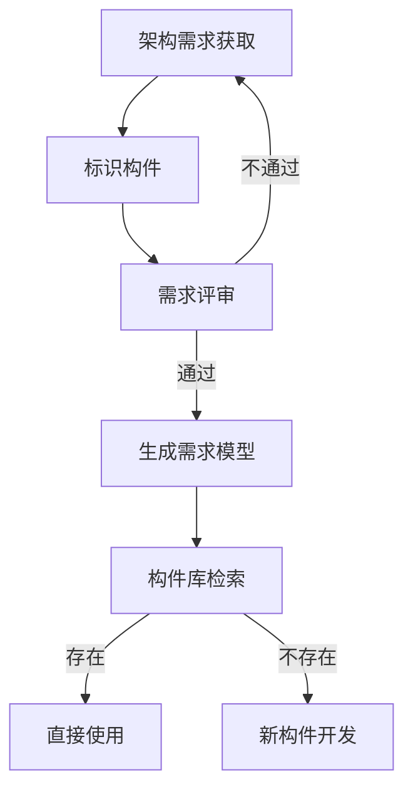

架构需求获取过程：

1. **需求获取**：与用户沟通，收集功能和非功能需求[^12]。
2. **标识构件**：从需求中提取系统构件，建立需求模型[^13]。
3. **需求评审**：组织评审小组对需求进行审查，确保正确性和完整性[^14]。

> 📌 **考试重点**：架构需求获取的三个步骤（需求获取、标识构件、需求评审）是考试常考点。

> 🔗 **真题关联**：2023年上半年第18题考查了架构需求获取过程；2022年上半年第22题考查了需求评审的作用。

---

## 架构设计

架构设计是一个迭代过程，包括提出架构模型、产生架构设计和进行设计评审等活动[^15]。架构设计将需求转化为软件架构，是ABSD方法的核心环节[^16]。

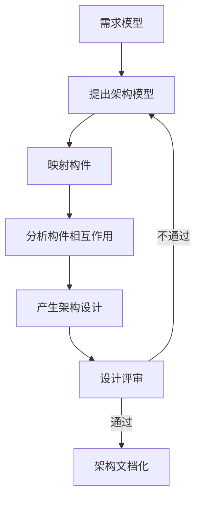

架构设计步骤：

1. **提出架构模型**：根据需求选择合适的架构风格，建立初步架构模型[^17]。
2. **映射构件**：将已标识的构件映射到架构模型中，产生中间结构[^18]。
3. **分析构件相互作用**：明确构件之间的连接关系和交互方式[^19]。
4. **产生架构设计**：完善中间结构，形成完整的架构设计[^20]。
5. **设计评审**：邀请外部人员对架构设计进行评审[^21]。

> 📌 **考试重点**：架构设计的五个步骤和迭代特性是重要考点，常以流程题形式出现。

> 🔗 **真题关联**：2024年下半年第10题考查了架构设计步骤；2023年上半年第25题考查了架构设计评审。

---

## 架构文档化

架构文档化是对架构设计结果的记录和描述，主要输出是 **架构需求规格说明** 和 **测试架构需求的质量设计说明书**[^22]。文档化的目的是在系统开发者之间建立共同的理解基础[^23]。

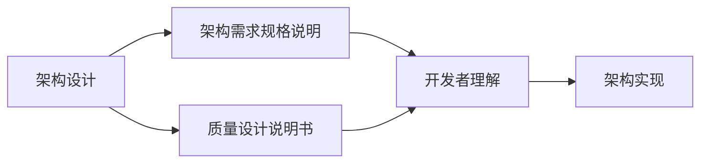

架构文档化的主要内容：

- **架构需求规格说明**：描述系统的功能需求、质量属性需求和约束条件[^24]。
- **质量设计说明书**：描述架构如何满足质量属性需求，包括性能、可靠性、安全性等[^25]。
- **架构视图**：从不同角度描述架构，如逻辑视图、进程视图、物理视图、开发视图[^26]。

> 📌 **考试重点**：架构文档化的两个主要输出（架构需求规格说明、质量设计说明书）是高频考点。

> 🔗 **真题关联**：2023年下半年第30题考查了架构文档化的输出；2022年下半年第35题考查了架构视图。

---

## 架构复审

架构复审是标识潜在风险、及早发现架构设计缺陷和错误的过程，包括 **架构能否满足需求、质量需求是否在设计中得到体现、层次是否清晰、构件划分是否合理、文档表达是否明确、构件设计是否满足功能与性能要求**[^27]。

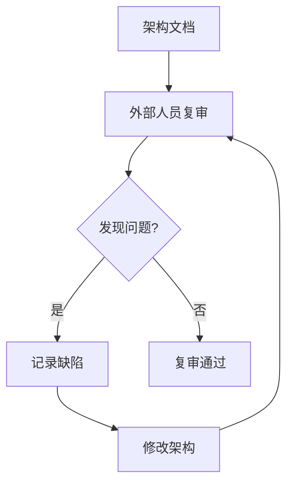

复审人员安排：

- **外部人员**：用户代表和领域专家参加，确保架构满足业务需求[^28]。
- **内部人员**：开发团队成员参与，确保技术可行性[^29]。

复审重点检查项：

| 检查项 | 说明 |
|---|---|
| 需求满足度 | 架构是否满足所有功能和非功能需求 |
| 质量属性 | 性能、可靠性、安全性等是否在设计中体现 |
| 层次清晰度 | 架构层次划分是否合理 |
| 构件划分 | 构件职责是否明确、接口是否清晰 |
| 文档质量 | 文档表达是否准确、完整 |

> 📌 **考试重点**：架构复审的参与人员（外部人员+内部人员）和复审检查项是常考内容。

> 🔗 **真题关联**：2024年上半年第28题考查了架构复审的参与人员；2023年上半年第32题考查了复审检查项。

---

## 架构实现

架构实现是将架构设计转化为可执行代码的过程，包括 **分析与设计、构件实现、构件组装、系统测试** 等活动[^30]。

架构实现步骤：

1. **分析与设计**：基于架构文档进行详细设计，确定构件内部结构和接口[^31]。
2. **构件实现**：开发或复用构件，实现构件功能[^32]。
3. **构件组装**：将构件按照架构设计组装成完整系统[^33]。
4. **系统测试**：对组装后的系统进行测试，验证架构实现是否正确[^34]。

架构实现中的关键技术：

- **构件接口设计**：定义清晰的构件接口，确保构件间正确交互[^35]。
- **构件组装技术**：使用中间件、框架等技术实现构件组装[^36]。
- **配置管理**：管理构件版本和配置，确保系统一致性[^37]。

> 📌 **考试重点**：架构实现的四个步骤和构件组装技术是重要考点。

> 🔗 **真题关联**：2023年下半年第38题考查了架构实现步骤；2022年上半年第40题考查了构件组装技术。

---

## 架构演化

架构演化是系统在运行过程中对架构进行的修改和调整，包括 **需求变化归类、制订演化计划、修改构件、更新构件相互作用、构件组装与测试、技术评审** 等步骤[^38]。

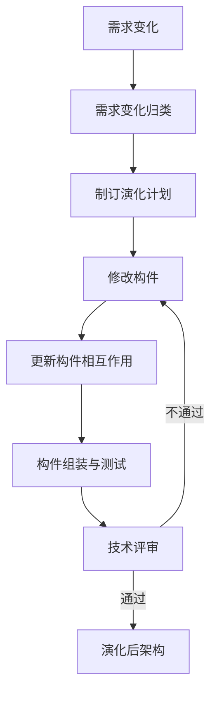

架构演化步骤详解：

1. **需求变化归类**：将需求变化分类，确定变化类型和影响范围[^39]。
2. **制订演化计划**：根据变化类型制定演化策略和时间计划[^40]。
3. **修改构件**：对受影响的构件进行修改或替换[^41]。
4. **更新构件相互作用**：调整构件间的连接关系和交互方式[^42]。
5. **构件组装与测试**：重新组装系统并进行测试[^43]。
6. **技术评审**：对演化后的架构进行评审，确保质量[^44]。

> 📌 **考试重点**：架构演化的六个步骤和演化计划制定是高频考点。

> 🔗 **真题关联**：2024年下半年第45题考查了架构演化步骤；2023年上半年第48题考查了演化计划制定。

---

## 架构风格分类

架构风格是描述特定应用领域中系统组织方式的惯用模式，定义了构件和连接件的词汇表及约束[^45]。

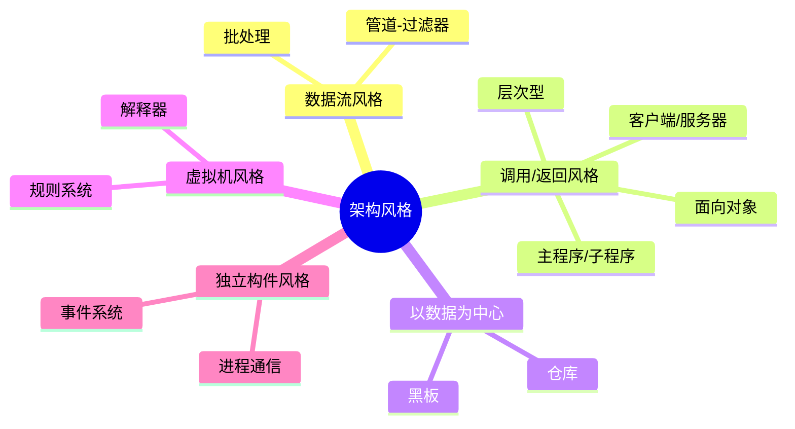

主要架构风格：

- **数据流风格**：批处理（独立程序顺序执行）、管道-过滤器（数据流驱动，过滤器处理、管道传输）[^46]。
- **调用/返回风格**：主程序/子程序、面向对象、层次型（每层为上层服务、下层客户）、C/S 和三层 C/S[^47]。
- **以数据为中心**：仓库（中央数据+独立构件）、黑板（知识源+共享黑板，适合复杂问题求解）[^48]。
- **虚拟机风格**：解释器、规则系统（增加灵活性，但执行效率较低）[^49]。
- **独立构件风格**：进程通信、事件系统（隐式调用，构件不直接调用过程，通过事件触发）[^50]。

> 📌 **考试重点**：五大架构风格分类及其特点、适用场景是必考内容，常以对比题形式出现。

> 🔗 **真题关联**：历年真题多次考查架构风格分类，如2024年上半年第15题、2023年下半年第20题、2022年上半年第25题。

---

## 数据流风格

数据流风格包括 **批处理序列** 和 **管道-过滤器** 两种典型风格[^51]。

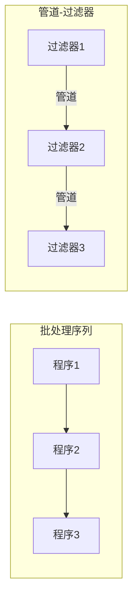

**批处理序列**：

- 构件为一系列顺序执行的独立程序[^52]。
- 每一步处理在前一步完成后才开始，数据整体传递[^53]。
- 典型应用：传统数据处理系统、编译器[^54]。

**管道-过滤器**：

- 构件为过滤器，连接件为管道[^55]。
- 过滤器对数据进行渐进处理，管道传输数据流[^56]。
- 特点：支持并发执行、可复用性好、易于维护和扩展[^57]。
- 缺点：不适合处理交互式应用、数据格式解析复杂[^58]。
- 典型应用：Unix Shell、编译器、信号处理系统[^59]。

> 📌 **考试重点**：批处理与管道-过滤器的区别、管道-过滤器的优缺点和典型应用是高频考点。

> 🔗 **真题关联**：2024年上半年第18题考查了管道-过滤器风格；2023年下半年第22题考查了批处理与管道-过滤器的区别。

---

## 调用/返回风格

调用/返回风格包括 **主程序/子程序、面向对象、层次结构、客户端/服务器** 等风格[^60]。

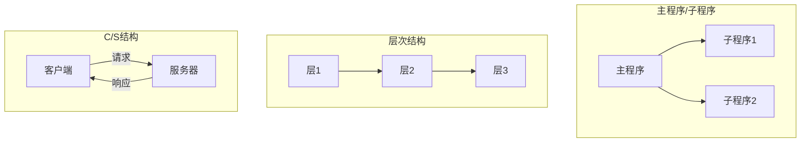

**主程序/子程序**：

- 单线程控制，主程序调用子程序，子程序返回结果[^61]。
- 优点：结构简单、易于理解[^62]。
- 缺点：难以适应大规模系统、复用性差[^63]。

**面向对象**：

- 构件为对象，连接件为消息传递[^64]。
- 特点：封装、继承、多态[^65]。
- 优点：可维护性好、复用性高[^66]。

**层次结构**：

- 系统组织为层次结构，每层为上层提供服务，作为下层的客户[^67]。
- 优点：支持增量开发、层次间松耦合[^68]。
- 缺点：性能开销、层次划分困难[^69]。
- 典型应用：OSI七层模型、TCP/IP协议栈[^70]。

**客户端/服务器（C/S）**：

- 客户端请求服务，服务器提供服务[^71]。
- 二层C/S：客户端+数据库服务器[^72]。
- 三层C/S：表示层+业务逻辑层+数据层[^73]。
- 优点：负载均衡、可扩展性好[^74]。

> 📌 **考试重点**：层次结构的特点和典型应用、C/S结构的层次划分是常考内容。

> 🔗 **真题关联**：2023年上半年第28题考查了层次结构；2022年下半年第32题考查了C/S结构。

---

## 以数据为中心的风格

以数据为中心的风格包括 **仓库风格** 和 **黑板风格**[^75]。

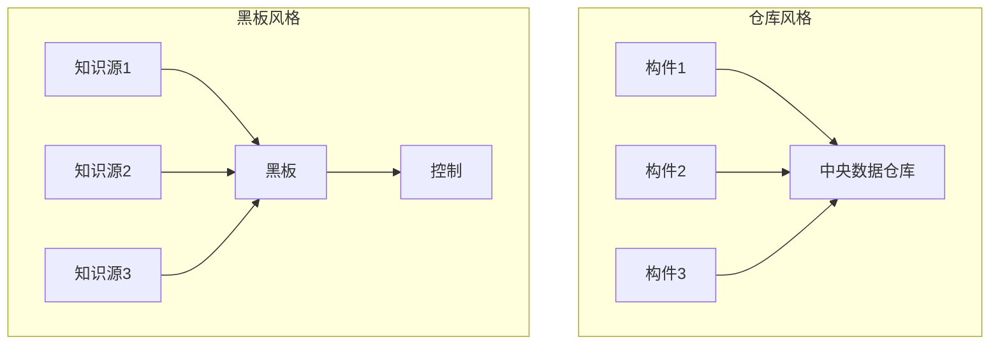

**仓库风格**：

- 中央数据仓库 + 独立构件集合[^76]。
- 构件围绕中央数据仓库进行数据交换[^77]。
- 优点：数据共享方便、构件间松耦合[^78]。
- 缺点：中央数据仓库可能成为瓶颈[^79]。
- 典型应用：数据库系统、超文本系统、IDE环境[^80]。

**黑板风格**：

- 知识源 + 黑板 + 控制三部分[^81]。
- 知识源独立且相互不直接通信，通过黑板交换信息[^82]。
- 控制模块协调知识源的执行顺序[^83]。
- 优点：支持复杂问题求解、知识源可独立开发[^84]。
- 缺点：执行效率较低、控制策略复杂[^85]。
- 典型应用：语音识别、模式识别、专家系统[^86]。

> 📌 **考试重点**：仓库风格与黑板风格的区别、黑板风格的三要素（知识源、黑板、控制）是高频考点。

> 🔗 **真题关联**：2024年下半年第25题考查了黑板风格；2023年上半年第30题考查了仓库风格与黑板风格的区别。

---

## 虚拟机风格

虚拟机风格包括 **解释器风格** 和 **基于规则的系统**[^87]。

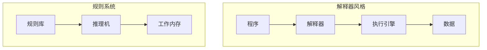

**解释器风格**：

- 构件：程序、解释器、执行引擎、数据[^88]。
- 解释器读取程序指令并逐条执行[^89]。
- 优点：灵活性高、支持动态修改[^90]。
- 缺点：执行效率低[^91]。
- 典型应用：脚本语言解释器、虚拟机[^92]。

**基于规则的系统**：

- 构件：规则库、推理机、工作内存[^93]。
- 推理机根据规则库中的规则对工作内存中的数据进行推理[^94]。
- 优点：知识表示直观、易于修改[^95]。
- 缺点：执行效率低、规则冲突处理复杂[^96]。
- 典型应用：专家系统、业务规则引擎[^97]。

> 📌 **考试重点**：解释器风格和规则系统的组成、优缺点及典型应用是常考内容。

> 🔗 **真题关联**：2023年下半年第35题考查了解释器风格；2022年上半年第38题考查了规则系统。

---

## 独立构件风格

独立构件风格包括 **进程通信** 和 **事件系统**[^98]。

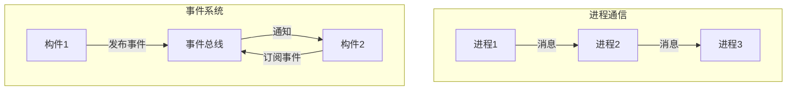

**进程通信**：

- 构件为独立进程，连接件为消息传递[^99]。
- 进程间通过消息进行通信和同步[^100]。
- 优点：支持分布式系统、进程独立性好[^101]。
- 缺点：通信开销大、同步复杂[^102]。
- 典型应用：分布式系统、微服务架构[^103]。

**事件系统（隐式调用）**：

- 构件不直接调用过程，而是通过发布/订阅事件进行交互[^104]。
- 事件源发布事件，事件监听器订阅并处理事件[^105]。
- 优点：构件间松耦合、支持广播通信[^106]。
- 缺点：控制流不明确、调试困难[^107]。
- 典型应用：GUI系统、消息中间件、发布订阅系统[^108]。

> 📌 **考试重点**：事件系统的隐式调用机制、进程通信与事件系统的区别是高频考点。

> 🔗 **真题关联**：2024年上半年第32题考查了事件系统；2023年下半年第38题考查了进程通信与事件系统的区别。

---

## 软件架构复用

软件架构复用是指系统化地识别、开发、获取和修改软件资产，以便在不同开发过程中重复使用[^109]。

复用类型包括 **机会复用**（发现即复用）和 **系统复用**（开发前规划复用策略）[^110]。

可复用的资产包括：需求、架构设计、元素、建模与分析、测试、项目规划、过程方法和工具、人员、样本系统、缺陷消除经验[^111]。

复用过程三阶段：

1. **获取可复用资产**：构造可靠、易理解的构件[^112]。
2. **管理可复用资产**：构件库存储、分类、检索[^113]。
3. **使用可复用资产**：选择、定制、组装[^114]。

> 📌 **考试重点**：软件架构复用的三阶段（获取、管理、使用）和可复用资产类型是常考内容。

> 🔗 **真题关联**：2023年上半年第42题考查了复用过程三阶段；2022年下半年第45题考查了可复用资产类型。

---

## 特定领域软件架构（DSSA）

DSSA（Domain Specific Software Architecture）是在一个特定应用领域中为一组应用提供组织结构参考的标准软件架构[^115]。

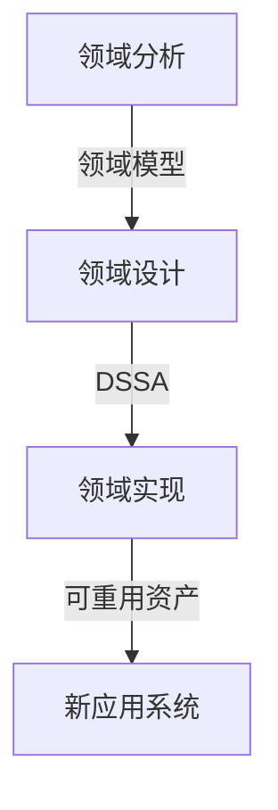

DSSA 的三个基本活动：

- **领域分析**：获得领域模型，描述系统中共同需求，定义领域边界[^116]。
- **领域设计**：获得 DSSA，描述满足领域需求的解决方案，具有适应变化的能力[^117]。
- **领域实现**：开发和组织可重用信息，依据领域模型和 DSSA 进行[^118]。

DSSA 的必备特征：严格定义的问题域和解域、具有普遍性、领域构件组织模型的恰当抽象、固定的可重用元素[^119]。

参与人员包括：领域专家、领域分析人员、领域设计人员、领域实现人员[^120]。

> 📌 **考试重点**：DSSA的三个基本活动（领域分析、领域设计、领域实现）和参与人员角色是高频考点。

> 🔗 **真题关联**：2024年上半年第48题考查了DSSA基本活动；2023年下半年第50题考查了DSSA参与人员。

---

## 参考文献

[^1]: 《系统架构设计师教程(第二版)》P.248 §7.1.1

[^2]: 《系统架构设计师教程(第二版)》P.248 §7.1.1

[^3]: 《系统架构设计师教程(第二版)》P.252-253 §7.1.3

[^4]: 《系统架构设计师教程(第二版)》P.248-252 §7.1.2

[^5]: 《系统架构设计师教程(第二版)》P.254 §7.2.1

[^6]: 《系统架构设计师教程(第二版)》P.254 §7.2.2

[^7]: 《系统架构设计师教程(第二版)》P.254 §7.2.2

[^8]: 《系统架构设计师教程(第二版)》P.254 §7.2.2

[^9]: 《系统架构设计师教程(第二版)》P.255 §7.2.3

[^10]: 《系统架构设计师教程(第二版)》P.255 §7.2.4

[^11]: 《系统架构设计师教程(第二版)》P.255 §7.2.4

[^12]: 《系统架构设计师教程(第二版)》P.255 §7.2.4

[^13]: 《系统架构设计师教程(第二版)》P.255 §7.2.4

[^14]: 《系统架构设计师教程(第二版)》P.256 §7.2.4

[^15]: 《系统架构设计师教程(第二版)》P.256 §7.2.5

[^16]: 《系统架构设计师教程(第二版)》P.256 §7.2.5

[^17]: 《系统架构设计师教程(第二版)》P.256 §7.2.5

[^18]: 《系统架构设计师教程(第二版)》P.256 §7.2.5

[^19]: 《系统架构设计师教程(第二版)》P.256 §7.2.5

[^20]: 《系统架构设计师教程(第二版)》P.256 §7.2.5

[^21]: 《系统架构设计师教程(第二版)》P.257 §7.2.5

[^22]: 《系统架构设计师教程(第二版)》P.257 §7.2.6

[^23]: 《系统架构设计师教程(第二版)》P.257 §7.2.6

[^24]: 《系统架构设计师教程(第二版)》P.257 §7.2.6

[^25]: 《系统架构设计师教程(第二版)》P.257 §7.2.6

[^26]: 《系统架构设计师教程(第二版)》P.258 §7.2.6

[^27]: 《系统架构设计师教程(第二版)》P.258 §7.2.7

[^28]: 《系统架构设计师教程(第二版)》P.258 §7.2.7

[^29]: 《系统架构设计师教程(第二版)》P.258 §7.2.7

[^30]: 《系统架构设计师教程(第二版)》P.258 §7.2.8

[^31]: 《系统架构设计师教程(第二版)》P.258 §7.2.8

[^32]: 《系统架构设计师教程(第二版)》P.258 §7.2.8

[^33]: 《系统架构设计师教程(第二版)》P.259 §7.2.8

[^34]: 《系统架构设计师教程(第二版)》P.259 §7.2.8

[^35]: 《系统架构设计师教程(第二版)》P.259 §7.2.8

[^36]: 《系统架构设计师教程(第二版)》P.259 §7.2.8

[^37]: 《系统架构设计师教程(第二版)》P.259 §7.2.8

[^38]: 《系统架构设计师教程(第二版)》P.259 §7.2.9

[^39]: 《系统架构设计师教程(第二版)》P.259 §7.2.9

[^40]: 《系统架构设计师教程(第二版)》P.259 §7.2.9

[^41]: 《系统架构设计师教程(第二版)》P.259 §7.2.9

[^42]: 《系统架构设计师教程(第二版)》P.259 §7.2.9

[^43]: 《系统架构设计师教程(第二版)》P.259 §7.2.9

[^44]: 《系统架构设计师教程(第二版)》P.259 §7.2.9

[^45]: 《系统架构设计师教程(第二版)》P.259 §7.3.1

[^46]: 《系统架构设计师教程(第二版)》P.259-260 §7.3.2

[^47]: 《系统架构设计师教程(第二版)》P.260-262 §7.3.3

[^48]: 《系统架构设计师教程(第二版)》P.262-263 §7.3.4

[^49]: 《系统架构设计师教程(第二版)》P.263-264 §7.3.5

[^50]: 《系统架构设计师教程(第二版)》P.264-265 §7.3.6

[^51]: 《系统架构设计师教程(第二版)》P.259 §7.3.2

[^52]: 《系统架构设计师教程(第二版)》P.259 §7.3.2

[^53]: 《系统架构设计师教程(第二版)》P.259 §7.3.2

[^54]: 《系统架构设计师教程(第二版)》P.259 §7.3.2

[^55]: 《系统架构设计师教程(第二版)》P.260 §7.3.2

[^56]: 《系统架构设计师教程(第二版)》P.260 §7.3.2

[^57]: 《系统架构设计师教程(第二版)》P.260 §7.3.2

[^58]: 《系统架构设计师教程(第二版)》P.260 §7.3.2

[^59]: 《系统架构设计师教程(第二版)》P.260 §7.3.2

[^60]: 《系统架构设计师教程(第二版)》P.260 §7.3.3

[^61]: 《系统架构设计师教程(第二版)》P.260 §7.3.3

[^62]: 《系统架构设计师教程(第二版)》P.260 §7.3.3

[^63]: 《系统架构设计师教程(第二版)》P.260 §7.3.3

[^64]: 《系统架构设计师教程(第二版)》P.261 §7.3.3

[^65]: 《系统架构设计师教程(第二版)》P.261 §7.3.3

[^66]: 《系统架构设计师教程(第二版)》P.261 §7.3.3

[^67]: 《系统架构设计师教程(第二版)》P.261 §7.3.3

[^68]: 《系统架构设计师教程(第二版)》P.261 §7.3.3

[^69]: 《系统架构设计师教程(第二版)》P.261 §7.3.3

[^70]: 《系统架构设计师教程(第二版)》P.261 §7.3.3

[^71]: 《系统架构设计师教程(第二版)》P.262 §7.3.3

[^72]: 《系统架构设计师教程(第二版)》P.262 §7.3.3

[^73]: 《系统架构设计师教程(第二版)》P.262 §7.3.3

[^74]: 《系统架构设计师教程(第二版)》P.262 §7.3.3

[^75]: 《系统架构设计师教程(第二版)》P.262 §7.3.4

[^76]: 《系统架构设计师教程(第二版)》P.262 §7.3.4

[^77]: 《系统架构设计师教程(第二版)》P.262 §7.3.4

[^78]: 《系统架构设计师教程(第二版)》P.262 §7.3.4

[^79]: 《系统架构设计师教程(第二版)》P.262 §7.3.4

[^80]: 《系统架构设计师教程(第二版)》P.263 §7.3.4

[^81]: 《系统架构设计师教程(第二版)》P.263 §7.3.4

[^82]: 《系统架构设计师教程(第二版)》P.263 §7.3.4

[^83]: 《系统架构设计师教程(第二版)》P.263 §7.3.4

[^84]: 《系统架构设计师教程(第二版)》P.263 §7.3.4

[^85]: 《系统架构设计师教程(第二版)》P.263 §7.3.4

[^86]: 《系统架构设计师教程(第二版)》P.263 §7.3.4

[^87]: 《系统架构设计师教程(第二版)》P.263 §7.3.5

[^88]: 《系统架构设计师教程(第二版)》P.263 §7.3.5

[^89]: 《系统架构设计师教程(第二版)》P.263 §7.3.5

[^90]: 《系统架构设计师教程(第二版)》P.263 §7.3.5

[^91]: 《系统架构设计师教程(第二版)》P.264 §7.3.5

[^92]: 《系统架构设计师教程(第二版)》P.264 §7.3.5

[^93]: 《系统架构设计师教程(第二版)》P.264 §7.3.5

[^94]: 《系统架构设计师教程(第二版)》P.264 §7.3.5

[^95]: 《系统架构设计师教程(第二版)》P.264 §7.3.5

[^96]: 《系统架构设计师教程(第二版)》P.264 §7.3.5

[^97]: 《系统架构设计师教程(第二版)》P.264 §7.3.5

[^98]: 《系统架构设计师教程(第二版)》P.264 §7.3.6

[^99]: 《系统架构设计师教程(第二版)》P.264 §7.3.6

[^100]: 《系统架构设计师教程(第二版)》P.264 §7.3.6

[^101]: 《系统架构设计师教程(第二版)》P.264 §7.3.6

[^102]: 《系统架构设计师教程(第二版)》P.265 §7.3.6

[^103]: 《系统架构设计师教程(第二版)》P.265 §7.3.6

[^104]: 《系统架构设计师教程(第二版)》P.265 §7.3.6

[^105]: 《系统架构设计师教程(第二版)》P.265 §7.3.6

[^106]: 《系统架构设计师教程(第二版)》P.265 §7.3.6

[^107]: 《系统架构设计师教程(第二版)》P.265 §7.3.6

[^108]: 《系统架构设计师教程(第二版)》P.265 §7.3.6

[^109]: 《系统架构设计师教程(第二版)》P.265 §7.4.1

[^110]: 《系统架构设计师教程(第二版)》P.265 §7.4.1

[^111]: 《系统架构设计师教程(第二版)》P.266 §7.4.3

[^112]: 《系统架构设计师教程(第二版)》P.267 §7.4.4

[^113]: 《系统架构设计师教程(第二版)》P.267 §7.4.4

[^114]: 《系统架构设计师教程(第二版)》P.267 §7.4.4

[^115]: 《系统架构设计师教程(第二版)》P.267 §7.5.1

[^116]: 《系统架构设计师教程(第二版)》P.268 §7.5.2

[^117]: 《系统架构设计师教程(第二版)》P.268 §7.5.2

[^118]: 《系统架构设计师教程(第二版)》P.268 §7.5.2

[^119]: 《系统架构设计师教程(第二版)》P.267 §7.5.1

[^120]: 《系统架构设计师教程(第二版)》P.269 §7.5.3
