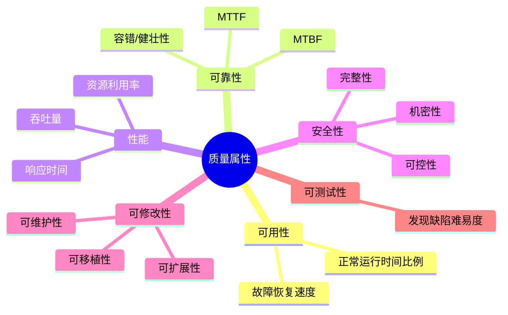
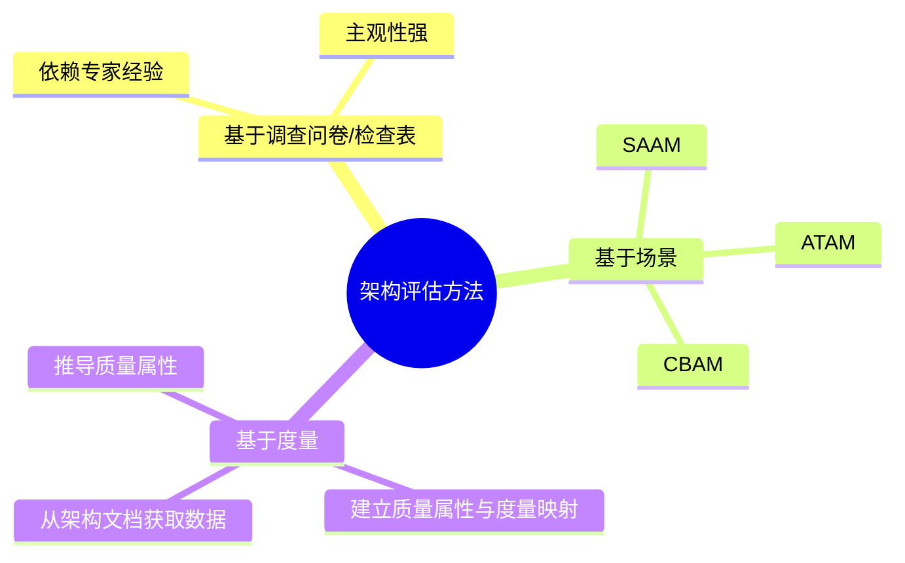
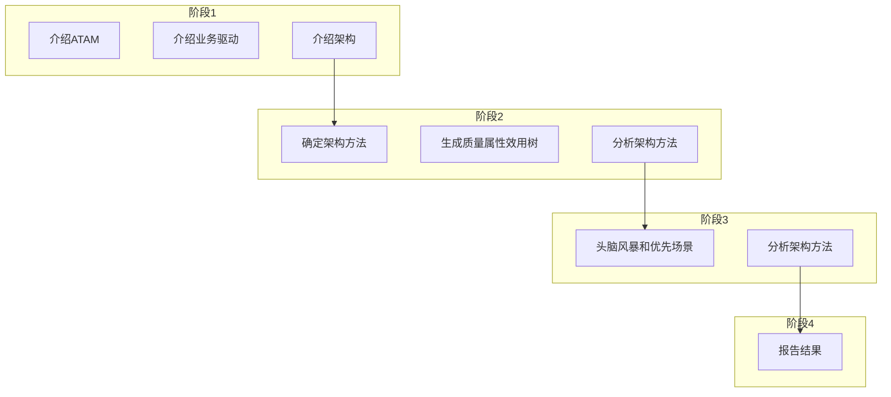
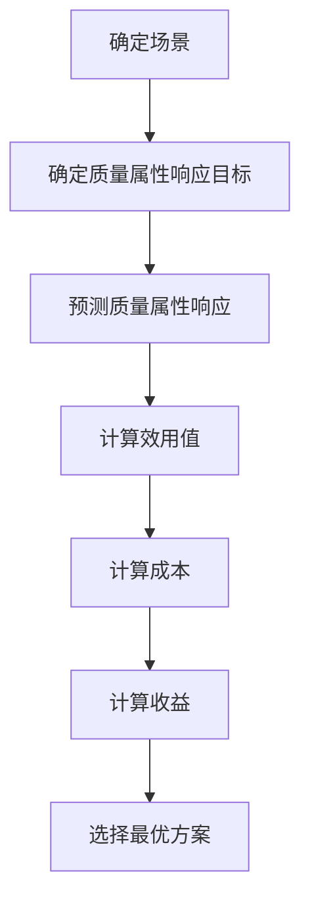
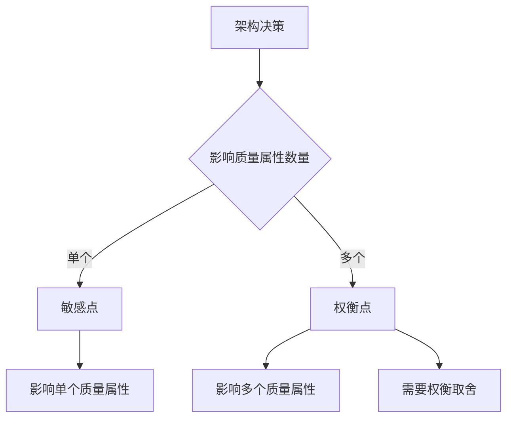
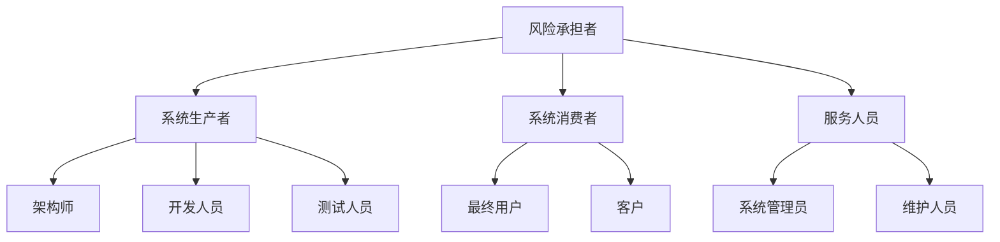
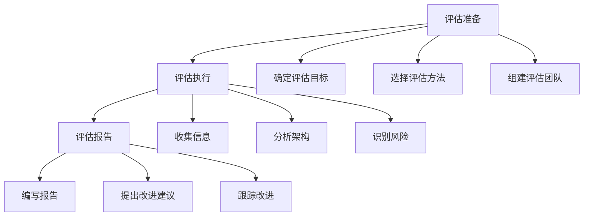
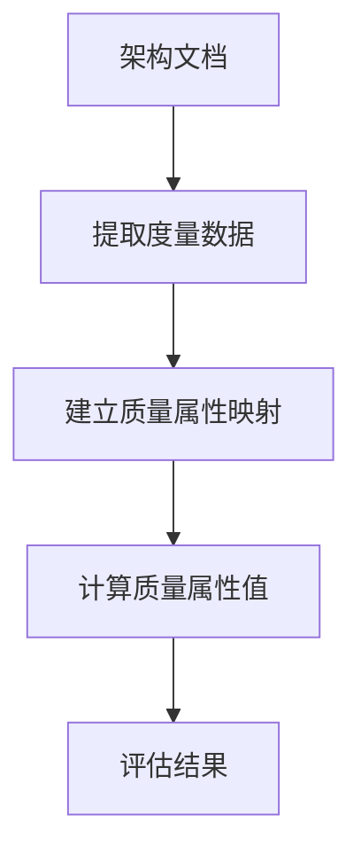
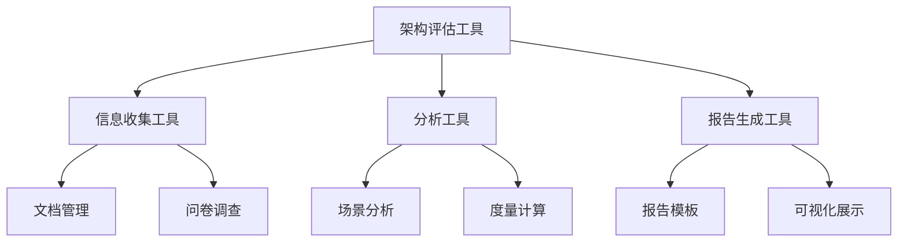
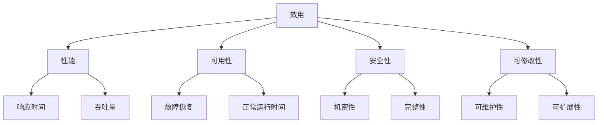

## 质量属性六要素

软件架构重点关注系统的质量属性。面向架构评估的主要质量属性包括 **可用性、可靠性、性能、安全性、可修改性、可测试性** 等[^1]。

主要质量属性说明：

- **性能**：系统响应能力，常用响应时间、吞吐量衡量[^2]。
- **可靠性**：规定条件和时间内完成规定功能的能力，用 MTTF/MTBF 衡量，包含容错与健壮性[^3]。
- **可用性**：系统正常运行时间比例，关注故障频率和恢复速度[^4]。
- **安全性**：阻止非授权使用、保护机密性和完整性，包含机密性、完整性、不可否认性、可控性[^5]。
- **可修改性**：快速、高性价比地变更系统的能力，包括可维护性、可扩展性、可移植性等[^6]。
- **可测试性**：通过测试发现缺陷和证明需求满足程度的难易度[^7]。

> 📌 **考试重点**：六大质量属性的定义和衡量指标是必考内容，常以选择题形式考查各属性的区别。

> 🔗 **真题关联**：历年真题多次考查质量属性分类，如2024年上半年第5题、2023年下半年第8题、2022年上半年第12题。

---

## 质量属性场景描述

质量属性场景是描述质量属性需求的精确方式，由 **6 个组成部分** 构成[^8]。

六个要素：

- **刺激源**：生成刺激的实体（人、系统或其他）[^9]。
- **刺激**：到达系统时需要考虑的条件[^10]。
- **环境**：刺激发生时的上下文（正常、超载、降级模式等）[^11]。
- **制品**：被激励的对象，可能是整个系统或部分[^12]。
- **响应**：激励到达后采取的行动[^13]。
- **响应度量**：评估响应效果的指标，如时间、成本、成功率等[^14]。

质量属性场景可用于可用性、可修改性、性能、安全性、可测试性、易用性等属性的精确描述[^15]。

> 📌 **考试重点**：质量属性场景的六个组成部分（刺激源、刺激、环境、制品、响应、响应度量）是高频考点。

> 🔗 **真题关联**：2024年上半年第10题考查了质量属性场景组成；2023年上半年第15题考查了刺激源的定义。

---

## 可用性场景描述

可用性场景描述系统在故障发生时的响应和恢复能力[^16]。

可用性场景示例：

| 要素 | 示例 |
|---|---|
| 刺激源 | 系统内部或外部 |
| 刺激 | 系统故障、错误、崩溃 |
| 环境 | 正常模式、降级模式 |
| 制品 | 系统、处理器、通信通道、存储 |
| 响应 | 错误检测、记录、通知、自动恢复、降级运行 |
| 响应度量 | 恢复时间、可用性比例、故障间隔时间 |

> 📌 **考试重点**：可用性场景的六个要素及其典型值是常考内容，常以填空或选择题形式出现。

> 🔗 **真题关联**：2023年下半年第18题考查了可用性场景；2022年上半年第20题考查了可用性响应度量。

---

## 性能场景描述

性能场景描述系统对事件响应的速度和效率[^17]。

性能场景示例：

| 要素 | 示例 |
|---|---|
| 刺激源 | 用户、系统、外部设备 |
| 刺激 | 事件到达、请求生成、数据变化 |
| 环境 | 正常模式、超载模式 |
| 制品 | 系统、服务、网络、数据库 |
| 响应 | 处理事件、改变服务级别、拒绝服务 |
| 响应度量 | 响应时间、吞吐量、资源利用率、延迟 |

> 📌 **考试重点**：性能场景的响应度量（响应时间、吞吐量、资源利用率）是高频考点。

> 🔗 **真题关联**：2024年上半年第15题考查了性能场景；2023年上半年第22题考查了性能响应度量。

---

## 安全性场景描述

安全性场景描述系统对非授权访问的防护能力[^18]。

安全性场景示例：

| 要素 | 示例 |
|---|---|
| 刺激源 | 用户、系统、外部攻击者 |
| 刺激 | 非授权访问、数据篡改、拒绝服务 |
| 环境 | 正常模式、降级模式 |
| 制品 | 系统、数据、服务、通信通道 |
| 响应 | 认证、授权、加密、审计、拒绝访问 |
| 响应度量 | 检测时间、成功率、数据完整性 |

> 📌 **考试重点**：安全性场景的响应（认证、授权、加密、审计）和响应度量是常考内容。

> 🔗 **真题关联**：2023年下半年第25题考查了安全性场景；2022年下半年第28题考查了安全性响应度量。

---

## 可修改性场景描述

可修改性场景描述系统对变更的适应能力[^19]。

可修改性场景示例：

| 要素 | 示例 |
|---|---|
| 刺激源 | 开发人员、用户、系统管理员 |
| 刺激 | 增加功能、删除功能、修改功能、改变配置 |
| 环境 | 设计时、编译时、构建时、运行时 |
| 制品 | 系统、组件、接口、数据 |
| 响应 | 修改代码、重新编译、重新部署、动态调整 |
| 响应度量 | 修改成本、修改时间、影响范围、缺陷数 |

> 📌 **考试重点**：可修改性场景的环境（设计时、编译时、构建时、运行时）和响应度量是高频考点。

> 🔗 **真题关联**：2024年上半年第20题考查了可修改性场景；2023年上半年第28题考查了可修改性环境。

---

## 架构评估方法

系统架构评估方法分为三类：**基于调查问卷/检查表、基于场景、基于度量**[^20]。

- **基于调查问卷/检查表**：设计问卷，依赖评估人员经验，主观性强[^21]。
- **基于场景**：通过分析架构对场景（使用或修改活动）的支持程度，判断对质量需求的满足程度，典型方法有 SAAM、ATAM、CBAM[^22]。
- **基于度量**：建立质量属性与度量之间的映射，从架构文档获取信息，推导质量属性[^23]。

评估中的重要概念：

- **敏感点**：影响单个质量属性的架构决策[^24]。
- **权衡点**：影响多个质量属性的特性，是多个质量属性的敏感点[^25]。
- **风险承担者**：包括系统生产者、消费者、服务人员等，各自关注不同质量属性[^26]。

> 📌 **考试重点**：三类评估方法（基于调查问卷、基于场景、基于度量）和敏感点/权衡点的定义是必考内容。

> 🔗 **真题关联**：历年真题多次考查架构评估方法分类，如2024年上半年第25题、2023年下半年第30题、2022年上半年第35题。

---

## ATAM 方法

ATAM（Architecture Tradeoff Analysis Method）是在 SAAM 基础上发展起来的架构权衡分析方法，主要针对性能、可用性、安全性和可修改性[^27]。

ATAM 四个阶段：

1. **演示**：介绍 ATAM、业务驱动和待评估架构[^28]。
2. **调查和分析**：确定架构方法、生成效用树、分析架构方法[^29]。
3. **测试**：头脑风暴产生场景并投票，再次分析架构方法[^30]。
4. **报告**：汇总效用树、场景、分析问题、风险/非风险、敏感点/权衡点[^31]。

ATAM 使用 **效用树** 对质量属性进行分类和优先级排序，主要关注性能、安全性、可修改性和可用性[^32]。

> 📌 **考试重点**：ATAM的四个阶段和效用树的使用是高频考点，常以流程题形式出现。

> 🔗 **真题关联**：2024年上半年第30题考查了ATAM阶段；2023年上半年第35题考查了效用树；2022年下半年第40题考查了ATAM报告内容。

---

## SAAM 方法

SAAM（Scenarios-based Architecture Analysis Method）是最早形成文档并广泛使用的软件架构分析方法，基于场景评估架构[^33]。

SAAM 的主要特点：

- **目标**：验证架构假设、评估风险、比较不同架构[^34]。
- **评估技术**：场景技术，用场景描述系统活动和状态变化[^35]。
- **主要质量属性**：可修改性，也可用于可移植性、可扩展性等[^36]。
- **输入**：问题描述、需求说明、架构描述[^37]。
- **输出**：场景影响列表、总体权衡和评价[^38]。

SAAM 适用于架构最后版本但早于详细设计阶段，强调风险承担者之间的共识[^39]。

> 📌 **考试重点**：SAAM的目标、评估技术、主要质量属性（可修改性）和适用阶段是常考内容。

> 🔗 **真题关联**：2023年下半年第38题考查了SAAM方法；2022年上半年第42题考查了SAAM的主要质量属性。

---

## CBAM 方法

CBAM（Cost Benefit Analysis Method）是一种基于成本的架构评估方法，用于在多个架构方案中选择最优方案[^40]。

CBAM 的主要步骤：

1. **确定场景**：收集和确定需要评估的场景[^41]。
2. **确定质量属性响应目标**：为每个场景设定质量属性目标值[^42]。
3. **预测质量属性响应**：预测架构对场景的响应[^43]。
4. **计算效用值**：根据响应计算效用值[^44]。
5. **计算成本**：估算实现架构的成本[^45]。
6. **计算收益**：计算效用值与成本的比值[^46]。
7. **选择最优方案**：选择收益最高的架构方案[^47]。

> 📌 **考试重点**：CBAM的成本收益分析方法和选择最优方案的标准是常考内容。

> 🔗 **真题关联**：2024年上半年第35题考查了CBAM方法；2023年上半年第40题考查了CBAM的成本收益计算。

---

## 敏感点与权衡点

敏感点和权衡点是架构评估中的核心概念，用于识别架构决策对质量属性的影响[^48]。

**敏感点**：

- 影响单个质量属性的架构决策[^49]。
- 例如：使用缓存机制提高性能（影响性能属性）[^50]。
- 识别敏感点有助于优化特定质量属性[^51]。

**权衡点**：

- 影响多个质量属性的特性，是多个质量属性的敏感点[^52]。
- 例如：使用冗余设计提高可用性，但增加成本和降低性能[^53]。
- 权衡点需要在多个质量属性之间进行取舍[^54]。
- 权衡分析是ATAM方法的核心[^55]。

> 📌 **考试重点**：敏感点与权衡点的定义和区别是高频考点，常以案例题形式出现。

> 🔗 **真题关联**：历年真题多次考查敏感点与权衡点，如2024年上半年第38题、2023年下半年第42题、2022年上半年第45题。

---

## 风险承担者

风险承担者（Stakeholders）是架构评估中需要考虑的各方利益相关者，各自关注不同的质量属性[^56]。

主要风险承担者及其关注点：

| 风险承担者 | 关注质量属性 |
|---|---|
| 架构师 | 可修改性、可扩展性、性能 |
| 开发人员 | 可维护性、可测试性、可理解性 |
| 测试人员 | 可测试性、可靠性、性能 |
| 最终用户 | 可用性、性能、安全性 |
| 客户 | 成本、进度、可修改性 |
| 系统管理员 | 可部署性、可管理性、安全性 |
| 维护人员 | 可维护性、可理解性、可修改性 |

> 📌 **考试重点**：不同风险承担者关注的质量属性是常考内容，常以选择题形式考查。

> 🔗 **真题关联**：2023年上半年第45题考查了风险承担者；2022年下半年第48题考查了不同角色的关注点。

---

## 架构评估实践

架构评估实践是将评估方法应用于实际项目的过程，包括评估准备、评估执行和评估报告三个阶段[^57]。

评估准备阶段：

1. **确定评估目标**：明确评估的范围、目的和期望结果[^58]。
2. **选择评估方法**：根据项目特点选择ATAM、SAAM或CBAM等方法[^59]。
3. **组建评估团队**：包括架构师、领域专家、风险承担者代表[^60]。

评估执行阶段：

1. **收集信息**：收集架构文档、需求说明、设计决策等信息[^61]。
2. **分析架构**：使用选定的方法对架构进行分析[^62]。
3. **识别风险**：识别架构中的敏感点、权衡点和风险[^63]。

评估报告阶段：

1. **编写报告**：记录评估过程、发现的问题和建议[^64]。
2. **提出改进建议**：针对识别的问题提出改进措施[^65]。
3. **跟踪改进**：跟踪改进措施的实施情况[^66]。

> 📌 **考试重点**：架构评估的三个阶段（准备、执行、报告）和各阶段的主要活动是常考内容。

> 🔗 **真题关联**：2024年上半年第42题考查了架构评估实践；2023年上半年第48题考查了评估准备阶段。

---

---

## 可测试性场景描述

可测试性场景描述系统对测试活动的支持能力[^67]。

可测试性场景示例：

| 要素 | 示例 |
|---|---|
| 刺激源 | 测试人员、自动化测试工具 |
| 刺激 | 单元测试、集成测试、系统测试请求 |
| 环境 | 开发环境、测试环境、生产环境 |
| 制品 | 系统、组件、接口、数据 |
| 响应 | 提供测试接口、返回测试数据、记录测试日志 |
| 响应度量 | 测试覆盖率、缺陷发现率、测试执行时间 |

提高可测试性的架构策略：

- **模块化设计**：高内聚低耦合，便于独立测试[^68]。
- **接口清晰**：定义清晰的接口，便于模拟和替换[^69]。
- **可观测性**：提供日志、监控、追踪等可观测性支持[^70]。
- **测试钩子**：预留测试接口和测试数据注入点[^71]。

> 📌 **考试重点**：可测试性场景的六个要素和提高可测试性的架构策略是常考内容。

> 🔗 **真题关联**：2023年下半年第32题考查了可测试性场景；2022年上半年第35题考查了可测试性架构策略。

---

## 基于度量的评估方法

基于度量的评估方法通过建立质量属性与度量之间的映射，从架构文档获取信息，推导质量属性[^72]。

基于度量的评估步骤：

1. **确定度量指标**：选择与质量属性相关的度量指标[^73]。
2. **收集度量数据**：从架构文档、代码、测试报告等收集数据[^74]。
3. **建立映射关系**：建立度量指标与质量属性之间的映射[^75]。
4. **计算质量属性**：根据映射关系计算质量属性值[^76]。
5. **评估结果**：根据计算结果评估架构质量[^77]。

常用度量指标：

| 质量属性 | 度量指标 |
|---|---|
| 性能 | 响应时间、吞吐量、资源利用率 |
| 可靠性 | 故障率、MTTF、MTBF |
| 可用性 | 正常运行时间比例、恢复时间 |
| 可修改性 | 圈复杂度、耦合度、内聚度 |
| 可测试性 | 测试覆盖率、缺陷密度 |

> 📌 **考试重点**：基于度量的评估步骤和常用度量指标是常考内容。

> 🔗 **真题关联**：2024年上半年第48题考查了基于度量的评估方法；2023年上半年第52题考查了度量指标。

---

## 架构评估工具

架构评估工具是支持架构评估活动的软件工具，帮助评估人员收集信息、分析架构、生成报告[^78]。

常用架构评估工具：

- **ATAM工具**：支持ATAM评估过程的工具，包括场景管理、效用树生成、风险识别等功能[^79]。
- **SAAM工具**：支持SAAM评估过程的工具，包括场景开发、架构描述、评估报告等功能[^80]。
- **度量分析工具**：支持基于度量的评估，包括代码度量、架构度量、质量属性计算等功能[^81]。
- **可视化工具**：支持架构可视化和评估结果展示[^82]。

架构评估工具的选择标准：

| 标准 | 说明 |
|---|---|
| 功能完整性 | 是否支持评估全过程 |
| 易用性 | 是否易于学习和使用 |
| 可扩展性 | 是否支持自定义扩展 |
| 集成能力 | 是否与其他工具集成 |
| 成本 | 购买和维护成本 |

> 📌 **考试重点**：架构评估工具的类型和选择标准是常考内容。

> 🔗 **真题关联**：2023年上半年第55题考查了架构评估工具；2022年下半年第50题考查了工具选择标准。

---

## 质量属性效用树详解

质量属性效用树是ATAM方法中用于对质量属性进行分类和优先级排序的工具[^83]。

效用树的构建步骤：

1. **确定质量属性**：识别系统需要关注的主要质量属性[^84]。
2. **细化质量属性**：将每个质量属性细化为具体的子属性[^85]。
3. **确定场景**：为每个子属性确定具体的场景[^86]。
4. **优先级排序**：对场景进行优先级排序（高、中、低）[^87]。

效用树示例：

| 质量属性 | 子属性 | 场景 | 优先级 |
|---|---|---|---|
| 性能 | 响应时间 | 用户查询响应时间<2s | 高 |
| 性能 | 吞吐量 | 系统支持1000并发用户 | 高 |
| 可用性 | 故障恢复 | 故障后30秒内恢复 | 中 |
| 安全性 | 机密性 | 用户数据加密存储 | 高 |
| 可修改性 | 可维护性 | 新功能开发周期<2周 | 中 |

> 📌 **考试重点**：效用树的构建步骤和示例是高频考点。

> 🔗 **真题关联**：2024年上半年第50题考查了效用树；2023年下半年第52题考查了效用树构建步骤。

---
## 参考文献

[^1]: 《系统架构设计师教程(第二版)》P.272-273 §8.1.2

[^2]: 《系统架构设计师教程(第二版)》P.272 §8.1.2

[^3]: 《系统架构设计师教程(第二版)》P.272 §8.1.2

[^4]: 《系统架构设计师教程(第二版)》P.273 §8.1.2

[^5]: 《系统架构设计师教程(第二版)》P.273 §8.1.2

[^6]: 《系统架构设计师教程(第二版)》P.273 §8.1.2

[^7]: 《系统架构设计师教程(第二版)》P.272 §8.1.2

[^8]: 《系统架构设计师教程(第二版)》P.274 §8.1.3

[^9]: 《系统架构设计师教程(第二版)》P.274 §8.1.3

[^10]: 《系统架构设计师教程(第二版)》P.274 §8.1.3

[^11]: 《系统架构设计师教程(第二版)》P.274 §8.1.3

[^12]: 《系统架构设计师教程(第二版)》P.274 §8.1.3

[^13]: 《系统架构设计师教程(第二版)》P.274 §8.1.3

[^14]: 《系统架构设计师教程(第二版)》P.274 §8.1.3

[^15]: 《系统架构设计师教程(第二版)》P.274-276 §8.1.3

[^16]: 《系统架构设计师教程(第二版)》P.274 §8.1.3

[^17]: 《系统架构设计师教程(第二版)》P.275 §8.1.3

[^18]: 《系统架构设计师教程(第二版)》P.275 §8.1.3

[^19]: 《系统架构设计师教程(第二版)》P.276 §8.1.3

[^20]: 《系统架构设计师教程(第二版)》P.279 §8.2.2

[^21]: 《系统架构设计师教程(第二版)》P.279 §8.2.2

[^22]: 《系统架构设计师教程(第二版)》P.279 §8.2.2

[^23]: 《系统架构设计师教程(第二版)》P.279 §8.2.2

[^24]: 《系统架构设计师教程(第二版)》P.278 §8.2.1

[^25]: 《系统架构设计师教程(第二版)》P.278 §8.2.1

[^26]: 《系统架构设计师教程(第二版)》P.278 §8.2.1

[^27]: 《系统架构设计师教程(第二版)》P.280 §8.2.2

[^28]: 《系统架构设计师教程(第二版)》P.289 §8.3.1

[^29]: 《系统架构设计师教程(第二版)》P.292 §8.3.2

[^30]: 《系统架构设计师教程(第二版)》P.299 §8.3.3

[^31]: 《系统架构设计师教程(第二版)》P.304 §8.3.4

[^32]: 《系统架构设计师教程(第二版)》P.282 §8.2.2

[^33]: 《系统架构设计师教程(第二版)》P.279-280 §8.2.2

[^34]: 《系统架构设计师教程(第二版)》P.280 §8.2.2

[^35]: 《系统架构设计师教程(第二版)》P.280 §8.2.2

[^36]: 《系统架构设计师教程(第二版)》P.280 §8.2.2

[^37]: 《系统架构设计师教程(第二版)》P.280 §8.2.2

[^38]: 《系统架构设计师教程(第二版)》P.280 §8.2.2

[^39]: 《系统架构设计师教程(第二版)》P.280 §8.2.2

[^40]: 《系统架构设计师教程(第二版)》P.304 §8.3.4

[^41]: 《系统架构设计师教程(第二版)》P.304 §8.3.4

[^42]: 《系统架构设计师教程(第二版)》P.304 §8.3.4

[^43]: 《系统架构设计师教程(第二版)》P.304 §8.3.4

[^44]: 《系统架构设计师教程(第二版)》P.304 §8.3.4

[^45]: 《系统架构设计师教程(第二版)》P.304 §8.3.4

[^46]: 《系统架构设计师教程(第二版)》P.304 §8.3.4

[^47]: 《系统架构设计师教程(第二版)》P.304 §8.3.4

[^48]: 《系统架构设计师教程(第二版)》P.278 §8.2.1

[^49]: 《系统架构设计师教程(第二版)》P.278 §8.2.1

[^50]: 《系统架构设计师教程(第二版)》P.278 §8.2.1

[^51]: 《系统架构设计师教程(第二版)》P.278 §8.2.1

[^52]: 《系统架构设计师教程(第二版)》P.278 §8.2.1

[^53]: 《系统架构设计师教程(第二版)》P.278 §8.2.1

[^54]: 《系统架构设计师教程(第二版)》P.278 §8.2.1

[^55]: 《系统架构设计师教程(第二版)》P.280 §8.2.2

[^56]: 《系统架构设计师教程(第二版)》P.278 §8.2.1

[^57]: 《系统架构设计师教程(第二版)》P.289 §8.3.1

[^58]: 《系统架构设计师教程(第二版)》P.289 §8.3.1

[^59]: 《系统架构设计师教程(第二版)》P.289 §8.3.1

[^60]: 《系统架构设计师教程(第二版)》P.289 §8.3.1

[^61]: 《系统架构设计师教程(第二版)》P.292 §8.3.2

[^62]: 《系统架构设计师教程(第二版)》P.292 §8.3.2

[^63]: 《系统架构设计师教程(第二版)》P.292 §8.3.2

[^64]: 《系统架构设计师教程(第二版)》P.304 §8.3.4

[^65]: 《系统架构设计师教程(第二版)》P.304 §8.3.4

[^66]: 《系统架构设计师教程(第二版)》P.304 §8.3.4
[^67]: 《系统架构设计师教程(第二版)》P.276 §8.1.3
[^68]: 《系统架构设计师教程(第二版)》P.276 §8.1.3
[^69]: 《系统架构设计师教程(第二版)》P.276 §8.1.3
[^70]: 《系统架构设计师教程(第二版)》P.276 §8.1.3
[^71]: 《系统架构设计师教程(第二版)》P.276 §8.1.3
[^72]: 《系统架构设计师教程(第二版)》P.279 §8.2.2
[^73]: 《系统架构设计师教程(第二版)》P.279 §8.2.2
[^74]: 《系统架构设计师教程(第二版)》P.279 §8.2.2
[^75]: 《系统架构设计师教程(第二版)》P.279 §8.2.2
[^76]: 《系统架构设计师教程(第二版)》P.279 §8.2.2
[^77]: 《系统架构设计师教程(第二版)》P.279 §8.2.2
[^78]: 《系统架构设计师教程(第二版)》P.289 §8.3.1
[^79]: 《系统架构设计师教程(第二版)》P.289 §8.3.1
[^80]: 《系统架构设计师教程(第二版)》P.289 §8.3.1
[^81]: 《系统架构设计师教程(第二版)》P.289 §8.3.1
[^82]: 《系统架构设计师教程(第二版)》P.289 §8.3.1
[^83]: 《系统架构设计师教程(第二版)》P.292 §8.3.2
[^84]: 《系统架构设计师教程(第二版)》P.292 §8.3.2
[^85]: 《系统架构设计师教程(第二版)》P.292 §8.3.2
[^86]: 《系统架构设计师教程(第二版)》P.292 §8.3.2
[^87]: 《系统架构设计师教程(第二版)》P.292 §8.3.2
