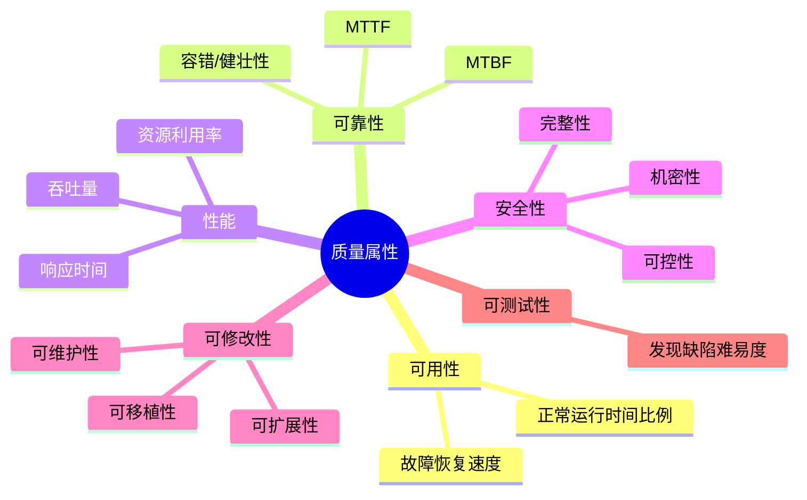
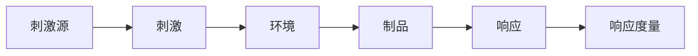
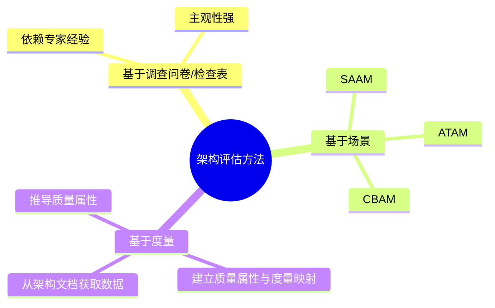
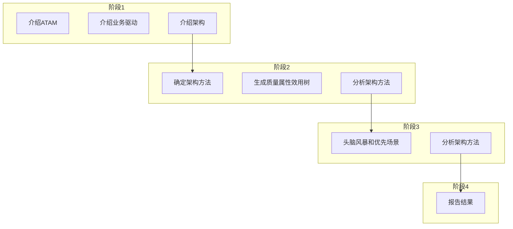
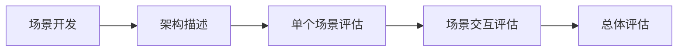

## 质量属性六要素

软件架构重点关注系统的质量属性。面向架构评估的主要质量属性包括 **可用性、可靠性、性能、安全性、可修改性、可测试性** 等[^1]。

主要质量属性说明：

- **性能**：系统响应能力，常用响应时间、吞吐量衡量[^2]。
- **可靠性**：规定条件和时间内完成规定功能的能力，用 MTTF/MTBF 衡量，包含容错与健壮性[^3]。
- **可用性**：系统正常运行时间比例，关注故障频率和恢复速度[^4]。
- **安全性**：阻止非授权使用、保护机密性和完整性，包含机密性、完整性、不可否认性、可控性[^5]。
- **可修改性**：快速、高性价比地变更系统的能力，包括可维护性、可扩展性、可移植性等[^6]。
- **可测试性**：通过测试发现缺陷和证明需求满足程度的难易度[^7]。

---

## 质量属性场景描述

质量属性场景是描述质量属性需求的精确方式，由 **6 个组成部分** 构成[^8]。

六个要素：

- **刺激源**：生成刺激的实体（人、系统或其他）[^9]。
- **刺激**：到达系统时需要考虑的条件[^10]。
- **环境**：刺激发生时的上下文（正常、超载、降级模式等）[^11]。
- **制品**：被激励的对象，可能是整个系统或部分[^12]。
- **响应**：激励到达后采取的行动[^13]。
- **响应度量**：评估响应效果的指标，如时间、成本、成功率等[^14]。

质量属性场景可用于可用性、可修改性、性能、安全性、可测试性、易用性等属性的精确描述[^15]。

---

## 架构评估方法

系统架构评估方法分为三类：**基于调查问卷/检查表、基于场景、基于度量**[^16]。

- **基于调查问卷/检查表**：设计问卷，依赖评估人员经验，主观性强[^17]。
- **基于场景**：通过分析架构对场景（使用或修改活动）的支持程度，判断对质量需求的满足程度，典型方法有 SAAM、ATAM、CBAM[^18]。
- **基于度量**：建立质量属性与度量之间的映射，从架构文档获取信息，推导质量属性[^19]。

评估中的重要概念：

- **敏感点**：影响单个质量属性的架构决策[^20]。
- **权衡点**：影响多个质量属性的特性，是多个质量属性的敏感点[^21]。
- **风险承担者**：包括系统生产者、消费者、服务人员等，各自关注不同质量属性[^22]。

---

## ATAM 方法

ATAM（Architecture Tradeoff Analysis Method）是在 SAAM 基础上发展起来的架构权衡分析方法，主要针对性能、可用性、安全性和可修改性[^23]。

ATAM 四个阶段：

1. **演示**：介绍 ATAM、业务驱动和待评估架构[^24]。
2. **调查和分析**：确定架构方法、生成效用树、分析架构方法[^25]。
3. **测试**：头脑风暴产生场景并投票，再次分析架构方法[^26]。
4. **报告**：汇总效用树、场景、分析问题、风险/非风险、敏感点/权衡点[^27]。

ATAM 使用 **效用树** 对质量属性进行分类和优先级排序，主要关注性能、安全性、可修改性和可用性[^28]。

---

## SAAM 方法

SAAM（Scenarios-based Architecture Analysis Method）是最早形成文档并广泛使用的软件架构分析方法，基于场景评估架构[^29]。

SAAM 的主要特点：

- **目标**：验证架构假设、评估风险、比较不同架构[^30]。
- **评估技术**：场景技术，用场景描述系统活动和状态变化[^31]。
- **主要质量属性**：可修改性，也可用于可移植性、可扩展性等[^32]。
- **输入**：问题描述、需求说明、架构描述[^33]。
- **输出**：场景影响列表、总体权衡和评价[^34]。

SAAM 适用于架构最后版本但早于详细设计阶段，强调风险承担者之间的共识[^35]。

---

## 参考文献

[^1]: 《系统架构设计师教程(第二版)》P.272-273 §8.1.2

[^2]: 《系统架构设计师教程(第二版)》P.272 §8.1.2

[^3]: 《系统架构设计师教程(第二版)》P.272 §8.1.2

[^4]: 《系统架构设计师教程(第二版)》P.273 §8.1.2

[^5]: 《系统架构设计师教程(第二版)》P.273 §8.1.2

[^6]: 《系统架构设计师教程(第二版)》P.273 §8.1.2

[^7]: 《系统架构设计师教程(第二版)》P.272 §8.1.2

[^8]: 《系统架构设计师教程(第二版)》P.274 §8.1.3

[^9]: 《系统架构设计师教程(第二版)》P.274 §8.1.3

[^10]: 《系统架构设计师教程(第二版)》P.274 §8.1.3

[^11]: 《系统架构设计师教程(第二版)》P.274 §8.1.3

[^12]: 《系统架构设计师教程(第二版)》P.274 §8.1.3

[^13]: 《系统架构设计师教程(第二版)》P.274 §8.1.3

[^14]: 《系统架构设计师教程(第二版)》P.274 §8.1.3

[^15]: 《系统架构设计师教程(第二版)》P.274-276 §8.1.3

[^16]: 《系统架构设计师教程(第二版)》P.279 §8.2.2

[^17]: 《系统架构设计师教程(第二版)》P.279 §8.2.2

[^18]: 《系统架构设计师教程(第二版)》P.279 §8.2.2

[^19]: 《系统架构设计师教程(第二版)》P.279 §8.2.2

[^20]: 《系统架构设计师教程(第二版)》P.278 §8.2.1

[^21]: 《系统架构设计师教程(第二版)》P.278 §8.2.1

[^22]: 《系统架构设计师教程(第二版)》P.278 §8.2.1

[^23]: 《系统架构设计师教程(第二版)》P.280 §8.2.2

[^24]: 《系统架构设计师教程(第二版)》P.289 §8.3.1

[^25]: 《系统架构设计师教程(第二版)》P.292 §8.3.2

[^26]: 《系统架构设计师教程(第二版)》P.299 §8.3.3

[^27]: 《系统架构设计师教程(第二版)》P.304 §8.3.4

[^28]: 《系统架构设计师教程(第二版)》P.282 §8.2.2

[^29]: 《系统架构设计师教程(第二版)》P.279-280 §8.2.2

[^30]: 《系统架构设计师教程(第二版)》P.280 §8.2.2

[^31]: 《系统架构设计师教程(第二版)》P.280 §8.2.2

[^32]: 《系统架构设计师教程(第二版)》P.280 §8.2.2

[^33]: 《系统架构设计师教程(第二版)》P.280 §8.2.2

[^34]: 《系统架构设计师教程(第二版)》P.280 §8.2.2

[^35]: 《系统架构设计师教程(第二版)》P.280 §8.2.2
