## 软件可靠性定义

软件可靠性（Software Reliability）是软件产品在 **规定的条件下和规定的时间区间完成规定功能的能力**[^1]。

```mermaid
graph LR
    A[规定条件] --> B[软件可靠性]
    C[规定时间] --> B
    D[规定功能] --> B
    B --> E[可靠度 R(t)]
    B --> F[失效强度 f(t)]
    B --> G[MTTF/MTBF]
```

软件与硬件在可靠性方面的主要不同：

- **复杂性**：软件逻辑高度复杂，设计错误是失效主因[^2]。
- **物理退化**：软件不存在物理退化，正确软件始终可靠[^3]。
- **唯一性**：软件复制不改变本身，概率方法在软件领域效果不如硬件[^4]。
- **版本更新快**：软件版本更新频繁，给可靠性评估带来难度[^5]。

IEEE 定义：在规定条件下、规定时间内，软件不引起系统失效的概率，是系统输入和软件缺陷的函数[^6]。

定量描述指标：

- **可靠度 R(t)**：R(t) = 1 - F(t)，其中 F(t) 为失效概率[^7]。
- **失效强度 f(t)**：单位时间软件出现失效的概率[^8]。
- **MTTF**：平均失效前时间，系统持续运行时间的期望值[^9]。
- **MTBF**：平均故障间隔时间，MTBF = MTTF + MTTR[^10]。

> 📌 **考试重点**：软件可靠性定义（规定条件、规定时间、规定功能）和定量描述指标（R(t)、MTTF、MTBF）是必考内容。

> 🔗 **真题关联**：历年真题多次考查软件可靠性定义，如2023年上半年第5题、2022年下半年第8题。

---

## 软件可靠性目标

软件可靠性目标是指用户对软件产品可靠性的期望，通常用定量指标表示[^11]。

```mermaid
graph TD
    A[用户需求] --> B[可靠性目标]
    B --> C[定量指标]
    C --> D[可靠度 R(t)]
    C --> E[失效强度 λ]
    C --> F[MTTF/MTBF]
    B --> G[定性指标]
    G --> H[容错能力]
    G --> I[恢复能力]
```

可靠性目标的确定因素：

- **系统重要性**：安全攸关系统（如航空、医疗）要求更高的可靠性[^12]。
- **使用环境**：恶劣环境下运行的软件需要更高的可靠性[^13]。
- **成本约束**：可靠性越高，开发和测试成本越高[^14]。
- **技术可行性**：当前技术水平能否达到目标可靠性[^15]。

可靠性目标示例：

| 系统类型 | 可靠度目标 | MTTF |
|---|---|---|
| 一般商业软件 | 0.99 | 100小时 |
| 工业控制软件 | 0.999 | 1000小时 |
| 航空航天软件 | 0.999999 | 100000小时 |

> 📌 **考试重点**：软件可靠性目标的确定因素和不同系统类型的可靠性目标是常考内容。

> 🔗 **真题关联**：2023年上半年第15题考查了可靠性目标；2022年下半年第18题考查了安全攸关系统的可靠性要求。

---

## 软件可靠性建模

软件可靠性建模是建立软件可靠性数学模型，用于评估和预测软件可靠性[^16]。

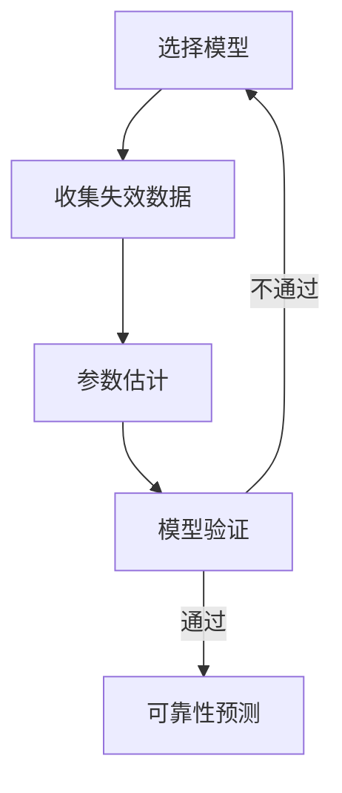

影响软件可靠性的因素：

- **软件规模**：规模越大，潜在缺陷越多，可靠性越低[^17]。
- **软件复杂度**：复杂度越高，可靠性越低[^18]。
- **开发方法**：结构化方法、面向对象方法等影响可靠性[^19]。
- **测试充分性**：测试越充分，发现的缺陷越多，可靠性越高[^20]。
- **运行环境**：硬件环境、操作系统、网络等影响可靠性[^21]。

可靠性建模方法：

- **数据域方法**：基于输入数据分布和程序路径分析[^22]。
- **程序域方法**：基于程序结构和执行路径分析[^23]。

> 📌 **考试重点**：影响软件可靠性的因素和建模方法是常考内容。

> 🔗 **真题关联**：2024年上半年第10题考查了影响软件可靠性的因素；2023年上半年第20题考查了可靠性建模方法。

---

## 软件可靠性模型分类

软件可靠性模型分为 **预测模型** 和 **评估模型** 两大类[^24]。

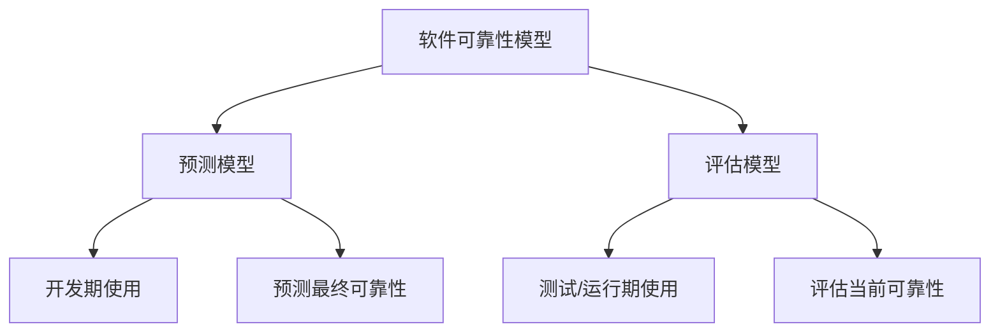

**预测模型**：

- 在软件开发早期使用，预测最终可靠性[^25]。
- 基于软件规模、复杂度、开发过程等因素[^26]。
- 典型模型：Rome实验室模型、Putnam模型、COCOMO模型[^27]。

**评估模型**：

- 在软件测试或运行阶段使用，评估当前可靠性[^28]。
- 基于失效数据，使用统计方法[^29]。
- 典型模型：Jelinski-Moranda模型、Goel-Okumoto模型、Musa模型[^30]。

常用可靠性模型：

| 模型类型 | 模型名称 | 特点 |
|---|---|---|
| 失效率类 | Jelinski-Moranda | 假设失效率与剩余缺陷数成正比 |
| 失效率类 | Schick-Wolverton | 考虑测试时间对失效率的影响 |
| NHPP | Goel-Okumoto | 非齐次泊松过程，假设累积失效数服从泊松分布 |
| NHPP | Musa指数模型 | 假设失效率随时间指数下降 |
| 贝叶斯 | 贝叶斯模型 | 利用先验分布和测试信息评估可靠性 |
| 种子法 | 种子法模型 | 捕获-再捕获抽样估计错误数 |

> 📌 **考试重点**：预测模型与评估模型的区别、常用可靠性模型的特点是高频考点。

> 🔗 **真题关联**：2023年下半年第25题考查了可靠性模型分类；2022年上半年第28题考查了NHPP模型。

---

## 软件可靠性管理

软件可靠性管理是在软件生命周期中对可靠性进行计划、组织、协调和控制的活动[^31]。

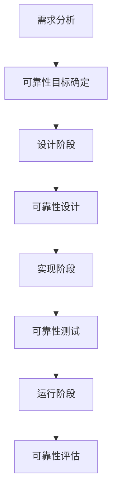

软件可靠性管理的主要内容：

1. **可靠性计划**：制定可靠性目标、策略和计划[^32]。
2. **可靠性设计**：在软件设计阶段采取可靠性措施[^33]。
3. **可靠性测试**：通过测试发现缺陷，评估可靠性[^34]。
4. **可靠性评估**：使用可靠性模型评估软件可靠性[^35]。
5. **可靠性改进**：根据评估结果改进软件可靠性[^36]。

可靠性管理的关键活动：

| 生命周期阶段 | 可靠性管理活动 |
|---|---|
| 需求分析 | 确定可靠性目标、制定可靠性计划 |
| 设计 | 可靠性设计、容错设计、冗余设计 |
| 实现 | 代码审查、静态分析、单元测试 |
| 测试 | 可靠性测试、失效数据收集 |
| 运行 | 可靠性评估、故障监控、改进 |

> 📌 **考试重点**：软件可靠性管理的五个主要内容和各阶段的关键活动是常考内容。

> 🔗 **真题关联**：2024年上半年第15题考查了可靠性管理；2023年上半年第25题考查了可靠性管理活动。

---

## 可靠性设计技术

可靠性设计是在软件设计阶段采取措施进行可靠性控制，最有效、最经济的手段[^37]。

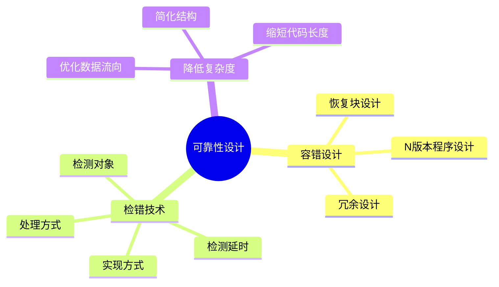

主要技术：

- **容错设计**：适用于失效后果特别严重的场合，如飞行控制系统、核反应堆安全系统等[^38]。
  - **恢复块设计**：选择一组操作作为容错单元，包含多个功能相同、设计差异的程序块，故障时切换备份[^39]。
  - **N 版本程序设计**：设计多个模块或不同版本，对相同输入结果实行多数表决，防止单一故障[^40]。
  - **冗余设计**：设计不同路径、算法或实现方法的模块作为备份，出现故障时替换[^41]。
- **检错技术**：在故障后及时发现并报警，代价低于容错，但不能自动解决故障[^42]。
- **降低复杂度设计**：简化软件结构、缩短代码长度、优化数据流向，降低复杂度从而提高可靠性[^43]。

> 📌 **考试重点**：容错设计的三种技术（恢复块、N版本、冗余）和检错技术的特点是高频考点。

> 🔗 **真题关联**：历年真题多次考查可靠性设计技术，如2024年上半年第20题、2023年下半年第30题、2022年上半年第35题。

---

## 恢复块设计

恢复块设计是一种容错设计技术，通过设计多个功能相同但实现不同的程序块，在故障时切换到备份块[^44]。

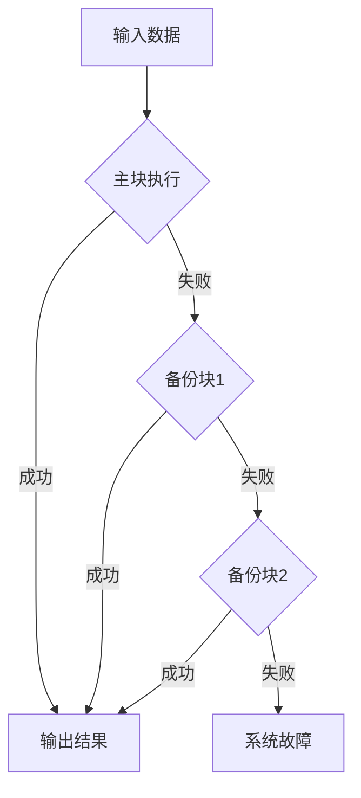

恢复块设计的关键要素：

- **主块**：主要执行块，首先执行[^45]。
- **备份块**：功能相同但实现不同的备份程序块[^46]。
- **接受测试**：验证执行结果是否正确[^47]。
- **切换机制**：主块失败时自动切换到备份块[^48]。

恢复块设计的优缺点：

| 优点 | 缺点 |
|---|---|
| 实现相对简单 | 需要设计多个实现 |
| 切换速度快 | 增加开发成本 |
| 适用于实时系统 | 备份块可能引入新缺陷 |

> 📌 **考试重点**：恢复块设计的四个关键要素（主块、备份块、接受测试、切换机制）是常考内容。

> 🔗 **真题关联**：2023年上半年第30题考查了恢复块设计；2022年下半年第35题考查了恢复块与N版本程序设计的区别。

---

## N版本程序设计

N版本程序设计是一种容错设计技术，通过设计多个独立实现的版本，对相同输入的结果进行多数表决，防止单一故障[^49]。

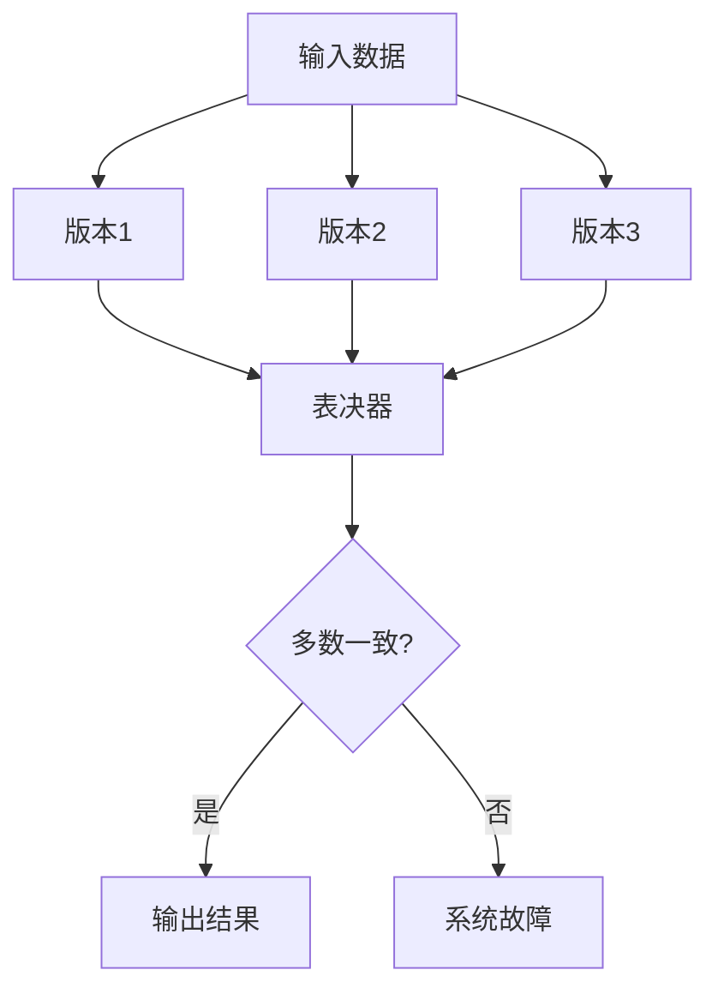

N版本程序设计的关键要素：

- **N个独立版本**：由不同团队独立设计和实现[^50]。
- **相同输入**：所有版本接收相同的输入数据[^51]。
- **表决器**：比较各版本输出结果，选择多数一致的结果[^52]。
- **独立性**：各版本的设计和实现应相互独立，避免共同缺陷[^53]。

N版本程序设计的优缺点：

| 优点 | 缺点 |
|---|---|
| 可容忍多个版本同时故障 | 开发成本高 |
| 适用于高可靠性要求系统 | 需要独立团队 |
| 表决机制简单可靠 | 增加系统复杂度 |

> 📌 **考试重点**：N版本程序设计的四个关键要素和与恢复块设计的区别是高频考点。

> 🔗 **真题关联**：2024年上半年第25题考查了N版本程序设计；2023年下半年第38题考查了N版本与恢复块的比较。

---

## 检错技术

检错技术是在故障发生后及时发现并报警的技术，代价低于容错技术，但不能自动解决故障[^54]。

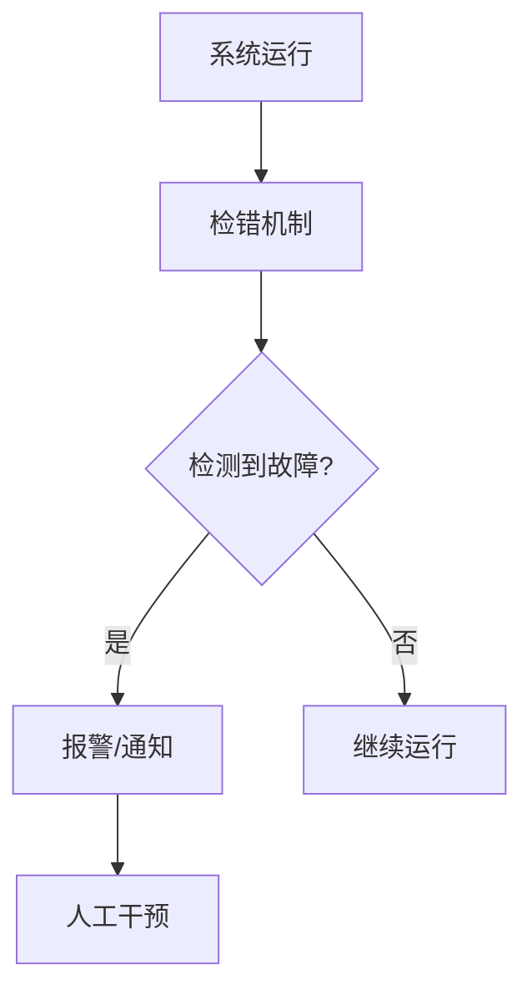

检错技术的关键要素：

- **检测对象**：需要检测的故障类型（数据错误、状态异常、超时等）[^55]。
- **检测延时**：从故障发生到检测到故障的时间间隔[^56]。
- **实现方式**：断言、心跳检测、超时检测、一致性检查等[^57]。
- **处理方式**：报警、记录、通知运维人员等[^58]。

常用检错技术：

| 技术 | 原理 | 适用场景 |
|---|---|---|
| 断言 | 检查程序状态是否满足预期 | 开发阶段、调试 |
| 心跳检测 | 定期发送心跳信号，检测节点存活 | 分布式系统 |
| 超时检测 | 检测操作是否在规定时间内完成 | 网络通信、数据库 |
| 一致性检查 | 检查数据一致性 | 数据库、分布式系统 |
| 冗余计算 | 重复计算并比较结果 | 关键计算 |

> 📌 **考试重点**：检错技术的四个关键要素和常用检错技术的适用场景是常考内容。

> 🔗 **真题关联**：2023年上半年第35题考查了检错技术；2022年上半年第40题考查了心跳检测。

---

## 系统配置技术

系统配置技术通过整体容错来提高可靠性，主要包括 **双机热备** 和 **服务器集群**[^59]。

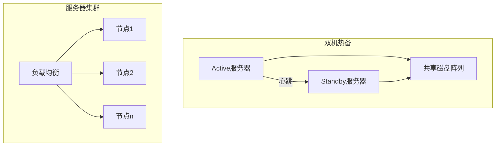

双机热备三种模式：

- **双机热备模式（Active/Standby）**：Active 工作，Standby 监控，故障时切换。存在计算资源浪费[^60]。
- **双机互备模式**：两个独立应用在两台机器同时运行，互为备机[^61]。
- **双机双工模式**：两台服务器均活动，同时运行相同应用，实现负载均衡和互为备份[^62]。

**服务器集群**：一组独立服务器组合成单一系统，提供高可靠性服务。集群内任一系统故障时，应用程序在另一节点自动接管[^63]。

> 📌 **考试重点**：双机热备三种模式的特点和区别、服务器集群的故障接管机制是高频考点。

> 🔗 **真题关联**：历年真题多次考查系统配置技术，如2024年上半年第30题、2023年下半年第42题、2022年上半年第45题。

---

## 软件可靠性测试

软件可靠性测试是通过运行剖面生成测试用例，在真实或模拟环境下执行测试，收集故障数据[^64]。


测试要点：

- **运行剖面**：定义软件使用条件，包括输入值按时间分布或出现概率分布[^65]。
- **测试用例设计**：使用马尔可夫链建模，将输入域分层为用户级和用法级，为每个元素分配发生概率和关键因子[^66]。
- **测试实施**：优先测试最重要或最频繁使用的功能，使用多台计算机增加累计运行时间[^67]。
- **数据收集**：收集失效时间数据、失效间隔时间数据、分组失效数等[^68]。

可靠性测试必须是受控测试，每个测试用例必须使用相同软件版本，新版本意味着新测试开始[^69]。

> 📌 **考试重点**：可靠性测试的四个要点（运行剖面、测试用例设计、测试实施、数据收集）是常考内容。

> 🔗 **真题关联**：2023年上半年第40题考查了可靠性测试；2022年下半年第48题考查了运行剖面。

---

## 运行剖面

运行剖面是描述软件使用条件的模型，包括输入值按时间分布或出现概率分布[^70]。

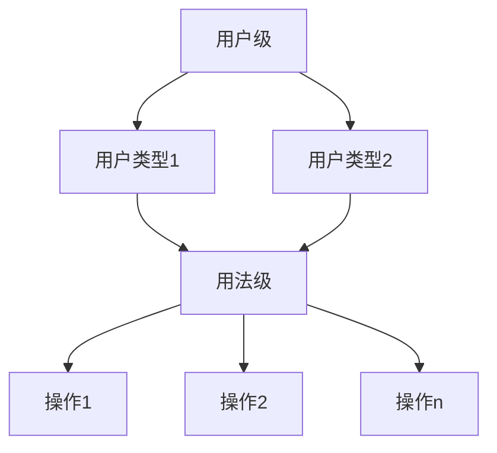

运行剖面的构建步骤：

1. **确定用户类型**：识别系统的不同用户群体[^71]。
2. **定义用户级**：描述用户类型的特征和使用模式[^72]。
3. **定义用法级**：描述用户的具体操作和输入[^73]。
4. **分配概率**：为每个操作分配发生概率[^74]。
5. **验证剖面**：验证运行剖面的正确性和完整性[^75]。

运行剖面的应用：

- **测试用例生成**：根据运行剖面生成测试用例[^76]。
- **可靠性评估**：基于运行剖面的测试数据进行可靠性评估[^77]。
- **资源分配**：根据运行剖面分配测试资源[^78]。

> 📌 **考试重点**：运行剖面的构建步骤和应用是常考内容。

> 🔗 **真题关联**：2024年上半年第35题考查了运行剖面；2023年上半年第45题考查了运行剖面的构建。

---

## 可靠性评价

软件可靠性评价是选用合适的可靠性数学模型，对失效数据进行处理，评估和预测软件可靠性[^79]。

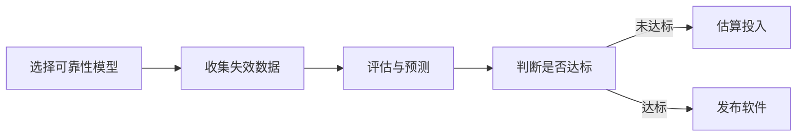

评价过程包含三个方面：

1. **选择可靠性模型**：考虑模型假设适用性、预测能力、输出值是否满足需求、使用简便性[^80]。
2. **收集可靠性数据**：贯穿整个软件生命周期，包括测试数据、运行数据等[^81]。
3. **可靠性评估和预测**：判断可靠性目标是否达到、估算所需时间和成本、预测未来可靠性水平[^82]。

常用可靠性模型分类：

- **种子法模型**：捕获-再捕获抽样估计错误数[^83]。
- **失效率类模型**：Jelinski-Moranda、Schick-Wolverton 等[^84]。
- **非齐次泊松过程（NHPP）**：Musa 指数模型、Goel-Okumoto 模型等[^85]。
- **贝叶斯模型**：利用先验分布和测试信息评估可靠性[^86]。

> 📌 **考试重点**：可靠性评价的三个过程和常用模型分类是高频考点。

> 🔗 **真题关联**：2023年下半年第48题考查了可靠性评价；2022年上半年第50题考查了可靠性模型选择。

---

## 失效率类模型

失效率类模型假设软件失效率与剩余缺陷数或测试时间相关[^87]。

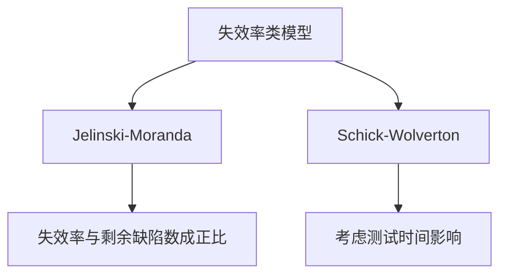

**Jelinski-Moranda模型**：

- 假设：每个缺陷的失效率相同，修复一个缺陷后失效率按比例下降[^88]。
- 公式：λ(i) = φ(N - i + 1)，其中N为总缺陷数，i为已修复缺陷数[^89]。
- 特点：模型简单，但假设过于理想化[^90]。

**Schick-Wolverton模型**：

- 假设：失效率与测试时间和剩余缺陷数都相关[^91]。
- 特点：比J-M模型更复杂，考虑了测试时间的影响[^92]。
- 适用：测试时间对可靠性影响较大的场景[^93]。

> 📌 **考试重点**：Jelinski-Moranda模型的假设和公式是常考内容。

> 🔗 **真题关联**：2024年上半年第38题考查了失效率类模型；2023年上半年第48题考查了J-M模型假设。

---

## NHPP模型

非齐次泊松过程（NHPP）模型假设累积失效数服从泊松分布，失效率随时间变化[^94]。

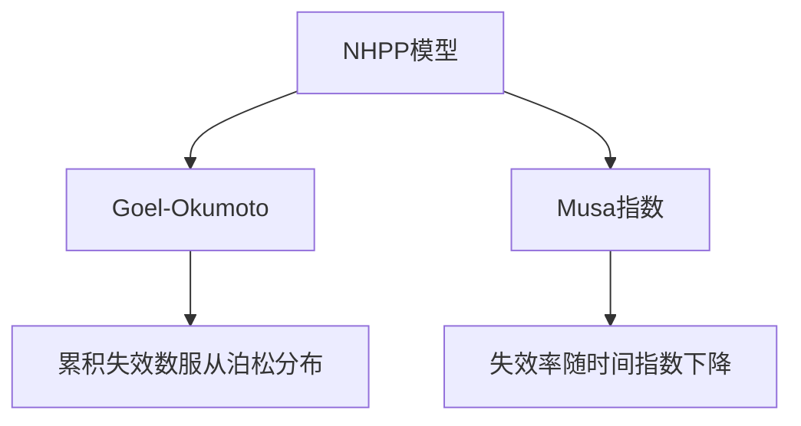

**Goel-Okumoto模型**：

- 假设：累积失效数服从泊松分布，期望累积失效数为指数增长[^95]。
- 公式：m(t) = a(1 - e^(-bt))，其中a为总缺陷数，b为缺陷发现率[^96]。
- 特点：模型简单，适用于早期测试阶段[^97]。

**Musa指数模型**：

- 假设：失效率随时间指数下降[^98]。
- 公式：λ(t) = λ₀e^(-θt)，其中λ₀为初始失效率，θ为下降率[^99]。
- 特点：适用于测试过程中失效率持续下降的场景[^100]。

> 📌 **考试重点**：Goel-Okumoto模型的公式和Musa指数模型的假设是高频考点。

> 🔗 **真题关联**：2023年下半年第50题考查了NHPP模型；2022年上半年第52题考查了Goel-Okumoto模型。

---

## 贝叶斯模型

贝叶斯模型利用先验分布和测试信息评估可靠性，结合主观先验知识和客观测试数据[^101]。

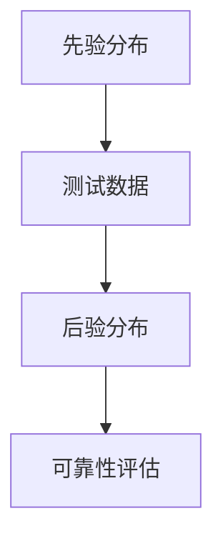

贝叶斯模型的特点：

- **先验知识**：利用历史数据或专家经验建立先验分布[^102]。
- **测试数据**：收集当前测试的失效数据[^103]。
- **后验分布**：结合先验分布和测试数据得到后验分布[^104]。
- **适用场景**：小样本场景、历史数据丰富的场景[^105]。

贝叶斯模型的优点：

- 可以结合主观先验知识[^106]。
- 适用于小样本场景[^107]。
- 结果解释直观[^108]。

贝叶斯模型的缺点：

- 先验分布的选择影响结果[^109]。
- 计算复杂度较高[^110]。

> 📌 **考试重点**：贝叶斯模型的特点、优点和适用场景是常考内容。

> 🔗 **真题关联**：2024年上半年第42题考查了贝叶斯模型；2023年上半年第50题考查了贝叶斯模型的优点。

---

## 参考文献

[^1]: 《系统架构设计师教程(第二版)》P.305 §9.1.1

[^2]: 《系统架构设计师教程(第二版)》P.306 §9.1.1

[^3]: 《系统架构设计师教程(第二版)》P.306 §9.1.1

[^4]: 《系统架构设计师教程(第二版)》P.306 §9.1.1

[^5]: 《系统架构设计师教程(第二版)》P.306 §9.1.1

[^6]: 《系统架构设计师教程(第二版)》P.306 §9.1.1

[^7]: 《系统架构设计师教程(第二版)》P.307 §9.1.2

[^8]: 《系统架构设计师教程(第二版)》P.307 §9.1.2

[^9]: 《系统架构设计师教程(第二版)》P.308 §9.1.2

[^10]: 《系统架构设计师教程(第二版)》P.308 §9.1.2

[^11]: 《系统架构设计师教程(第二版)》P.308 §9.1.2

[^12]: 《系统架构设计师教程(第二版)》P.308 §9.1.2

[^13]: 《系统架构设计师教程(第二版)》P.308 §9.1.2

[^14]: 《系统架构设计师教程(第二版)》P.308 §9.1.2

[^15]: 《系统架构设计师教程(第二版)》P.308 §9.1.2

[^16]: 《系统架构设计师教程(第二版)》P.309 §9.2

[^17]: 《系统架构设计师教程(第二版)》P.309 §9.2.1

[^18]: 《系统架构设计师教程(第二版)》P.309 §9.2.1

[^19]: 《系统架构设计师教程(第二版)》P.309 §9.2.1

[^20]: 《系统架构设计师教程(第二版)》P.309 §9.2.1

[^21]: 《系统架构设计师教程(第二版)》P.309 §9.2.1

[^22]: 《系统架构设计师教程(第二版)》P.310 §9.2.2

[^23]: 《系统架构设计师教程(第二版)》P.310 §9.2.2

[^24]: 《系统架构设计师教程(第二版)》P.310 §9.2.2

[^25]: 《系统架构设计师教程(第二版)》P.310 §9.2.2

[^26]: 《系统架构设计师教程(第二版)》P.310 §9.2.2

[^27]: 《系统架构设计师教程(第二版)》P.310 §9.2.2

[^28]: 《系统架构设计师教程(第二版)》P.310 §9.2.2

[^29]: 《系统架构设计师教程(第二版)》P.310 §9.2.2

[^30]: 《系统架构设计师教程(第二版)》P.310 §9.2.2

[^31]: 《系统架构设计师教程(第二版)》P.316 §9.3

[^32]: 《系统架构设计师教程(第二版)》P.316 §9.3

[^33]: 《系统架构设计师教程(第二版)》P.316 §9.3

[^34]: 《系统架构设计师教程(第二版)》P.316 §9.3

[^35]: 《系统架构设计师教程(第二版)》P.316 §9.3

[^36]: 《系统架构设计师教程(第二版)》P.316 §9.3

[^37]: 《系统架构设计师教程(第二版)》P.318 §9.4

[^38]: 《系统架构设计师教程(第二版)》P.319 §9.4.1

[^39]: 《系统架构设计师教程(第二版)》P.319 §9.4.1

[^40]: 《系统架构设计师教程(第二版)》P.319 §9.4.1

[^41]: 《系统架构设计师教程(第二版)》P.320 §9.4.1

[^42]: 《系统架构设计师教程(第二版)》P.320 §9.4.2

[^43]: 《系统架构设计师教程(第二版)》P.320 §9.4.3

[^44]: 《系统架构设计师教程(第二版)》P.319 §9.4.1

[^45]: 《系统架构设计师教程(第二版)》P.319 §9.4.1

[^46]: 《系统架构设计师教程(第二版)》P.319 §9.4.1

[^47]: 《系统架构设计师教程(第二版)》P.319 §9.4.1

[^48]: 《系统架构设计师教程(第二版)》P.319 §9.4.1

[^49]: 《系统架构设计师教程(第二版)》P.319 §9.4.1

[^50]: 《系统架构设计师教程(第二版)》P.319 §9.4.1

[^51]: 《系统架构设计师教程(第二版)》P.319 §9.4.1

[^52]: 《系统架构设计师教程(第二版)》P.319 §9.4.1

[^53]: 《系统架构设计师教程(第二版)》P.319 §9.4.1

[^54]: 《系统架构设计师教程(第二版)》P.320 §9.4.2

[^55]: 《系统架构设计师教程(第二版)》P.320 §9.4.2

[^56]: 《系统架构设计师教程(第二版)》P.320 §9.4.2

[^57]: 《系统架构设计师教程(第二版)》P.320 §9.4.2

[^58]: 《系统架构设计师教程(第二版)》P.320 §9.4.2

[^59]: 《系统架构设计师教程(第二版)》P.321 §9.4.4

[^60]: 《系统架构设计师教程(第二版)》P.321 §9.4.4

[^61]: 《系统架构设计师教程(第二版)》P.321 §9.4.4

[^62]: 《系统架构设计师教程(第二版)》P.321 §9.4.4

[^63]: 《系统架构设计师教程(第二版)》P.322 §9.4.4

[^64]: 《系统架构设计师教程(第二版)》P.322 §9.5

[^65]: 《系统架构设计师教程(第二版)》P.309 §9.1.3

[^66]: 《系统架构设计师教程(第二版)》P.322-323 §9.5.2

[^67]: 《系统架构设计师教程(第二版)》P.324 §9.5.4

[^68]: 《系统架构设计师教程(第二版)》P.325 §9.5.4

[^69]: 《系统架构设计师教程(第二版)》P.325 §9.5.4

[^70]: 《系统架构设计师教程(第二版)》P.309 §9.1.3

[^71]: 《系统架构设计师教程(第二版)》P.309 §9.1.3

[^72]: 《系统架构设计师教程(第二版)》P.309 §9.1.3

[^73]: 《系统架构设计师教程(第二版)》P.309 §9.1.3

[^74]: 《系统架构设计师教程(第二版)》P.309 §9.1.3

[^75]: 《系统架构设计师教程(第二版)》P.309 §9.1.3

[^76]: 《系统架构设计师教程(第二版)》P.322 §9.5.2

[^77]: 《系统架构设计师教程(第二版)》P.322 §9.5.2

[^78]: 《系统架构设计师教程(第二版)》P.322 §9.5.2

[^79]: 《系统架构设计师教程(第二版)》P.326 §9.6.1

[^80]: 《系统架构设计师教程(第二版)》P.326 §9.6.2

[^81]: 《系统架构设计师教程(第二版)》P.327-328 §9.6.3

[^82]: 《系统架构设计师教程(第二版)》P.328 §9.6.4

[^83]: 《系统架构设计师教程(第二版)》P.314 §9.2.3

[^84]: 《系统架构设计师教程(第二版)》P.314 §9.2.3

[^85]: 《系统架构设计师教程(第二版)》P.315 §9.2.3

[^86]: 《系统架构设计师教程(第二版)》P.315 §9.2.3

[^87]: 《系统架构设计师教程(第二版)》P.314 §9.2.3

[^88]: 《系统架构设计师教程(第二版)》P.314 §9.2.3

[^89]: 《系统架构设计师教程(第二版)》P.314 §9.2.3

[^90]: 《系统架构设计师教程(第二版)》P.314 §9.2.3

[^91]: 《系统架构设计师教程(第二版)》P.314 §9.2.3

[^92]: 《系统架构设计师教程(第二版)》P.314 §9.2.3

[^93]: 《系统架构设计师教程(第二版)》P.314 §9.2.3

[^94]: 《系统架构设计师教程(第二版)》P.315 §9.2.3

[^95]: 《系统架构设计师教程(第二版)》P.315 §9.2.3

[^96]: 《系统架构设计师教程(第二版)》P.315 §9.2.3

[^97]: 《系统架构设计师教程(第二版)》P.315 §9.2.3

[^98]: 《系统架构设计师教程(第二版)》P.315 §9.2.3

[^99]: 《系统架构设计师教程(第二版)》P.315 §9.2.3

[^100]: 《系统架构设计师教程(第二版)》P.315 §9.2.3

[^101]: 《系统架构设计师教程(第二版)》P.315 §9.2.3

[^102]: 《系统架构设计师教程(第二版)》P.315 §9.2.3

[^103]: 《系统架构设计师教程(第二版)》P.315 §9.2.3

[^104]: 《系统架构设计师教程(第二版)》P.315 §9.2.3

[^105]: 《系统架构设计师教程(第二版)》P.315 §9.2.3

[^106]: 《系统架构设计师教程(第二版)》P.315 §9.2.3

[^107]: 《系统架构设计师教程(第二版)》P.315 §9.2.3

[^108]: 《系统架构设计师教程(第二版)》P.315 §9.2.3

[^109]: 《系统架构设计师教程(第二版)》P.315 §9.2.3

[^110]: 《系统架构设计师教程(第二版)》P.315 §9.2.3
