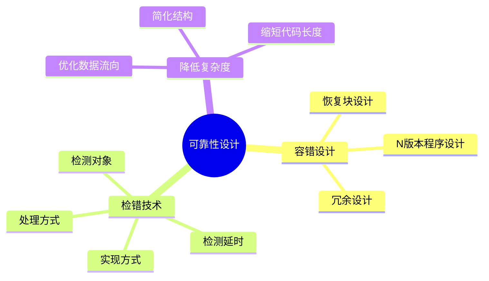
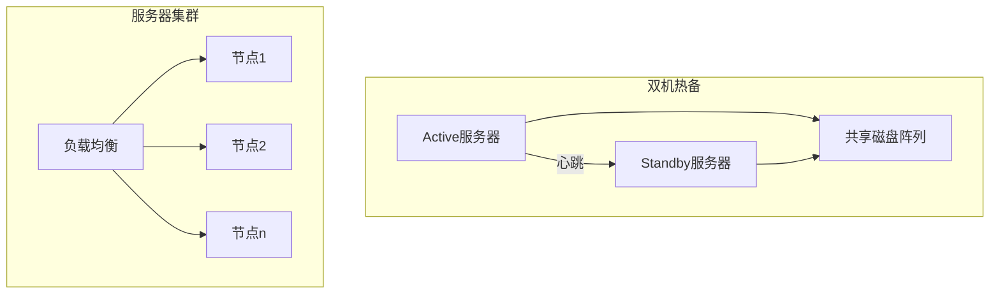
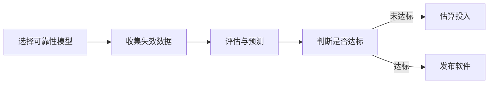

## 软件可靠性定义

软件可靠性（Software Reliability）是软件产品在 **规定的条件下和规定的时间区间完成规定功能的能力**[^1]。

```mermaid
graph LR
    A[规定条件] --> B[软件可靠性]
    C[规定时间] --> B
    D[规定功能] --> B
    B --> E[可靠度 R(t)]
    B --> F[失效强度 f(t)]
    B --> G[MTTF/MTBF]
```

软件与硬件在可靠性方面的主要不同：

- **复杂性**：软件逻辑高度复杂，设计错误是失效主因[^2]。
- **物理退化**：软件不存在物理退化，正确软件始终可靠[^3]。
- **唯一性**：软件复制不改变本身，概率方法在软件领域效果不如硬件[^4]。
- **版本更新快**：软件版本更新频繁，给可靠性评估带来难度[^5]。

IEEE 定义：在规定条件下、规定时间内，软件不引起系统失效的概率，是系统输入和软件缺陷的函数[^6]。

定量描述指标：

- **可靠度 R(t)**：R(t) = 1 - F(t)，其中 F(t) 为失效概率[^7]。
- **失效强度 f(t)**：单位时间软件出现失效的概率[^8]。
- **MTTF**：平均失效前时间，系统持续运行时间的期望值[^9]。
- **MTBF**：平均故障间隔时间，MTBF = MTTF + MTTR[^10]。

[^1]: 《系统架构设计师教程(第二版)》P.305 §9.1.1

[^2]: 《系统架构设计师教程(第二版)》P.306 §9.1.1

[^3]: 《系统架构设计师教程(第二版)》P.306 §9.1.1

[^4]: 《系统架构设计师教程(第二版)》P.306 §9.1.1

[^5]: 《系统架构设计师教程(第二版)》P.306 §9.1.1

[^6]: 《系统架构设计师教程(第二版)》P.306 §9.1.1

[^7]: 《系统架构设计师教程(第二版)》P.307 §9.1.2

[^8]: 《系统架构设计师教程(第二版)》P.307 §9.1.2

[^9]: 《系统架构设计师教程(第二版)》P.308 §9.1.2

[^10]: 《系统架构设计师教程(第二版)》P.308 §9.1.2

---

## 可靠性设计技术

可靠性设计是在软件设计阶段采取措施进行可靠性控制，最有效、最经济的手段[^11]。



主要技术：

- **容错设计**：适用于失效后果特别严重的场合，如飞行控制系统、核反应堆安全系统等[^12]。
  - **恢复块设计**：选择一组操作作为容错单元，包含多个功能相同、设计差异的程序块，故障时切换备份[^13]。
  - **N 版本程序设计**：设计多个模块或不同版本，对相同输入结果实行多数表决，防止单一故障[^14]。
  - **冗余设计**：设计不同路径、算法或实现方法的模块作为备份，出现故障时替换[^15]。
- **检错技术**：在故障后及时发现并报警，代价低于容错，但不能自动解决故障[^16]。
- **降低复杂度设计**：简化软件结构、缩短代码长度、优化数据流向，降低复杂度从而提高可靠性[^17]。

[^11]: 《系统架构设计师教程(第二版)》P.318 §9.4

[^12]: 《系统架构设计师教程(第二版)》P.319 §9.4.1

[^13]: 《系统架构设计师教程(第二版)》P.319 §9.4.1

[^14]: 《系统架构设计师教程(第二版)》P.319 §9.4.1

[^15]: 《系统架构设计师教程(第二版)》P.320 §9.4.1

[^16]: 《系统架构设计师教程(第二版)》P.320 §9.4.2

[^17]: 《系统架构设计师教程(第二版)》P.320 §9.4.3

---

## 系统配置技术

系统配置技术通过整体容错来提高可靠性，主要包括 **双机热备** 和 **服务器集群**[^18]。



双机热备三种模式：

- **双机热备模式（Active/Standby）**：Active 工作，Standby 监控，故障时切换。存在计算资源浪费[^19]。
- **双机互备模式**：两个独立应用在两台机器同时运行，互为备机[^20]。
- **双机双工模式**：两台服务器均活动，同时运行相同应用，实现负载均衡和互为备份[^21]。

**服务器集群**：一组独立服务器组合成单一系统，提供高可靠性服务。集群内任一系统故障时，应用程序在另一节点自动接管[^22]。

[^18]: 《系统架构设计师教程(第二版)》P.321 §9.4.4

[^19]: 《系统架构设计师教程(第二版)》P.321 §9.4.4

[^20]: 《系统架构设计师教程(第二版)》P.321 §9.4.4

[^21]: 《系统架构设计师教程(第二版)》P.321 §9.4.4

[^22]: 《系统架构设计师教程(第二版)》P.322 §9.4.4

---

## 软件可靠性测试

软件可靠性测试是通过运行剖面生成测试用例，在真实或模拟环境下执行测试，收集故障数据[^23]。


测试要点：

- **运行剖面**：定义软件使用条件，包括输入值按时间分布或出现概率分布[^24]。
- **测试用例设计**：使用马尔可夫链建模，将输入域分层为用户级和用法级，为每个元素分配发生概率和关键因子[^25]。
- **测试实施**：优先测试最重要或最频繁使用的功能，使用多台计算机增加累计运行时间[^26]。
- **数据收集**：收集失效时间数据、失效间隔时间数据、分组失效数等[^27]。

可靠性测试必须是受控测试，每个测试用例必须使用相同软件版本，新版本意味着新测试开始[^28]。

[^23]: 《系统架构设计师教程(第二版)》P.322 §9.5

[^24]: 《系统架构设计师教程(第二版)》P.309 §9.1.3

[^25]: 《系统架构设计师教程(第二版)》P.322-323 §9.5.2

[^26]: 《系统架构设计师教程(第二版)》P.324 §9.5.4

[^27]: 《系统架构设计师教程(第二版)》P.325 §9.5.4

[^28]: 《系统架构设计师教程(第二版)》P.325 §9.5.4

---

## 可靠性评价

软件可靠性评价是选用合适的可靠性数学模型，对失效数据进行处理，评估和预测软件可靠性[^29]。



评价过程包含三个方面：

1. **选择可靠性模型**：考虑模型假设适用性、预测能力、输出值是否满足需求、使用简便性[^30]。
2. **收集可靠性数据**：贯穿整个软件生命周期，包括测试数据、运行数据等[^31]。
3. **可靠性评估和预测**：判断可靠性目标是否达到、估算所需时间和成本、预测未来可靠性水平[^32]。

常用可靠性模型分类：

- **种子法模型**：捕获-再捕获抽样估计错误数[^33]。
- **失效率类模型**：Jelinski-Moranda、Schick-Wolverton 等[^34]。
- **非齐次泊松过程（NHPP）**：Musa 指数模型、Goel-Okumoto 模型等[^35]。
- **贝叶斯模型**：利用先验分布和测试信息评估可靠性[^36]。

[^29]: 《系统架构设计师教程(第二版)》P.326 §9.6.1

[^30]: 《系统架构设计师教程(第二版)》P.326 §9.6.2

[^31]: 《系统架构设计师教程(第二版)》P.327-328 §9.6.3

[^32]: 《系统架构设计师教程(第二版)》P.328 §9.6.4

[^33]: 《系统架构设计师教程(第二版)》P.314 §9.2.3

[^34]: 《系统架构设计师教程(第二版)》P.314 §9.2.3

[^35]: 《系统架构设计师教程(第二版)》P.315 §9.2.3

[^36]: 《系统架构设计师教程(第二版)》P.315 §9.2.3

---

## 参考文献

[^1]: 《系统架构设计师教程(第二版)》P.305 §9.1.1

[^2]: 《系统架构设计师教程(第二版)》P.306 §9.1.1

[^3]: 《系统架构设计师教程(第二版)》P.306 §9.1.1

[^4]: 《系统架构设计师教程(第二版)》P.306 §9.1.1

[^5]: 《系统架构设计师教程(第二版)》P.306 §9.1.1

[^6]: 《系统架构设计师教程(第二版)》P.306 §9.1.1

[^7]: 《系统架构设计师教程(第二版)》P.307 §9.1.2

[^8]: 《系统架构设计师教程(第二版)》P.307 §9.1.2

[^9]: 《系统架构设计师教程(第二版)》P.308 §9.1.2

[^10]: 《系统架构设计师教程(第二版)》P.308 §9.1.2

[^11]: 《系统架构设计师教程(第二版)》P.318 §9.4

[^12]: 《系统架构设计师教程(第二版)》P.319 §9.4.1

[^13]: 《系统架构设计师教程(第二版)》P.319 §9.4.1

[^14]: 《系统架构设计师教程(第二版)》P.319 §9.4.1

[^15]: 《系统架构设计师教程(第二版)》P.320 §9.4.1

[^16]: 《系统架构设计师教程(第二版)》P.320 §9.4.2

[^17]: 《系统架构设计师教程(第二版)》P.320 §9.4.3

[^18]: 《系统架构设计师教程(第二版)》P.321 §9.4.4

[^19]: 《系统架构设计师教程(第二版)》P.321 §9.4.4

[^20]: 《系统架构设计师教程(第二版)》P.321 §9.4.4

[^21]: 《系统架构设计师教程(第二版)》P.321 §9.4.4

[^22]: 《系统架构设计师教程(第二版)》P.322 §9.4.4

[^23]: 《系统架构设计师教程(第二版)》P.322 §9.5

[^24]: 《系统架构设计师教程(第二版)》P.309 §9.1.3

[^25]: 《系统架构设计师教程(第二版)》P.322-323 §9.5.2

[^26]: 《系统架构设计师教程(第二版)》P.324 §9.5.4

[^27]: 《系统架构设计师教程(第二版)》P.325 §9.5.4

[^28]: 《系统架构设计师教程(第二版)》P.325 §9.5.4

[^29]: 《系统架构设计师教程(第二版)》P.326 §9.6.1

[^30]: 《系统架构设计师教程(第二版)》P.326 §9.6.2

[^31]: 《系统架构设计师教程(第二版)》P.327-328 §9.6.3

[^32]: 《系统架构设计师教程(第二版)》P.328 §9.6.4

[^33]: 《系统架构设计师教程(第二版)》P.314 §9.2.3

[^34]: 《系统架构设计师教程(第二版)》P.314 §9.2.3

[^35]: 《系统架构设计师教程(第二版)》P.315 §9.2.3

[^36]: 《系统架构设计师教程(第二版)》P.315 §9.2.3
