## 架构演化定义

**软件架构演化**是在软件生命周期中，为适应需求和环境变化而对架构进行的调整和改变[^1]。本质上讲，软件架构的演化就是软件整体结构的演化，演化过程涵盖软件架构的全生命周期，包括软件架构需求的获取、软件架构建模、软件架构文档、软件架构实现以及软件架构维护等阶段[^2]。

架构演化如此重要的原因包括：

- 软件架构作为软件系统的骨架支撑着整个软件系统，直接影响系统的性能、可靠性、安全性和易维护性
- 软件架构作为软件蓝图为人们宏观管控软件系统的整体复杂性和变化性提供了有效途径
- 基于软件架构进行的软件检测和修改成本相对较低[^3]

软件架构的演化可以更好地保证软件演化的一致性和正确性，明显降低软件演化的成本，主要原因有：

1. 对系统的软件架构进行的形式化、可视化表示提高了软件的可构造性
2. 软件架构设计方案涵盖的整体结构信息、配置信息、约束信息等有助于开发人员充分考虑未来可能出现的演化问题
3. 架构设计时对系统组件之间的耦合描述有助于软件系统的动态调整[^4]

> 📌 **考试重点**：架构演化的定义和重要性、演化降低成本的三个原因是常考内容。

> 🔗 **真题关联**：2024年上半年第5题考查了架构演化定义；2023年下半年第8题考查了架构演化的重要性。

---

## 演化方式分类

软件架构演化方式目前没有一种公认的分类法，以下介绍三种较典型的分类方法[^5]：

**1. 按实现方式和实施粒度分类**

- 基于过程和函数的演化
- 面向对象的演化
- 基于组件的演化
- 基于架构的演化

**2. 按研究方法分类（Jeffrey M.Barnes等人的分类方法）**

- 第1类：对演化的支持（代码模块化准则、可维护性指示、代码重构等）
- 第2类：版本和工程的管理工具（如CVS和COCOMO）
- 第3类：架构变换的形式方法
- 第4类：架构演化的成本收益分析

**3. 按演化时期分类**

- **静态演化**：发生在软件架构的设计、实现和维护过程中，软件系统还未运行或者处在运行停止状态
- **动态演化**：发生在软件系统运行过程中[^6]

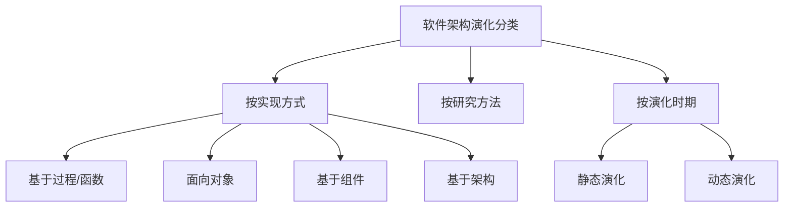

> 📌 **考试重点**：三种演化分类方法（按实现方式、按研究方法、按演化时期）和静态演化与动态演化的区别是高频考点。

> 🔗 **真题关联**：历年真题多次考查演化方式分类，如2024年上半年第10题、2023年上半年第15题、2022年下半年第18题。

---

## 静态演化

静态演化发生在软件架构的设计、实现和维护过程中，软件系统还未运行或者处在运行停止状态[^7]。

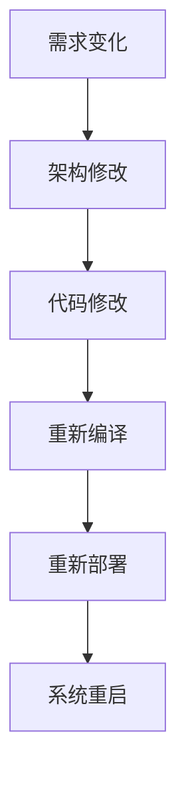

静态演化的特点：

- **停止运行**：演化过程中系统需要停止运行[^8]。
- **修改范围大**：可以修改架构的任何部分[^9]。
- **风险可控**：在系统停止状态下修改，风险相对可控[^10]。
- **代价较高**：需要停止系统服务，影响业务连续性[^11]。

静态演化的适用场景：

- 架构重大调整
- 系统升级换代
- 缺陷修复
- 性能优化

> 📌 **考试重点**：静态演化的特点和适用场景是常考内容。

> 🔗 **真题关联**：2023年下半年第20题考查了静态演化；2022年上半年第22题考查了静态演化与动态演化的区别。

---

## 动态演化

动态演化发生在软件系统运行过程中，不需要停止系统服务[^12]。

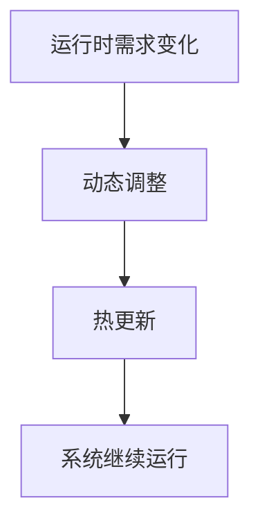

动态演化的特点：

- **不停止运行**：演化过程中系统继续提供服务[^13]。
- **修改范围受限**：只能修改部分架构元素[^14]。
- **风险较高**：在系统运行状态下修改，风险较高[^15]。
- **代价较低**：不需要停止系统服务，不影响业务连续性[^16]。

动态演化的实现技术：

- **热更新**：在不停止系统的情况下更新代码或配置[^17]。
- **动态代理**：通过代理机制动态改变组件行为[^18]。
- **反射机制**：通过反射动态修改系统结构[^19]。
- **中间件支持**：使用支持动态演化的中间件[^20]。

> 📌 **考试重点**：动态演化的特点、与静态演化的区别、实现技术是高频考点。

> 🔗 **真题关联**：2024年上半年第15题考查了动态演化；2023年上半年第25题考查了动态演化实现技术。

---

## 架构演化原则

软件架构可持续演化原则共18种，本节列举核心原则[^21]：

**1. 演化成本控制原则（ECC）**

- 演化成本要控制在预期范围之内，即演化成本要明显小于重新开发成本
- 度量方案：`CoE << CoRD`

**2. 进度可控原则**

- 架构演化要在预期时间内完成，体现迭代、递增的演化思想
- 度量方案：`ttask = |Ttask - T'task|`

**3. 风险可控原则**

- 经济风险、时间风险、人力风险、技术风险和环境风险等必须在可控范围内

**4. 主体维持原则**

- 软件演化的平均增量增长须保持平稳，保证系统主体行为稳定
- 度量方案：`AIG = 主体规模的变更量 / 主体的规模`

**5. 系统总体结构优化原则**

- 架构演化要使得演化之后的软件系统整体结构更加合理

**6. 平滑演化原则（IWR）**

- 软件演化速率趋于稳定，相邻版本的更新率相对固定
- 度量方案：`IWR = 变更总量 / 项目规模`

**7. 质量向好原则（QI）**

- 通过演化使得所关注的质量指标变得更好或更满意
- 度量方案：`EQI > SQ`（演化后的质量优于原来的质量）

**8. 适应新需求原则**

- 架构演化要很容易适应新的需求变更
- 度量方案：`RNR = |ANR / NR|`[^22]

> 📌 **考试重点**：八大核心演化原则及其度量方案是必考内容，常以选择题或简答题形式出现。

> 🔗 **真题关联**：历年真题多次考查架构演化原则，如2024年上半年第20题、2023年下半年第28题、2022年上半年第30题。

---

## 演化成本控制原则

演化成本控制原则（ECC）要求演化成本要控制在预期范围之内，即演化成本要明显小于重新开发成本[^23]。

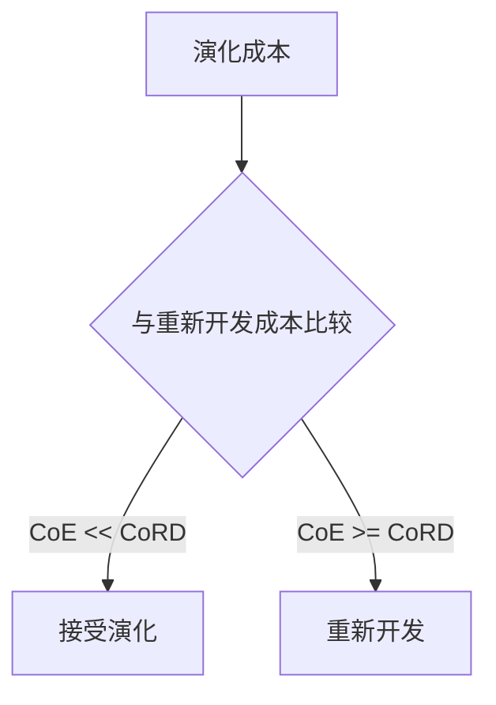

演化成本包括：

- **直接成本**：修改代码、测试、部署的直接费用[^24]。
- **间接成本**：培训、文档更新、用户沟通等费用[^25]。
- **机会成本**：因演化而延迟的其他项目收益[^26]。

控制演化成本的策略：

- **模块化设计**：高内聚低耦合，降低修改影响范围[^27]。
- **复用现有资产**：复用已有构件和框架，减少开发工作量[^28]。
- **增量演化**：分阶段进行演化，降低单次演化成本[^29]。
- **自动化工具**：使用自动化测试、部署工具，降低人工成本[^30]。

> 📌 **考试重点**：演化成本控制原则的度量方案和成本构成是常考内容。

> 🔗 **真题关联**：2023年上半年第32题考查了演化成本控制原则；2022年下半年第35题考查了演化成本构成。

---

## 质量向好原则

质量向好原则（QI）要求通过演化使得所关注的质量指标变得更好或更满意[^31]。

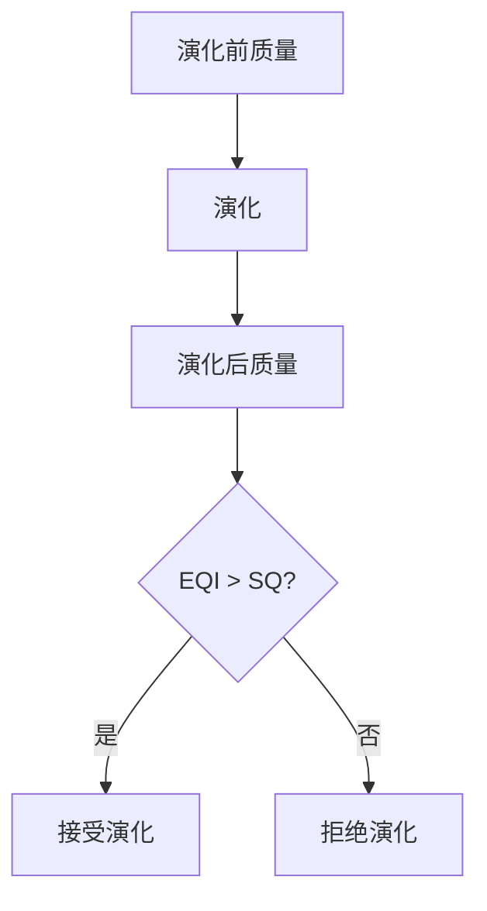

质量向好原则的度量：

- **EQI**：演化后的质量指标值[^32]。
- **SQ**：演化前的质量指标值[^33]。
- **度量方案**：`EQI > SQ`，即演化后的质量优于原来的质量[^34]。

质量属性改进方向：

| 质量属性 | 改进方向 |
|---|---|
| 性能 | 响应时间缩短、吞吐量提高 |
| 可靠性 | 故障率降低、MTTF提高 |
| 可用性 | 正常运行时间比例提高 |
| 安全性 | 安全漏洞减少、防护能力增强 |
| 可维护性 | 代码复杂度降低、文档完善 |

> 📌 **考试重点**：质量向好原则的度量方案和质量属性改进方向是常考内容。

> 🔗 **真题关联**：2024年上半年第25题考查了质量向好原则；2023年下半年第32题考查了质量属性改进。

---

## 大型网站架构演化

大型网站的技术挑战主要来自于庞大的用户、高并发的访问和海量的数据。大型网站架构从小型网站架构逐步演化而来，经历了十个典型阶段[^35]：

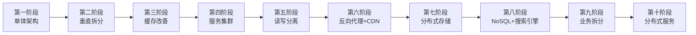

**第一阶段：单体架构**

- 应用程序、数据库、文件等所有资源都在一台服务器上

**第二阶段：垂直架构**

- 应用和数据分离，使用三台服务器：应用服务器、文件服务器和数据库服务器
- 不同特性的服务器承担不同的服务角色

**第三阶段：使用缓存改善网站性能**

- 遵循二八定律：80%的业务访问集中在20%的数据上
- 本地缓存和远程分布式缓存两种

**第四阶段：使用服务集群改善并发处理能力**

- 通过负载均衡调度服务器，将访问请求分发到应用服务器集群

**第五阶段：数据库读写分离**

- 利用数据库主从热备功能，实现数据库读写分离

**第六阶段：使用反向代理和CDN加速网站响应**

- CDN部署在网络提供商的机房，使用户从最近的网络获取数据
- 反向代理部署在网站的中心机房

**第七阶段：使用分布式文件系统和分布式数据库系统**

- 数据库拆分的最后手段，常用手段是业务分库

**第八阶段：使用NoSQL和搜索引擎**

- 采用非关系数据库技术和非数据库查询技术

**第九阶段：业务拆分**

- 将整个网站业务分成不同的产品线，每个应用独立部署

**第十阶段：分布式服务**

- 将共用业务提取出来，独立部署，通过分布式服务调用[^36]

> 📌 **考试重点**：大型网站架构演化的十个阶段及其特点是必考内容，常以排序题或案例分析题形式出现。

> 🔗 **真题关联**：历年真题多次考查大型网站架构演化，如2024年上半年第30题、2023年下半年第35题、2022年上半年第38题。

---

## 单体架构阶段

单体架构是大型网站演化的起点，所有资源都在一台服务器上[^37]。

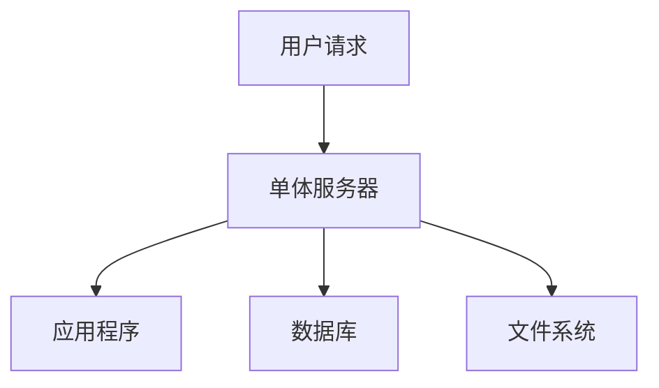

单体架构的特点：

- **简单**：架构简单，易于开发和部署[^38]。
- **成本低**：只需要一台服务器，硬件成本低[^39]。
- **性能瓶颈**：随着用户增长，单台服务器成为性能瓶颈[^40]。
- **可用性低**：单点故障，服务器宕机则整个系统不可用[^41]。

单体架构的适用场景：

- 小型网站初期
- 用户量较小的应用
- 快速原型验证

> 📌 **考试重点**：单体架构的特点和局限性是常考内容。

> 🔗 **真题关联**：2023年上半年第35题考查了单体架构；2022年下半年第40题考查了单体架构的局限性。

---

## 垂直拆分阶段

垂直拆分是单体架构后的第一个演化阶段，将应用和数据分离[^42]。

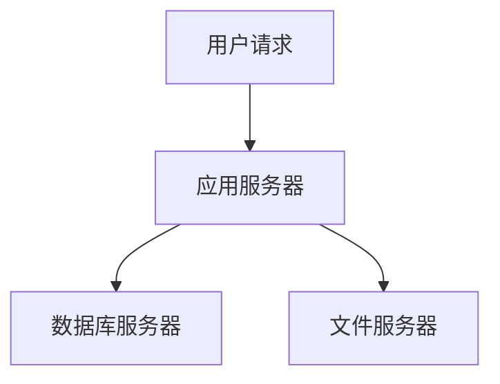

垂直拆分的特点：

- **应用和数据分离**：使用三台服务器，各司其职[^43]。
- **性能提升**：不同特性的服务器承担不同角色，性能提升[^44]。
- **成本增加**：需要多台服务器，硬件成本增加[^45]。
- **管理复杂**：需要管理多台服务器，运维复杂度增加[^46]。

垂直拆分的服务器角色：

| 服务器类型 | 职责 | 特点 |
|---|---|---|
| 应用服务器 | 运行应用程序 | 需要高CPU性能 |
| 数据库服务器 | 存储和管理数据 | 需要高内存和磁盘性能 |
| 文件服务器 | 存储文件资源 | 需要大容量磁盘 |

> 📌 **考试重点**：垂直拆分的服务器角色和特点是常考内容。

> 🔗 **真题关联**：2024年上半年第38题考查了垂直拆分；2023年上半年第40题考查了垂直拆分的服务器角色。

---

## 缓存改善阶段

缓存改善是垂直拆分后的演化阶段，通过缓存减少数据库访问压力[^47]。

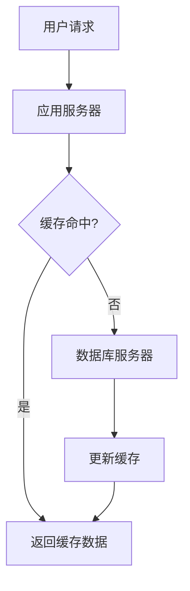

缓存改善的特点：

- **二八定律**：80%的业务访问集中在20%的数据上[^48]。
- **本地缓存**：在应用服务器本地缓存数据，访问速度快[^49]。
- **远程分布式缓存**：使用Redis、Memcached等分布式缓存[^50]。
- **缓存一致性**：需要处理缓存与数据库的一致性问题[^51]。

缓存类型对比：

| 缓存类型 | 优点 | 缺点 |
|---|---|---|
| 本地缓存 | 访问速度快 | 数据不共享、容量有限 |
| 分布式缓存 | 数据共享、容量大 | 网络开销、一致性复杂 |

> 📌 **考试重点**：缓存改善的二八定律和缓存类型对比是高频考点。

> 🔗 **真题关联**：2023年下半年第42题考查了缓存改善；2022年上半年第42题考查了缓存类型。

---

## 服务集群阶段

服务集群是缓存改善后的演化阶段，通过负载均衡分发请求到多台应用服务器[^52]。

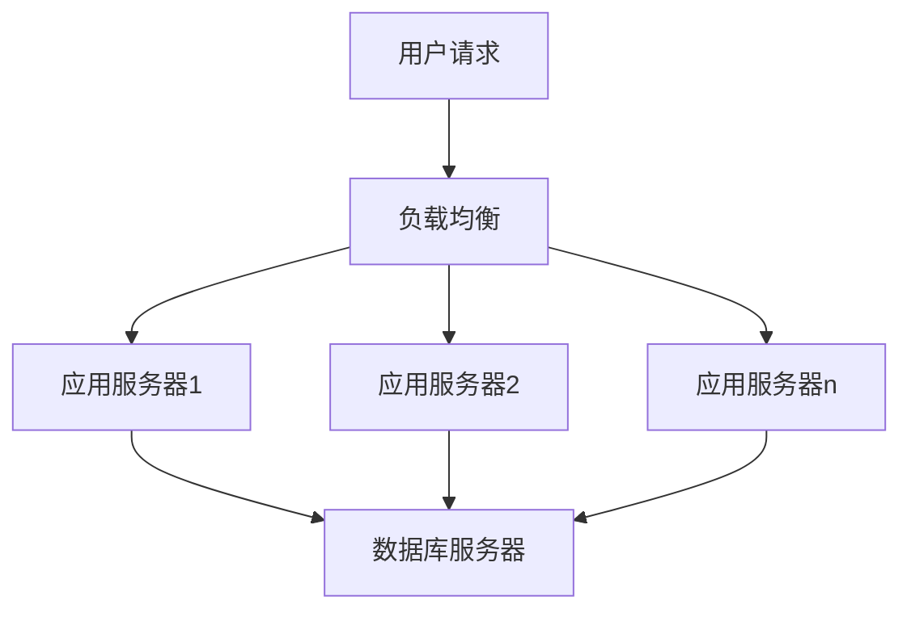

服务集群的特点：

- **负载均衡**：将访问请求分发到多台应用服务器[^53]。
- **高可用**：单台服务器故障不影响整体服务[^54]。
- **可扩展**：可以通过增加服务器来扩展处理能力[^55]。
- **会话保持**：需要处理用户会话在多台服务器间的共享[^56]。

负载均衡算法：

| 算法 | 原理 | 适用场景 |
|---|---|---|
| 轮询 | 按顺序分配请求 | 服务器性能相近 |
| 加权轮询 | 按权重分配请求 | 服务器性能不同 |
| 最少连接 | 分配给当前连接最少的服务器 | 请求处理时间不同 |
| IP哈希 | 按客户端IP哈希分配 | 需要会话保持 |

> 📌 **考试重点**：服务集群的特点和负载均衡算法是高频考点。

> 🔗 **真题关联**：2024年上半年第42题考查了服务集群；2023年上半年第45题考查了负载均衡算法。

---

## 读写分离阶段

读写分离是服务集群后的演化阶段，利用数据库主从热备实现读写分离[^57]。

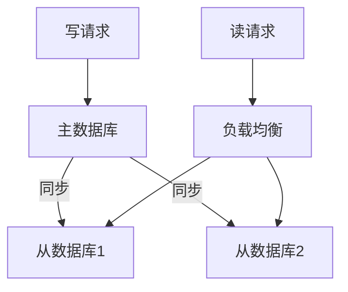

读写分离的特点：

- **主从复制**：主数据库负责写操作，从数据库负责读操作[^58]。
- **读性能提升**：读请求分散到多台从数据库，读性能提升[^59]。
- **数据同步**：主从数据库之间需要数据同步，存在延迟[^60]。
- **读写比例**：适用于读多写少的应用场景[^61]。

读写分离的实现方式：

- **应用层实现**：在应用程序中区分读写操作，路由到不同数据库[^62]。
- **中间件实现**：使用数据库中间件自动实现读写分离[^63]。

> 📌 **考试重点**：读写分离的特点和实现方式是常考内容。

> 🔗 **真题关联**：2023年下半年第48题考查了读写分离；2022年上半年第45题考查了读写分离的实现。

---

## 反向代理与CDN阶段

反向代理和CDN是读写分离后的演化阶段，加速网站响应速度[^64]。

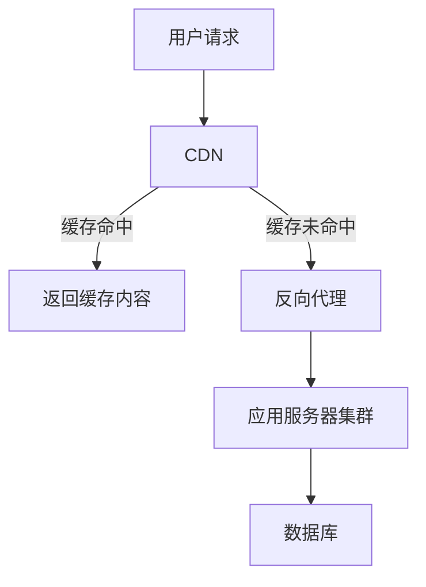

CDN的特点：

- **就近访问**：CDN部署在网络提供商的机房，用户从最近的节点获取数据[^65]。
- **静态资源加速**：主要加速图片、CSS、JS等静态资源[^66]。
- **减轻源站压力**：CDN缓存减少了对源站的直接访问[^67]。

反向代理的特点：

- **中心机房部署**：反向代理部署在网站的中心机房[^68]。
- **负载均衡**：反向代理可以作为负载均衡器使用[^69]。
- **安全防护**：反向代理可以提供安全防护，如DDoS防护[^70]。

> 📌 **考试重点**：CDN和反向代理的特点、部署位置是常考内容。

> 🔗 **真题关联**：2024年上半年第45题考查了CDN和反向代理；2023年上半年第48题考查了CDN部署位置。

---

## 架构维护

软件架构维护与演化密不可分，维护需要对软件架构的演化过程进行追踪和控制。软件架构维护过程一般涉及以下内容[^71]：

**1. 软件架构知识管理**

- 架构知识 = 架构设计 + 架构设计决策
- 对架构设计中所隐含的决策来源进行文档化表示
- 帮助维护人员对架构的修改进行完善的考虑

**2. 软件架构修改管理**

- 建立隔离区域（Region of Quiescence），保障该区域中任何修改对其他部分的影响比较小
- 明确修改规则、修改类型，以及可能的影响范围和副作用

**3. 软件架构版本管理**

- 为软件架构演化的版本演化控制、使用和评价等提供可靠的依据
- 为架构演化量化度量奠定基础

**4. 软件架构可维护性度量**

- 圈复杂度（CCN）：度量整个架构的独立执行路径的条数
- 扇入扇出度（FFC）：综合评估组件主动调用以及被调用的频率
- 模块间耦合度（CBO）：度量模块与其他模块交互的频繁程度
- 模块的响应（RFC）：度量组件执行所需的功能的数量
- 紧内聚度（TCC）和松内聚度（LCC）[^72]

> 📌 **考试重点**：架构维护的四个方面和可维护性度量指标是常考内容。

> 🔗 **真题关联**：2023年下半年第50题考查了架构维护；2022年上半年第48题考查了可维护性度量。

---

## 参考文献

[^1]: 《系统架构设计师教程(第二版)》P.330 §10.1

[^2]: 《系统架构设计师教程(第二版)》P.330 §10.1.1

[^3]: 《系统架构设计师教程(第二版)》P.330 §10.1.1

[^4]: 《系统架构设计师教程(第二版)》P.330 §10.1.1

[^5]: 《系统架构设计师教程(第二版)》P.336 §10.3

[^6]: 《系统架构设计师教程(第二版)》P.336 §10.3

[^7]: 《系统架构设计师教程(第二版)》P.336 §10.3

[^8]: 《系统架构设计师教程(第二版)》P.336 §10.3

[^9]: 《系统架构设计师教程(第二版)》P.336 §10.3

[^10]: 《系统架构设计师教程(第二版)》P.336 §10.3

[^11]: 《系统架构设计师教程(第二版)》P.336 §10.3

[^12]: 《系统架构设计师教程(第二版)》P.336 §10.3

[^13]: 《系统架构设计师教程(第二版)》P.336 §10.3

[^14]: 《系统架构设计师教程(第二版)》P.336 §10.3

[^15]: 《系统架构设计师教程(第二版)》P.336 §10.3

[^16]: 《系统架构设计师教程(第二版)》P.336 §10.3

[^17]: 《系统架构设计师教程(第二版)》P.336 §10.3

[^18]: 《系统架构设计师教程(第二版)》P.336 §10.3

[^19]: 《系统架构设计师教程(第二版)》P.336 §10.3

[^20]: 《系统架构设计师教程(第二版)》P.336 §10.3

[^21]: 《系统架构设计师教程(第二版)》P.347 §10.4

[^22]: 《系统架构设计师教程(第二版)》P.347-350 §10.4

[^23]: 《系统架构设计师教程(第二版)》P.347 §10.4

[^24]: 《系统架构设计师教程(第二版)》P.347 §10.4

[^25]: 《系统架构设计师教程(第二版)》P.347 §10.4

[^26]: 《系统架构设计师教程(第二版)》P.347 §10.4

[^27]: 《系统架构设计师教程(第二版)》P.347 §10.4

[^28]: 《系统架构设计师教程(第二版)》P.347 §10.4

[^29]: 《系统架构设计师教程(第二版)》P.347 §10.4

[^30]: 《系统架构设计师教程(第二版)》P.347 §10.4

[^31]: 《系统架构设计师教程(第二版)》P.347 §10.4

[^32]: 《系统架构设计师教程(第二版)》P.347 §10.4

[^33]: 《系统架构设计师教程(第二版)》P.347 §10.4

[^34]: 《系统架构设计师教程(第二版)》P.347 §10.4

[^35]: 《系统架构设计师教程(第二版)》P.354 §10.6

[^36]: 《系统架构设计师教程(第二版)》P.355-361 §10.6

[^37]: 《系统架构设计师教程(第二版)》P.354 §10.6

[^38]: 《系统架构设计师教程(第二版)》P.354 §10.6

[^39]: 《系统架构设计师教程(第二版)》P.354 §10.6

[^40]: 《系统架构设计师教程(第二版)》P.354 §10.6

[^41]: 《系统架构设计师教程(第二版)》P.354 §10.6

[^42]: 《系统架构设计师教程(第二版)》P.355 §10.6

[^43]: 《系统架构设计师教程(第二版)》P.355 §10.6

[^44]: 《系统架构设计师教程(第二版)》P.355 §10.6

[^45]: 《系统架构设计师教程(第二版)》P.355 §10.6

[^46]: 《系统架构设计师教程(第二版)》P.355 §10.6

[^47]: 《系统架构设计师教程(第二版)》P.356 §10.6

[^48]: 《系统架构设计师教程(第二版)》P.356 §10.6

[^49]: 《系统架构设计师教程(第二版)》P.356 §10.6

[^50]: 《系统架构设计师教程(第二版)》P.356 §10.6

[^51]: 《系统架构设计师教程(第二版)》P.356 §10.6

[^52]: 《系统架构设计师教程(第二版)》P.357 §10.6

[^53]: 《系统架构设计师教程(第二版)》P.357 §10.6

[^54]: 《系统架构设计师教程(第二版)》P.357 §10.6

[^55]: 《系统架构设计师教程(第二版)》P.357 §10.6

[^56]: 《系统架构设计师教程(第二版)》P.357 §10.6

[^57]: 《系统架构设计师教程(第二版)》P.358 §10.6

[^58]: 《系统架构设计师教程(第二版)》P.358 §10.6

[^59]: 《系统架构设计师教程(第二版)》P.358 §10.6

[^60]: 《系统架构设计师教程(第二版)》P.358 §10.6

[^61]: 《系统架构设计师教程(第二版)》P.358 §10.6

[^62]: 《系统架构设计师教程(第二版)》P.358 §10.6

[^63]: 《系统架构设计师教程(第二版)》P.358 §10.6

[^64]: 《系统架构设计师教程(第二版)》P.359 §10.6

[^65]: 《系统架构设计师教程(第二版)》P.359 §10.6

[^66]: 《系统架构设计师教程(第二版)》P.359 §10.6

[^67]: 《系统架构设计师教程(第二版)》P.359 §10.6

[^68]: 《系统架构设计师教程(第二版)》P.359 §10.6

[^69]: 《系统架构设计师教程(第二版)》P.359 §10.6

[^70]: 《系统架构设计师教程(第二版)》P.359 §10.6

[^71]: 《系统架构设计师教程(第二版)》P.362 §10.7

[^72]: 《系统架构设计师教程(第二版)》P.364 §10.7.4
