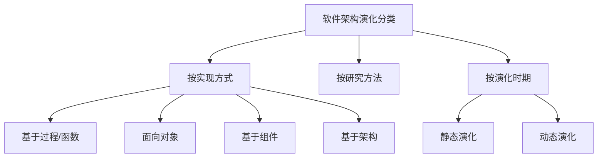
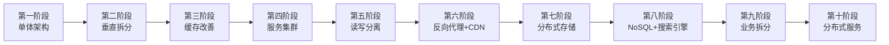

## 架构演化定义

**软件架构演化**是在软件生命周期中，为适应需求和环境变化而对架构进行的调整和改变[^1]。本质上讲，软件架构的演化就是软件整体结构的演化，演化过程涵盖软件架构的全生命周期，包括软件架构需求的获取、软件架构建模、软件架构文档、软件架构实现以及软件架构维护等阶段[^2]。

架构演化如此重要的原因包括：

- 软件架构作为软件系统的骨架支撑着整个软件系统，直接影响系统的性能、可靠性、安全性和易维护性
- 软件架构作为软件蓝图为人们宏观管控软件系统的整体复杂性和变化性提供了有效途径
- 基于软件架构进行的软件检测和修改成本相对较低[^3]

软件架构的演化可以更好地保证软件演化的一致性和正确性，明显降低软件演化的成本，主要原因有：

1. 对系统的软件架构进行的形式化、可视化表示提高了软件的可构造性
2. 软件架构设计方案涵盖的整体结构信息、配置信息、约束信息等有助于开发人员充分考虑未来可能出现的演化问题
3. 架构设计时对系统组件之间的耦合描述有助于软件系统的动态调整[^4]

---

## 演化方式分类

软件架构演化方式目前没有一种公认的分类法，以下介绍三种较典型的分类方法[^5]：

**1. 按实现方式和实施粒度分类**

- 基于过程和函数的演化
- 面向对象的演化
- 基于组件的演化
- 基于架构的演化

**2. 按研究方法分类（Jeffrey M.Barnes等人的分类方法）**

- 第1类：对演化的支持（代码模块化准则、可维护性指示、代码重构等）
- 第2类：版本和工程的管理工具（如CVS和COCOMO）
- 第3类：架构变换的形式方法
- 第4类：架构演化的成本收益分析

**3. 按演化时期分类**

- **静态演化**：发生在软件架构的设计、实现和维护过程中，软件系统还未运行或者处在运行停止状态
- **动态演化**：发生在软件系统运行过程中[^6]

---

## 架构演化原则

软件架构可持续演化原则共18种，本节列举核心原则[^7]：

**1. 演化成本控制原则（ECC）**

- 演化成本要控制在预期范围之内，即演化成本要明显小于重新开发成本
- 度量方案：`CoE << CoRD`

**2. 进度可控原则**

- 架构演化要在预期时间内完成，体现迭代、递增的演化思想
- 度量方案：`ttask = |Ttask - T'task|`

**3. 风险可控原则**

- 经济风险、时间风险、人力风险、技术风险和环境风险等必须在可控范围内

**4. 主体维持原则**

- 软件演化的平均增量增长须保持平稳，保证系统主体行为稳定
- 度量方案：`AIG = 主体规模的变更量 / 主体的规模`

**5. 系统总体结构优化原则**

- 架构演化要使得演化之后的软件系统整体结构更加合理

**6. 平滑演化原则（IWR）**

- 软件演化速率趋于稳定，相邻版本的更新率相对固定
- 度量方案：`IWR = 变更总量 / 项目规模`

**7. 质量向好原则（QI）**

- 通过演化使得所关注的质量指标变得更好或更满意
- 度量方案：`EQI > SQ`（演化后的质量优于原来的质量）

**8. 适应新需求原则**

- 架构演化要很容易适应新的需求变更
- 度量方案：`RNR = |ANR / NR|`[^8]

---

## 大型网站架构演化

大型网站的技术挑战主要来自于庞大的用户、高并发的访问和海量的数据。大型网站架构从小型网站架构逐步演化而来，经历了十个典型阶段[^9]：

**第一阶段：单体架构**

- 应用程序、数据库、文件等所有资源都在一台服务器上

**第二阶段：垂直架构**

- 应用和数据分离，使用三台服务器：应用服务器、文件服务器和数据库服务器
- 不同特性的服务器承担不同的服务角色

**第三阶段：使用缓存改善网站性能**

- 遵循二八定律：80%的业务访问集中在20%的数据上
- 本地缓存和远程分布式缓存两种

**第四阶段：使用服务集群改善并发处理能力**

- 通过负载均衡调度服务器，将访问请求分发到应用服务器集群

**第五阶段：数据库读写分离**

- 利用数据库主从热备功能，实现数据库读写分离

**第六阶段：使用反向代理和CDN加速网站响应**

- CDN部署在网络提供商的机房，使用户从最近的网络获取数据
- 反向代理部署在网站的中心机房

**第七阶段：使用分布式文件系统和分布式数据库系统**

- 数据库拆分的最后手段，常用手段是业务分库

**第八阶段：使用NoSQL和搜索引擎**

- 采用非关系数据库技术和非数据库查询技术

**第九阶段：业务拆分**

- 将整个网站业务分成不同的产品线，每个应用独立部署

**第十阶段：分布式服务**

- 将共用业务提取出来，独立部署，通过分布式服务调用[^10]

---

## 架构维护

软件架构维护与演化密不可分，维护需要对软件架构的演化过程进行追踪和控制。软件架构维护过程一般涉及以下内容[^11]：

**1. 软件架构知识管理**

- 架构知识 = 架构设计 + 架构设计决策
- 对架构设计中所隐含的决策来源进行文档化表示
- 帮助维护人员对架构的修改进行完善的考虑

**2. 软件架构修改管理**

- 建立隔离区域（Region of Quiescence），保障该区域中任何修改对其他部分的影响比较小
- 明确修改规则、修改类型，以及可能的影响范围和副作用

**3. 软件架构版本管理**

- 为软件架构演化的版本演化控制、使用和评价等提供可靠的依据
- 为架构演化量化度量奠定基础

**4. 软件架构可维护性度量**

- 圈复杂度（CCN）：度量整个架构的独立执行路径的条数
- 扇入扇出度（FFC）：综合评估组件主动调用以及被调用的频率
- 模块间耦合度（CBO）：度量模块与其他模块交互的频繁程度
- 模块的响应（RFC）：度量组件执行所需的功能的数量
- 紧内聚度（TCC）和松内聚度（LCC）[^12]

---

## 参考文献

[^1]: 《系统架构设计师教程(第二版)》P.330 §10.1

[^2]: 《系统架构设计师教程(第二版)》P.330 §10.1.1

[^3]: 《系统架构设计师教程(第二版)》P.330 §10.1.1

[^4]: 《系统架构设计师教程(第二版)》P.330 §10.1.1

[^5]: 《系统架构设计师教程(第二版)》P.336 §10.3

[^6]: 《系统架构设计师教程(第二版)》P.336 §10.3

[^7]: 《系统架构设计师教程(第二版)》P.347 §10.4

[^8]: 《系统架构设计师教程(第二版)》P.347-350 §10.4

[^9]: 《系统架构设计师教程(第二版)》P.354 §10.6

[^10]: 《系统架构设计师教程(第二版)》P.355-361 §10.6

[^11]: 《系统架构设计师教程(第二版)》P.362 §10.7

[^12]: 《系统架构设计师教程(第二版)》P.364 §10.7.4
