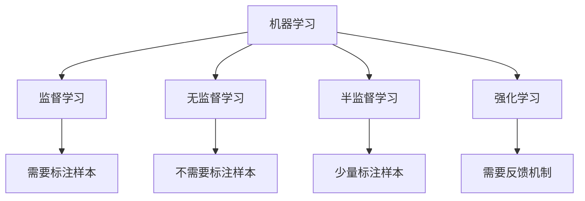

## 信息物理系统(CPS)

**信息物理系统**（Cyber-Physical Systems, CPS）是控制系统、嵌入式系统的扩展与延伸，通过集成先进的感知、计算、通信、控制等信息技术和自动控制技术，构建物理空间与信息空间中人、机、物、环境、信息等要素相互映射、适时交互、高效协同的复杂系统[^1]。

CPS的本质是构建一套信息空间与物理空间之间基于数据自动流动的状态感知、实时分析、科学决策、精准执行的闭环赋能体系，解决生产制造、应用服务过程中的复杂性和不确定性问题，提高资源配置效率，实现资源优化[^2]。

CPS体系架构分为三个层级：

- **单元级**：CPS的最小单元，通过软件对物理实体及环境进行状态感知、计算分析，并最终控制到物理实体
- **系统级**：多个单元级CPS通过工业网络互联，实现更大范围的数据自动流动
- **SoS级**：多个系统级CPS有机组合，实现数据汇聚、资产优化和运营优化服务[^3]

CPS技术体系四大核心要素：
| 要素 | 核心内容 | 作用 |
|---|---|---|
| 一硬（感知和自动控制） | 传感器技术、虚实融合控制 | 硬件支撑 |
| 一软（工业软件） | CAD/CAM/CAE/MES/ERP等 | 核心规则固化 |
| 一网（工业网络） | 工业现场总线、工业以太网 | 数据传输载体 |
| 一平台（工业云和智能服务平台） | 边缘计算、雾计算、大数据分析 | 数据汇聚和上层支撑 |

---

## 人工智能关键技术

**人工智能**（Artificial Intelligence, AI）是利用数字计算机或者数字计算机控制的机器模拟、延伸和扩展人的智能，感知环境、获取知识并使用知识获得最佳结果的理论、方法、技术及应用系统[^4]。

根据是否能真正实现推理、思考和解决问题，人工智能可分为：

- **弱人工智能**：不能真正实现推理和解决问题的智能机器，目前主流研究集中于此
- **强人工智能**：真正能思维的智能机器，当前鲜有进展，至少在未来几十年内难以实现[^5]

人工智能关键技术领域：

- **自然语言处理（NLP）**：机器翻译、语义理解、问答系统
- **计算机视觉**：图像提取、处理、理解和分析
- **知识图谱**：结构化的语义知识库，描述物理世界概念及其相互关系
- **人机交互**：语音交互、情感交互、体感交互及脑机交互
- **虚拟现实/增强现实（VR/AR）**：生成与真实环境高度近似的数字化环境
- **机器学习**：人工智能的核心研究领域[^6]

机器学习按学习模式分类：

典型深度学习算法包括卷积神经网络（CNN）、循环神经网络（RNN）等[^7]。

---

## 边缘计算

**边缘计算**将数据的处理、应用程序的运行甚至一些功能服务的实现，由网络中心下放到网络边缘的节点上。在网络边缘侧的智能网关上就近采集并且处理数据，不需要将大量未处理的原生数据上传到远处的大数据平台[^8]。

边缘计算产业联盟（ECC）对边缘计算的定义：在靠近物或数据源头的网络边缘侧，融合网络、计算、存储、应用核心能力的开放平台，就近提供边缘智能服务，满足行业数字化在敏捷连接、实时业务、数据优化、应用智能、安全与隐私保护等方面的关键需求[^9]。

边缘计算具有以下特点：

- **联接性**：丰富的联接功能，支持各种网络接口、协议、拓扑
- **数据第一入口**：物理世界到数字世界的桥梁，拥有大量、实时、完整的数据
- **约束性**：适配工业现场相对恶劣的工作条件与运行环境
- **分布性**：天然具备分布式特征，支持分布式计算与存储[^10]

**边云协同**是边缘计算的核心能力发展方向。边缘计算更适用局部性、实时、短周期数据的处理与分析；云计算擅长全局性、非实时、长周期的大数据处理与分析。二者不是替代关系，而是互补协同关系[^11]。

边云协同包括六种协同：

1. 资源协同
2. 数据协同
3. 智能协同
4. 应用管理协同
5. 业务管理协同
6. 服务协同

---

## 数字孪生

**数字孪生体**是现有或将有的物理实体对象的数字模型，通过实测、仿真和数据分析来实时感知、诊断、预测物理实体对象的状态，通过优化和指令来调控物理实体对象的行为，通过相关数字模型间的相互学习来进化自身，同时改进利益相关方在物理实体对象生命周期内的决策[^12]。

数字孪生体发展历程可分为四个阶段：

- **1960-21世纪初**：技术准备期，主要指CAD/CAE建模仿真、传统系统工程等预先技术的准备
- **2002-2010年**：概念产生期，数字孪生体模型出现和英文术语名称确定
- **2010-2020年**：领先应用期，NASA、美军方和GE等航空航天、国防军工机构的领先应用
- **2020-2030年**：深度开发和大规模扩展应用期[^13]

数字孪生体的三项核心技术：

- **建模**：将我们对物理世界的理解进行简化和模型化
- **仿真**：验证和确认模型理解的正确性和有效性
- **数字线程**：基于数据融合，支持多视图模型间的协同[^14]

数字孪生体主要应用于：

- **制造**：研发设计和生产制造环节的智能化
- **产业**：全产业链应用，促进传统产业向智慧化和服务型制造转型
- **城市**：构建城市数字孪生体，实现城市智慧管理
- **战场**：辅助战争决策，包括单体装备应用和战场综合应用[^15]

---

## 云计算服务模型

**云计算**是同时描述一个系统平台或者一类应用程序的术语。云计算平台按需进行动态部署、配置、重新配置以及取消服务。在云计算平台中的服务器可以是物理或虚拟的服务器[^16]。

云计算三种典型服务方式：

| 服务方式       | 英文 | 服务内容                                   | 典型代表                                 |
| -------------- | ---- | ------------------------------------------ | ---------------------------------------- |
| 软件即服务     | SaaS | 服务提供商将应用软件统一部署在云计算平台上 | Salesforce、Office 365                   |
| 平台即服务     | PaaS | 提供分布式开发环境与平台                   | AWS Elastic Beanstalk、Google App Engine |
| 基础设施即服务 | IaaS | 将多台服务器组成的云端基础设施作为计量服务 | AWS EC2、阿里云ECS                       |

三种服务方式特征对比：

- **灵活性**：SaaS → PaaS → IaaS 依次增强
- **方便性**：IaaS → PaaS → SaaS 依次增强[^17]

云计算四种部署模式：

- **公有云**：云基础设施公开，可自由分配给公众
- **社区云**：云基础设施分配给一些社区组织所专有
- **私有云**：云基础服务设施分配给单个组织使用
- **混合云**：公有云、私有云和社区云的组合[^18]

---

## 参考文献

[^1]: 《系统架构设计师教程(第二版)》P.369 §11.1.1

[^2]: 《系统架构设计师教程(第二版)》P.370 §11.1.1

[^3]: 《系统架构设计师教程(第二版)》P.370 §11.1.2

[^4]: 《系统架构设计师教程(第二版)》P.374 §11.2.1

[^5]: 《系统架构设计师教程(第二版)》P.374 §11.2.1

[^6]: 《系统架构设计师教程(第二版)》P.376 §11.2.3

[^7]: 《系统架构设计师教程(第二版)》P.377-378 §11.2.3

[^8]: 《系统架构设计师教程(第二版)》P.384 §11.4.1

[^9]: 《系统架构设计师教程(第二版)》P.385 §11.4.2

[^10]: 《系统架构设计师教程(第二版)》P.386 §11.4.3

[^11]: 《系统架构设计师教程(第二版)》P.386 §11.4.4

[^12]: 《系统架构设计师教程(第二版)》P.391 §11.5.2

[^13]: 《系统架构设计师教程(第二版)》P.390 §11.5.1

[^14]: 《系统架构设计师教程(第二版)》P.392 §11.5.3

[^15]: 《系统架构设计师教程(第二版)》P.393 §11.5.4

[^16]: 《系统架构设计师教程(第二版)》P.395 §11.6.1

[^17]: 《系统架构设计师教程(第二版)》P.395 §11.6.1

[^18]: 《系统架构设计师教程(第二版)》P.396 §11.6.1
