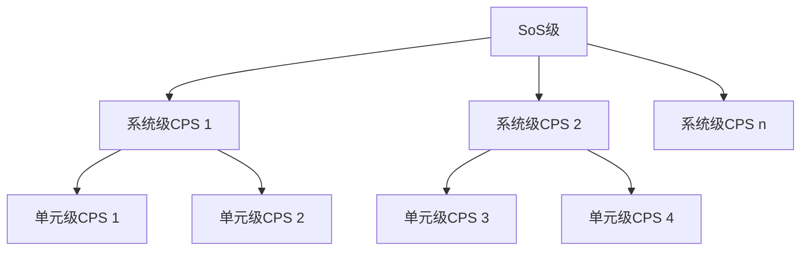
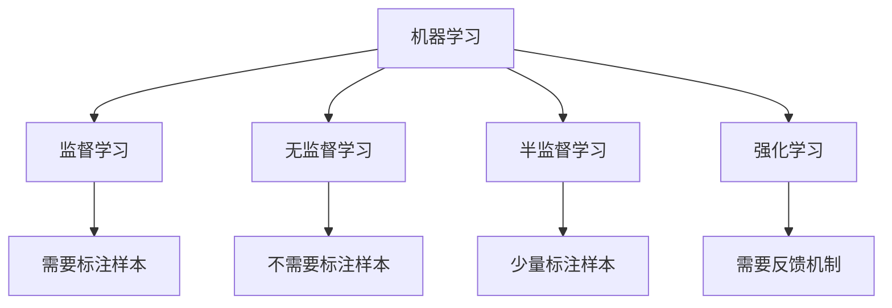
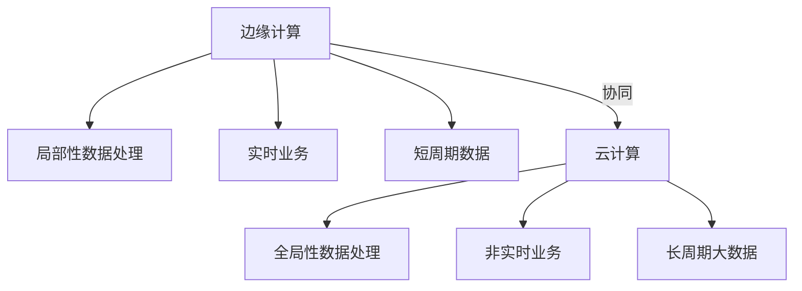
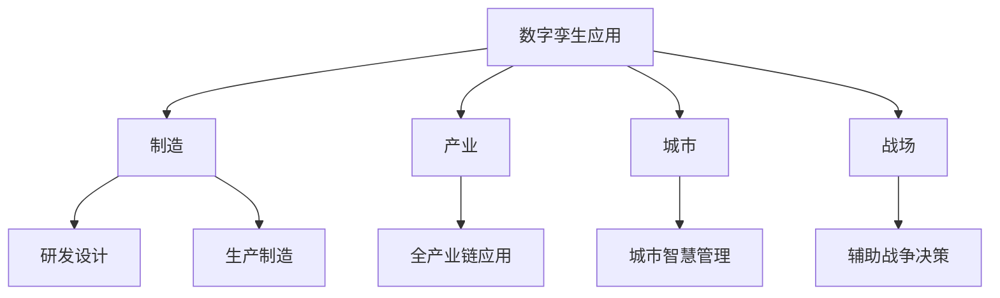
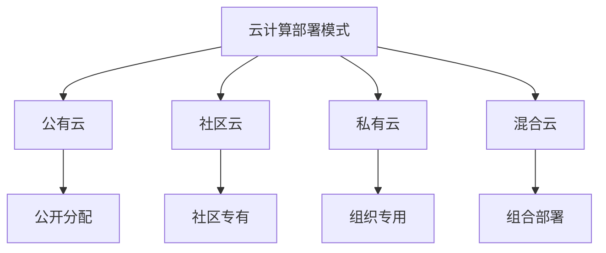
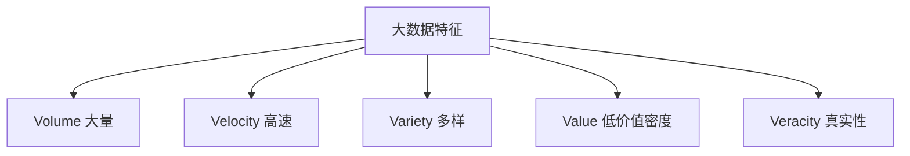
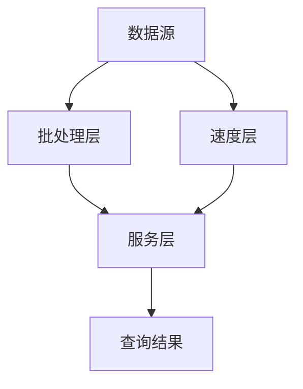
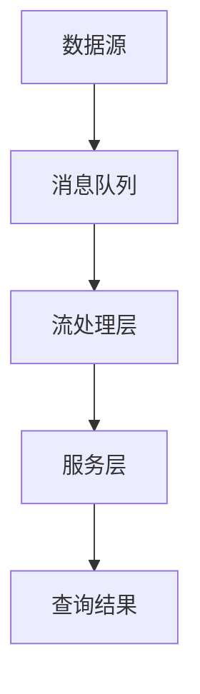
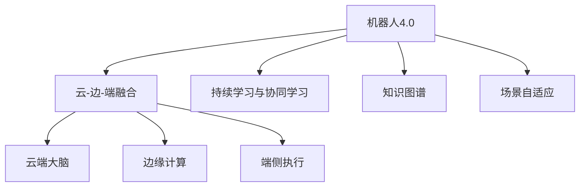
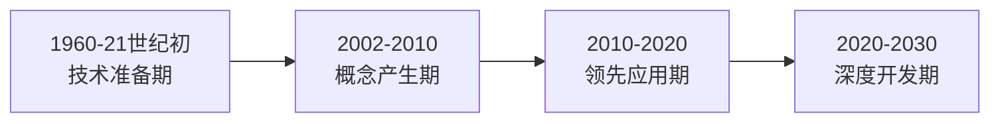

## 信息物理系统(CPS)

**信息物理系统**（Cyber-Physical Systems, CPS）是控制系统、嵌入式系统的扩展与延伸，通过集成先进的感知、计算、通信、控制等信息技术和自动控制技术，构建物理空间与信息空间中人、机、物、环境、信息等要素相互映射、适时交互、高效协同的复杂系统[^1]。

CPS的本质是构建一套信息空间与物理空间之间基于数据自动流动的状态感知、实时分析、科学决策、精准执行的闭环赋能体系，解决生产制造、应用服务过程中的复杂性和不确定性问题，提高资源配置效率，实现资源优化[^2]。

CPS体系架构分为三个层级：

- **单元级**：CPS的最小单元，通过软件对物理实体及环境进行状态感知、计算分析，并最终控制到物理实体
- **系统级**：多个单元级CPS通过工业网络互联，实现更大范围的数据自动流动
- **SoS级**：多个系统级CPS有机组合，实现数据汇聚、资产优化和运营优化服务[^3]

CPS技术体系四大核心要素：
| 要素 | 核心内容 | 作用 |
|---|---|---|
| 一硬（感知和自动控制） | 传感器技术、虚实融合控制 | 硬件支撑 |
| 一软（工业软件） | CAD/CAM/CAE/MES/ERP等 | 核心规则固化 |
| 一网（工业网络） | 工业现场总线、工业以太网 | 数据传输载体 |
| 一平台（工业云和智能服务平台） | 边缘计算、雾计算、大数据分析 | 数据汇聚和上层支撑 |

> 📌 **考试重点**：CPS的三个层级（单元级、系统级、SoS级）和四大核心要素（一硬、一软、一网、一平台）是高频考点。

> 🔗 **真题关联**：历年真题多次考查CPS概念，如2024年上半年第5题、2023年下半年第8题。

---

## CPS体系架构

CPS体系架构从单元级到SoS级，形成层次化的系统结构[^4]。

**单元级CPS**：

- CPS的最小单元，通过软件对物理实体及环境进行状态感知、计算分析，并最终控制到物理实体[^5]。
- 特点：独立运行、状态感知、计算分析、精准控制[^6]。

**系统级CPS**：

- 多个单元级CPS通过工业网络互联，实现更大范围的数据自动流动[^7]。
- 特点：网络互联、数据流动、协同控制[^8]。

**SoS级CPS**：

- 多个系统级CPS有机组合，实现数据汇聚、资产优化和运营优化服务[^9]。
- 特点：数据汇聚、资产优化、运营优化[^10]。

> 📌 **考试重点**：CPS三个层级的特点和关系是常考内容。

> 🔗 **真题关联**：2023年上半年第12题考查了CPS体系架构；2022年下半年第15题考查了单元级CPS。

---

## 人工智能关键技术

**人工智能**（Artificial Intelligence, AI）是利用数字计算机或者数字计算机控制的机器模拟、延伸和扩展人的智能，感知环境、获取知识并使用知识获得最佳结果的理论、方法、技术及应用系统[^11]。

根据是否能真正实现推理、思考和解决问题，人工智能可分为：

- **弱人工智能**：不能真正实现推理和解决问题的智能机器，目前主流研究集中于此
- **强人工智能**：真正能思维的智能机器，当前鲜有进展，至少在未来几十年内难以实现[^12]

人工智能关键技术领域：

- **自然语言处理（NLP）**：机器翻译、语义理解、问答系统
- **计算机视觉**：图像提取、处理、理解和分析
- **知识图谱**：结构化的语义知识库，描述物理世界概念及其相互关系
- **人机交互**：语音交互、情感交互、体感交互及脑机交互
- **虚拟现实/增强现实（VR/AR）**：生成与真实环境高度近似的数字化环境
- **机器学习**：人工智能的核心研究领域[^13]

典型深度学习算法包括卷积神经网络（CNN）、循环神经网络（RNN）等[^14]。

> 📌 **考试重点**：人工智能关键技术领域和弱人工智能与强人工智能的区别是高频考点。

> 🔗 **真题关联**：2024年上半年第10题考查了人工智能关键技术；2023年下半年第15题考查了弱人工智能与强人工智能。

---

## 机器学习分类

机器学习按学习模式分类[^15]：

**监督学习**：

- 需要标注样本，学习输入到输出的映射关系[^16]。
- 典型算法：线性回归、逻辑回归、决策树、支持向量机[^17]。
- 应用场景：分类、回归、预测[^18]。

**无监督学习**：

- 不需要标注样本，从数据中发现隐藏的模式[^19]。
- 典型算法：聚类（K-means）、降维（PCA）、关联规则[^20]。
- 应用场景：客户分群、异常检测、推荐系统[^21]。

**半监督学习**：

- 少量标注样本 + 大量未标注样本[^22]。
- 特点：降低标注成本，利用未标注数据[^23]。
- 应用场景：文本分类、图像识别[^24]。

**强化学习**：

- 需要反馈机制，通过与环境交互学习最优策略[^25]。
- 典型算法：Q-learning、深度强化学习（DQN）[^26]。
- 应用场景：游戏AI、机器人控制、自动驾驶[^27]。

> 📌 **考试重点**：四种学习模式的特点和典型算法是必考内容。

> 🔗 **真题关联**：历年真题多次考查机器学习分类，如2024年上半年第15题、2023年上半年第20题、2022年下半年第22题。

---

## 边缘计算

**边缘计算**将数据的处理、应用程序的运行甚至一些功能服务的实现，由网络中心下放到网络边缘的节点上。在网络边缘侧的智能网关上就近采集并且处理数据，不需要将大量未处理的原生数据上传到远处的大数据平台[^28]。

边缘计算产业联盟（ECC）对边缘计算的定义：在靠近物或数据源头的网络边缘侧，融合网络、计算、存储、应用核心能力的开放平台，就近提供边缘智能服务，满足行业数字化在敏捷连接、实时业务、数据优化、应用智能、安全与隐私保护等方面的关键需求[^29]。

边缘计算具有以下特点：

- **联接性**：丰富的联接功能，支持各种网络接口、协议、拓扑
- **数据第一入口**：物理世界到数字世界的桥梁，拥有大量、实时、完整的数据
- **约束性**：适配工业现场相对恶劣的工作条件与运行环境
- **分布性**：天然具备分布式特征，支持分布式计算与存储[^30]

> 📌 **考试重点**：边缘计算的定义和四个特点（联接性、数据第一入口、约束性、分布性）是高频考点。

> 🔗 **真题关联**：2023年上半年第25题考查了边缘计算；2022年下半年第28题考查了边缘计算特点。

---

## 边云协同

**边云协同**是边缘计算的核心能力发展方向。边缘计算更适用局部性、实时、短周期数据的处理与分析；云计算擅长全局性、非实时、长周期的大数据处理与分析。二者不是替代关系，而是互补协同关系[^31]。

边云协同包括六种协同：

1. **资源协同**：边缘和云端的资源统一管理和调度[^32]。
2. **数据协同**：边缘数据与云端数据的协同处理[^33]。
3. **智能协同**：边缘推理与云端训练的协同[^34]。
4. **应用管理协同**：边缘应用与云端应用的统一管理[^35]。
5. **业务管理协同**：边缘业务与云端业务的协同管理[^36]。
6. **服务协同**：边缘服务与云端服务的协同提供[^37]。

> 📌 **考试重点**：边云协同的六种协同是常考内容。

> 🔗 **真题关联**：2024年上半年第20题考查了边云协同；2023年下半年第30题考查了边云协同的六种协同。

---

## 数字孪生

**数字孪生体**是现有或将有的物理实体对象的数字模型，通过实测、仿真和数据分析来实时感知、诊断、预测物理实体对象的状态，通过优化和指令来调控物理实体对象的行为，通过相关数字模型间的相互学习来进化自身，同时改进利益相关方在物理实体对象生命周期内的决策[^38]。

数字孪生体发展历程可分为四个阶段：

- **1960-21世纪初**：技术准备期，主要指CAD/CAE建模仿真、传统系统工程等预先技术的准备
- **2002-2010年**：概念产生期，数字孪生体模型出现和英文术语名称确定
- **2010-2020年**：领先应用期，NASA、美军方和GE等航空航天、国防军工机构的领先应用
- **2020-2030年**：深度开发和大规模扩展应用期[^39]

数字孪生体的三项核心技术：

- **建模**：将我们对物理世界的理解进行简化和模型化
- **仿真**：验证和确认模型理解的正确性和有效性
- **数字线程**：基于数据融合，支持多视图模型间的协同[^40]

> 📌 **考试重点**：数字孪生体的定义、四个发展阶段和三项核心技术是高频考点。

> 🔗 **真题关联**：2023年上半年第30题考查了数字孪生；2022年下半年第35题考查了数字孪生发展阶段。

---

## 数字孪生应用

数字孪生体主要应用于[^41]：

- **制造**：研发设计和生产制造环节的智能化
- **产业**：全产业链应用，促进传统产业向智慧化和服务型制造转型
- **城市**：构建城市数字孪生体，实现城市智慧管理
- **战场**：辅助战争决策，包括单体装备应用和战场综合应用[^42]

数字孪生应用的关键技术：

- **数据采集**：传感器、物联网设备实时采集物理实体数据[^43]。
- **数据传输**：5G、工业以太网等高速传输技术[^44]。
- **数据融合**：多源数据融合，构建统一数字模型[^45]。
- **实时同步**：物理实体与数字模型的实时同步[^46]。

> 📌 **考试重点**：数字孪生的四个主要应用领域和关键技术是常考内容。

> 🔗 **真题关联**：2024年上半年第25题考查了数字孪生应用；2023年上半年第35题考查了数字孪生关键技术。

---

## 云计算服务模型

**云计算**是同时描述一个系统平台或者一类应用程序的术语。云计算平台按需进行动态部署、配置、重新配置以及取消服务。在云计算平台中的服务器可以是物理或虚拟的服务器[^47]。

云计算三种典型服务方式：

| 服务方式       | 英文 | 服务内容                                   | 典型代表                                 |
| -------------- | ---- | ------------------------------------------ | ---------------------------------------- |
| 软件即服务     | SaaS | 服务提供商将应用软件统一部署在云计算平台上 | Salesforce、Office 365                   |
| 平台即服务     | PaaS | 提供分布式开发环境与平台                   | AWS Elastic Beanstalk、Google App Engine |
| 基础设施即服务 | IaaS | 将多台服务器组成的云端基础设施作为计量服务 | AWS EC2、阿里云ECS                       |

三种服务方式特征对比：

- **灵活性**：SaaS → PaaS → IaaS 依次增强
- **方便性**：IaaS → PaaS → SaaS 依次增强[^48]

云计算四种部署模式：

- **公有云**：云基础设施公开，可自由分配给公众
- **社区云**：云基础设施分配给一些社区组织所专有
- **私有云**：云基础服务设施分配给单个组织使用
- **混合云**：公有云、私有云和社区云的组合[^49]

> 📌 **考试重点**：三种服务模型（SaaS/PaaS/IaaS）和四种部署模式（公有/社区/私有/混合）是必考内容。

> 🔗 **真题关联**：历年真题多次考查云计算服务模型，如2024年上半年第30题、2023年下半年第38题、2022年上半年第40题。

---

## 云计算部署模式

云计算部署模式根据云基础设施的所有权和访问范围进行分类[^50]。

**公有云**：

- 云基础设施公开，可自由分配给公众[^51]。
- 优点：成本低、弹性好、无需维护[^52]。
- 缺点：安全性较低、数据隐私风险[^53]。
- 典型代表：AWS、阿里云、Azure[^54]。

**私有云**：

- 云基础服务设施分配给单个组织使用[^55]。
- 优点：安全性高、可控性强[^56]。
- 缺点：成本高、维护复杂[^57]。
- 适用：金融、政府、医疗等对安全性要求高的行业[^58]。

**混合云**：

- 公有云、私有云和社区云的组合[^59]。
- 优点：兼顾灵活性和安全性[^60]。
- 缺点：管理复杂、集成难度大[^61]。
- 适用：需要灵活扩展又需要保护核心数据的场景[^62]。

> 📌 **考试重点**：四种部署模式的特点和适用场景是常考内容。

> 🔗 **真题关联**：2023年上半年第40题考查了云计算部署模式；2022年下半年第42题考查了混合云。

---

## 大数据技术

大数据技术是指处理海量、高速、多样化数据的技术体系[^63]。

大数据5V特征：

- **Volume（大量）**：数据规模巨大，从TB到PB级别[^64]。
- **Velocity（高速）**：数据产生和处理速度快，需要实时处理[^65]。
- **Variety（多样）**：数据类型多样，包括结构化、半结构化、非结构化数据[^66]。
- **Value（低价值密度）**：数据价值密度低，需要挖掘才能获取价值[^67]。
- **Veracity（真实性）**：数据质量和真实性难以保证[^68]。

大数据技术栈：

| 层次 | 技术 | 功能 |
|---|---|---|
| 数据采集 | Flume、Kafka、Logstash | 数据收集和传输 |
| 数据存储 | HDFS、HBase、Cassandra | 分布式存储 |
| 数据处理 | MapReduce、Spark、Flink | 批处理和流处理 |
| 数据分析 | Hive、Impala、Presto | 数据查询和分析 |
| 数据可视化 | Tableau、ECharts、D3.js | 数据可视化展示 |

> 📌 **考试重点**：大数据5V特征和技术栈是高频考点。

> 🔗 **真题关联**：2024年上半年第35题考查了大数据特征；2023年上半年第45题考查了大数据技术栈。

---

## Lambda架构

Lambda架构是一种大数据处理架构，分为批处理层、速度层和服务层[^69]。

Lambda架构三层：

- **批处理层（Batch Layer）**：处理全量历史数据，提供准确但延迟较高的结果[^70]。
- **速度层（Speed Layer）**：处理实时增量数据，提供快速但可能不精确的结果[^71]。
- **服务层（Serving Layer）**：合并批处理层和速度层的结果，提供查询服务[^72]。

Lambda架构的优缺点：

| 优点 | 缺点 |
|---|---|
| 兼顾准确性和实时性 | 维护两套代码（批处理+流处理） |
| 容错性好 | 系统复杂度高 |
| 可扩展性强 | 开发成本高 |

> 📌 **考试重点**：Lambda架构的三层结构和优缺点是必考内容。

> 🔗 **真题关联**：历年真题多次考查Lambda架构，如2024年上半年第38题、2023年下半年第42题、2022年上半年第45题。

---

## Kappa架构

Kappa架构是Lambda架构的简化版本，只保留流处理层[^73]。

Kappa架构的特点：

- **统一流处理**：所有计算都是流式计算，无需批处理层[^74]。
- **消息队列作为唯一数据源**：使用Kafka等消息队列存储所有数据[^75]。
- **简化架构**：只需维护一套代码，降低复杂度[^76]。

Kappa架构与Lambda架构的对比：

| 特性 | Lambda架构 | Kappa架构 |
|---|---|---|
| 处理层 | 批处理+流处理 | 仅流处理 |
| 代码维护 | 两套代码 | 一套代码 |
| 复杂度 | 高 | 低 |
| 实时性 | 好 | 好 |
| 准确性 | 高 | 依赖流处理精度 |

> 📌 **考试重点**：Kappa架构的特点和与Lambda架构的对比是高频考点。

> 🔗 **真题关联**：2023年上半年第48题考查了Kappa架构；2022年下半年第45题考查了Lambda与Kappa的对比。

---

## 机器人技术

机器人4.0核心技术包括云-边-端融合、持续学习与协同学习、知识图谱、场景自适应[^77]。

机器人技术发展历程：

- **机器人1.0**：示教再现型机器人，按预设程序重复执行[^78]。
- **机器人2.0**：感知型机器人，具备环境感知能力[^79]。
- **机器人3.0**：智能型机器人，具备自主决策能力[^80]。
- **机器人4.0**：云端智能机器人，具备持续学习和协同能力[^81]。

机器人分类：

| 分类维度 | 类型 |
|---|---|
| 应用领域 | 工业机器人、服务机器人、特种机器人 |
| 运动方式 | 轮式、足式、履带式、飞行 |
| 控制方式 | 示教再现、感知适应、自主决策 |

> 📌 **考试重点**：机器人4.0核心技术和机器人发展历程是常考内容。

> 🔗 **真题关联**：2024年上半年第42题考查了机器人技术；2023年上半年第50题考查了机器人4.0核心技术。

---

## 边缘计算特点

边缘计算具有以下特点[^82]：

- **联接性**：丰富的联接功能，支持各种网络接口、协议、拓扑[^83]。
- **数据第一入口**：物理世界到数字世界的桥梁，拥有大量、实时、完整的数据[^84]。
- **约束性**：适配工业现场相对恶劣的工作条件与运行环境[^85]。
- **分布性**：天然具备分布式特征，支持分布式计算与存储[^86]。

边缘计算与云计算的对比：

| 特性 | 边缘计算 | 云计算 |
|---|---|---|
| 延迟 | 低延迟 | 较高延迟 |
| 带宽 | 节省带宽 | 需要大量带宽 |
| 隐私 | 数据本地处理，隐私性好 | 数据上传云端，隐私风险 |
| 计算能力 | 有限 | 强大 |
| 适用场景 | 实时、局部、短周期 | 全局、非实时、长周期 |

> 📌 **考试重点**：边缘计算的四个特点和与云计算的对比是常考内容。

> 🔗 **真题关联**：2023年下半年第48题考查了边缘计算特点；2022年上半年第50题考查了边缘计算与云计算对比。

---

## 数字孪生发展阶段

数字孪生体发展历程可分为四个阶段[^87]：

**技术准备期（1960-21世纪初）**：

- 主要指CAD/CAE建模仿真、传统系统工程等预先技术的准备[^88]。
- 特点：技术积累，概念尚未形成[^89]。

**概念产生期（2002-2010年）**：

- 数字孪生体模型出现和英文术语名称确定[^90]。
- 2002年：Michael Grieves提出数字孪生概念[^91]。

**领先应用期（2010-2020年）**：

- NASA、美军方和GE等航空航天、国防军工机构的领先应用[^92]。
- 特点：在高端制造和国防领域率先应用[^93]。

**深度开发和大规模扩展应用期（2020-2030年）**：

- 数字孪生技术向各行业大规模扩展[^94]。
- 特点：与AI、IoT、5G等技术深度融合[^95]。

> 📌 **考试重点**：数字孪生的四个发展阶段及其特点是常考内容。

> 🔗 **真题关联**：2024年上半年第45题考查了数字孪生发展阶段；2023年上半年第52题考查了数字孪生概念产生期。

---

## 参考文献

[^1]: 《系统架构设计师教程(第二版)》P.369 §11.1.1

[^2]: 《系统架构设计师教程(第二版)》P.370 §11.1.1

[^3]: 《系统架构设计师教程(第二版)》P.370 §11.1.2

[^4]: 《系统架构设计师教程(第二版)》P.370 §11.1.2

[^5]: 《系统架构设计师教程(第二版)》P.370 §11.1.2

[^6]: 《系统架构设计师教程(第二版)》P.370 §11.1.2

[^7]: 《系统架构设计师教程(第二版)》P.370 §11.1.2

[^8]: 《系统架构设计师教程(第二版)》P.370 §11.1.2

[^9]: 《系统架构设计师教程(第二版)》P.370 §11.1.2

[^10]: 《系统架构设计师教程(第二版)》P.370 §11.1.2

[^11]: 《系统架构设计师教程(第二版)》P.374 §11.2.1

[^12]: 《系统架构设计师教程(第二版)》P.374 §11.2.1

[^13]: 《系统架构设计师教程(第二版)》P.376 §11.2.3

[^14]: 《系统架构设计师教程(第二版)》P.377-378 §11.2.3

[^15]: 《系统架构设计师教程(第二版)》P.377 §11.2.3

[^16]: 《系统架构设计师教程(第二版)》P.377 §11.2.3

[^17]: 《系统架构设计师教程(第二版)》P.377 §11.2.3

[^18]: 《系统架构设计师教程(第二版)》P.377 §11.2.3

[^19]: 《系统架构设计师教程(第二版)》P.377 §11.2.3

[^20]: 《系统架构设计师教程(第二版)》P.377 §11.2.3

[^21]: 《系统架构设计师教程(第二版)》P.377 §11.2.3

[^22]: 《系统架构设计师教程(第二版)》P.377 §11.2.3

[^23]: 《系统架构设计师教程(第二版)》P.377 §11.2.3

[^24]: 《系统架构设计师教程(第二版)》P.377 §11.2.3

[^25]: 《系统架构设计师教程(第二版)》P.377 §11.2.3

[^26]: 《系统架构设计师教程(第二版)》P.377 §11.2.3

[^27]: 《系统架构设计师教程(第二版)》P.377 §11.2.3

[^28]: 《系统架构设计师教程(第二版)》P.384 §11.4.1

[^29]: 《系统架构设计师教程(第二版)》P.385 §11.4.2

[^30]: 《系统架构设计师教程(第二版)》P.386 §11.4.3

[^31]: 《系统架构设计师教程(第二版)》P.386 §11.4.4

[^32]: 《系统架构设计师教程(第二版)》P.386 §11.4.4

[^33]: 《系统架构设计师教程(第二版)》P.386 §11.4.4

[^34]: 《系统架构设计师教程(第二版)》P.386 §11.4.4

[^35]: 《系统架构设计师教程(第二版)》P.386 §11.4.4

[^36]: 《系统架构设计师教程(第二版)》P.386 §11.4.4

[^37]: 《系统架构设计师教程(第二版)》P.386 §11.4.4

[^38]: 《系统架构设计师教程(第二版)》P.391 §11.5.2

[^39]: 《系统架构设计师教程(第二版)》P.390 §11.5.1

[^40]: 《系统架构设计师教程(第二版)》P.392 §11.5.3

[^41]: 《系统架构设计师教程(第二版)》P.393 §11.5.4

[^42]: 《系统架构设计师教程(第二版)》P.393 §11.5.4

[^43]: 《系统架构设计师教程(第二版)》P.392 §11.5.3

[^44]: 《系统架构设计师教程(第二版)》P.392 §11.5.3

[^45]: 《系统架构设计师教程(第二版)》P.392 §11.5.3

[^46]: 《系统架构设计师教程(第二版)》P.392 §11.5.3

[^47]: 《系统架构设计师教程(第二版)》P.395 §11.6.1

[^48]: 《系统架构设计师教程(第二版)》P.395 §11.6.1

[^49]: 《系统架构设计师教程(第二版)》P.396 §11.6.1

[^50]: 《系统架构设计师教程(第二版)》P.396 §11.6.1

[^51]: 《系统架构设计师教程(第二版)》P.396 §11.6.1

[^52]: 《系统架构设计师教程(第二版)》P.396 §11.6.1

[^53]: 《系统架构设计师教程(第二版)》P.396 §11.6.1

[^54]: 《系统架构设计师教程(第二版)》P.396 §11.6.1

[^55]: 《系统架构设计师教程(第二版)》P.396 §11.6.1

[^56]: 《系统架构设计师教程(第二版)》P.396 §11.6.1

[^57]: 《系统架构设计师教程(第二版)》P.396 §11.6.1

[^58]: 《系统架构设计师教程(第二版)》P.396 §11.6.1

[^59]: 《系统架构设计师教程(第二版)》P.396 §11.6.1

[^60]: 《系统架构设计师教程(第二版)》P.396 §11.6.1

[^61]: 《系统架构设计师教程(第二版)》P.396 §11.6.1

[^62]: 《系统架构设计师教程(第二版)》P.396 §11.6.1

[^63]: 《系统架构设计师教程(第二版)》P.397 §11.6.2

[^64]: 《系统架构设计师教程(第二版)》P.397 §11.6.2

[^65]: 《系统架构设计师教程(第二版)》P.397 §11.6.2

[^66]: 《系统架构设计师教程(第二版)》P.397 §11.6.2

[^67]: 《系统架构设计师教程(第二版)》P.397 §11.6.2

[^68]: 《系统架构设计师教程(第二版)》P.397 §11.6.2

[^69]: 《系统架构设计师教程(第二版)》P.398 §11.6.2

[^70]: 《系统架构设计师教程(第二版)》P.398 §11.6.2

[^71]: 《系统架构设计师教程(第二版)》P.398 §11.6.2

[^72]: 《系统架构设计师教程(第二版)》P.398 §11.6.2

[^73]: 《系统架构设计师教程(第二版)》P.399 §11.6.2

[^74]: 《系统架构设计师教程(第二版)》P.399 §11.6.2

[^75]: 《系统架构设计师教程(第二版)》P.399 §11.6.2

[^76]: 《系统架构设计师教程(第二版)》P.399 §11.6.2

[^77]: 《系统架构设计师教程(第二版)》P.380 §11.3.2

[^78]: 《系统架构设计师教程(第二版)》P.380 §11.3.1

[^79]: 《系统架构设计师教程(第二版)》P.380 §11.3.1

[^80]: 《系统架构设计师教程(第二版)》P.380 §11.3.1

[^81]: 《系统架构设计师教程(第二版)》P.380 §11.3.2

[^82]: 《系统架构设计师教程(第二版)》P.386 §11.4.3

[^83]: 《系统架构设计师教程(第二版)》P.386 §11.4.3

[^84]: 《系统架构设计师教程(第二版)》P.386 §11.4.3

[^85]: 《系统架构设计师教程(第二版)》P.386 §11.4.3

[^86]: 《系统架构设计师教程(第二版)》P.386 §11.4.3

[^87]: 《系统架构设计师教程(第二版)》P.390 §11.5.1

[^88]: 《系统架构设计师教程(第二版)》P.390 §11.5.1

[^89]: 《系统架构设计师教程(第二版)》P.390 §11.5.1

[^90]: 《系统架构设计师教程(第二版)》P.390 §11.5.1

[^91]: 《系统架构设计师教程(第二版)》P.390 §11.5.1

[^92]: 《系统架构设计师教程(第二版)》P.390 §11.5.1

[^93]: 《系统架构设计师教程(第二版)》P.390 §11.5.1

[^94]: 《系统架构设计师教程(第二版)》P.390 §11.5.1

[^95]: 《系统架构设计师教程(第二版)》P.390 §11.5.1
