## 信息系统架构基本概念

信息系统架构（Information System Architecture, ISA）反映了一个政府、企业或事业单位信息系统的各个组成部分之间的关系，以及信息系统与相关业务、信息系统与相关技术之间的关系[^1]。

信息系统架构的发展经历了从单机应用到分布式、从集中式到云原生的演进过程。理解信息系统架构的基本概念是进行架构设计的前提。

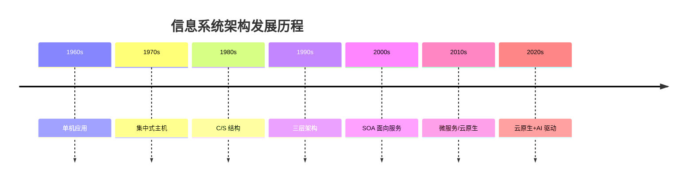

> 📌 **考试重点**：信息系统架构的定义、物理结构分类（集中式/分布式）、逻辑结构分类（单机/C/S/MVC/SOA）是高频考点，常以选择题形式出现。

> 🔗 **真题关联**：历年真题多次考查信息系统架构的基本概念和分类，2023年上半年考查了集中式与分布式结构的优缺点对比。

---

## 信息系统架构分类

从物理结构上，信息系统架构可分为两类：

- **集中式结构**：物理资源在空间上集中配置。优点是资源集中、便于管理、利用率较高；缺点是系统脆弱，主机故障会导致整个系统瘫痪
- **分布式结构**：通过计算机网络把不同地点的计算机硬件、软件、数据等资源联系在一起，实现资源共享。优点是扩展方便、安全性好；缺点是管理标准不易统一、协调困难[^2]

分布式结构又可分为一般分布式与客户机/服务器模式：

- **一般分布式系统**：服务器只提供软件与数据的文件服务
- **客户机/服务器结构**：网络上的计算机分为客户机与服务器两大类，用户通过客户机向服务器提出服务请求[^3]

从逻辑结构上，信息系统常见4种架构模型：

1. **单机应用模式（Standalone）**：运行在一台物理机器上的独立应用程序
2. **客户机/服务器模式（C/S）**：两层/多层C/S结构
3. **MVC结构**：Model-View-Controller
4. **面向服务的SOA模式**：多服务集合和数据交换总线[^4]

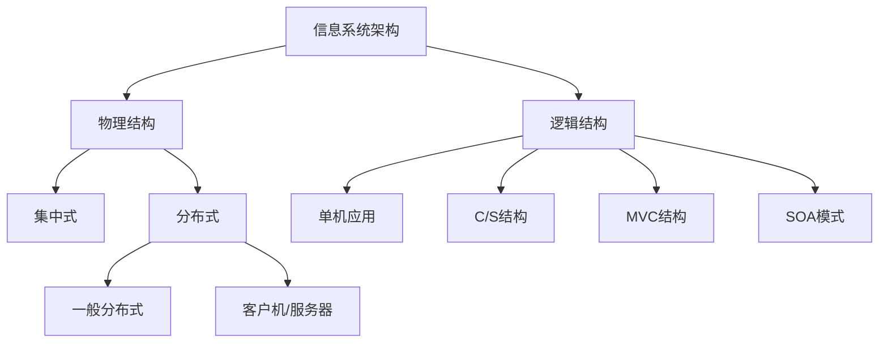

> 📌 **考试重点**：集中式与分布式结构的优缺点对比、C/S 与 B/S 的区别、四种逻辑架构模型的特点是案例分析常考内容。

> 🔗 **真题关联**：2022年下半年案例分析题考查了某企业信息系统从集中式向分布式架构迁移的设计方案。

---

## 企业总体框架(TOGAF)

**TOGAF**（The Open Group Architecture Framework）是一种开放式企业架构框架标准，它为标准、方法论和企业架构专业人员之间的沟通提供一致性保障[^5]。

TOGAF旨在通过以下目标帮助企业：

- 确保所有用户使用相同的语言，打破沟通障碍
- 避免被锁定到企业架构的专有解决方案
- 节省时间和金钱，更有效地利用资源
- 实现可观的投资回报（ROI）[^6]

TOGAF 9版本包括六个组件：

1. **架构开发方法（ADM）**：TOGAF的核心，描述开发企业架构的分步方法
2. **ADM指南和技术**：一系列可用于应用ADM的指南和技术
3. **架构内容框架**：描述架构工件的结构化元模型、可重用架构构建块
4. **企业连续体和工具**：对企业内部架构活动的输出进行分类和存储
5. **TOGAF参考模型**：技术参考模型（TRM）和集成信息基础设施参考模型（III-RM）
6. **架构能力框架**：讨论在企业内建立和运营架构实践所需的组织、流程、技能、角色和职责[^7]

信息系统体系结构的总体参考框架由四个部分组成：

- **战略系统**：与战略制定、高层决策有关的管理活动
- **业务系统**：企业中完成一定业务功能的各部分组成的系统
- **应用系统**：应用软件系统，为业务控制提供计算机实现手段
- **信息基础设施**：企业实现信息化的基础部分[^8]

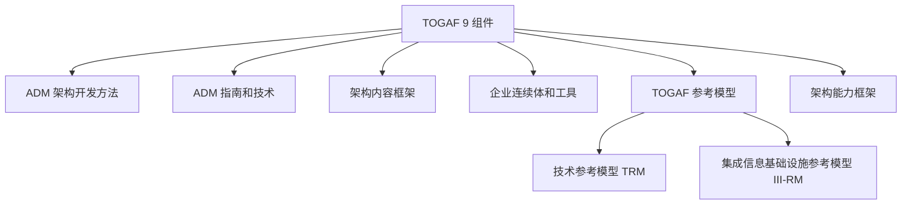

> 📌 **考试重点**：TOGAF 的六个组件、ADM 的核心地位、四个总体参考框架（战略/业务/应用/基础设施）是必考知识点。

> 🔗 **真题关联**：2021年上半年选择题考查了 TOGAF 的组件构成，2020年考查了 ADM 的阶段划分。

---

## ADM架构开发方法

**ADM**（Architecture Development Method）是TOGAF规范中最为核心的内容，为开发企业架构所需要执行的各个步骤以及它们之间的关系进行了详细定义[^9]。

ADM全生命周期模型将架构开发划分为十个阶段，反复迭代：

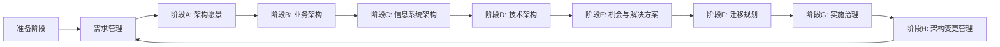

ADM三个级别的迭代概念：

1. **基于ADM整体的迭代**：用环形方式应用ADM，一个阶段完成后直接进入下一个阶段
2. **多个开发阶段间的迭代**：例如完成技术架构阶段后重新回到业务架构开发阶段
3. **一个阶段内部的迭代**：对复杂的架构内容进行迭代开发[^10]

ADM主要阶段活动：

| 阶段                  | 主要活动                                      |
| --------------------- | --------------------------------------------- |
| 准备阶段              | 定义组织机构、特定架构框架、架构原则          |
| 需求管理              | 完成需求的识别、保管和交付                    |
| 阶段A：架构愿景       | 设置项目范围、约束和期望，创建架构愿景        |
| 阶段B：业务架构       | 开发基线和目标业务架构，执行差距分析          |
| 阶段C：信息系统架构   | 数据架构设计和应用架构设计                    |
| 阶段D：技术架构       | 开发基线和目标技术架构                        |
| 阶段E：机会与解决方案 | 确定主要实施项目，决定途径                    |
| 阶段F：迁移规划       | 制订详细的实施和迁移计划                      |
| 阶段G：实施治理       | 提供实施项目的架构监督，发布架构合同          |
| 阶段H：架构变更管理   | 持续监测和变更管理，确保架构响应企业需求[^11] |

> 📌 **考试重点**：ADM 的十个阶段名称、各阶段主要活动、三个级别的迭代概念是高频考点，常以选择题和案例分析形式出现。

> 🔗 **真题关联**：2023年下半年选择题考查了 ADM 阶段 C（信息系统架构）包含数据架构和应用架构设计。

---

## 信息化总体架构方法

建立企业信息系统体系结构总体参考框架，必须考虑企业的四个方面：战略系统、业务系统、应用系统和信息基础设施。这四个部分相互关联，并构成与管理金字塔相一致的层次[^12]。

**战略系统**：

- 与战略制定、高层决策有关的管理活动和计算机辅助系统
- 由高层决策支持系统和企业战略规划体系两部分组成
- 表示信息系统对企业高层管理者的决策支持能力，以及企业战略规划对信息系统建设的影响和要求[^13]

**业务系统**：

- 企业中完成一定业务功能的各部分（物质、能量、信息和人）组成的系统
- 包括生产系统、销售系统、采购系统、人事系统、会计系统等
- 业务过程重组（BPR）可使企业的经济效率提高70%～80%[^14]

**应用系统**：

- 信息系统中的应用软件部分
- 包含事务处理系统TPS、管理信息系统MIS、决策支持系统DSS、专家系统ES、办公自动化系统OAS、CAD/CAPP/CAM、制造资源计划系统MRP II等
- 从架构角度看，包含内部功能实现部分和外部界面部分[^15]

**企业信息基础设施（EII）**：

- 根据企业当前业务和可预见的发展趋势，构筑由信息设备、通信网络、数据库、系统软件和支持性软件等组成的环境
- 分为三部分：技术基础设施、信息资源设施、管理基础设施[^16]

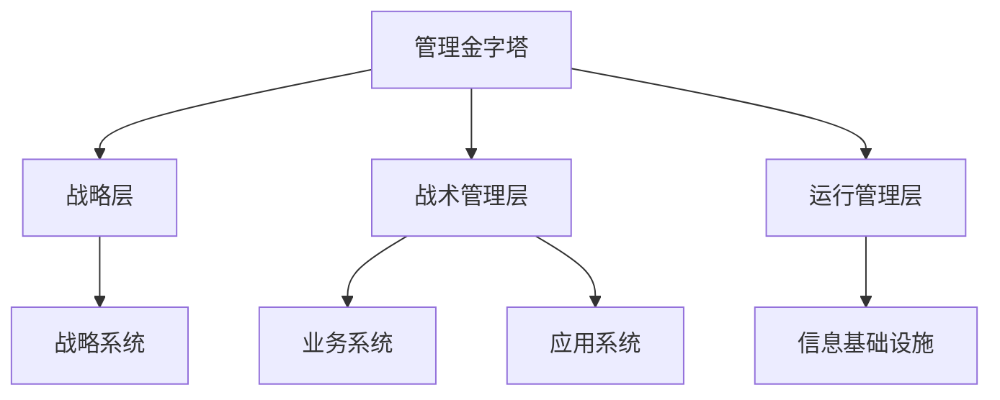

> 📌 **考试重点**：四个总体参考框架（战略/业务/应用/基础设施）与管理金字塔的对应关系、BPR 的效率提升数据是常考内容。

> 🔗 **真题关联**：2022年上半年选择题考查了企业信息基础设施（EII）的三个组成部分。

---

## 信息系统架构风格

信息系统架构风格是指系统在组织方式上的通用模式，常见的架构风格包括[^17]：

**1. 管道-过滤器风格（Pipe and Filter）**

- 每个构件（过滤器）读取输入数据流，处理后产生输出数据流
- 构件之间通过管道连接，数据流单向流动
- 典型应用：编译器、Unix Shell 管道

**2. 数据抽象和面向对象风格**

- 数据及其操作封装为抽象数据类型或对象
- 构件是对象，通过函数和过程调用交互
- 典型应用：面向对象系统

**3. 事件驱动风格**

- 构件不直接调用过程，而是触发或广播事件
- 其他构件注册感兴趣的事件，事件发生时自动调用
- 典型应用：GUI 系统、调试器

**4. 分层系统风格**

- 系统组织为层次结构，每层为上层提供服务
- 每层只与相邻层交互，降低耦合
- 典型应用：OSI 七层模型、TCP/IP 协议栈

**5. 仓库风格（Repository）**

- 中心数据结构（仓库）与一组独立构件
- 构件围绕仓库进行数据存取
- 典型应用：数据库系统、IDE 环境

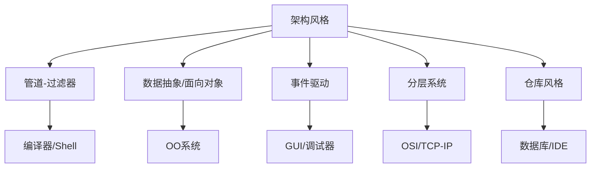

> 📌 **考试重点**：五种架构风格的特点、典型应用场景、优缺点对比是综合知识考试的高频考点。

> 🔗 **真题关联**：2021年下半年选择题考查了分层系统风格与事件驱动风格的区别。

---

## 信息系统架构设计原则

信息系统架构设计需要遵循以下核心原则[^18]：

**1. 模块化原则**

- 将系统分解为独立的模块，每个模块完成特定功能
- 模块之间通过定义良好的接口交互
- 提高系统的可维护性和可扩展性

**2. 信息隐藏原则**

- 模块内部实现细节对外部隐藏
- 外部只能通过接口访问模块功能
- 降低模块间的耦合度

**3. 关注点分离原则**

- 将不同的关注点（如业务逻辑、数据访问、用户界面）分离到不同模块
- 每个模块专注于单一职责
- 便于独立开发和测试

**4. 可复用性原则**

- 设计可复用的构件和服务
- 避免重复开发，提高开发效率
- 建立企业级构件库

**5. 可扩展性原则**

- 架构应支持未来业务增长和技术演进
- 预留扩展点，避免架构僵化
- 支持水平扩展和垂直扩展

**6. 安全性原则**

- 架构设计应考虑安全需求
- 实施身份认证、访问控制、数据加密等措施
- 建立安全审计机制

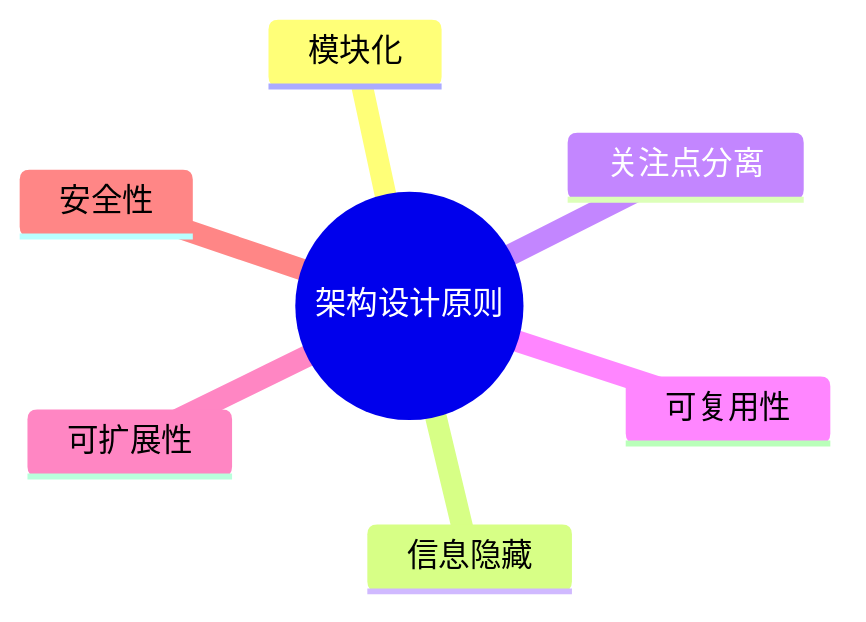

> 📌 **考试重点**：六大架构设计原则的内涵、应用场景、相互关系是案例分析题的常考内容。

> 🔗 **真题关联**：2020年下半年案例分析题考查了某系统架构设计中模块化原则和信息隐藏原则的应用。

---

## 信息系统架构案例分析：电子政务系统

某省级电子政务系统需要整合多个委办局的业务系统，实现"一网通办"。系统架构设计如下[^19]：

**背景与挑战**：

- 原有系统分散在30+个委办局，技术栈不统一
- 数据孤岛严重，群众办事需要重复提交材料
- 需要实现跨部门数据共享和业务协同

**架构设计方案**：

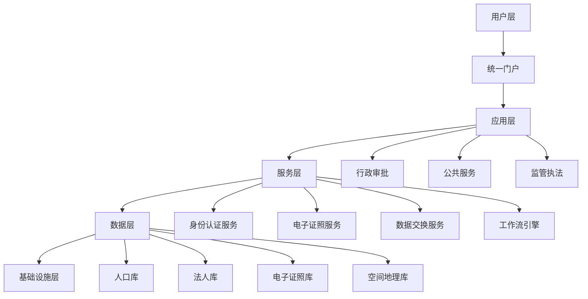

**关键技术决策**：

1. **采用 SOA 架构**：通过 ESB 实现各委办局系统的服务集成
2. **统一身份认证**：基于 OAuth 2.0 实现单点登录
3. **数据共享交换**：建立数据交换平台，实现"一次采集、多方复用"
4. **电子证照应用**：减少纸质材料提交，实现"免证办"

**实施效果**：

- 办事材料减少60%，办理时限压缩50%
- 实现200+项服务"全程网办"
- 群众满意度提升至95%

> 📌 **考试重点**：电子政务系统的架构设计要点（SOA、数据共享、统一认证）是案例分析的典型考题。

> 🔗 **真题关联**：2022年下半年案例分析题考查了电子政务系统的架构设计与数据共享方案。

---

## 信息系统架构案例分析：企业ERP系统

某大型制造企业实施ERP系统，整合财务、生产、采购、销售等业务流程[^20]：

**业务需求**：

- 整合分散的部门级系统，消除信息孤岛
- 实现业务流程标准化和自动化
- 支持集团化管控和决策分析

**架构设计**：

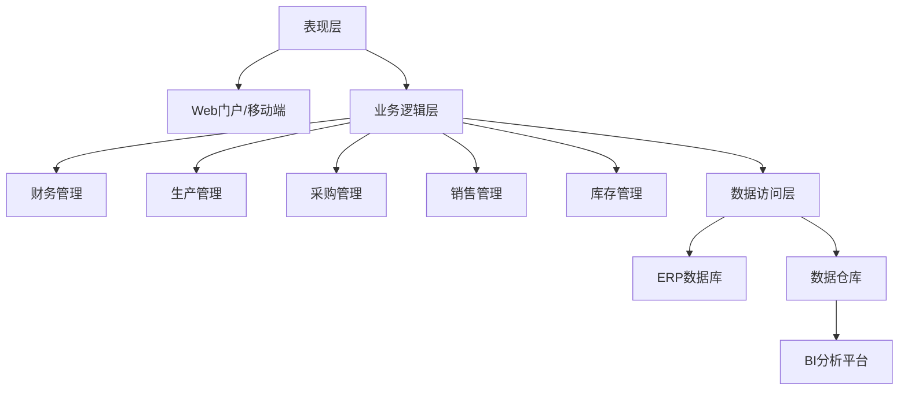

**架构特点**：

1. **三层架构**：表现层、业务逻辑层、数据访问层分离
2. **模块化设计**：各业务模块独立部署，松耦合集成
3. **数据集中管理**：统一数据库，保证数据一致性
4. **BI 分析支持**：数据仓库+OLAP，支持管理决策

**实施挑战与对策**：

| 挑战 | 对策 |
|------|------|
| 业务流程重组阻力大 | 高层推动，分阶段实施 |
| 历史数据迁移复杂 | 制定数据清洗规则，分批迁移 |
| 用户培训成本高 | 建立培训中心，编制操作手册 |
| 系统性能瓶颈 | 数据库优化，引入缓存机制 |

> 📌 **考试重点**：ERP 系统的架构设计、三层架构应用、业务流程重组（BPR）是案例分析的常考内容。

> 🔗 **真题关联**：2021年上半年案例分析题考查了企业 ERP 系统的架构设计与实施策略。

---

## 信息系统架构案例分析：智慧城市平台

某城市建设智慧城市运营管理中心，整合城市运行数据，实现智能决策支持[^21]：

**系统架构**：

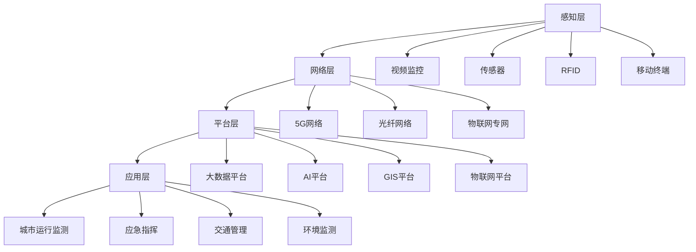

**关键技术**：

1. **多源数据融合**：整合视频、传感器、政务数据等多源异构数据
2. **实时流处理**：采用 Flink 实现城市运行数据的实时分析
3. **AI 智能分析**：应用机器学习进行交通预测、事件检测
4. **数字孪生**：构建城市三维模型，实现可视化仿真

**架构优势**：

- 支持PB级数据存储和处理
- 毫秒级事件响应
- 弹性扩展，应对数据量增长

> 📌 **考试重点**：智慧城市平台的层次架构、多源数据融合、实时流处理技术是案例分析的新兴考点。

> 🔗 **真题关联**：2023年下半年案例分析题考查了智慧城市大数据平台的架构设计。

---

## 信息系统架构设计方法

信息系统架构设计需要遵循科学的方法论，常见的设计方法包括自顶向下、自底向上和迭代式三种[^22]。

**自顶向下方法**：

- 从系统总体目标出发，逐层分解为子系统和模块
- 先定义高层架构，再细化各组成部分
- 优点：整体一致性好，适合大型复杂系统
- 缺点：对需求理解要求高，前期投入大

**自底向上方法**：

- 从现有组件和基础设施出发，逐步集成和抽象
- 先构建可运行的子系统，再整合为完整系统
- 优点：可快速验证，适合遗留系统改造
- 缺点：可能缺乏整体一致性，集成风险高

**迭代式方法**：

- 结合自顶向下和自底向上的优点
- 通过多轮迭代逐步完善架构
- 每轮迭代都产生可交付的架构增量
- 是现代架构设计的主流方法

**架构视图（4+1视图）**：

Philippe Kruchten提出的4+1视图模型从五个维度描述软件架构[^23]：

| 视图 | 关注点 | 主要元素 |
|------|--------|----------|
| 逻辑视图 | 功能需求 | 类、包、子系统 |
| 开发视图 | 软件组织 | 模块、层次、库 |
| 进程视图 | 运行时行为 | 进程、线程、并发 |
| 物理视图 | 部署拓扑 | 节点、网络、硬件 |
| 场景视图 | 用例驱动 | 用例、场景、序列 |

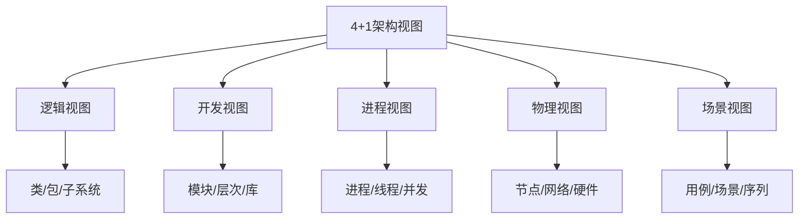

**架构文档化**：

- 架构文档是架构决策的记录和沟通工具
- 应包含架构视图、设计决策、约束条件、风险分析
- 常用文档模板：架构决策记录（ADR）、架构概览图、接口规范

> 📌 **考试重点**：三种架构设计方法的优缺点对比、4+1视图模型的五个视图及其关注点是高频考点，常以选择题和简答题形式出现。

> 🔗 **真题关联**：2022年上半年选择题考查了4+1视图模型中各视图的定义，2021年下半年考查了自顶向下与自底向上方法的区别。

---

## 信息系统架构评估

架构评估是在架构设计完成后，对架构是否满足质量需求进行系统性的分析和评价[^24]。

**架构评估的目的**：

1. **识别风险**：发现架构中潜在的设计缺陷和风险点
2. **验证质量属性**：确认架构是否满足性能、可用性、安全性等质量目标
3. **支持决策**：为架构选型和优化提供客观依据
4. **促进沟通**：通过评估过程促进利益相关方的共识

**架构评估方法**：

**SAAM（Software Architecture Analysis Method）**：

- 卡内基梅隆大学提出的场景驱动评估方法
- 通过场景描述来评估架构对质量属性的支持程度
- 步骤：场景开发 → 架构描述 → 场景分类和优先级排序 → 场景单独评估 → 场景交互评估 → 总体评估
- 适用于评估可修改性等质量属性

**ATAM（Architecture Tradeoff Analysis Method）**：

- SAAM的扩展方法，专注于权衡分析
- 识别质量属性之间的冲突和权衡点
- 步骤：呈现ATAM → 呈现业务驱动 → 呈现架构 → 识别架构方法 → 生成质量属性效用树 → 分析架构方法 → 头脑风暴和优先场景 → 分析架构方法 → 呈现结果
- 适用于大型复杂系统的架构评估[^25]

**质量属性场景**：

质量属性场景由六个部分组成：刺激源、刺激、环境、制品、响应、响应度量。

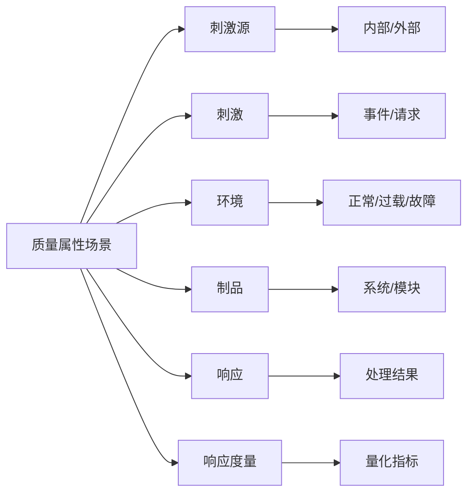

> 📌 **考试重点**：SAAM和ATAM两种评估方法的步骤和适用场景、质量属性场景的六个组成部分是综合知识考试的重点内容。

> 🔗 **真题关联**：2023年上半年选择题考查了ATAM方法的主要步骤，2020年下半年考查了质量属性场景的组成要素。

---

## 信息系统架构演化

信息系统架构演化是指系统运行过程中，由于业务需求变化、技术更新或环境变化，对架构进行调整和改进的过程[^26]。

**架构演化的原因**：

1. **业务需求变化**：新业务场景、业务流程优化、监管要求变化
2. **技术更新**：新技术出现、旧技术淘汰、性能瓶颈
3. **环境变化**：用户规模增长、数据量激增、安全威胁演变
4. **架构债务**：早期设计决策的局限性逐渐暴露

**架构演化策略**：

**大爆炸式演化**：

- 一次性全面替换旧架构
- 优点：彻底解决问题，无历史包袱
- 缺点：风险极高，回滚困难，业务中断时间长
- 适用场景：小型系统或系统已无法维护

**增量式演化**：

- 逐步替换系统的各个组成部分
- 优点：风险可控，可逐步验证
- 缺点：新旧架构并存，集成复杂
- 适用场景：大型系统的逐步改造

**迭代式演化**：

- 通过多个迭代周期持续改进架构
- 每个迭代都产生可交付的价值
- 是现代架构演化的主流策略[^27]

**演化风险评估**：

| 风险类型 | 描述 | 缓解措施 |
|----------|------|----------|
| 业务中断风险 | 演化过程中系统不可用 | 蓝绿部署、金丝雀发布 |
| 数据一致性风险 | 新旧系统数据不同步 | 双写机制、数据校验 |
| 性能退化风险 | 新架构性能不达标 | 渐进式流量切换、压测 |
| 回滚风险 | 演化失败无法恢复 | 保留回滚方案、数据备份 |

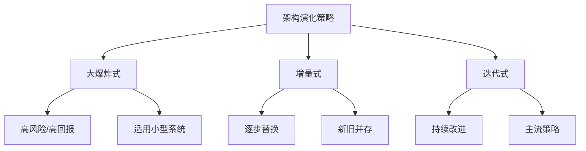

> 📌 **考试重点**：三种架构演化策略的优缺点对比、演化风险类型及缓解措施是案例分析的常考内容。

> 🔗 **真题关联**：2022年下半年案例分析题考查了某企业从单体架构向微服务架构迁移的演化策略选择。

---

## 信息系统架构与云计算

云计算对信息系统架构产生了深远影响，推动了架构模式从传统数据中心向云原生架构转变[^28]。

**云计算对信息系统架构的影响**：

1. **资源获取方式变化**：从自建基础设施到按需获取计算资源
2. **弹性扩展能力**：架构需要支持自动伸缩以应对流量波动
3. **服务化趋势**：系统组件以云服务形式提供，促进微服务架构普及
4. **运维模式转变**：从人工运维向DevOps、SRE模式转变
5. **成本模型变化**：从资本支出（CapEx）转向运营支出（OpEx）

**云计算服务模式**：

| 模式 | 全称 | 提供商责任 | 用户责任 | 典型应用 |
|------|------|------------|----------|----------|
| IaaS | 基础设施即服务 | 物理基础设施 | 操作系统及以上 | 虚拟机、存储、网络 |
| PaaS | 平台即服务 | 运行时平台 | 应用和数据 | 数据库、中间件、开发平台 |
| SaaS | 软件即服务 | 完整软件 | 配置和使用 | ERP、CRM、办公软件 |

**混合云架构**：

混合云架构结合了公有云和私有云的优势，是企业上云的常见路径[^29]：

- **敏感数据私有云**：核心数据、个人隐私信息部署在私有云
- **弹性负载公有云**：面向互联网的应用、突发流量使用公有云
- **统一管理平台**：跨云资源统一调度和监控
- **数据同步机制**：私有云与公有云之间的数据同步和备份

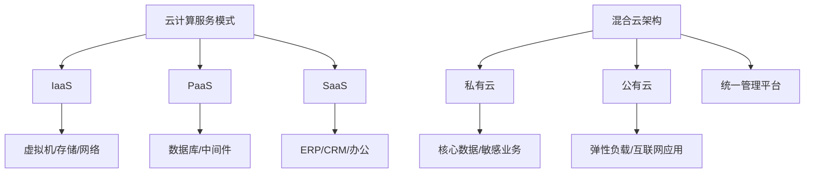

> 📌 **考试重点**：三种云服务模式的区别和责任划分、混合云架构的设计要点是综合知识的高频考点。

> 🔗 **真题关联**：2023年下半年选择题考查了IaaS/PaaS/SaaS的责任边界划分，2021年上半年案例分析题考查了企业混合云架构设计方案。

---
## 参考文献

[^1]: 《系统架构设计师教程(第二版)》P.405 §12.1

[^2]: 《系统架构设计师教程(第二版)》P.408 §12.2.2

[^3]: 《系统架构设计师教程(第二版)》P.408 §12.2.2

[^4]: 《系统架构设计师教程(第二版)》P.411 §12.2.4

[^5]: 《系统架构设计师教程(第二版)》P.415 §12.2.5

[^6]: 《系统架构设计师教程(第二版)》P.417 §12.3.1

[^7]: 《系统架构设计师教程(第二版)》P.417 §12.3.1

[^8]: 《系统架构设计师教程(第二版)》P.415 §12.2.5

[^9]: 《系统架构设计师教程(第二版)》P.417 §12.3.1

[^10]: 《系统架构设计师教程(第二版)》P.419 §12.3.1

[^11]: 《系统架构设计师教程(第二版)》P.419-420 §12.3.1

[^12]: 《系统架构设计师教程(第二版)》P.415 §12.2.5

[^13]: 《系统架构设计师教程(第二版)》P.416 §12.2.5

[^14]: 《系统架构设计师教程(第二版)》P.416 §12.2.5

[^15]: 《系统架构设计师教程(第二版)》P.416-417 §12.2.5

[^16]: 《系统架构设计师教程(第二版)》P.417 §12.2.5

[^17]: 《系统架构设计师教程(第二版)》P.406-408 §12.2.1

[^18]: 《系统架构设计师教程(第二版)》P.409-410 §12.2.3

[^19]: 《系统架构设计师教程(第二版)》P.421-425 §12.4

[^20]: 《系统架构设计师教程(第二版)》P.425-430 §12.4

[^21]: 《系统架构设计师教程(第二版)》P.430-435 §12.4

[^22]: 《系统架构设计师教程(第二版)》P.409-410 §12.2.3

[^23]: 《系统架构设计师教程(第二版)》P.410-411 §12.2.3

[^24]: 《系统架构设计师教程(第二版)》P.412-413 §12.2.3

[^25]: 《系统架构设计师教程(第二版)》P.413-414 §12.2.3

[^26]: 《系统架构设计师教程(第二版)》P.414-415 §12.2.3

[^27]: 《系统架构设计师教程(第二版)》P.415 §12.2.3

[^28]: 《系统架构设计师教程(第二版)》P.418-419 §12.3.2

[^29]: 《系统架构设计师教程(第二版)》P.419-420 §12.3.2
