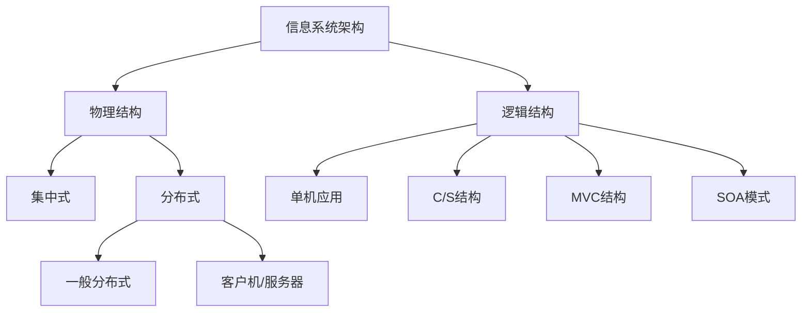
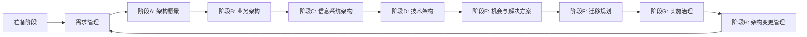
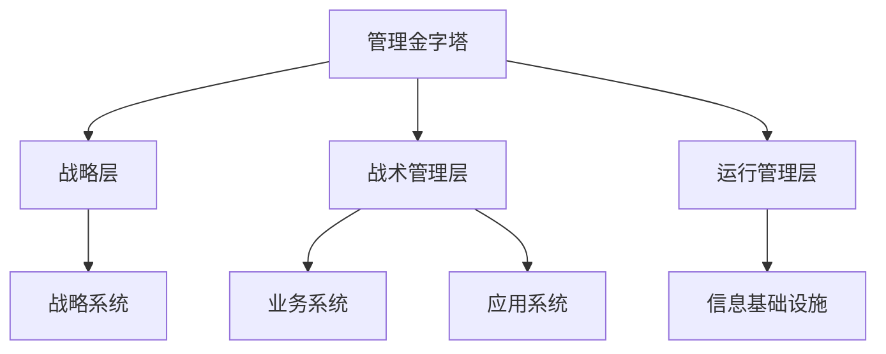

## 信息系统架构分类

信息系统架构（Information System Architecture, ISA）反映了一个政府、企业或事业单位信息系统的各个组成部分之间的关系，以及信息系统与相关业务、信息系统与相关技术之间的关系[^1]。

从物理结构上，信息系统架构可分为两类：

- **集中式结构**：物理资源在空间上集中配置。优点是资源集中、便于管理、利用率较高；缺点是系统脆弱，主机故障会导致整个系统瘫痪
- **分布式结构**：通过计算机网络把不同地点的计算机硬件、软件、数据等资源联系在一起，实现资源共享。优点是扩展方便、安全性好；缺点是管理标准不易统一、协调困难[^2]

分布式结构又可分为一般分布式与客户机/服务器模式：

- **一般分布式系统**：服务器只提供软件与数据的文件服务
- **客户机/服务器结构**：网络上的计算机分为客户机与服务器两大类，用户通过客户机向服务器提出服务请求[^3]

从逻辑结构上，信息系统常见4种架构模型：

1. **单机应用模式（Standalone）**：运行在一台物理机器上的独立应用程序
2. **客户机/服务器模式（C/S）**：两层/多层C/S结构
3. **MVC结构**：Model-View-Controller
4. **面向服务的SOA模式**：多服务集合和数据交换总线[^4]

---

## 企业总体框架(TOGAF)

**TOGAF**（The Open Group Architecture Framework）是一种开放式企业架构框架标准，它为标准、方法论和企业架构专业人员之间的沟通提供一致性保障[^5]。

TOGAF旨在通过以下目标帮助企业：

- 确保所有用户使用相同的语言，打破沟通障碍
- 避免被锁定到企业架构的专有解决方案
- 节省时间和金钱，更有效地利用资源
- 实现可观的投资回报（ROI）[^6]

TOGAF 9版本包括六个组件：

1. **架构开发方法（ADM）**：TOGAF的核心，描述开发企业架构的分步方法
2. **ADM指南和技术**：一系列可用于应用ADM的指南和技术
3. **架构内容框架**：描述架构工件的结构化元模型、可重用架构构建块
4. **企业连续体和工具**：对企业内部架构活动的输出进行分类和存储
5. **TOGAF参考模型**：技术参考模型（TRM）和集成信息基础设施参考模型（III-RM）
6. **架构能力框架**：讨论在企业内建立和运营架构实践所需的组织、流程、技能、角色和职责[^7]

信息系统体系结构的总体参考框架由四个部分组成：

- **战略系统**：与战略制定、高层决策有关的管理活动
- **业务系统**：企业中完成一定业务功能的各部分组成的系统
- **应用系统**：应用软件系统，为业务控制提供计算机实现手段
- **信息基础设施**：企业实现信息化的基础部分[^8]

---

## ADM架构开发方法

**ADM**（Architecture Development Method）是TOGAF规范中最为核心的内容，为开发企业架构所需要执行的各个步骤以及它们之间的关系进行了详细定义[^9]。

ADM全生命周期模型将架构开发划分为十个阶段，反复迭代：

ADM三个级别的迭代概念：

1. **基于ADM整体的迭代**：用环形方式应用ADM，一个阶段完成后直接进入下一个阶段
2. **多个开发阶段间的迭代**：例如完成技术架构阶段后重新回到业务架构开发阶段
3. **一个阶段内部的迭代**：对复杂的架构内容进行迭代开发[^10]

ADM主要阶段活动：

| 阶段                  | 主要活动                                      |
| --------------------- | --------------------------------------------- |
| 准备阶段              | 定义组织机构、特定架构框架、架构原则          |
| 需求管理              | 完成需求的识别、保管和交付                    |
| 阶段A：架构愿景       | 设置项目范围、约束和期望，创建架构愿景        |
| 阶段B：业务架构       | 开发基线和目标业务架构，执行差距分析          |
| 阶段C：信息系统架构   | 数据架构设计和应用架构设计                    |
| 阶段D：技术架构       | 开发基线和目标技术架构                        |
| 阶段E：机会与解决方案 | 确定主要实施项目，决定途径                    |
| 阶段F：迁移规划       | 制订详细的实施和迁移计划                      |
| 阶段G：实施治理       | 提供实施项目的架构监督，发布架构合同          |
| 阶段H：架构变更管理   | 持续监测和变更管理，确保架构响应企业需求[^11] |

---

## 信息化总体架构方法

建立企业信息系统体系结构总体参考框架，必须考虑企业的四个方面：战略系统、业务系统、应用系统和信息基础设施。这四个部分相互关联，并构成与管理金字塔相一致的层次[^12]。

**战略系统**：

- 与战略制定、高层决策有关的管理活动和计算机辅助系统
- 由高层决策支持系统和企业战略规划体系两部分组成
- 表示信息系统对企业高层管理者的决策支持能力，以及企业战略规划对信息系统建设的影响和要求[^13]

**业务系统**：

- 企业中完成一定业务功能的各部分（物质、能量、信息和人）组成的系统
- 包括生产系统、销售系统、采购系统、人事系统、会计系统等
- 业务过程重组（BPR）可使企业的经济效率提高70%～80%[^14]

**应用系统**：

- 信息系统中的应用软件部分
- 包含事务处理系统TPS、管理信息系统MIS、决策支持系统DSS、专家系统ES、办公自动化系统OAS、CAD/CAPP/CAM、制造资源计划系统MRP II等
- 从架构角度看，包含内部功能实现部分和外部界面部分[^15]

**企业信息基础设施（EII）**：

- 根据企业当前业务和可预见的发展趋势，构筑由信息设备、通信网络、数据库、系统软件和支持性软件等组成的环境
- 分为三部分：技术基础设施、信息资源设施、管理基础设施[^16]

---

## 参考文献

[^1]: 《系统架构设计师教程(第二版)》P.405 §12.1

[^2]: 《系统架构设计师教程(第二版)》P.408 §12.2.2

[^3]: 《系统架构设计师教程(第二版)》P.408 §12.2.2

[^4]: 《系统架构设计师教程(第二版)》P.411 §12.2.4

[^5]: 《系统架构设计师教程(第二版)》P.415 §12.2.5

[^6]: 《系统架构设计师教程(第二版)》P.417 §12.3.1

[^7]: 《系统架构设计师教程(第二版)》P.417 §12.3.1

[^8]: 《系统架构设计师教程(第二版)》P.415 §12.2.5

[^9]: 《系统架构设计师教程(第二版)》P.417 §12.3.1

[^10]: 《系统架构设计师教程(第二版)》P.419 §12.3.1

[^11]: 《系统架构设计师教程(第二版)》P.419-420 §12.3.1

[^12]: 《系统架构设计师教程(第二版)》P.415 §12.2.5

[^13]: 《系统架构设计师教程(第二版)》P.416 §12.2.5

[^14]: 《系统架构设计师教程(第二版)》P.416 §12.2.5

[^15]: 《系统架构设计师教程(第二版)》P.416-417 §12.2.5

[^16]: 《系统架构设计师教程(第二版)》P.417 §12.2.5
