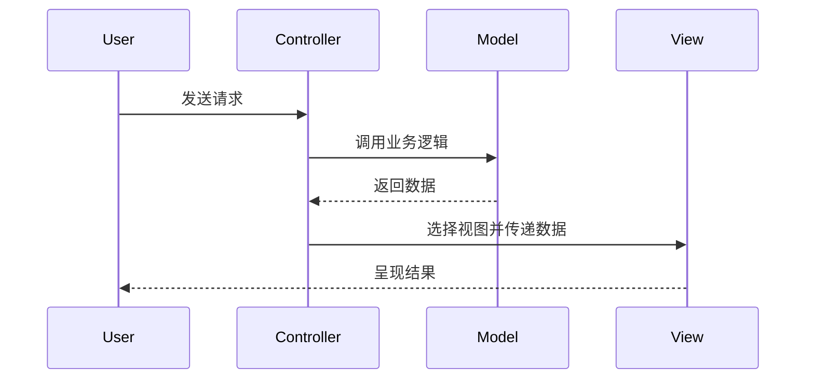
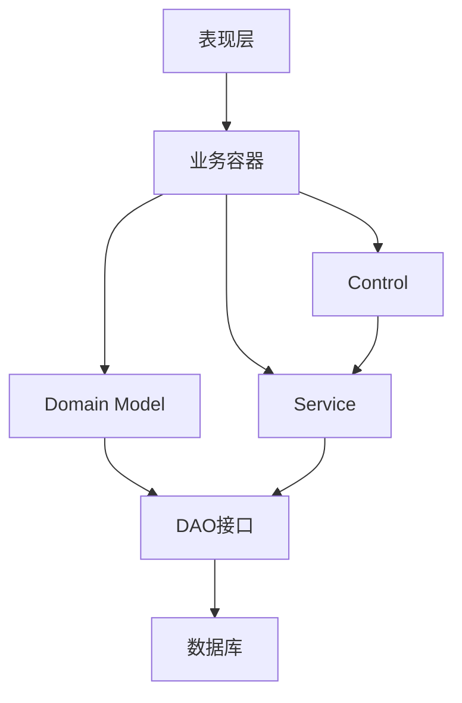
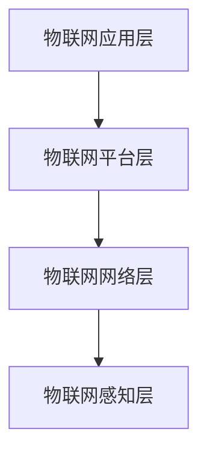

## 层次式架构概述

**层次式架构**将系统分成多个层次，每层只与相邻层交互。这种架构方式可以有效地将系统划分为不同的功能层次，降低系统的复杂性，提高系统的可维护性和可扩展性[^1]。

常见的三层架构包括：

- **表现层**（Presentation Layer）：负责用户界面显示和用户交互
- **业务逻辑层**（Business Logic Layer）：负责业务规则的处理和业务逻辑的实现
- **数据访问层**（Data Access Layer）：负责数据的持久化和访问[^2]

层次式架构的优点：

- 各层职责清晰，便于分工开发
- 层与层之间低耦合，某一层变化对其他层影响有限
- 有利于系统功能的复用和扩展
- 便于测试和维护

---

## 表现层设计

表现层设计模式主要包括 **MVC**、**MVP** 和 **MVVM** 三种模式[^3]。

**1. MVC模式（Model-View-Controller）**

- **Model**：模型，负责业务逻辑处理和数据
- **View**：视图，负责用户界面显示
- **Controller**：控制器，负责接收用户请求，调用模型处理，并选择视图展示

MVC流程：

MVC优点：

- 允许多种用户界面的扩展
- 易于维护，控制器和视图可随模型扩展
- 功能强大的用户界面[^4]

**2. MVP模式（Model-View-Presenter）**

- 从MVC演变而来，View和Model之间不允许直接通信
- 所有交互都发生在Presenter内部
- Presenter依赖抽象化的View（接口IView），便于测试[^5]

MVP优点：

- 模型与视图完全分离
- 可以更高效地使用模型
- 一个Presenter可用于多个视图
- 便于单元测试[^6]

**3. MVVM模式（Model-View-ViewModel）**

- View和Model不能直接通信，通过ViewModel实现双向数据绑定
- 适用于数据驱动的场景，尤其是数据操作频繁的场景
- 官方建议使用ViewModel、LiveData等架构组件实现[^7]

---

## 中间层架构设计

中间层即业务逻辑层，是实现系统功能的核心组件。采用容器的形式，便于系统功能的开发、代码重用和管理[^8]。

业务逻辑层组件设计：

- **业务逻辑组件**：分为接口和实现类两个部分
- 接口用于定义业务逻辑组件必须实现的方法
- 实现类以多个DAO（Data Access Object）组件为基础，对外提供业务逻辑服务
- 采用面向接口编程，实现更好的解耦[^9]

业务逻辑层工作流设计：

- **工作流**是业务流程的全部或部分自动化
- 工作流管理联盟（WFMC）定义了五个接口标准：
  - Interface 1：过程定义导入/导出接口（XPDL）
  - Interface 2：客户端应用程序接口
  - Interface 3：应用程序调用接口
  - Interface 4：工作流机协作接口
  - Interface 5：管理和监视接口[^10]

业务逻辑层框架采用 **Domain Model—Service—Control** 思想实现：

- **Domain Model**：领域层业务对象，仅包含业务相关属性
- **Service**：业务过程实现的组成部分，通过定义良好的接口和契约联系
- **Control**：服务控制器，不同服务之间的切换通过它实现[^11]

---

## 数据访问层设计

数据访问层负责数据的持久化和访问，常见5种数据访问模式[^12]：

| 模式         | 说明                                                 | 适用场景             |
| ------------ | ---------------------------------------------------- | -------------------- |
| 在线访问     | 占用一个数据库连接，每个操作都通过该连接与数据源交互 | 最基本、最常用的模式 |
| DAO模式      | 将底层数据访问操作与高层业务逻辑分离                 | 标准J2EE设计模式     |
| DTO模式      | 跨不同进程或网络边界传输数据的容器                   | 远程调用场景         |
| 离线数据模式 | 数据从数据源获取后按预定义结构存放，独立于后台连接   | 数据为中心的应用     |
| ORM模式      | 对象/关系映射，在对象和关系数据库之间转换            | 面向对象应用[^13]    |

ORM框架示例：

- **Hibernate**：对JDBC进行轻量级对象封装，使Java程序员可以面向对象思维操纵数据库
- 通过Cache实现性能调优，隔离实际数据存储和业务层
- 推动了基于普通Java对象模型的持久对象开发[^14]

事务处理设计：

- 事务必须服从 **ACID** 原则：
  - **原子性（Atomicity）**：事务执行过程中的任何失败都将导致事务所做的任何修改失效
  - **一致性（Consistency）**：事务执行失败时，所有被影响的数据都应恢复到事务执行前的状态
  - **隔离性（Isolation）**：事务执行过程中对数据的修改，在提交之前对其他事务不可见
  - **持久性（Durability）**：已提交的数据在事务执行失败时状态正确[^15]

---

## 物联网层次架构

物联网（IoT）四层架构设计如下[^16]：

**1. 感知层**

- 负责信息采集和物体识别
- 包括传感器、RFID、二维码、摄像头等感知设备

**2. 网络层**

- 负责信息的传输和处理
- 包括移动通信网络、互联网、无线局域网、卫星通信等

**3. 平台层**

- 负责数据的存储、处理和分析
- 提供设备管理、数据管理、应用使能等能力

**4. 应用层**

- 面向最终用户提供各种物联网应用服务
- 包括智慧城市、智能家居、工业物联网、车联网等[^17]

物联网层次架构与通用信息系统层次架构的对应关系：

- 感知层对应数据采集
- 网络层对应数据传输
- 平台层对应数据处理
- 应用层对应业务应用

---

## 参考文献

[^1]: 《系统架构设计师教程(第二版)》P.451 §13.1

[^2]: 《系统架构设计师教程(第二版)》P.451 §13.1

[^3]: 《系统架构设计师教程(第二版)》P.453 §13.2.1

[^4]: 《系统架构设计师教程(第二版)》P.454 §13.2.1

[^5]: 《系统架构设计师教程(第二版)》P.454 §13.2.1

[^6]: 《系统架构设计师教程(第二版)》P.454 §13.2.1

[^7]: 《系统架构设计师教程(第二版)》P.455 §13.2.1

[^8]: 《系统架构设计师教程(第二版)》P.458 §13.3

[^9]: 《系统架构设计师教程(第二版)》P.458 §13.3.1

[^10]: 《系统架构设计师教程(第二版)》P.459 §13.3.2

[^11]: 《系统架构设计师教程(第二版)》P.463 §13.3.4

[^12]: 《系统架构设计师教程(第二版)》P.464 §13.4.1

[^13]: 《系统架构设计师教程(第二版)》P.464-467 §13.4.1

[^14]: 《系统架构设计师教程(第二版)》P.469 §13.4.3

[^15]: 《系统架构设计师教程(第二版)》P.471 §13.4.5

[^16]: 《系统架构设计师教程(第二版)》P.475 §13.6

[^17]: 《系统架构设计师教程(第二版)》P.475 §13.6
