## 层次式架构概述

**层次式架构**将系统分成多个层次，每层只与相邻层交互。这种架构方式可以有效地将系统划分为不同的功能层次，降低系统的复杂性，提高系统的可维护性和可扩展性[^1]。

层次式架构的核心思想是"关注点分离"，通过将系统功能按抽象级别分层，每层专注于特定职责，层与层之间通过定义良好的接口交互。

常见的三层架构包括：

- **表现层**（Presentation Layer）：负责用户界面显示和用户交互
- **业务逻辑层**（Business Logic Layer）：负责业务规则的处理和业务逻辑的实现
- **数据访问层**（Data Access Layer）：负责数据的持久化和访问[^2]

层次式架构的优点：

- 各层职责清晰，便于分工开发
- 层与层之间低耦合，某一层变化对其他层影响有限
- 有利于系统功能的复用和扩展
- 便于测试和维护

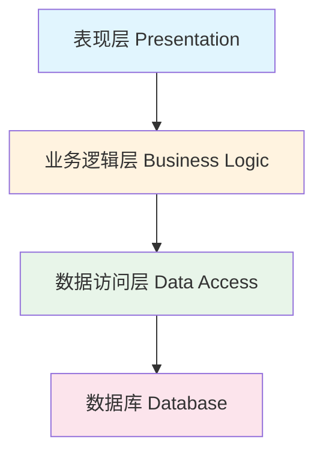

> 📌 **考试重点**：三层架构的层次划分、各层职责、层次式架构的优缺点是基础考点，常以选择题形式出现。

> 🔗 **真题关联**：历年真题多次考查三层架构的基本概念，2023年上半年考查了表现层与业务逻辑层的职责划分。

---

## 表现层设计模式

表现层设计模式主要包括 **MVC**、**MVP** 和 **MVVM** 三种模式[^3]。

**1. MVC模式（Model-View-Controller）**

- **Model**：模型，负责业务逻辑处理和数据
- **View**：视图，负责用户界面显示
- **Controller**：控制器，负责接收用户请求，调用模型处理，并选择视图展示

MVC流程：

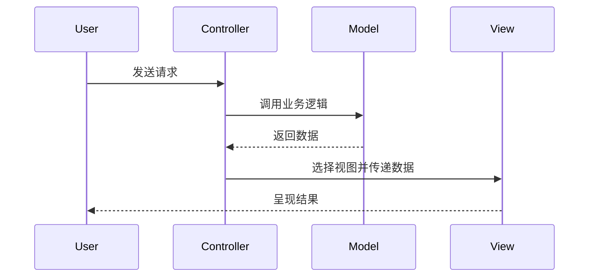

MVC优点：

- 允许多种用户界面的扩展
- 易于维护，控制器和视图可随模型扩展
- 功能强大的用户界面[^4]

**2. MVP模式（Model-View-Presenter）**

- 从MVC演变而来，View和Model之间不允许直接通信
- 所有交互都发生在Presenter内部
- Presenter依赖抽象化的View（接口IView），便于测试[^5]

MVP优点：

- 模型与视图完全分离
- 可以更高效地使用模型
- 一个Presenter可用于多个视图
- 便于单元测试[^6]

**3. MVVM模式（Model-View-ViewModel）**

- View和Model不能直接通信，通过ViewModel实现双向数据绑定
- 适用于数据驱动的场景，尤其是数据操作频繁的场景
- 官方建议使用ViewModel、LiveData等架构组件实现[^7]

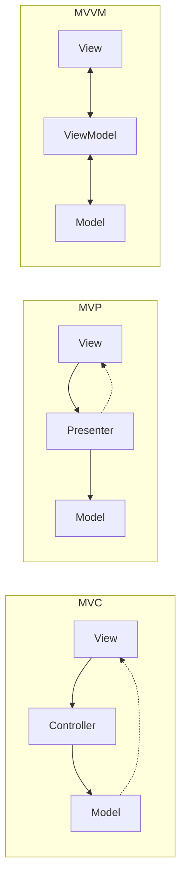

> 📌 **考试重点**：MVC、MVP、MVVM 三种模式的区别、数据流向、适用场景是高频考点，常以对比表格形式考查。

> 🔗 **真题关联**：2022年下半年选择题考查了 MVP 与 MVC 的区别，2021年考查了 MVVM 的双向数据绑定机制。

---

## 表现层框架设计

表现层框架设计涉及用户界面组件的组织、事件处理、数据绑定等关键问题[^8]。

**XML 设计思想**：

- 使用 XML 描述用户界面布局，实现界面与代码分离
- 支持动态界面生成，提高界面灵活性
- 便于国际化和主题切换

**UIP（User Interface Process）设计思想**：

- 将用户界面流程抽象为状态机
- 管理复杂的界面导航和状态转换
- 支持向导式界面和业务流程驱动界面

**动态生成技术**：

- 基于元数据动态生成界面
- 支持运行时界面调整
- 减少硬编码，提高可配置性

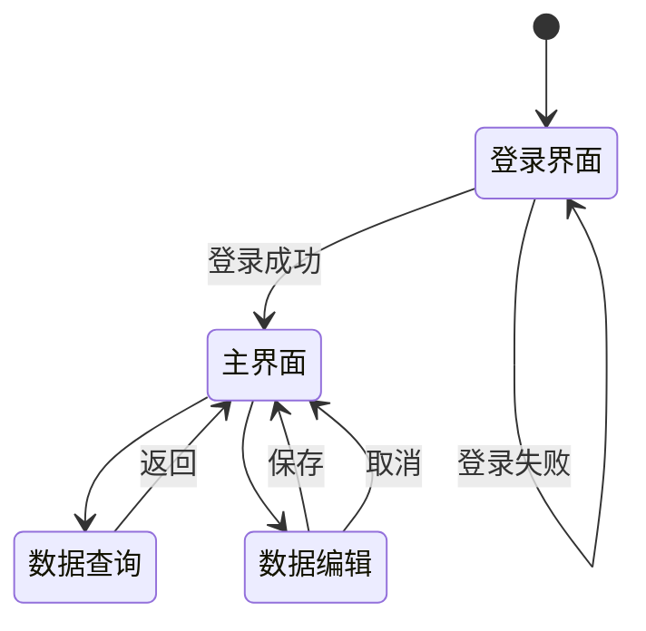

> 📌 **考试重点**：UIP 设计思想、XML 界面描述、动态界面生成技术是表现层设计的进阶考点。

> 🔗 **真题关联**：2020年下半年选择题考查了 UIP 设计思想在复杂界面流程管理中的应用。

---

## 中间层架构设计

中间层即业务逻辑层，是实现系统功能的核心组件。采用容器的形式，便于系统功能的开发、代码重用和管理[^9]。

业务逻辑层组件设计：

- **业务逻辑组件**：分为接口和实现类两个部分
- 接口用于定义业务逻辑组件必须实现的方法
- 实现类以多个DAO（Data Access Object）组件为基础，对外提供业务逻辑服务
- 采用面向接口编程，实现更好的解耦[^10]

业务逻辑层工作流设计：

- **工作流**是业务流程的全部或部分自动化
- 工作流管理联盟（WFMC）定义了五个接口标准：
  - Interface 1：过程定义导入/导出接口（XPDL）
  - Interface 2：客户端应用程序接口
  - Interface 3：应用程序调用接口
  - Interface 4：工作流机协作接口
  - Interface 5：管理和监视接口[^11]

业务逻辑层框架采用 **Domain Model—Service—Control** 思想实现：

- **Domain Model**：领域层业务对象，仅包含业务相关属性
- **Service**：业务过程实现的组成部分，通过定义良好的接口和契约联系
- **Control**：服务控制器，不同服务之间的切换通过它实现[^12]

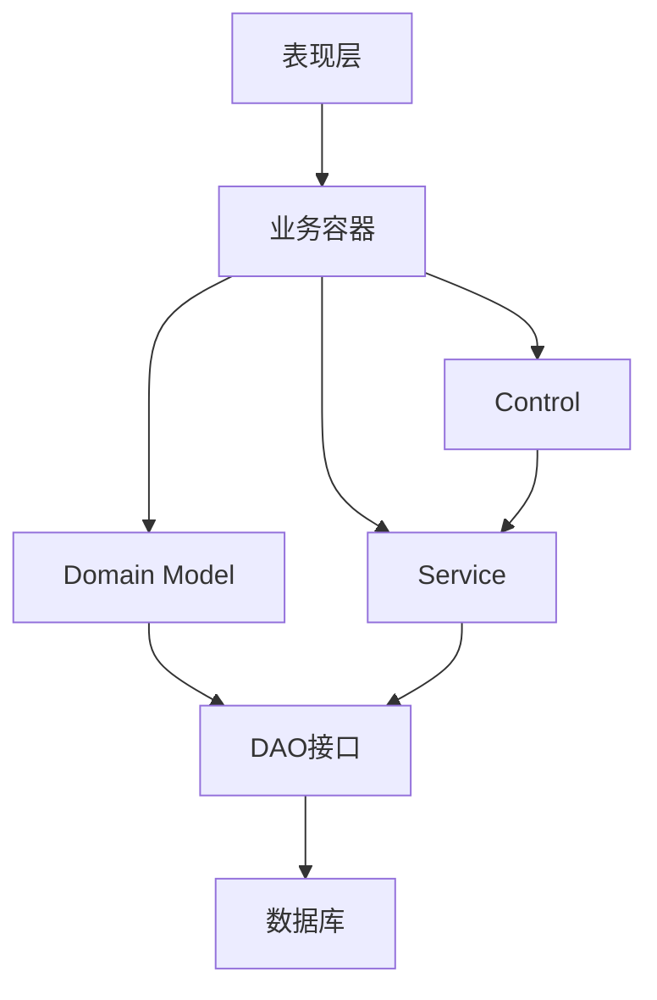

> 📌 **考试重点**：Domain Model—Service—Control 框架、WFMC 五个接口标准、业务逻辑组件设计是中间层架构的核心考点。

> 🔗 **真题关联**：2021年下半年选择题考查了 WFMC 工作流接口标准，2020年考查了 Domain Model 的设计原则。

---

## 数据访问层设计

数据访问层负责数据的持久化和访问，常见5种数据访问模式[^13]：

| 模式         | 说明                                                 | 适用场景             |
| ------------ | ---------------------------------------------------- | -------------------- |
| 在线访问     | 占用一个数据库连接，每个操作都通过该连接与数据源交互 | 最基本、最常用的模式 |
| DAO模式      | 将底层数据访问操作与高层业务逻辑分离                 | 标准J2EE设计模式     |
| DTO模式      | 跨不同进程或网络边界传输数据的容器                   | 远程调用场景         |
| 离线数据模式 | 数据从数据源获取后按预定义结构存放，独立于后台连接   | 数据为中心的应用     |
| ORM模式      | 对象/关系映射，在对象和关系数据库之间转换            | 面向对象应用[^14]    |

ORM框架示例：

- **Hibernate**：对JDBC进行轻量级对象封装，使Java程序员可以面向对象思维操纵数据库
- 通过Cache实现性能调优，隔离实际数据存储和业务层
- 推动了基于普通Java对象模型的持久对象开发[^15]

事务处理设计：

- 事务必须服从 **ACID** 原则：
  - **原子性（Atomicity）**：事务执行过程中的任何失败都将导致事务所做的任何修改失效
  - **一致性（Consistency）**：事务执行失败时，所有被影响的数据都应恢复到事务执行前的状态
  - **隔离性（Isolation）**：事务执行过程中对数据的修改，在提交之前对其他事务不可见
  - **持久性（Durability）**：已提交的数据在事务执行失败时状态正确[^16]

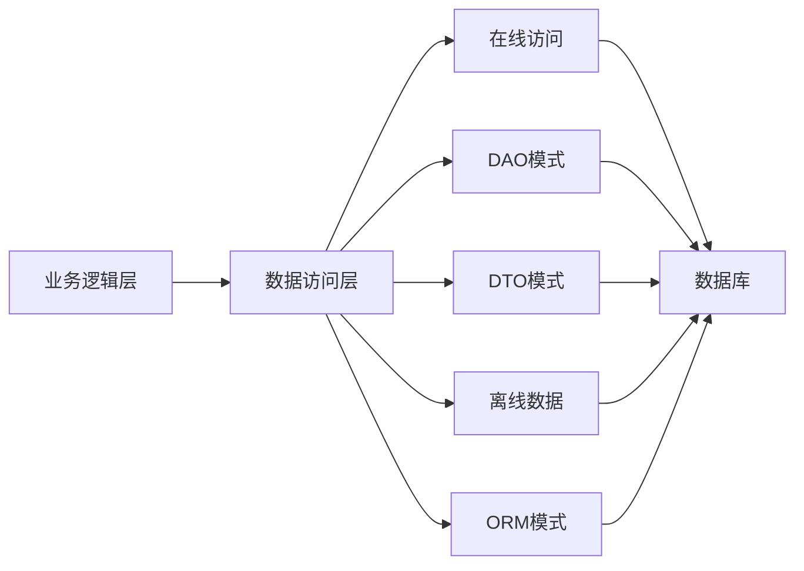

> 📌 **考试重点**：五种数据访问模式的特点、ACID 原则、ORM 框架（Hibernate）是数据访问层的高频考点。

> 🔗 **真题关联**：2022年上半年选择题考查了 ACID 原则中隔离性的含义，2021年考查了 DAO 模式与 DTO 模式的区别。

---

## 数据架构规划与设计

数据架构规划是层次式架构设计的重要组成部分，涉及数据模型设计、数据分布策略、数据一致性保证等关键问题[^17]。

**数据架构设计原则**：

1. **数据标准化**：统一数据定义、格式和编码规则
2. **数据共享**：避免数据冗余，实现"一次录入、多方共享"
3. **数据安全**：实施数据分级分类，保护敏感数据
4. **数据质量**：建立数据质量评估和改进机制

**数据分布策略**：

- **集中式**：所有数据集中存储，管理简单但存在单点故障风险
- **分区式**：按业务或地域分区存储，提高可用性和性能
- **复制式**：数据多副本存储，提高读取性能和容灾能力
- **混合式**：结合多种策略，平衡性能与一致性

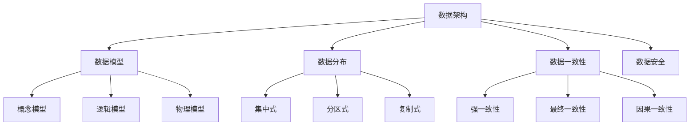

> 📌 **考试重点**：数据架构设计原则、数据分布策略（集中/分区/复制）、数据一致性模型是数据架构规划的核心考点。

> 🔗 **真题关联**：2023年上半年选择题考查了数据分布策略中分区式与复制式的区别。

---

## 物联网层次架构

物联网（IoT）四层架构设计如下[^18]：

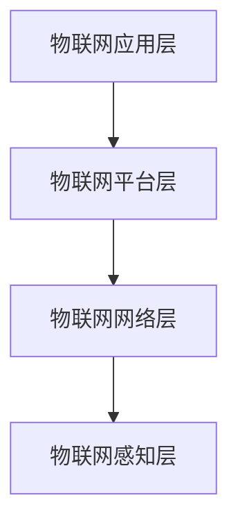

**1. 感知层**

- 负责信息采集和物体识别
- 包括传感器、RFID、二维码、摄像头等感知设备

**2. 网络层**

- 负责信息的传输和处理
- 包括移动通信网络、互联网、无线局域网、卫星通信等

**3. 平台层**

- 负责数据的存储、处理和分析
- 提供设备管理、数据管理、应用使能等能力

**4. 应用层**

- 面向最终用户提供各种物联网应用服务
- 包括智慧城市、智能家居、工业物联网、车联网等[^19]

物联网层次架构与通用信息系统层次架构的对应关系：

- 感知层对应数据采集
- 网络层对应数据传输
- 平台层对应数据处理
- 应用层对应业务应用

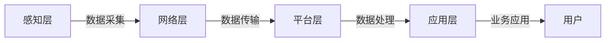

> 📌 **考试重点**：物联网四层架构（感知/网络/平台/应用）的层次划分、各层功能、与通用架构的对应关系是常考内容。

> 🔗 **真题关联**：2022年下半年选择题考查了物联网感知层的主要设备类型。

---

## 层次式架构案例分析：电商平台

某大型电商平台采用层次式架构设计，支持千万级用户并发访问[^20]：

**系统架构**：

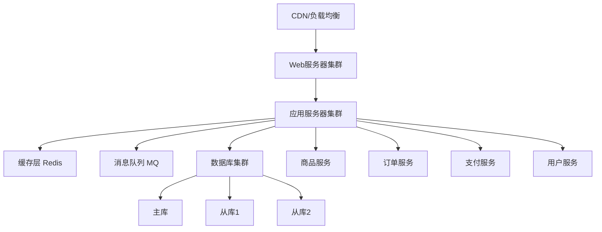

**架构设计要点**：

1. **表现层**：CDN 加速静态资源，负载均衡分发请求
2. **业务逻辑层**：微服务拆分，独立部署和扩展
3. **数据访问层**：读写分离，缓存热点数据
4. **异步处理**：消息队列削峰填谷，提高系统吞吐量

**性能优化措施**：

- 数据库分库分表，支持水平扩展
- Redis 缓存热点商品信息，减少数据库压力
- 异步化订单处理，提高响应速度
- 限流降级，保证核心链路稳定

> 📌 **考试重点**：电商平台的层次架构设计、缓存策略、读写分离、异步处理是案例分析的典型考题。

> 🔗 **真题关联**：2023年下半年案例分析题考查了电商平台的架构设计与性能优化方案。

---

## 层次式架构案例分析：银行核心系统

某银行核心系统采用层次式架构，支持高并发交易处理[^21]：

**架构设计**：

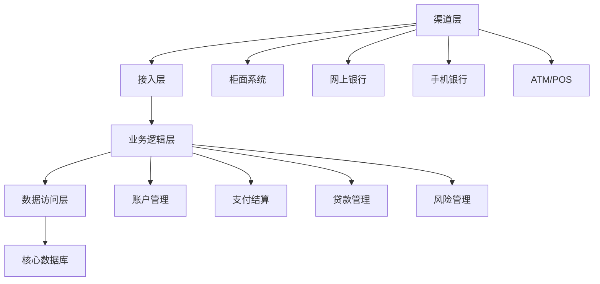

**关键设计决策**：

1. **渠道整合**：统一接入层，支持多渠道接入
2. **事务一致性**：分布式事务保证资金交易一致性
3. **高可用设计**：双活数据中心，RPO=0，RTO<30s
4. **安全合规**：满足金融监管要求，实施数据加密和审计

**技术挑战与对策**：

| 挑战 | 对策 |
|------|------|
| 高并发交易 | 数据库优化，引入缓存 |
| 数据一致性 | 分布式事务，最终一致性 |
| 系统可用性 | 双活架构，故障自动切换 |
| 监管合规 | 完善审计日志，数据加密 |

> 📌 **考试重点**：银行核心系统的架构设计、分布式事务、高可用设计是案例分析的高频考点。

> 🔗 **真题关联**：2021年上半年案例分析题考查了银行系统的架构设计与数据一致性保证。

---

## 层次式架构设计模式

层次式架构设计模式关注层间通信、数据传输和依赖管理三个核心问题[^22]。

**层间通信模式**：

- **同步通信**：上层直接调用下层接口，等待响应返回；实现简单但存在级联失败风险
- **异步通信**：上层发送消息后不等响应，通过回调或事件通知结果；提高系统吞吐量但增加复杂度
- **消息队列**：层间通过消息中间件解耦，实现削峰填谷和最终一致性

**层间数据传输模式**：

- **DTO（Data Transfer Object）**：用于层间数据传输的轻量级对象，仅包含数据不含业务逻辑
- **领域对象（Domain Object）**：包含业务逻辑和数据，适用于同进程内层间调用
- **VO（Value Object）**：用于表现层展示的数据对象，与视图需求紧密相关

**层间依赖管理**：

- **依赖倒置原则（DIP）**：高层模块不应依赖低层模块，二者都应依赖抽象
- **依赖注入（DI）**：通过容器将依赖关系从代码中剥离，实现松耦合
- **接口隔离**：每层对外暴露最小接口集合，隐藏内部实现细节

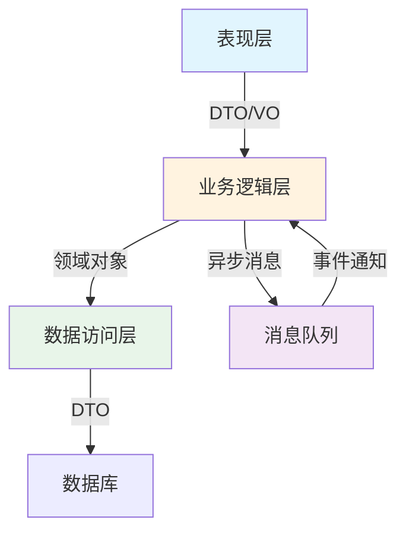

> 📌 **考试重点**：层间通信的同步/异步选择、DTO与领域对象的区别、依赖倒置原则是架构设计模式的核心考点。

> 🔗 **真题关联**：2022年上半年选择题考查了DTO模式在层间数据传输中的作用，2021年考查了依赖倒置原则在层次式架构中的应用。

---

## 层次式架构与SOA结合

层次式架构与面向服务架构（SOA）的结合是现代企业应用的主流设计方式[^23]。

**结合方式**：

- **服务层抽象**：在业务逻辑层之上构建统一的服务层，将业务能力封装为可复用的服务
- **分层服务模型**：表现层调用服务层，服务层编排领域服务，领域服务操作数据访问层
- **服务编排与编排**：通过BPEL或轻量级编排框架实现跨服务的业务流程

**服务层设计原则**：

- **服务粒度**：服务应高内聚低耦合，避免过细（通信开销大）或过粗（难以复用）
- **服务无状态性**：服务不保存客户端会话状态，便于水平扩展和故障恢复
- **服务契约**：通过WSDL/REST API文档明确服务的输入、输出和异常约定

**服务接口规范**：

- **RESTful API**：基于HTTP协议，使用统一接口（GET/POST/PUT/DELETE）
- **SOAP**：基于XML的协议，提供强类型和事务支持
- **gRPC**：基于HTTP/2的高性能RPC框架，适用于内部服务通信

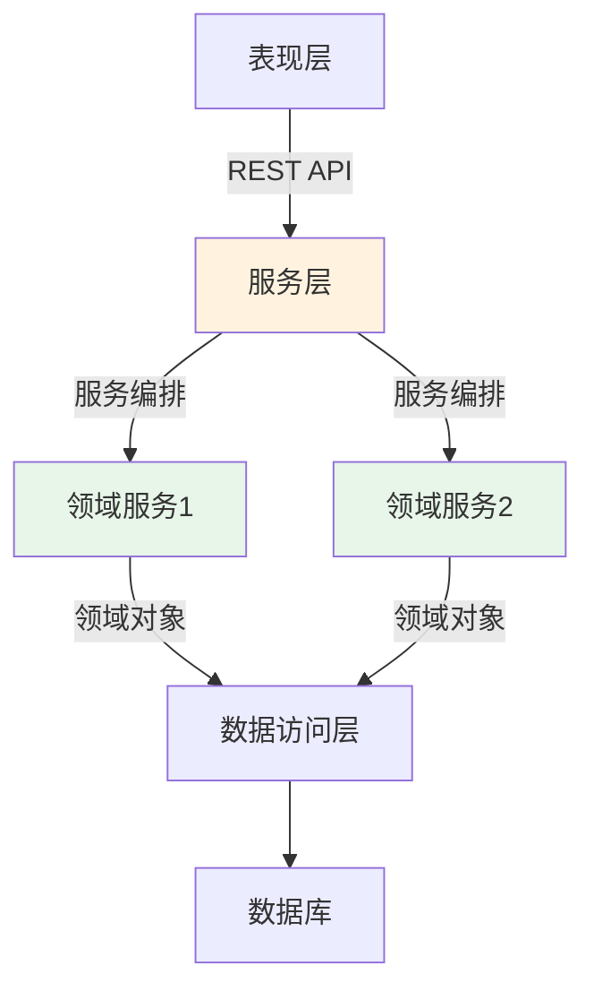

> 📌 **考试重点**：服务层设计原则、服务粒度控制、RESTful与SOAP的选型对比是层次式架构与SOA结合的高频考点。

> 🔗 **真题关联**：2023年上半年选择题考查了服务无状态性对系统扩展性的影响，2022年考查了RESTful API设计原则。

---

## 层次式架构安全性设计

层次式架构的安全性设计需要在每一层实施相应的安全策略，形成纵深防御体系[^24]。

**各层安全策略**：

- **表现层**：输入验证、输出编码、防CSRF/XSS攻击、HTTPS传输
- **业务逻辑层**：业务规则校验、权限检查、防越权访问、防重放攻击
- **数据访问层**：SQL注入防护、参数化查询、数据库连接安全
- **数据层**：数据加密存储、访问审计、备份恢复

**身份认证与授权**：

- **认证（Authentication）**：验证用户身份，常用方式包括用户名密码、Token、OAuth2、SSO
- **授权（Authorization）**：控制用户访问权限，常用模型包括RBAC（基于角色）、ABAC（基于属性）
- **JWT令牌**：无状态的认证机制，包含用户信息和签名，便于分布式系统扩展

**数据加密与安全审计**：

- **传输加密**：TLS/SSL保障数据在传输过程中的机密性
- **存储加密**：敏感字段（密码、身份证号）采用AES/RSA加密存储
- **安全审计**：记录用户操作日志，支持事后追溯和合规检查

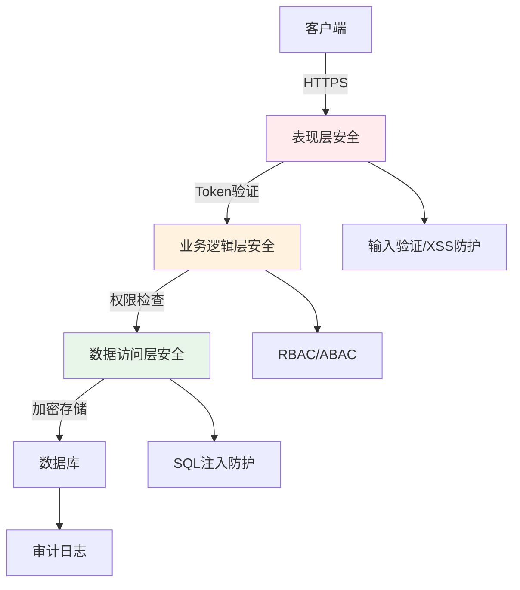

> 📌 **考试重点**：纵深防御思想、RBAC与ABAC的区别、JWT认证机制、各层安全职责划分是安全性设计的核心考点。

> 🔗 **真题关联**：2023年下半年选择题考查了RBAC模型的权限分配机制，2022年考查了HTTPS与TLS在传输层安全中的作用。

---

## 层次式架构性能优化

层次式架构的性能优化需要从各层协同入手，针对瓶颈层实施针对性优化策略[^25]。

**缓存策略**：

- **表现层缓存**：CDN加速静态资源，浏览器缓存减少重复请求
- **业务逻辑层缓存**：本地缓存（Guava/Caffeine）存储热点数据，减少计算开销
- **数据访问层缓存**：Redis/Memcached缓存数据库查询结果，降低数据库压力
- **缓存更新策略**：TTL过期、主动失效、延迟双删保证缓存一致性

**连接池管理**：

- **数据库连接池**：复用数据库连接，避免频繁创建销毁的开销（如HikariCP、Druid）
- **线程池**：控制并发线程数量，防止资源耗尽和系统过载
- **连接池参数**：最小连接数、最大连接数、连接超时时间、空闲检测

**懒加载与批量处理**：

- **懒加载（Lazy Loading）**：延迟加载非必要数据，减少单次查询数据量，提高响应速度
- **批量处理**：将多个操作合并为批量执行，减少网络往返和数据库交互次数
- **分页查询**：大数据集采用分页加载，避免一次性加载过多数据导致内存溢出

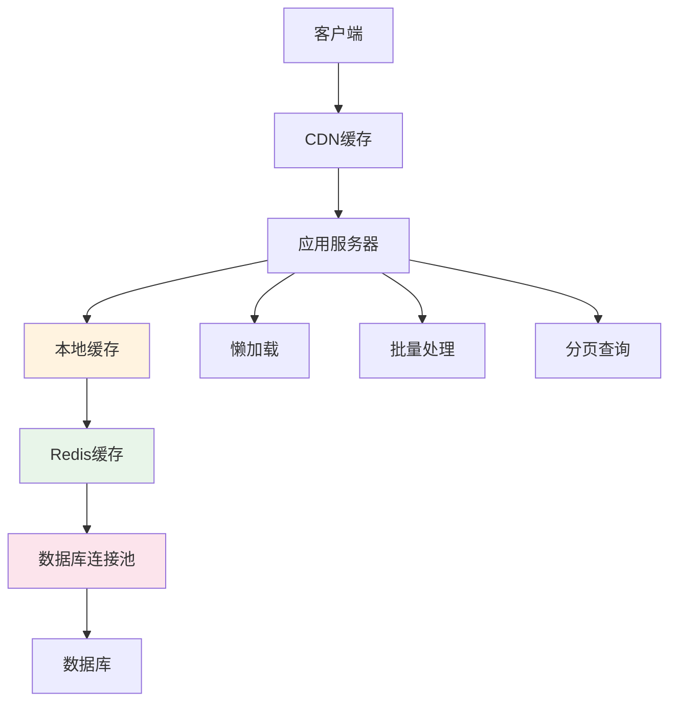

> 📌 **考试重点**：多级缓存架构、缓存一致性策略、连接池参数调优、懒加载与批量处理的适用场景是性能优化的核心考点。

> 🔗 **真题关联**：2023年上半年案例分析题考查了电商系统的缓存设计，2022年选择题考查了数据库连接池的工作原理。

---

## 层次式架构测试策略

层次式架构的测试策略需要针对各层特点设计不同的测试方法，形成完整的测试体系[^26]。

**单元测试**：

- **表现层**：测试控制器/视图模型的逻辑，使用Mock对象隔离依赖
- **业务逻辑层**：测试业务规则和算法，覆盖正常路径和异常路径
- **数据访问层**：测试DAO/Repository方法，使用内存数据库（H2/SQLite）避免依赖真实数据库
- **测试框架**：JUnit、TestNG、Mockito、Spring Boot Test

**集成测试**：

- **层间集成测试**：验证相邻层之间的接口契约和数据传输正确性
- **端到端测试**：模拟完整用户流程，验证系统各层协作是否满足业务需求
- **契约测试**：验证服务提供方和消费方之间的接口契约一致性（Pact框架）

**分层测试与TDD**：

- **分层测试策略**：自底向上（先测数据层）或自顶向下（先测表现层），或三明治测试（同时测顶层和底层）
- **测试驱动开发（TDD）**：先写测试再写实现，红-绿-重构循环
- **TDD在层次式架构中的应用**：从表现层需求出发，逐层推导各层的接口和实现

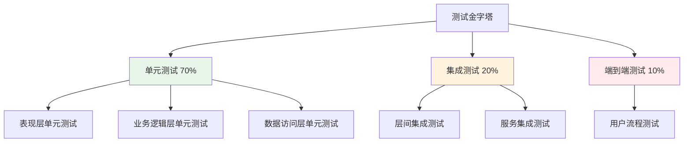

> 📌 **考试重点**：测试金字塔模型、单元测试与集成测试的区别、TDD开发流程、分层测试策略的选择是测试策略的核心考点。

> 🔗 **真题关联**：2022年下半年选择题考查了测试金字塔中各层测试的比例，2021年考查了TDD在层次式架构中的实践步骤。

---
## 参考文献

[^1]: 《系统架构设计师教程(第二版)》P.451 §13.1

[^2]: 《系统架构设计师教程(第二版)》P.451 §13.1

[^3]: 《系统架构设计师教程(第二版)》P.453 §13.2.1

[^4]: 《系统架构设计师教程(第二版)》P.454 §13.2.1

[^5]: 《系统架构设计师教程(第二版)》P.454 §13.2.1

[^6]: 《系统架构设计师教程(第二版)》P.454 §13.2.1

[^7]: 《系统架构设计师教程(第二版)》P.455 §13.2.1

[^8]: 《系统架构设计师教程(第二版)》P.456-457 §13.2.2-13.2.3

[^9]: 《系统架构设计师教程(第二版)》P.458 §13.3

[^10]: 《系统架构设计师教程(第二版)》P.458 §13.3.1

[^11]: 《系统架构设计师教程(第二版)》P.459 §13.3.2

[^12]: 《系统架构设计师教程(第二版)》P.463 §13.3.4

[^13]: 《系统架构设计师教程(第二版)》P.464 §13.4.1

[^14]: 《系统架构设计师教程(第二版)》P.464-467 §13.4.1

[^15]: 《系统架构设计师教程(第二版)》P.469 §13.4.3

[^16]: 《系统架构设计师教程(第二版)》P.471 §13.4.5

[^17]: 《系统架构设计师教程(第二版)》P.472-474 §13.5

[^18]: 《系统架构设计师教程(第二版)》P.475 §13.6

[^19]: 《系统架构设计师教程(第二版)》P.475 §13.6

[^20]: 《系统架构设计师教程(第二版)》P.476-480 §13.7

[^21]: 《系统架构设计师教程(第二版)》P.480-485 §13.7

[^22]: 《系统架构设计师教程(第二版)》P.451-455 §13.1-13.2

[^23]: 《系统架构设计师教程(第二版)》P.458-463 §13.3

[^24]: 《系统架构设计师教程(第二版)》P.464-471 §13.4

[^25]: 《系统架构设计师教程(第二版)》P.472-476 §13.5

[^26]: 《系统架构设计师教程(第二版)》P.476-480 §13.7
