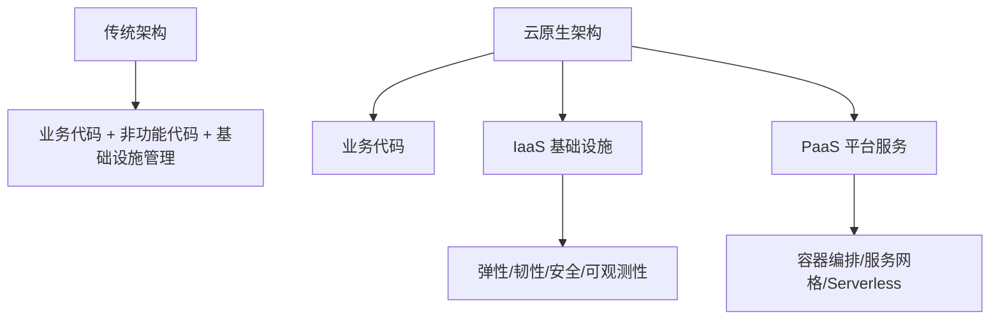
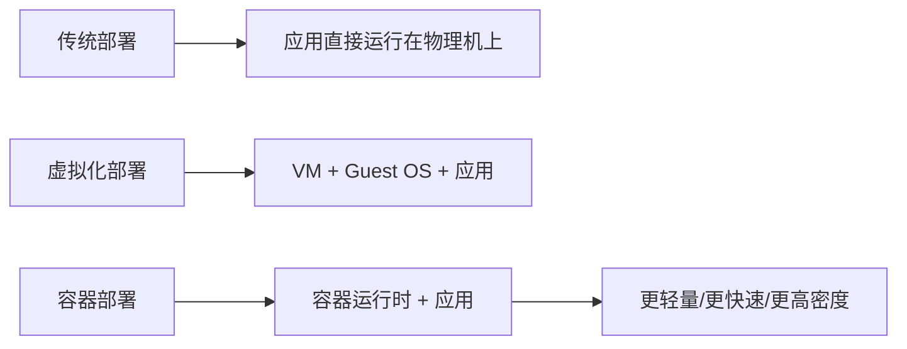
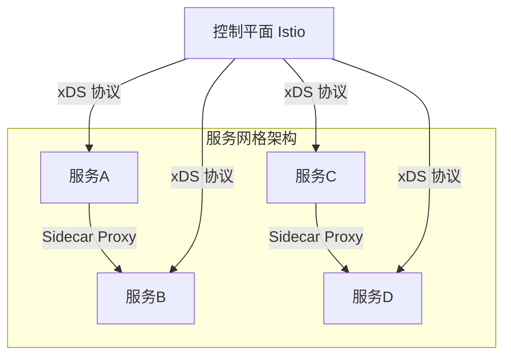

## 云原生定义

云原生（Cloud Native）是构建和运行云应用程序的方法，核心原则包括**微服务**、**容器**、**DevOps**、**持续交付**[^1]。从技术角度，云原生架构是基于云原生技术的一组架构原则和设计模式的集合，旨在将云应用中的非业务代码部分进行最大化的剥离，从而让云设施接管应用中原有的大量非功能特性（如弹性、韧性、安全、可观测性、灰度等）[^2]。

云原生的代码通常包括三部分：业务代码、三方软件、处理非功能特性的代码。其中只有业务代码是核心，另外两个部分都只算附属物。云原生架构相比较传统架构进了一大步，从业务代码中剥离大量非功能性特性到 IaaS 和 PaaS 中，从而减少业务代码开发人员的技术关注范围[^3]。

---

## 云原生架构原则

云原生架构遵循以下核心原则[^4]：

1. **服务化原则**：通过服务化架构把不同生命周期的模块分离出来，分别进行业务迭代，避免迭代频繁模块被慢速模块拖慢。同时服务化架构以面向接口编程，服务内部的功能高度内聚。

2. **弹性原则**：系统的部署规模可以随着业务量的变化而自动伸缩，无须根据事先的容量规划准备固定的硬件和软件资源。好的弹性能力不仅缩短了从采购到上线的时间，降低了企业的 IT 成本。

3. **可观测原则**：主动通过日志、链路跟踪和度量等手段，使得一次点击背后的多次服务调用的耗时、返回值和参数都清晰可见，使运维、开发和业务人员实时掌握软件运行情况。

4. **韧性原则**：当软件所依赖的软硬件组件出现各种异常时，软件表现出来的抵御能力。核心目标是提升软件的平均无故障时间（MTBF）。

5. **所有过程自动化原则**：通过 IaC、GitOps、OAM、Kubernetes Operator 和大量自动化交付工具在 CI/CD 流水线中的实践，实现整个软件交付和运维的自动化。

6. **零信任原则**：默认情况下不应该信任网络内部和外部的任何人/设备/系统，需要基于认证和授权重构访问控制的信任基础。

7. **架构持续演进原则**：云原生架构本身也必须是一个具备持续演进能力的架构，而不是一个封闭式架构。

---

## 容器技术

容器作为标准化软件单元，它将应用及其所有依赖项打包，使应用不再受环境限制，在不同计算环境间快速、可靠地运行[^5]。容器技术相比虚拟机更轻量，启动更快，资源利用率更高。

**Docker** 容器基于操作系统虚拟化技术，共享操作系统内核、轻量、没有资源损耗、秒级启动，极大提升了系统的应用部署密度和弹性。Docker 提出了创新的应用打包规范——Docker 镜像，解耦了应用与运行环境[^6]。

**Kubernetes** 已经成为容器编排的事实标准，被广泛用于自动部署、扩展和管理容器化应用。Kubernetes 提供了分布式应用管理的核心能力[^7]：

- 资源调度：根据应用请求的资源量选择合适的节点运行应用
- 应用部署与管理：支持自动发布与回滚
- 自动修复：节点健康检查自动进行应用迁移
- 服务发现与负载均衡：支持容器化应用之间的相互通信
- 弹性伸缩：监测业务负载进行自动扩容

---

## 微服务架构

微服务模式将后端单体应用拆分为松耦合的多个子应用，每个子应用负责一组子功能。这些子应用称为"微服务"，多个"微服务"共同形成了一个物理独立但逻辑完整的分布式微服务体系[^8]。

微服务设计约束包括[^9]：

- **微服务个体约束**：一个设计良好的微服务应用，所完成的功能在业务域划分上应是相互独立的，具备正交分解特性
- **微服务与微服务之间的横向关系**：可发现性（服务注册中心）和可交互性（与语言无关的远程调用协议）
- **微服务与数据层之间的纵向约束**：数据存储隔离（DSS）原则，数据是微服务的私有资产
- **全局视角下的微服务分布式约束**：全自动化的 CI/CD 流水线、全链路可观测能力

主要微服务技术包括：Apache Dubbo、Spring Cloud、Eclipse MicroProfile、Tars、SOFAStack、DAPR 等[^10]。

---

## 服务网格

服务网格（Service Mesh）是分布式应用在微服务软件架构之上发展起来的新技术，旨在将那些微服务间的连接、安全、流量控制和可观测等通用功能下沉为平台基础设施，实现应用与平台基础设施的解耦[^11]。

服务网格以无侵入的方式实现了应用轻量化。在架构上，服务网格分为**数据平面**和**控制平面**：

- **数据平面**：由 Sidecar 代理（如 Envoy）组成，负责服务间通信的流量管理
- **控制平面**：负责配置和管理数据平面的代理，下发流量规则

主要技术包括 **Istio**、**Linkerd**、**Consul** 等。Istio 的主要组件包括 Pilot（服务发现、流量管理）、Citadel（终端用户认证、流量加密）等[^12]。

---

## 无服务器（Serverless）

Serverless 将"部署"这个动作从运维中"收走"，使开发者不用关心应用运行地点、操作系统、网络配置、CPU 性能等。当业务流量到来/业务事件发生时，云会启动或调度一个已启动的业务进程进行处理，处理完成后云自动会关闭/调度业务进程[^13]。

Serverless 计算包含以下特征[^14]：

- 全托管的计算服务，客户只需要编写代码构建应用
- 通用性，结合云 BaaS API 的能力，能够支撑云上所有重要类型的应用
- 自动弹性伸缩，让用户无需为资源使用提前进行容量规划
- 按量计费，让企业使用成本得有效降低

函数计算（Function as a Service，FaaS）是 Serverless 中最具代表性的产品形态。目前函数计算在普及方面仍存在一定困难，如函数编程以事件驱动方式执行、冷启动会导致应用响应延迟等[^15]。

---

## 参考文献

[^1]: 《系统架构设计师教程(第二版)》P.482 §14.1

[^2]: 《系统架构设计师教程(第二版)》P.484 §14.2.1

[^3]: 《系统架构设计师教程(第二版)》P.484-485 §14.2.1

[^4]: 《系统架构设计师教程(第二版)》P.486-488 §14.2.2

[^5]: 《系统架构设计师教程(第二版)》P.492 §14.3.1

[^6]: 《系统架构设计师教程(第二版)》P.492-493 §14.3.1

[^7]: 《系统架构设计师教程(第二版)》P.493-494 §14.3.1

[^8]: 《系统架构设计师教程(第二版)》P.494 §14.3.2

[^9]: 《系统架构设计师教程(第二版)》P.494-496 §14.3.2

[^10]: 《系统架构设计师教程(第二版)》P.496 §14.3.2

[^11]: 《系统架构设计师教程(第二版)》P.498 §14.3.4

[^12]: 《系统架构设计师教程(第二版)》P.498-499 §14.3.4

[^13]: 《系统架构设计师教程(第二版)》P.496 §14.3.3

[^14]: 《系统架构设计师教程(第二版)》P.496-497 §14.3.3

[^15]: 《系统架构设计师教程(第二版)》P.497 §14.3.3
