## 云原生架构产生背景

云原生（Cloud Native）架构的产生源于云计算技术的快速发展和企业数字化转型的迫切需求。传统架构在面对海量用户、快速迭代、弹性伸缩等需求时暴露出诸多问题[^1]。

**传统架构的痛点**：

- **单体应用难以扩展**：所有功能耦合在一个应用中，无法独立扩展某个模块
- **部署复杂**：环境依赖多，部署周期长，回滚困难
- **运维成本高**：需要大量人力进行服务器维护、监控、故障处理
- **资源利用率低**：为应对峰值预留大量资源，平时利用率不足30%

**云计算的发展阶段**：

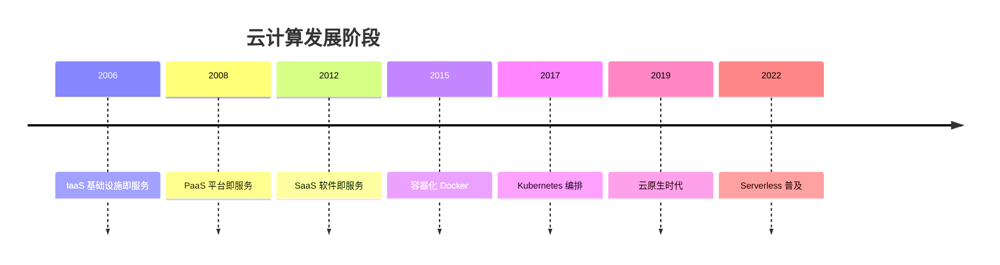

> 📌 **考试重点**：云原生产生的背景、传统架构痛点、云计算发展阶段是理解云原生的基础。

> 🔗 **真题关联**：2022年上半年选择题考查了云计算三种服务模式（IaaS/PaaS/SaaS）的区别。

---

## 云原生定义与内涵

云原生（Cloud Native）是构建和运行云应用程序的方法，核心原则包括**微服务**、**容器**、**DevOps**、**持续交付**[^2]。从技术角度，云原生架构是基于云原生技术的一组架构原则和设计模式的集合，旨在将云应用中的非业务代码部分进行最大化的剥离，从而让云设施接管应用中原有的大量非功能特性（如弹性、韧性、安全、可观测性、灰度等）[^3]。

云原生的代码通常包括三部分：业务代码、三方软件、处理非功能特性的代码。其中只有业务代码是核心，另外两个部分都只算附属物。云原生架构相比较传统架构进了一大步，从业务代码中剥离大量非功能性特性到 IaaS 和 PaaS 中，从而减少业务代码开发人员的技术关注范围[^4]。

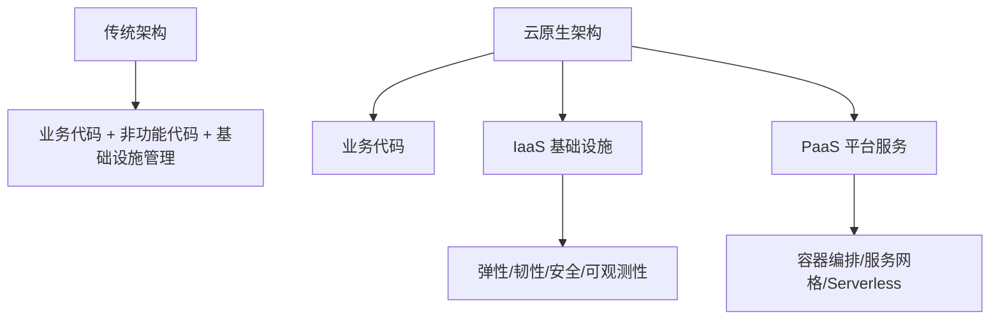

> 📌 **考试重点**：云原生的核心原则（微服务/容器/DevOps/持续交付）、代码三部分组成、非功能特性剥离是高频考点。

> 🔗 **真题关联**：2023年下半年选择题考查了云原生架构中业务代码与非功能代码的分离原则。

---

## 云原生架构原则

云原生架构遵循以下核心原则[^5]：

1. **服务化原则**：通过服务化架构把不同生命周期的模块分离出来，分别进行业务迭代，避免迭代频繁模块被慢速模块拖慢。同时服务化架构以面向接口编程，服务内部的功能高度内聚。

2. **弹性原则**：系统的部署规模可以随着业务量的变化而自动伸缩，无须根据事先的容量规划准备固定的硬件和软件资源。好的弹性能力不仅缩短了从采购到上线的时间，降低了企业的 IT 成本。

3. **可观测原则**：主动通过日志、链路跟踪和度量等手段，使得一次点击背后的多次服务调用的耗时、返回值和参数都清晰可见，使运维、开发和业务人员实时掌握软件运行情况。

4. **韧性原则**：当软件所依赖的软硬件组件出现各种异常时，软件表现出来的抵御能力。核心目标是提升软件的平均无故障时间（MTBF）。

5. **所有过程自动化原则**：通过 IaC、GitOps、OAM、Kubernetes Operator 和大量自动化交付工具在 CI/CD 流水线中的实践，实现整个软件交付和运维的自动化。

6. **零信任原则**：默认情况下不应该信任网络内部和外部的任何人/设备/系统，需要基于认证和授权重构访问控制的信任基础。

7. **架构持续演进原则**：云原生架构本身也必须是一个具备持续演进能力的架构，而不是一个封闭式架构。

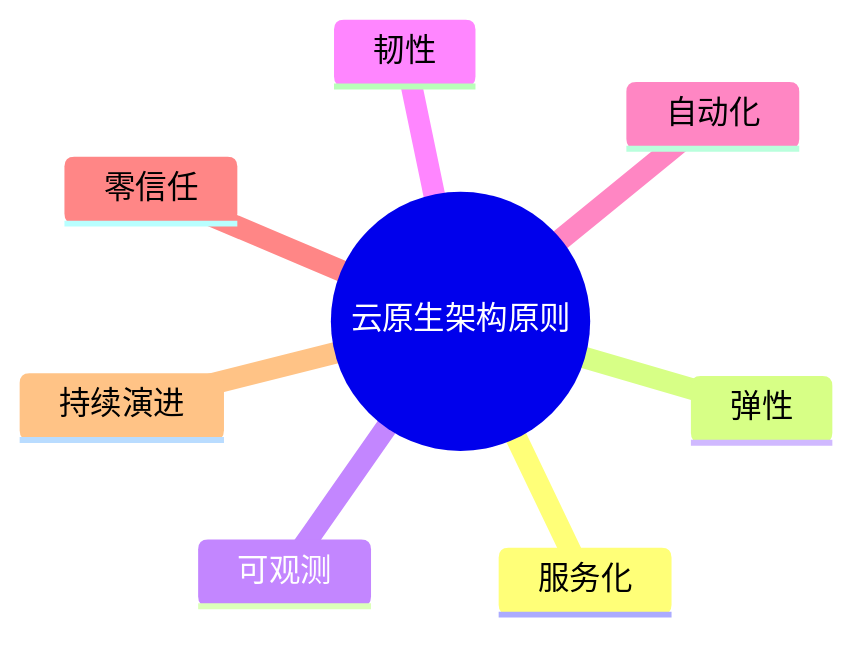

> 📌 **考试重点**：七大架构原则的内涵、应用场景、相互关系是云原生架构的核心考点。

> 🔗 **真题关联**：2021年下半年案例分析题考查了云原生架构中弹性原则与韧性原则的应用。

---

## 容器技术

容器作为标准化软件单元，它将应用及其所有依赖项打包，使应用不再受环境限制，在不同计算环境间快速、可靠地运行[^6]。容器技术相比虚拟机更轻量，启动更快，资源利用率更高。

**Docker** 容器基于操作系统虚拟化技术，共享操作系统内核、轻量、没有资源损耗、秒级启动，极大提升了系统的应用部署密度和弹性。Docker 提出了创新的应用打包规范——Docker 镜像，解耦了应用与运行环境[^7]。

**Kubernetes** 已经成为容器编排的事实标准，被广泛用于自动部署、扩展和管理容器化应用。Kubernetes 提供了分布式应用管理的核心能力[^8]：

- 资源调度：根据应用请求的资源量选择合适的节点运行应用
- 应用部署与管理：支持自动发布与回滚
- 自动修复：节点健康检查自动进行应用迁移
- 服务发现与负载均衡：支持容器化应用之间的相互通信
- 弹性伸缩：监测业务负载进行自动扩容

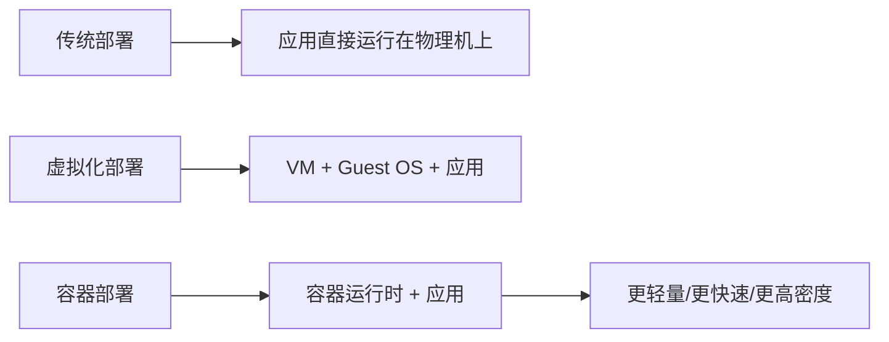

> 📌 **考试重点**：容器与虚拟机的区别、Docker 镜像、Kubernetes 核心能力是容器技术的高频考点。

> 🔗 **真题关联**：2022年上半年选择题考查了 Kubernetes 的服务发现与负载均衡机制。

---

## 微服务架构

微服务模式将后端单体应用拆分为松耦合的多个子应用，每个子应用负责一组子功能。这些子应用称为"微服务"，多个"微服务"共同形成了一个物理独立但逻辑完整的分布式微服务体系[^9]。

微服务设计约束包括[^10]：

- **微服务个体约束**：一个设计良好的微服务应用，所完成的功能在业务域划分上应是相互独立的，具备正交分解特性
- **微服务与微服务之间的横向关系**：可发现性（服务注册中心）和可交互性（与语言无关的远程调用协议）
- **微服务与数据层之间的纵向约束**：数据存储隔离（DSS）原则，数据是微服务的私有资产
- **全局视角下的微服务分布式约束**：全自动化的 CI/CD 流水线、全链路可观测能力

主要微服务技术包括：Apache Dubbo、Spring Cloud、Eclipse MicroProfile、Tars、SOFAStack、DAPR 等[^11]。

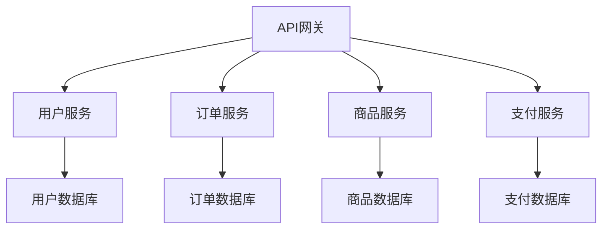

> 📌 **考试重点**：微服务设计约束（个体/横向/纵向/全局）、数据存储隔离（DSS）、微服务技术选型是常考内容。

> 🔗 **真题关联**：2023年上半年案例分析题考查了微服务拆分策略和数据隔离设计。

---

## 服务网格

服务网格（Service Mesh）是分布式应用在微服务软件架构之上发展起来的新技术，旨在将那些微服务间的连接、安全、流量控制和可观测等通用功能下沉为平台基础设施，实现应用与平台基础设施的解耦[^12]。

服务网格以无侵入的方式实现了应用轻量化。在架构上，服务网格分为**数据平面**和**控制平面**：

- **数据平面**：由 Sidecar 代理（如 Envoy）组成，负责服务间通信的流量管理
- **控制平面**：负责配置和管理数据平面的代理，下发流量规则

主要技术包括 **Istio**、**Linkerd**、**Consul** 等。Istio 的主要组件包括 Pilot（服务发现、流量管理）、Citadel（终端用户认证、流量加密）等[^13]。

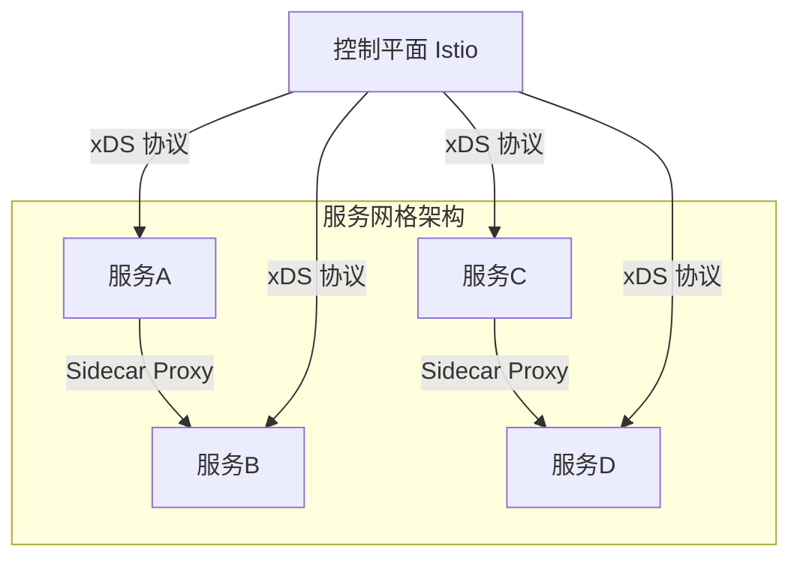

> 📌 **考试重点**：服务网格的定义、数据平面与控制平面的职责、Sidecar 模式、Istio 组件是服务网格的核心考点。

> 🔗 **真题关联**：2021年下半年选择题考查了服务网格中 Sidecar 代理的作用。

---

## 无服务器（Serverless）

Serverless 将"部署"这个动作从运维中"收走"，使开发者不用关心应用运行地点、操作系统、网络配置、CPU 性能等。当业务流量到来/业务事件发生时，云会启动或调度一个已启动的业务进程进行处理，处理完成后云自动会关闭/调度业务进程[^14]。

Serverless 计算包含以下特征[^15]：

- 全托管的计算服务，客户只需要编写代码构建应用
- 通用性，结合云 BaaS API 的能力，能够支撑云上所有重要类型的应用
- 自动弹性伸缩，让用户无需为资源使用提前进行容量规划
- 按量计费，让企业使用成本得有效降低

函数计算（Function as a Service，FaaS）是 Serverless 中最具代表性的产品形态。目前函数计算在普及方面仍存在一定困难，如函数编程以事件驱动方式执行、冷启动会导致应用响应延迟等[^16]。

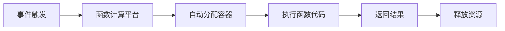

> 📌 **考试重点**：Serverless 的定义、FaaS 特征、冷启动问题、适用场景是 Serverless 的核心考点。

> 🔗 **真题关联**：2022年下半年选择题考查了 Serverless 的按量计费特征。

---

## 云原生架构模式

云原生架构模式是在云原生原则指导下形成的典型架构方案[^17]：

**1. 服务化架构模式**

- 将单体应用拆分为独立部署的服务
- 服务间通过轻量级协议通信
- 支持独立开发、测试、部署和扩展

**2. Mesh 化架构模式**

- 通过服务网格实现服务间通信治理
- 将非业务逻辑下沉到基础设施层
- 支持流量管理、安全、可观测性

**3. Serverless 架构模式**

- 事件驱动，按需执行
- 无需管理服务器和基础设施
- 适合短时、低频、突发流量场景

**4. 存储计算分离模式**

- 计算资源和存储资源独立扩展
- 提高资源利用率和灵活性
- 支持有状态和无状态服务

**5. 分布式事务模式**

- Saga 模式：通过补偿事务保证最终一致性
- TCC 模式：Try-Confirm-Cancel 三阶段提交
- 消息队列模式：通过消息保证最终一致性

**6. 事件驱动架构模式**

- 基于事件的生产者-消费者模型
- 支持异步通信和解耦
- 适合实时数据处理和流计算

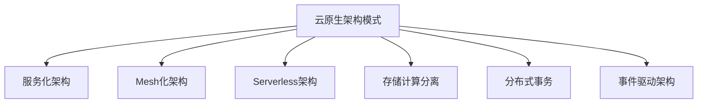

> 📌 **考试重点**：六种云原生架构模式的特点、适用场景、技术实现是案例分析的常考内容。

> 🔗 **真题关联**：2023年下半年案例分析题考查了云原生架构模式在电商系统中的应用。

---

## 云原生反模式

云原生架构在实践中也存在一些常见的反模式，需要避免[^18]：

**1. 庞大的单体应用**

- 将所有功能打包在一个应用中
- 无法独立扩展和部署
- 技术栈锁定，难以演进

**2. 单体应用硬拆微服务**

- 不考虑业务边界，强行拆分
- 导致服务间调用复杂，性能下降
- 分布式事务问题突出

**3. 缺乏自动化能力的微服务**

- 没有 CI/CD 流水线
- 手动部署和测试
- 运维成本高，容易出错

**4. 数据共享微服务**

- 多个服务共享同一个数据库
- 数据耦合，无法独立演进
- 违反数据存储隔离（DSS）原则

**5. 过度工程化**

- 为追求技术先进性而过度设计
- 引入不必要的复杂度
- 增加学习和维护成本

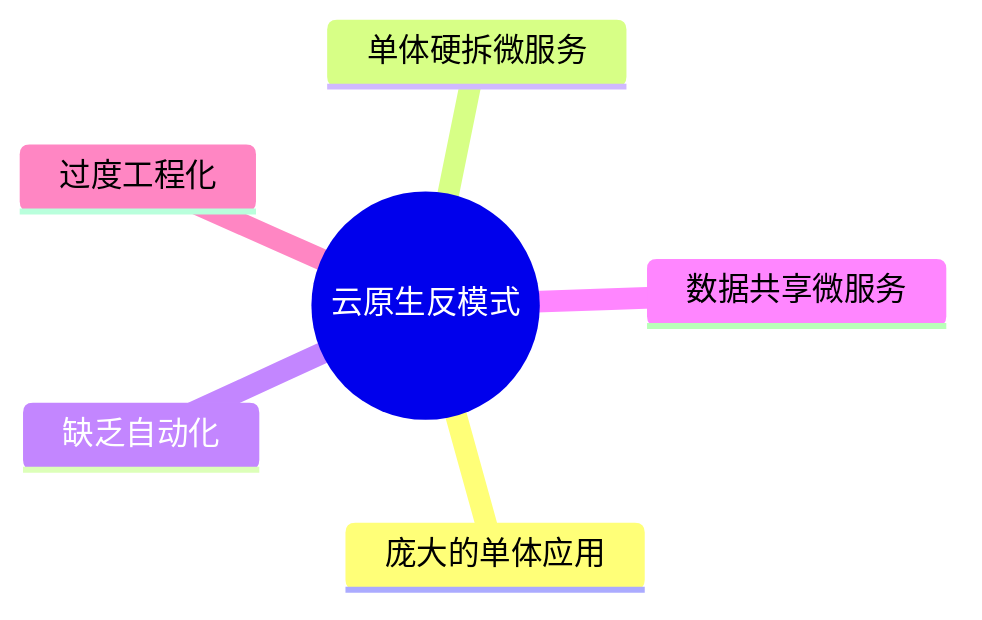

> 📌 **考试重点**：云原生反模式的识别、危害、避免方法是架构设计实践的重要考点。

> 🔗 **真题关联**：2021年上半年案例分析题考查了微服务拆分中的反模式识别。

---

## 云原生架构案例分析：电商平台

某电商平台从单体架构向云原生架构演进，支撑千万级用户并发访问[^19]：

**架构演进历程**：

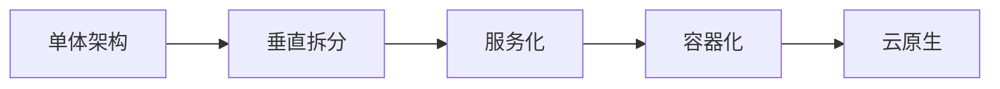

**云原生架构设计**：

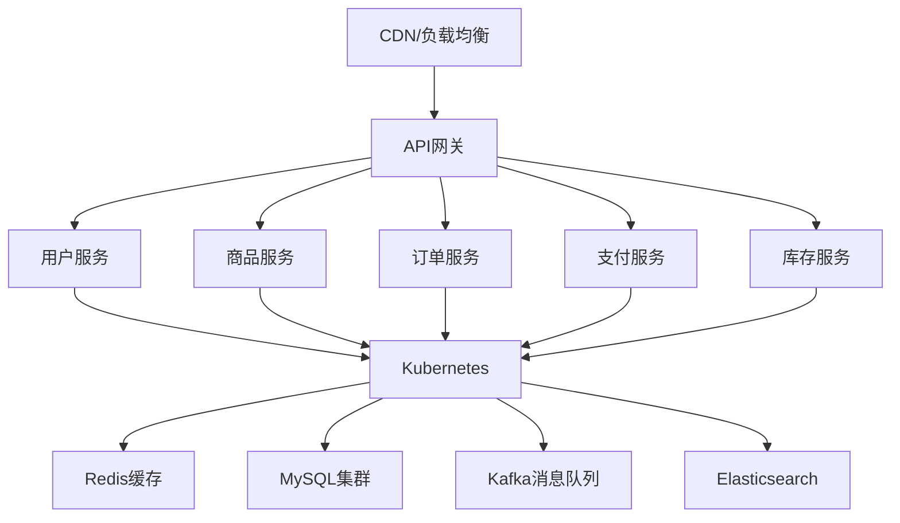

**关键技术决策**：

1. **容器化部署**：Docker + Kubernetes，实现快速部署和弹性伸缩
2. **微服务拆分**：按业务域拆分，每个服务独立部署和扩展
3. **服务网格**：Istio 实现服务间流量管理和安全通信
4. **DevOps 流水线**：GitLab CI/CD，自动化测试和部署
5. **可观测性**：Prometheus + Grafana + Jaeger，全链路监控

**实施效果**：

- 部署频率从每月1次提升到每天10次
- 故障恢复时间从小时级缩短到分钟级
- 资源利用率提升40%

> 📌 **考试重点**：电商平台云原生改造的技术决策、实施效果、演进路径是案例分析的典型考题。

> 🔗 **真题关联**：2023年下半年案例分析题考查了电商平台云原生架构设计与实施。

---

## 云原生可观测性

可观测性（Observability）是云原生架构的核心能力之一，通过日志、指标和链路追踪三大支柱，实现对分布式系统的全面监控和诊断[^20]。

**日志收集**：

- **ELK Stack**：Elasticsearch（存储与检索）+ Logstash（收集与处理）+ Kibana（可视化分析），是传统的日志解决方案
- **Loki**：由 Grafana Labs 开发的轻量级日志聚合系统，与 Prometheus 标签模型一致，存储成本更低，与 Grafana 无缝集成

**链路追踪**：

- **Jaeger**：由 Uber 开源，支持 OpenTracing 标准，提供分布式追踪、性能分析和依赖拓扑
- **Zipkin**：Twitter 开源的分布式追踪系统，轻量级，社区生态丰富
- **核心概念**：Trace（完整请求链路）、Span（单个操作单元）、Context（上下文传递）

**指标监控**：

- **Prometheus**：云原生监控的事实标准，支持多维数据模型、灵活的查询语言 PromQL、强大的告警能力
- **Grafana**：可视化仪表盘平台，支持多种数据源，提供丰富的图表和告警面板
- **核心指标**：RED（Rate/Errors/Duration）和 USE（Utilization/Saturation/Errors）方法论

**告警机制**：

- 基于阈值、趋势、异常检测的告警策略
- 告警分级：P0（紧急）/P1（重要）/P2（一般）
- 告警收敛：抑制、静默、聚合，避免告警风暴

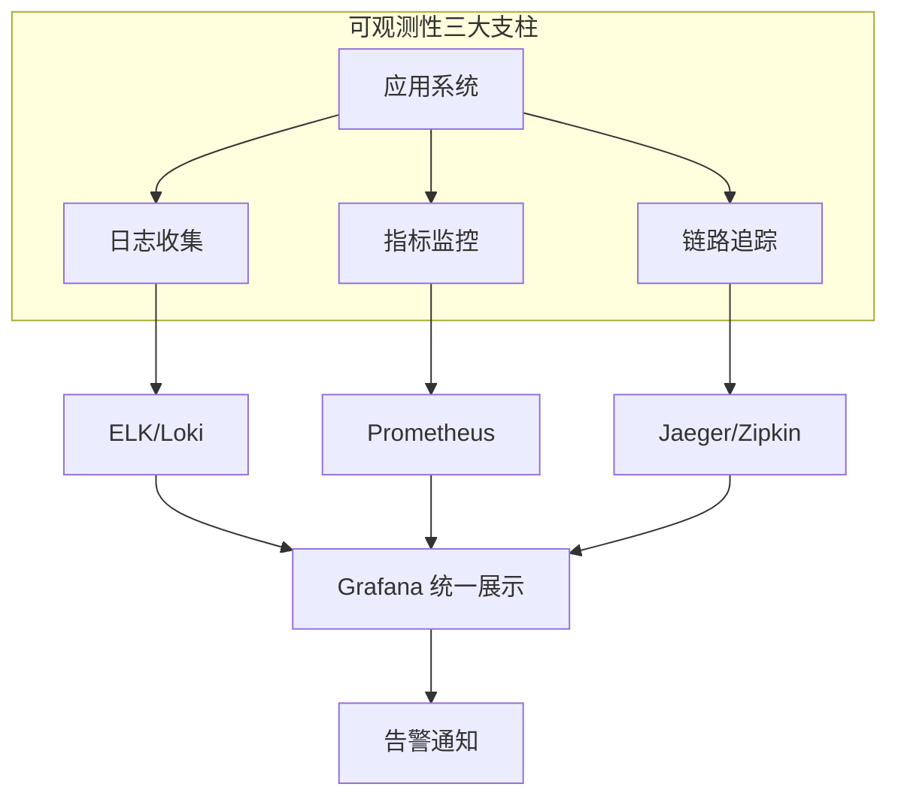

> 📌 **考试重点**：可观测性三大支柱（日志/指标/链路）、ELK 与 Loki 的区别、Prometheus 核心特性、RED/USE 方法论是高频考点。

> 🔗 **真题关联**：2023年上半年选择题考查了 Prometheus 的多维数据模型和 PromQL 查询语言特点。

---

## 云原生安全架构

云原生安全是一个贯穿应用全生命周期的系统性工程，涵盖容器安全、镜像安全、运行时安全、网络安全和密钥管理等多个维度[^21]。

**容器安全**：

- 容器逃逸防护：限制容器特权、使用用户命名空间、Seccomp/AppArmor 安全加固
- 资源隔离：cgroups 限制 CPU/内存/IO，防止资源耗尽攻击
- 最小化镜像：移除不必要的工具和依赖，减小攻击面

**镜像安全扫描**：

- 漏洞扫描：使用 Trivy、Clair、Snyk 等工具扫描镜像中的 CVE 漏洞
- 镜像签名：Notary/Cosign 实现镜像来源验证和完整性校验
- 镜像仓库安全：Harbor 提供漏洞扫描、签名验证、访问控制

**运行时安全**：

- Falco：CNCF 开源的运行时安全检测工具，基于系统调用监控异常行为
- 行为基线：建立容器正常行为模型，检测偏离基线的异常操作

**网络安全策略**：

- 网络隔离：Kubernetes NetworkPolicy 实现 Pod 间网络访问控制
- 零信任网络：默认拒绝，显式授权，服务间 mTLS 加密通信
- 服务网格安全：Istio 自动实现服务间双向 TLS 认证和授权策略

**密钥管理**：

- 敏感信息外置：避免将密码、Token 硬编码在镜像或代码中
- Kubernetes Secrets：原生密钥管理机制，支持加密存储（etcd 加密）
- 外部密钥管理：HashiCorp Vault、AWS KMS、阿里云 KMS 等

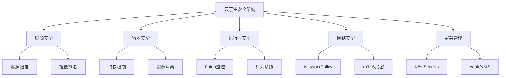

> 📌 **考试重点**：容器逃逸防护手段、镜像漏洞扫描工具、NetworkPolicy 作用、Kubernetes Secrets 机制、零信任安全原则是云原生安全的核心考点。

> 🔗 **真题关联**：2022年下半年案例分析题考查了云原生环境下的安全架构设计和密钥管理方案。

---

## 云原生DevOps实践

DevOps 是云原生架构的核心支柱之一，通过文化、流程和工具的融合，实现开发（Dev）与运维（Ops）的高效协作，缩短交付周期，提升软件质量[^22]。

**CI/CD 流水线**：

- **CI（持续集成）**：代码提交后自动触发编译、单元测试、代码扫描，快速反馈问题
- **CD（持续交付/部署）**：通过自动化流水线将经过验证的代码部署到测试/生产环境
- **常用工具**：Jenkins、GitLab CI、GitHub Actions、CircleCI、Tekton（云原生 CI/CD）

**GitOps**：

- 以 Git 仓库为唯一可信源（Single Source of Truth），所有基础设施和应用配置都存储在 Git 中
- 声明式配置：通过 YAML/JSON 描述期望状态，由控制器自动同步
- 工具代表：ArgoCD、Flux，自动监控 Git 变更并同步到 Kubernetes 集群
- 优势：版本控制、审计追踪、回滚能力、权限管理

**基础设施即代码（IaC）**：

- 使用代码管理和配置基础设施，替代手动操作
- **Terraform**：HashiCorp 出品，多云资源编排的事实标准，支持 AWS/Azure/阿里云等
- **Pulumi**：使用 TypeScript/Python/Go 等通用编程语言定义基础设施
- **Crossplane**：Kubernetes 原生的 IaC 方案，通过 CRD 管理云资源

**自动化测试**：

- 单元测试：验证最小功能单元的正确性
- 集成测试：验证服务间接口和交互
- 端到端测试：模拟用户场景验证完整流程
- 混沌工程：Chaos Mesh、Litmus 等工具主动注入故障，验证系统韧性

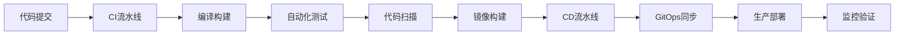

> 📌 **考试重点**：CI/CD 概念与流程、GitOps 核心思想（Git 为唯一可信源）、IaC 工具对比（Terraform/Pulumi/Crossplane）、混沌工程的概念是 DevOps 的高频考点。

> 🔗 **真题关联**：2023年下半年选择题考查了 GitOps 中声明式配置和自动同步的原理。

---

## 云原生与数字化转型

云原生架构是企业数字化转型的核心技术引擎，通过弹性、敏捷、高效的技术底座，支撑业务创新和快速响应市场变化[^23]。

**云原生在数字化转型中的作用**：

- **业务敏捷性**：微服务架构支持独立迭代，新功能上线周期从月缩短到天
- **资源弹性**：按需伸缩的云计算能力，降低 IT 成本，支撑业务峰值
- **技术标准化**：容器和 Kubernetes 成为跨云标准，避免厂商锁定
- **组织协同**：DevOps 文化打破部门壁垒，提升跨团队协作效率

**遗留系统迁移策略**：

- **绞杀者模式（Strangler Fig）**：逐步用新服务替换旧系统功能，而非一次性重构
- **防腐层（Anti-Corruption Layer）**：在遗留系统与新系统之间建立隔离层，保护新领域模型
- **并行运行**：新旧系统并行运行，通过灰度发布逐步切换流量
- **数据迁移**：先同步后切换，使用 CDC（Change Data Capture）保持双写一致性

**云原生成熟度模型**：

- **Level 1 - 初始级**：单体应用，手动部署，基础监控
- **Level 2 - 容器化**：应用容器化，基础编排，初步自动化
- **Level 3 - 微服务化**：服务拆分，CI/CD 流水线，服务网格
- **Level 4 - 云原生**：全面自动化，GitOps，可观测性，混沌工程
- **Level 5 - 智能化**：AI 驱动运维，自动扩缩容，智能告警与根因分析

**迁移挑战与应对**：

- 组织文化：从瀑布到敏捷的思维转变，需要培训和激励机制
- 技术债务：遗留系统文档缺失，需要逐步梳理和重构
- 人才缺口：云原生技术栈复杂，需要持续投入人才培养

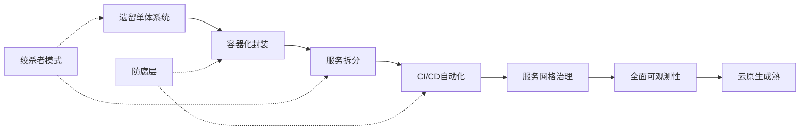

> 📌 **考试重点**：遗留系统迁移策略（绞杀者模式/防腐层）、云原生成熟度模型五个层级、云原生对数字化转型的价值是案例分析的常考内容。

> 🔗 **真题关联**：2021年上半年案例分析题考查了企业遗留系统向云原生架构迁移的策略选择和实施路径。

---

## 参考文献

[^1]: 《系统架构设计师教程(第二版)》P.482 §14.1

[^2]: 《系统架构设计师教程(第二版)》P.484 §14.2.1

[^3]: 《系统架构设计师教程(第二版)》P.484-485 §14.2.1

[^4]: 《系统架构设计师教程(第二版)》P.484-485 §14.2.1

[^5]: 《系统架构设计师教程(第二版)》P.486-488 §14.2.2

[^6]: 《系统架构设计师教程(第二版)》P.492 §14.3.1

[^7]: 《系统架构设计师教程(第二版)》P.492-493 §14.3.1

[^8]: 《系统架构设计师教程(第二版)》P.493-494 §14.3.1

[^9]: 《系统架构设计师教程(第二版)》P.494 §14.3.2

[^10]: 《系统架构设计师教程(第二版)》P.494-496 §14.3.2

[^11]: 《系统架构设计师教程(第二版)》P.496 §14.3.2

[^12]: 《系统架构设计师教程(第二版)》P.498 §14.3.4

[^13]: 《系统架构设计师教程(第二版)》P.498-499 §14.3.4

[^14]: 《系统架构设计师教程(第二版)》P.496 §14.3.3

[^15]: 《系统架构设计师教程(第二版)》P.496-497 §14.3.3

[^16]: 《系统架构设计师教程(第二版)》P.497 §14.3.3

[^17]: 《系统架构设计师教程(第二版)》P.488-492 §14.2.3

[^18]: 《系统架构设计师教程(第二版)》P.492 §14.2.4

[^19]: 《系统架构设计师教程(第二版)》P.499-502 §14.4

[^20]: 《系统架构设计师教程(第二版)》P.502-505 §14.5（可观测性）

[^21]: 《系统架构设计师教程(第二版)》P.505-508 §14.6（安全架构）

[^22]: 《系统架构设计师教程(第二版)》P.508-511 §14.7（DevOps实践）

[^23]: 《系统架构设计师教程(第二版)》P.511-514 §14.8（数字化转型）
