## SOA概述

面向服务的体系结构（Service-Oriented Architecture，SOA）从应用和原理的角度看，目前有两种业界公认的标准定义[^1]。

从应用的角度定义，SOA 是一种应用框架，它着眼于日常的业务应用，并将它们划分为单独的业务功能和流程，即所谓的服务。SOA 使用户可以构建、部署和整合这些服务，且无需依赖应用程序及其运行平台，从而提高业务流程的灵活性[^2]。

从软件的基本原理定义，SOA 是一个组件模型，它将应用程序的不同功能单元（称为服务）通过这些服务之间定义良好的接口和契约联系起来。接口是采用中立的方式进行定义的，它应该独立于实现服务的硬件平台、操作系统和编程语言[^3]。作为软件架构师，后一种从软件原理方面的定义，对日常工作更具指导性。

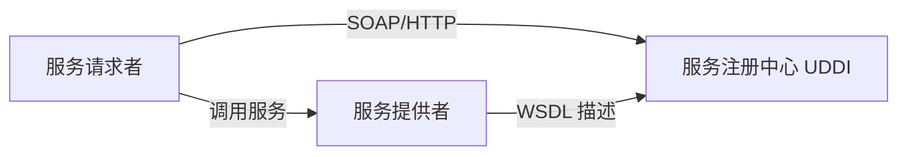

> 📌 **考试重点**：SOA 的两种定义（应用框架角度和组件模型角度）、服务的基本特征是基础考点。

> 🔗 **真题关联**：2021年上半年选择题考查了 SOA 的定义和服务特征。

---

## SOA关键技术

SOA 的关键技术包括 Web 服务（SOAP/WSDL/UDDI）、企业服务总线（ESB）、服务注册与发现、BPEL 业务流程编排等[^4]。

**Web 服务三剑客**[^5]：

- **SOAP（Simple Object Access Protocol）**：简单对象访问协议，是一个基于 XML 的协议，用于在分散或分布式的环境中交换信息
- **WSDL（Web Services Description Language）**：Web 服务描述语言，是一个用来描述 Web 服务和说明如何与 Web 服务通信的 XML 语言
- **UDDI（Universal Discovery Description and Integration）**：通用描述、发现和集成协议，使得商业实体能够彼此发现

**BPEL（Business Process Execution Language for Web Services）**[^6]：面向 Web 服务的业务流程执行语言，它是一种使用 Web 服务定义和执行业务流程的语言。使用 BPEL，用户可以通过组合、编排和协调 Web 服务自上而下地实现面向服务的体系结构。

**企业服务总线（ESB）**[^7]：是过去消息中间件的发展，采用了"总线"这样一种模式来管理和简化应用之间的集成拓扑结构，以广为接受的开放标准为基础来支持应用之间在消息、事件和服务的级别上动态地互联互通。

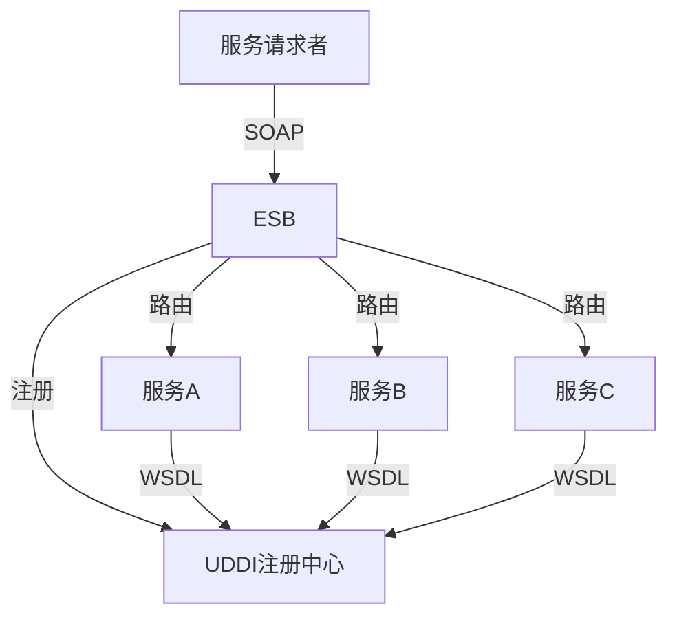

> 📌 **考试重点**：Web 服务三剑客（SOAP/WSDL/UDDI）、ESB 的功能、BPEL 的作用是 SOA 技术的核心考点。

> 🔗 **真题关联**：2022年下半年选择题考查了 SOAP 协议的特点和 WSDL 的作用。

---

## SOA与微服务的区别

SOA 与微服务的区别主要体现在以下几个方面[^8]：

| 维度   | SOA                      | 微服务                     |
| ------ | ------------------------ | -------------------------- |
| 粒度   | 较粗，强调企业级服务复用 | 更细，单个服务专注单一功能 |
| 部署   | 通常集中式部署           | 独立部署                   |
| 通信   | 常通过 ESB 企业服务总线  | 去中心化，直接调用         |
| 数据库 | 通常共享数据库           | 每个服务有自己的数据库     |
| 技术栈 | 相对统一                 | 去中心化，技术栈灵活       |

微服务架构是 SOA 架构思想的一种扩展，更加强调服务个体的独立性、拆分粒度更小[^9]。SOA 强调企业级集成，使用 ESB；微服务强调独立部署，去中心化，每个服务有自己的数据库。

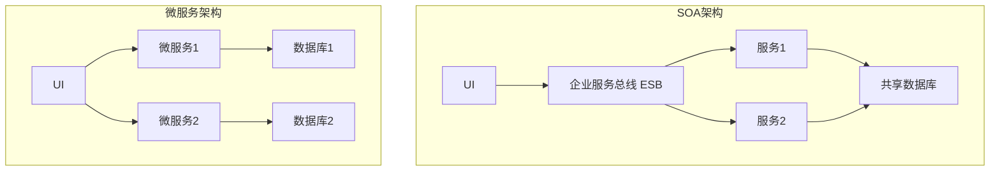

> 📌 **考试重点**：SOA 与微服务在粒度、部署、通信、数据库、技术栈五个维度的区别是高频考点。

> 🔗 **真题关联**：2023年上半年选择题考查了 SOA 与微服务在数据库设计上的区别。

---

## RESTful API设计

REST 是 Roy Thomas Fielding 博士在他的一篇论文中提出的一个概念，设计了一种新的互联网软件架构风格。REST 的设计不只是要适用于互联网环境，而是一个普遍的设计理念，目的是为了让不同的软件或者应用程序在任何网络环境下都可以进行信息的互相传递[^10]。

RESTful 即 REST 式的，是对遵循 REST 设计思想同时满足设计约束的一类架构设计或应用程序的统称。REST 的核心概念包括[^11]：

- **资源（Resource）**：REST 是以资源为中心构建，资源可以是一个订单、一幅图片等。将互联网中一切暴露给客户端的事物都可以看作是一种资源，借助 URI 标识 Web 上的资源。
- **表述（Representational）**：REST 中用表述描述资源在 Web 中某一个时间的状态。客户端和服务端借助 RESTful API 传递数据，实际就是在进行资源表述的交互。
- **状态转移（State Transfer）**：状态分为应用状态和资源状态。应用状态保存在客户端，资源状态在服务端保存。状态转移借助 HTTP 方法来实现，如 GET、POST、PUT、DELETE 等。
- **超链接**：在资源表述中除了处理当前请求资源信息外，还会添加一些相关资源 URI，便于用户请求这些资源。

REST 是一种设计风格而不是一个架构。RESTful 借助 HTTP、JSON、URI、HTML 等 Web 服务开发中广泛使用的标准和协议，通过 HTTP 方法操作资源状态，遵循 REST 设计原则实现应用程序或服务架构[^12]。

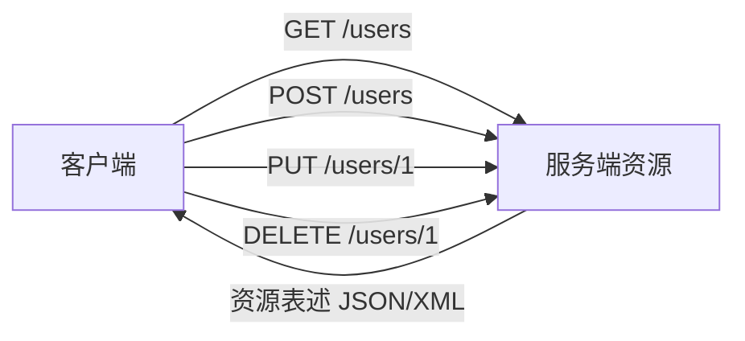

> 📌 **考试重点**：REST 的核心概念（资源/表述/状态转移/超链接）、HTTP 方法语义、REST 与 SOAP 的区别是常考内容。

> 🔗 **真题关联**：2022年上半年选择题考查了 REST 中状态转移的含义。

---

## SOA设计原则

SOA 架构中，继承了来自对象和组件设计的各种原则，如封装、自我包含等。那些保证服务的灵活性、松散耦合和重用能力的设计原则，对 SOA 架构来说同样是非常重要的[^13]。

常见 SOA 设计原则包括：

1. **无状态**：以避免服务请求者依赖于服务提供者的状态
2. **单一实例**：避免功能冗余
3. **明确定义的接口**：服务的接口由 WSDL 定义，用于指明服务的公共接口与其内部专用实现之间的界线
4. **自包含和模块化**：服务封装了那些在业务上稳定、重复出现的活动和组件
5. **粗粒度**：服务数量不应该太大，依靠消息交互而不是远程过程调用（RPC）
6. **服务之间的松耦合性**：服务使用者看到的是服务的接口，其位置、实现技术和当前状态等对使用者是不可见的
7. **重用能力**：服务应该是可以重用的
8. **互操作性、兼容和策略声明**：策略成为一个越来越重要的方面，可以是技术相关或业务语义相关的内容

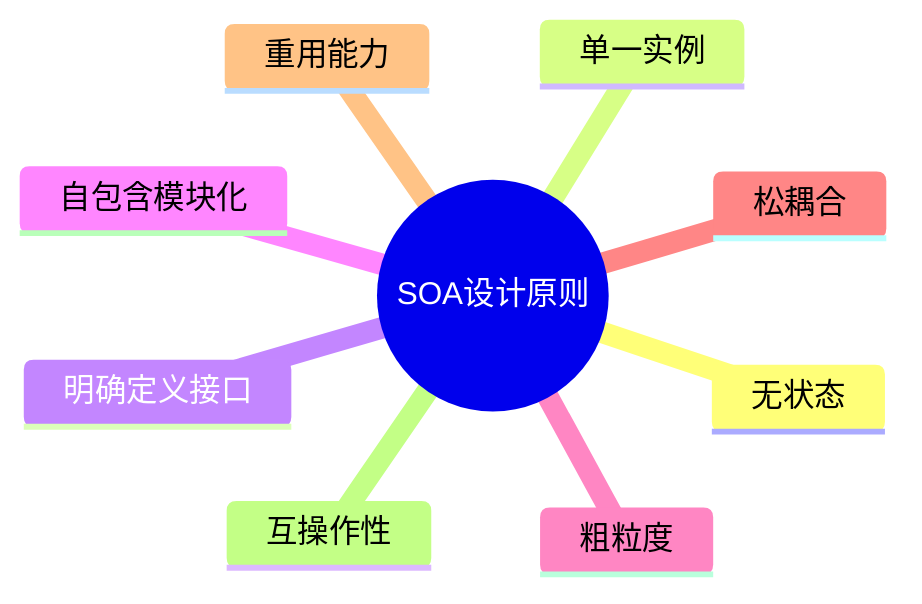

> 📌 **考试重点**：SOA 八大设计原则的内涵、应用场景、相互关系是 SOA 设计的核心考点。

> 🔗 **真题关联**：2021年下半年选择题考查了 SOA 中粗粒度原则的含义。

---

## SOA实施要点

构建 SOA 架构时需要注意以下问题[^14]：

1. **原有系统架构中的集成需求**：当架构师基于 SOA 来构建一个企业级的系统架构时，一定要注意对原有系统架构中的集成需求进行细致的分析和整理。SOA 可以通过利用当前系统已有的资源来重复利用系统中现有的系统和资源。

2. **服务粒度的控制**：SOA 系统中服务粒度的控制是一项十分重要的设计任务。通常来说，对于将暴露在整个系统外部的服务推荐使用粗粒度的接口，而相对较细粒度的服务接口通常用于企业系统架构的内部。

3. **无状态服务的设计**：SOA 系统架构中的具体服务应该都是独立的、自包含的请求，在实现这些服务的时候不需要前一个请求的状态，即服务不应该依赖于其他服务的上下文和状态。

4. **选择 SOA 解决方案**：尽量选择能进行全局规划的方案，充分考虑企业自身的需求，从平台、实施等技术方面进行考察。

5. **业务流程分析**：建立服务模型（自顶向下分解法、业务目标分析法、自底向上分析法），建立业务流程（业务对象、服务接口、业务流程）。

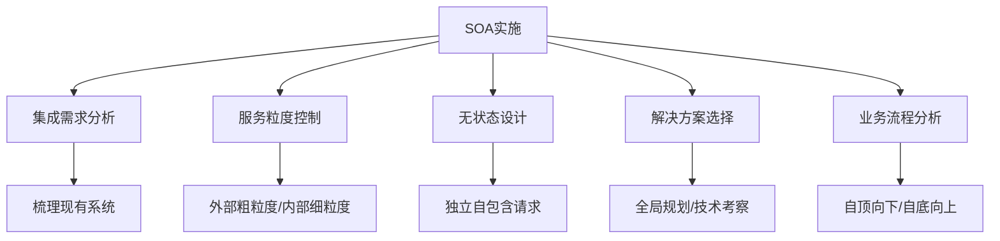

> 📌 **考试重点**：SOA 实施的五大要点（集成需求/粒度控制/无状态/方案选择/流程分析）是案例分析的常考内容。

> 🔗 **真题关联**：2020年下半年案例分析题考查了 SOA 实施中的服务粒度控制策略。

---

## ESB企业服务总线

企业服务总线（Enterprise Service Bus，ESB）是 SOA 架构中的核心组件，它采用了"总线"模式来管理和简化应用之间的集成拓扑结构[^15]。

**ESB 的核心功能**：

- **服务路由**：根据消息内容将请求路由到相应的服务
- **协议转换**：支持不同协议之间的转换（如 SOAP 到 REST）
- **消息转换**：对消息格式进行转换和映射
- **服务编排**：将多个服务组合成业务流程
- **安全控制**：提供认证、授权、加密等安全功能
- **监控管理**：对服务调用进行监控和日志记录

**ESB 与微服务网关的区别**：

| 维度 | ESB | API 网关 |
|------|-----|----------|
| 架构 | 集中式 | 去中心化 |
| 功能 | 复杂（路由/转换/编排） | 简单（路由/限流/认证） |
| 性能 | 可能成为瓶颈 | 高性能 |
| 适用 | SOA 企业级集成 | 微服务 API 管理 |

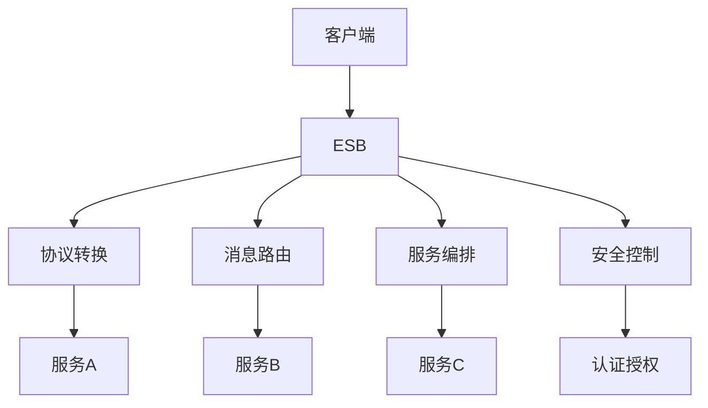

> 📌 **考试重点**：ESB 的核心功能、ESB 与 API 网关的区别是 SOA 技术的重要考点。

> 🔗 **真题关联**：2022年下半年选择题考查了 ESB 的服务路由功能。

---

## SOA架构模式

SOA 架构中常见的架构模式包括[^16]：

**1. 服务注册表模式**

- 服务提供者将服务注册到注册中心
- 服务消费者从注册中心查找服务
- 支持服务的动态发现和绑定

**2. 服务编排模式**

- 通过编排引擎将多个服务组合成业务流程
- 支持复杂的业务逻辑和事务管理
- 典型技术：BPEL、BPMN

**3. 服务组合模式**

- 将细粒度服务组合成粗粒度服务
- 支持服务的复用和层次化组织
- 提高服务的可维护性

**4. 事件驱动模式**

- 基于事件的生产者-消费者模型
- 支持异步通信和解耦
- 适合实时数据处理和通知

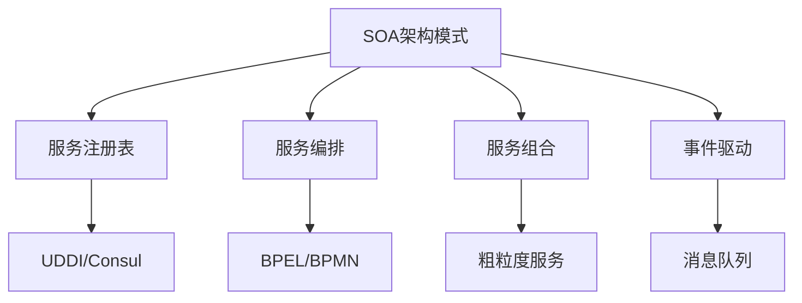

> 📌 **考试重点**：四种 SOA 架构模式的特点、技术实现、适用场景是架构设计的进阶考点。

> 🔗 **真题关联**：2021年上半年案例分析题考查了 SOA 架构模式在系统集成中的应用。

---

## SOA治理

SOA 治理是确保 SOA 架构成功实施的关键，涉及服务生命周期管理、版本控制、监控、安全等多个方面[^17]。

**服务生命周期管理**：

- **服务设计**：定义服务接口、契约和实现
- **服务开发**：实现服务逻辑和接口
- **服务测试**：功能测试、性能测试、安全测试
- **服务部署**：将服务部署到生产环境
- **服务运行**：监控服务运行状态
- **服务退役**：下线不再使用的服务

**服务版本控制**：

- 支持服务的多版本共存
- 提供版本兼容性保证
- 支持灰度发布和回滚

**服务监控**：

- 服务调用次数和响应时间
- 服务可用性和错误率
- 服务依赖关系和调用链

**服务安全策略**：

- 身份认证和授权
- 数据加密和传输安全
- 访问控制和审计日志

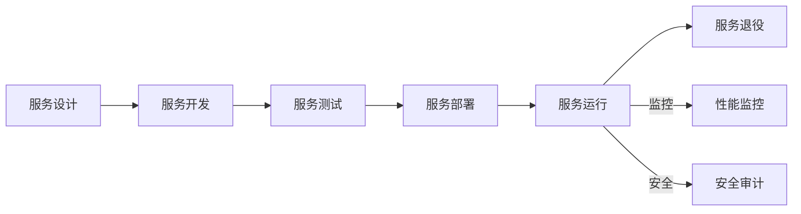

> 📌 **考试重点**：SOA 治理的四个方面（生命周期/版本控制/监控/安全）是 SOA 实施的重要考点。

> 🔗 **真题关联**：2020年上半年选择题考查了 SOA 治理中服务生命周期管理的阶段。

---

## SOA案例分析：金融企业集成

某大型金融企业采用 SOA 架构整合多个业务系统，实现跨系统业务流程自动化[^18]：

**背景与挑战**：

- 原有系统包括核心银行系统、信贷系统、支付系统、风控系统等
- 系统间通过点对点接口连接，耦合度高
- 业务流程跨多个系统，效率低下

**SOA 架构设计**：

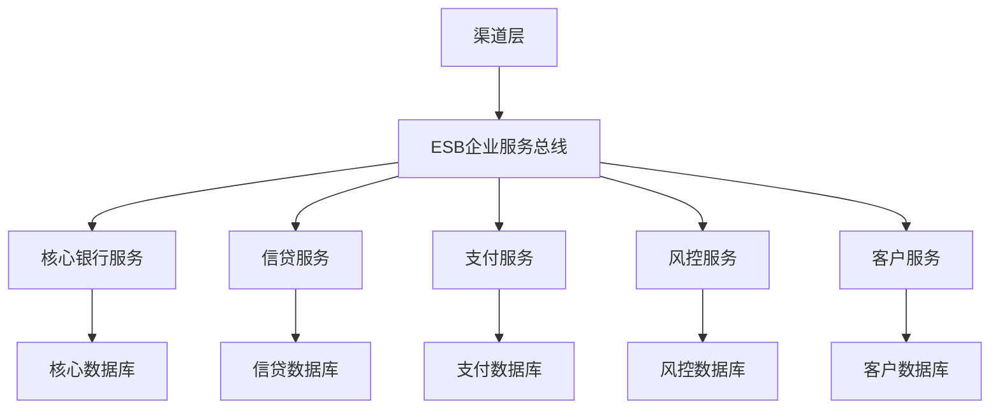

**关键技术决策**：

1. **ESB 选型**：采用 IBM Integration Bus 作为企业服务总线
2. **服务拆分**：按业务域拆分服务，每个服务独立部署
3. **服务编排**：使用 BPEL 实现跨系统业务流程
4. **数据一致性**：通过 Saga 模式保证分布式事务最终一致性

**实施效果**：

- 业务流程处理时间从小时级缩短到分钟级
- 系统间耦合度降低，新系统接入时间缩短50%
- 服务复用率提升至70%

> 📌 **考试重点**：金融企业 SOA 集成的架构设计、技术决策、实施效果是案例分析的典型考题。

> 🔗 **真题关联**：2022年下半年案例分析题考查了金融企业 SOA 架构设计与实施。

---

## SOA服务组合与编排

服务组合与编排是 SOA 架构中实现复杂业务流程的核心机制，通过将多个细粒度服务组合成粗粒度的业务流程[^19]。

**服务组合模式**：

- **编排（Orchestration）**：由中央控制器（编排引擎）统一协调各个服务的调用顺序，服务之间不直接通信。编排器掌握全局流程状态，适合复杂的长事务业务流程。
- **协同（Choreography）**：各服务之间通过事件订阅和发布进行协作，没有中央控制器。每个服务完成自己的任务后触发事件，其他服务监听并响应，适合松耦合的异步场景。

**BPEL业务流程**：

BPEL（Business Process Execution Language）是面向 Web 服务的业务流程执行语言，支持顺序、并行、条件分支、循环等流程控制结构，可将多个 Web 服务编排成完整的业务流程。

**服务编排引擎**：

- 解析 BPEL 流程定义
- 管理服务实例的生命周期
- 处理服务调用的异常和补偿
- 维护流程状态持久化

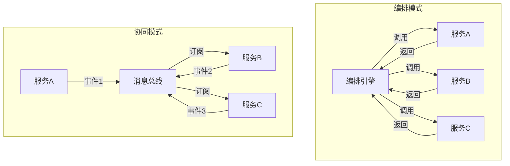

> 📌 **考试重点**：编排与协同两种模式的区别（中央控制 vs 事件驱动）、BPEL 的作用、编排引擎的核心功能是高频考点。

> 🔗 **真题关联**：2021年下半年选择题考查了服务编排与协同的区别。

---

## SOA服务安全

SOA 服务安全涉及服务认证、消息加密、数字签名等多个层面，确保分布式服务调用的安全性和可信度[^20]。

**WS-Security 服务认证**：

WS-Security 是 Web 服务安全规范，定义了在 SOAP 消息中传递安全令牌的标准方式，支持用户名/密码、X.509 证书、SAML 令牌等多种认证机制。

**消息加密**：

- **传输层加密**：使用 SSL/TLS 保护传输通道
- **消息层加密**：使用 XML Encryption 对 SOAP 消息体进行加密，实现端到端安全
- **加密算法**：支持对称加密（AES）和非对称加密（RSA）

**数字签名**：

使用 XML Signature 对 SOAP 消息进行数字签名，确保消息的完整性、不可抵赖性和发送者身份验证。

**安全令牌服务（STS）**：

STS 是 WS-Trust 规范定义的服务，负责颁发、验证和续订安全令牌。客户端向 STS 申请令牌，携带令牌访问目标服务，实现单点登录和联合身份认证。

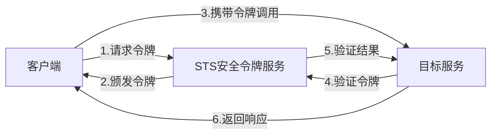

> 📌 **考试重点**：WS-Security 的认证机制、消息层加密与传输层加密的区别、STS 的作用是安全架构的重要考点。

> 🔗 **真题关联**：2022年上半年选择题考查了 WS-Security 在 SOAP 消息中的安全令牌传递机制。

---

## SOA服务版本管理

服务版本管理是 SOA 治理的关键环节，确保服务的演进不会影响现有消费者，支持平滑升级和回滚[^21]。

**服务版本策略**：

- **URL 版本**：在 URL 中包含版本号（如 /v1/users、/v2/users）
- **Header 版本**：通过 HTTP Header 传递版本信息（如 Accept-Version: v2）
- **消息体版本**：在请求消息中携带版本标识

**向后兼容**：

- 只添加新字段，不删除或修改已有字段
- 使用可选字段和默认值
- 保持接口语义不变
- 遵循开闭原则：对扩展开放，对修改关闭

**版本路由**：

ESB 或 API 网关根据请求中的版本标识，将请求路由到对应版本的服务实例，支持多版本服务并行运行。

**灰度发布**：

- 先向小部分用户发布新版本
- 监控新版本的性能和错误率
- 逐步扩大发布范围
- 发现问题时可快速回滚到旧版本

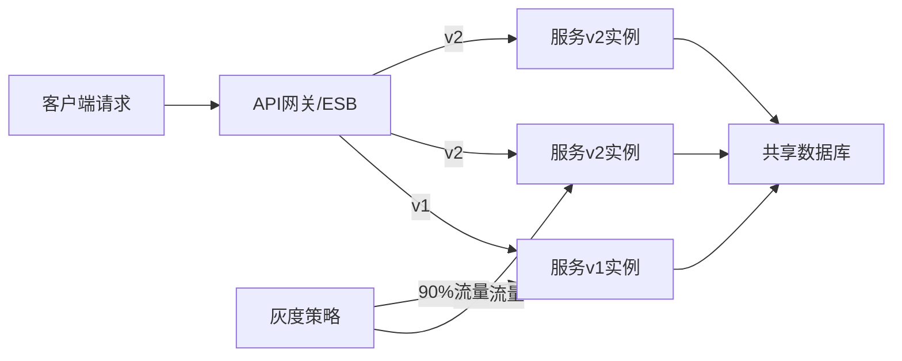

> 📌 **考试重点**：版本管理策略（URL/Header/消息体）、向后兼容原则、灰度发布的流程是服务治理的核心考点。

> 🔗 **真题关联**：2023年下半年选择题考查了 SOA 服务版本管理中的向后兼容原则。

---

## SOA与遗留系统集成

SOA 架构实施中，遗留系统（Legacy System）的集成是常见挑战，需要通过封装、适配和渐进式迁移策略实现平滑过渡[^22]。

**遗留系统封装**：

将遗留系统的功能封装为 Web 服务，对外暴露标准接口。封装方式包括：
- **包装器模式**：在遗留系统外层添加服务接口层
- **网关模式**：通过网关将遗留协议转换为标准 Web 服务协议

**适配器模式**：

适配器将遗留系统的数据格式、协议和接口转换为 SOA 标准格式。常见适配器包括：
- 协议适配器（如将 COBOL 调用转为 SOAP）
- 数据适配器（如将固定长度记录转为 XML/JSON）
- 接口适配器（如将专有 API 转为标准 WSDL）

**数据转换**：

遗留系统与 SOA 服务之间的数据模型差异需要通过数据转换层处理：
- 字段映射与类型转换
- 编码格式转换（如 EBCDIC 到 UTF-8）
- 数据结构重组（如扁平记录到层次化 XML）

**渐进式迁移策略**：

1. **封装阶段**：将遗留系统功能封装为服务，不改变原有系统
2. **共存阶段**：新服务与遗留系统并行运行，逐步切换流量
3. **替换阶段**：用新实现逐步替换遗留功能
4. **退役阶段**：完全下线遗留系统

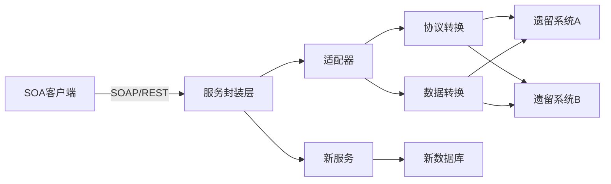

> 📌 **考试重点**：遗留系统封装方式、适配器模式的应用、渐进式迁移四阶段是系统集成的典型考点。

> 🔗 **真题关联**：2020年下半年案例分析题考查了遗留系统向 SOA 架构迁移的策略设计。

---

## 参考文献

[^19]: 《系统架构设计师教程(第二版)》P.520-523 §15.4

[^20]: 《系统架构设计师教程(第二版)》P.528-535 §15.8

[^21]: 《系统架构设计师教程(第二版)》P.528-535 §15.8

[^22]: 《系统架构设计师教程(第二版)》P.535-539 §15.9-15.10

[^1]: 《系统架构设计师教程(第二版)》P.513 §15.1.1

[^2]: 《系统架构设计师教程(第二版)》P.513 §15.1.1

[^3]: 《系统架构设计师教程(第二版)》P.513 §15.1.1

[^4]: 《系统架构设计师教程(第二版)》P.513-515 §15.1-15.2

[^5]: 《系统架构设计师教程(第二版)》P.514 §15.2.1

[^6]: 《系统架构设计师教程(第二版)》P.513 §15.1.2

[^7]: 《系统架构设计师教程(第二版)》P.517 §15.3.1

[^8]: 《系统架构设计师教程(第二版)》P.515 §15.2.3

[^9]: 《系统架构设计师教程(第二版)》P.515 §15.2.3

[^10]: 《系统架构设计师教程(第二版)》P.523 §15.4.4

[^11]: 《系统架构设计师教程(第二版)》P.523-524 §15.4.4

[^12]: 《系统架构设计师教程(第二版)》P.524 §15.4.4

[^13]: 《系统架构设计师教程(第二版)》P.527-528 §15.7

[^14]: 《系统架构设计师教程(第二版)》P.535-539 §15.9-15.10

[^15]: 《系统架构设计师教程(第二版)》P.517-520 §15.3

[^16]: 《系统架构设计师教程(第二版)》P.520-523 §15.4

[^17]: 《系统架构设计师教程(第二版)》P.528-535 §15.8

[^18]: 《系统架构设计师教程(第二版)》P.539-545 §15.11
