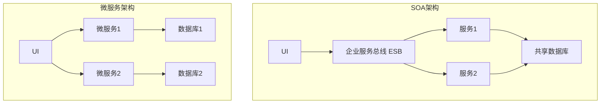
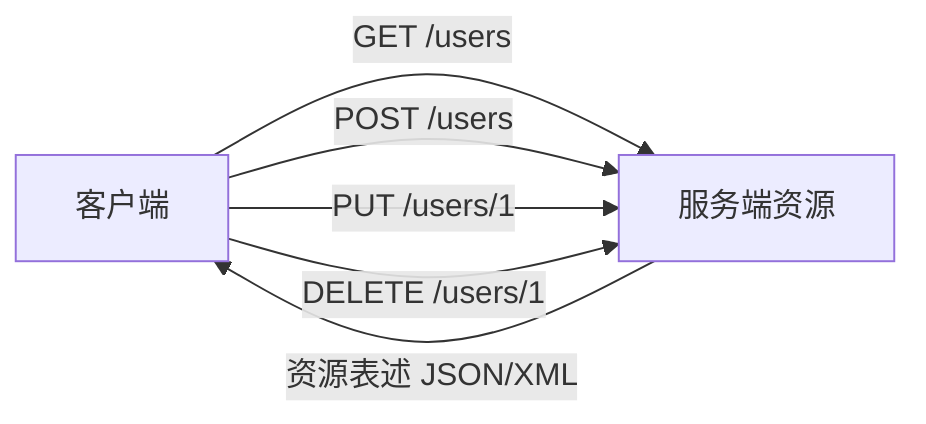

## SOA 定义

面向服务的体系结构（Service-Oriented Architecture，SOA）从应用和原理的角度看，目前有两种业界公认的标准定义[^1]。

从应用的角度定义，SOA 是一种应用框架，它着眼于日常的业务应用，并将它们划分为单独的业务功能和流程，即所谓的服务。SOA 使用户可以构建、部署和整合这些服务，且无需依赖应用程序及其运行平台，从而提高业务流程的灵活性[^2]。

从软件的基本原理定义，SOA 是一个组件模型，它将应用程序的不同功能单元（称为服务）通过这些服务之间定义良好的接口和契约联系起来。接口是采用中立的方式进行定义的，它应该独立于实现服务的硬件平台、操作系统和编程语言[^3]。作为软件架构师，后一种从软件原理方面的定义，对日常工作更具指导性。

---

## SOA 关键技术

SOA 的关键技术包括 Web 服务（SOAP/WSDL/UDDI）、企业服务总线（ESB）、服务注册与发现、BPEL 业务流程编排等[^4]。

**Web 服务三剑客**[^5]：

- **SOAP（Simple Object Access Protocol）**：简单对象访问协议，是一个基于 XML 的协议，用于在分散或分布式的环境中交换信息
- **WSDL（Web Services Description Language）**：Web 服务描述语言，是一个用来描述 Web 服务和说明如何与 Web 服务通信的 XML 语言
- **UDDI（Universal Discovery Description and Integration）**：通用描述、发现和集成协议，使得商业实体能够彼此发现

**BPEL（Business Process Execution Language for Web Services）**[^6]：面向 Web 服务的业务流程执行语言，它是一种使用 Web 服务定义和执行业务流程的语言。使用 BPEL，用户可以通过组合、编排和协调 Web 服务自上而下地实现面向服务的体系结构。

**企业服务总线（ESB）**[^7]：是过去消息中间件的发展，采用了"总线"这样一种模式来管理和简化应用之间的集成拓扑结构，以广为接受的开放标准为基础来支持应用之间在消息、事件和服务的级别上动态地互联互通。

---

## SOA 与微服务的区别

SOA 与微服务的区别主要体现在以下几个方面[^8]：

| 维度   | SOA                      | 微服务                     |
| ------ | ------------------------ | -------------------------- |
| 粒度   | 较粗，强调企业级服务复用 | 更细，单个服务专注单一功能 |
| 部署   | 通常集中式部署           | 独立部署                   |
| 通信   | 常通过 ESB 企业服务总线  | 去中心化，直接调用         |
| 数据库 | 通常共享数据库           | 每个服务有自己的数据库     |
| 技术栈 | 相对统一                 | 去中心化，技术栈灵活       |

微服务架构是 SOA 架构思想的一种扩展，更加强调服务个体的独立性、拆分粒度更小[^9]。SOA 强调企业级集成，使用 ESB；微服务强调独立部署，去中心化，每个服务有自己的数据库。

---

## RESTful API 设计

REST 是 Roy Thomas Fielding 博士在他的一篇论文中提出的一个概念，设计了一种新的互联网软件架构风格。REST 的设计不只是要适用于互联网环境，而是一个普遍的设计理念，目的是为了让不同的软件或者应用程序在任何网络环境下都可以进行信息的互相传递[^10]。

RESTful 即 REST 式的，是对遵循 REST 设计思想同时满足设计约束的一类架构设计或应用程序的统称。REST 的核心概念包括[^11]：

- **资源（Resource）**：REST 是以资源为中心构建，资源可以是一个订单、一幅图片等。将互联网中一切暴露给客户端的事物都可以看作是一种资源，借助 URI 标识 Web 上的资源。
- **表述（Representational）**：REST 中用表述描述资源在 Web 中某一个时间的状态。客户端和服务端借助 RESTful API 传递数据，实际就是在进行资源表述的交互。
- **状态转移（State Transfer）**：状态分为应用状态和资源状态。应用状态保存在客户端，资源状态在服务端保存。状态转移借助 HTTP 方法来实现，如 GET、POST、PUT、DELETE 等。
- **超链接**：在资源表述中除了处理当前请求资源信息外，还会添加一些相关资源 URI，便于用户请求这些资源。

REST 是一种设计风格而不是一个架构。RESTful 借助 HTTP、JSON、URI、HTML 等 Web 服务开发中广泛使用的标准和协议，通过 HTTP 方法操作资源状态，遵循 REST 设计原则实现应用程序或服务架构[^12]。

---

## SOA 设计原则

SOA 架构中，继承了来自对象和组件设计的各种原则，如封装、自我包含等。那些保证服务的灵活性、松散耦合和重用能力的设计原则，对 SOA 架构来说同样是非常重要的[^13]。

常见 SOA 设计原则包括：

1. **无状态**：以避免服务请求者依赖于服务提供者的状态
2. **单一实例**：避免功能冗余
3. **明确定义的接口**：服务的接口由 WSDL 定义，用于指明服务的公共接口与其内部专用实现之间的界线
4. **自包含和模块化**：服务封装了那些在业务上稳定、重复出现的活动和组件
5. **粗粒度**：服务数量不应该太大，依靠消息交互而不是远程过程调用（RPC）
6. **服务之间的松耦合性**：服务使用者看到的是服务的接口，其位置、实现技术和当前状态等对使用者是不可见的
7. **重用能力**：服务应该是可以重用的
8. **互操作性、兼容和策略声明**：策略成为一个越来越重要的方面，可以是技术相关或业务语义相关的内容

---

## SOA 实施要点

构建 SOA 架构时需要注意以下问题[^14]：

1. **原有系统架构中的集成需求**：当架构师基于 SOA 来构建一个企业级的系统架构时，一定要注意对原有系统架构中的集成需求进行细致的分析和整理。SOA 可以通过利用当前系统已有的资源来重复利用系统中现有的系统和资源。

2. **服务粒度的控制**：SOA 系统中服务粒度的控制是一项十分重要的设计任务。通常来说，对于将暴露在整个系统外部的服务推荐使用粗粒度的接口，而相对较细粒度的服务接口通常用于企业系统架构的内部。

3. **无状态服务的设计**：SOA 系统架构中的具体服务应该都是独立的、自包含的请求，在实现这些服务的时候不需要前一个请求的状态，即服务不应该依赖于其他服务的上下文和状态。

4. **选择 SOA 解决方案**：尽量选择能进行全局规划的方案，充分考虑企业自身的需求，从平台、实施等技术方面进行考察。

5. **业务流程分析**：建立服务模型（自顶向下分解法、业务目标分析法、自底向上分析法），建立业务流程（业务对象、服务接口、业务流程）。

---

## 参考文献

[^1]: 《系统架构设计师教程(第二版)》P.513 §15.1.1

[^2]: 《系统架构设计师教程(第二版)》P.513 §15.1.1

[^3]: 《系统架构设计师教程(第二版)》P.513 §15.1.1

[^4]: 《系统架构设计师教程(第二版)》P.513-515 §15.1-15.2

[^5]: 《系统架构设计师教程(第二版)》P.514 §15.2.1

[^6]: 《系统架构设计师教程(第二版)》P.513 §15.1.2

[^7]: 《系统架构设计师教程(第二版)》P.517 §15.3.1

[^8]: 《系统架构设计师教程(第二版)》P.515 §15.2.3

[^9]: 《系统架构设计师教程(第二版)》P.515 §15.2.3

[^10]: 《系统架构设计师教程(第二版)》P.523 §15.4.4

[^11]: 《系统架构设计师教程(第二版)》P.523-524 §15.4.4

[^12]: 《系统架构设计师教程(第二版)》P.524 §15.4.4

[^13]: 《系统架构设计师教程(第二版)》P.527-528 §15.7

[^14]: 《系统架构设计师教程(第二版)》P.535-539 §15.9-15.10
