## 嵌入式系统概述

嵌入式系统（Embedded System）是为了特定应用而专门构建且将信息处理过程和物理过程紧密结合为一体的专用计算机系统[^1]。嵌入式系统架构设计具有以下特点：

1. **专用性强**：针对特定应用场景设计，软件和硬件紧密结合
2. **实时性要求高**：许多嵌入式系统需要对外部事件快速响应
3. **资源受限**：受限于内存、CPU、功耗等物理资源
4. **可靠性要求高**：常用于工业控制、医疗设备等关键领域
5. **功耗敏感**：尤其在物联网和移动设备中至关重要

嵌入式系统的发展大致经历了五个阶段：单片微型计算机（SCM）阶段、微控制器（MUC）阶段、片上系统（SoC）阶段、以 Internet 为基础的嵌入式系统阶段、在智能化和云技术推动下的嵌入式系统阶段[^2]。

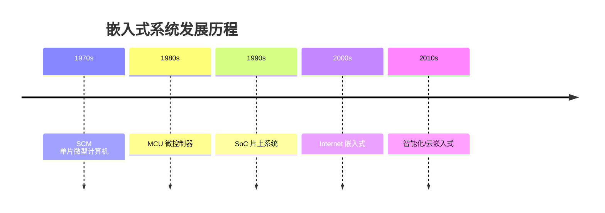

> 📌 **考试重点**：嵌入式系统的五大特点、发展历程五个阶段是基础考点。

> 🔗 **真题关联**：2022年上半年选择题考查了嵌入式系统与通用计算机系统的区别。

---

## 嵌入式系统硬件体系结构

从传统意义上讲，嵌入式系统主要由嵌入式微处理器（控制器 MCU）、存储器（RAM/ROM）、内（外）总线逻辑、定时/计数器、看门狗电路、I/O 接口和外部设备等部件组成[^3]。

嵌入式处理器按类型可分为[^4]：

- **微处理器（MPU）**：将微处理器装配在专门设计的电路板上，只保留与嵌入式应用有关的母板功能
- **微控制器（MCU）**：又称单片机，单片化，体积小，功耗和成本下降，可靠性提高
- **信号处理器（DSP）**：对系统结构和指令进行特殊设计，适合于执行 DSP 算法
- **图形处理器（GPU）**：可执行渲染 3D 图形等图像的半导体芯片
- **片上系统（SoC）**：将大部分嵌入式系统功能集成到一块或几块芯片中

存储器按使用类型可分为只读存储器（ROM）和随机存储器（RAM）[^5]。ROM 包括 MASK ROM、PROM、EPROM、EEPROM、Flash Memory；RAM 包括 DRAM、SRAM、SDRAM、DDR SDRAM 等。

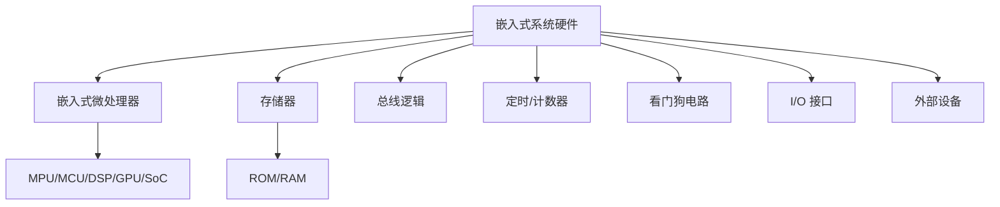

> 📌 **考试重点**：嵌入式处理器五种类型（MPU/MCU/DSP/GPU/SoC）、存储器分类是硬件体系结构的核心考点。

> 🔗 **真题关联**：2021年下半年选择题考查了 MCU 与 MPU 的区别。

---

## 嵌入式软件架构原理

嵌入式系统智能化发展过程中，嵌入式软件架构逐步形成。典型的嵌入式软件架构包括[^6]：

- 应用软件
- 嵌入式（实时）操作系统（RTOS）
- 板级支持包（BSP）
- 硬件层

目前比较典型的嵌入式软件架构有两种：**层次化模式架构**和**递归模式架构**[^7]。

**层次化模式架构**主要设计思想是：当一个系统存在高层次的抽象，这些抽象的表现形式是一个个的抽象概念，而这些抽象概念需要具体的低层概念进行实现时，就可采用层次化模式。层次化模式可以分为封闭型和开放性。封闭型一层中的对象只能调用同一层或下一个底层的对象提供的方法；开放型一层中的对象可以调用同一层或低于该层任意一层的对象提供的方法[^8]。

**递归模式架构**解决的问题是：需要将一个非常复杂的系统进行分解，并且还要确保分解过程是可扩展的。递归模式实际上是对系统的抽象：系统中的交互协作可以在不同的层次上进行抽象，只不过每层反映的细节不同而已[^9]。

**GOA（Generic Open Architecture）** 架构是美国汽车工程学会（SAE）在 AS4893 标准中定义的通用开放式架构，主要特点包括可移植性、可互操作性、可剪裁性、易获得性[^10]。

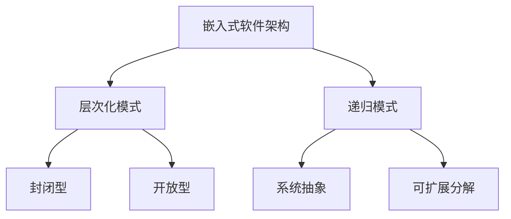

> 📌 **考试重点**：层次化模式（封闭型/开放型）、递归模式、GOA 架构特点是软件架构原理的核心考点。

> 🔗 **真题关联**：2020年下半年选择题考查了层次化模式架构中封闭型与开放型的区别。

---

## 嵌入式操作系统

嵌入式操作系统（Embedded Operating System，EOS）是指用于嵌入式系统的操作系统。嵌入式操作系统是一种用途广泛的系统软件，负责嵌入式系统的全部软、硬件资源分配、任务调度、控制、协调并行活动等工作[^11]。

与通用操作系统相比，嵌入式操作系统具备以下主要特点[^12]：

- 可剪裁性：支持开放性和可伸缩性的体系结构
- 可移植性：操作系统通常可运行在不同体系结构的处理器和开发板上
- 强实时性：实时性通常较强，可用于各种设备的控制
- 强紧凑性：由于资源受限，代码需要紧凑、精炼
- 高质量代码：广泛用于安全攸关系统，要求代码质量可靠
- 强定制性：可根据目标系统的不同需求进行专业化定制
- 标准接口：可提供设备统一的驱动接口
- 强稳定性、弱交互性：一旦运行就不需要用户过多干预
- 强确定性：任务调度和资源管理应确保在规定时间、容量内不发生任务超时和资源枯竭
- 可固化性：通常被固化在计算机系统的 ROM 中

嵌入式操作系统通常分为两类：一类是面向控制、通信等领域的嵌入式实时操作系统（如 VxWorks、Nucleus）；另一类是面向消费电子产品的非实时嵌入式操作系统（如 Android、iOS、WinCE）[^13]。

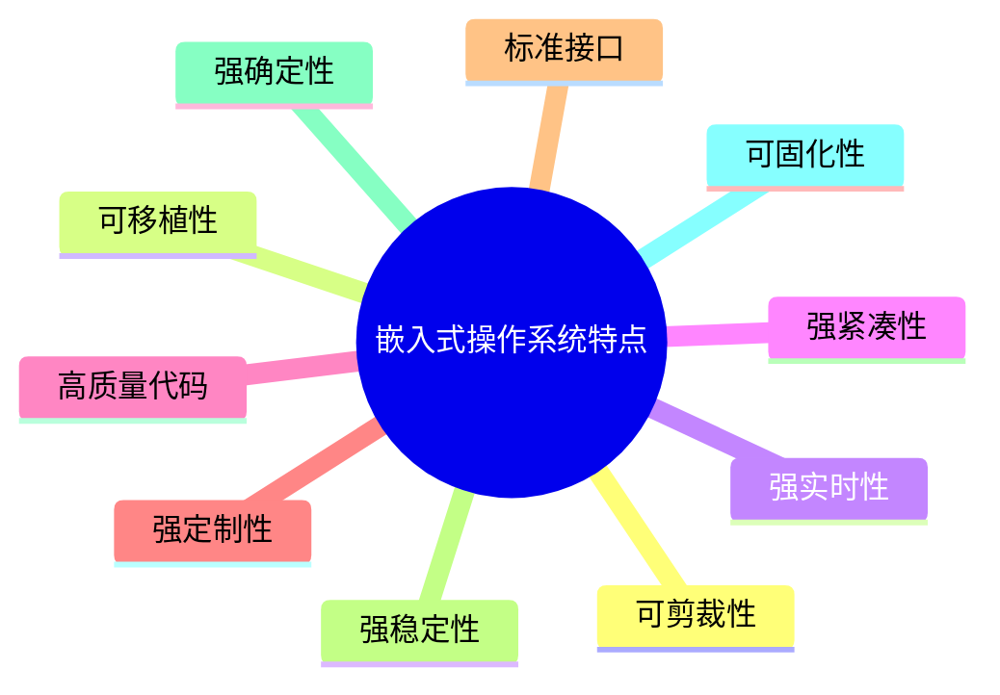

> 📌 **考试重点**：嵌入式操作系统的十大特点、实时与非实时分类是高频考点。

> 🔗 **真题关联**：2022年下半年选择题考查了嵌入式操作系统可剪裁性的含义。

---

## 嵌入式操作系统内核架构

从内核架构来划分，嵌入式操作系统可分为**宏内核（Monolithic Kernel）**和**微内核（Micro Kernel）**[^14]。

**宏内核**：宏内核管理着用户程序和硬件之间的系统资源，在宏内核架构中，用户服务和内核服务在同一空间中实现。宏内核代码耦合度非常高，甚至内核的功能组件代码可以互相调用。如 VxWorks 5.5、VRTX 等嵌入式操作系统均采用宏内核。

**微内核**：内核管理着所有的系统资源，在微内核中用户服务和内核服务在不同的地址空间中实现。微内核中的执行速度相对较慢，但系统结构相当清晰，有利于协作开发；有良好的移植性，代码量非常少；有相当好的伸缩性、扩展性。如嵌入式 Linux、L4、WinCE 等。

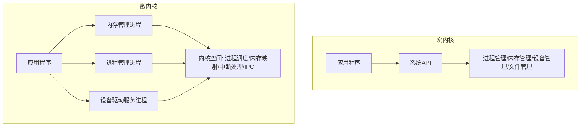

> 📌 **考试重点**：宏内核与微内核的区别、典型系统（VxWorks/Linux/L4/WinCE）是内核架构的核心考点。

> 🔗 **真题关联**：2021年上半年选择题考查了微内核架构中用户服务与内核服务的地址空间关系。

---

## 嵌入式实时调度算法

嵌入式操作系统的任务实时调度问题是操作系统任务管理的核心技术。根据任务优先级的确定时机，调度算法分为静态调度和动态调度两类；根据任务在运行过程中能否被打断，分为抢占式调度和非抢占式调度[^15]。

典型强实时调度算法包括：

1. **最早截止时间优先（EDF）算法**：根据任务的开始截止时间来确定任务的优先级。截止时间愈早，其优先级愈高。该算法既可用于剥夺式调度，也可用于非剥夺式调度方式中[^16]。

2. **最低松弛度优先（LLF）算法**：根据任务紧急（或松弛）的程度，来确定任务的优先级。任务的紧急程度愈高，该任务被赋予的优先级就愈高。松弛度即进程的富裕时间，计算公式为：松弛度 = 必须完成时间 - 其本身的运行时间 - 当前时间[^17]。

3. **单调速率调度算法（RMS）**：一种静态优先级调度算法，是经典的周期性任务调度算法。RMS 的基本思路是任务的优先级与它的周期表现为单调函数的关系，任务的周期越短，优先级越高。单调速率调度可认为是最优的，因为如果一组进程不能由此算法调度，它不能由任何其他分配静态优先级的算法来调度[^18]。

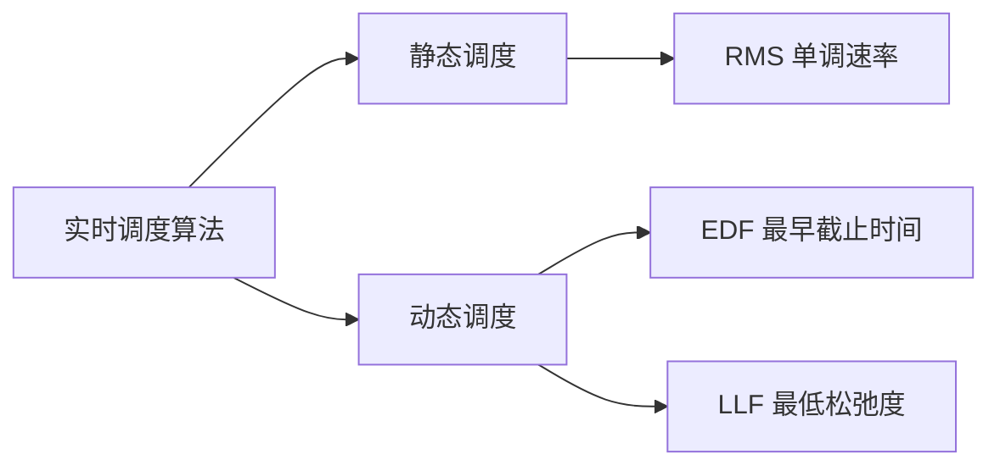

> 📌 **考试重点**：EDF、LLF、RMS 三种调度算法的原理、优先级确定方式、适用场景是实时调度的核心考点。

> 🔗 **真题关联**：2023年上半年选择题考查了 RMS 调度算法中优先级与任务周期的关系。

---

## 嵌入式数据库

嵌入式数据库嵌入应用程序进程，无需独立服务。常见的嵌入式数据库包括 SQLite（文件型）、eXtremeDB（内存型）、Berkeley DB（键值型）等[^19]。

嵌入式数据库的特点：

- 嵌入应用程序进程，无需独立服务进程
- 资源占用少，适合资源受限环境
- 管理简单，部署方便
- 通常支持 SQL 或键值接口

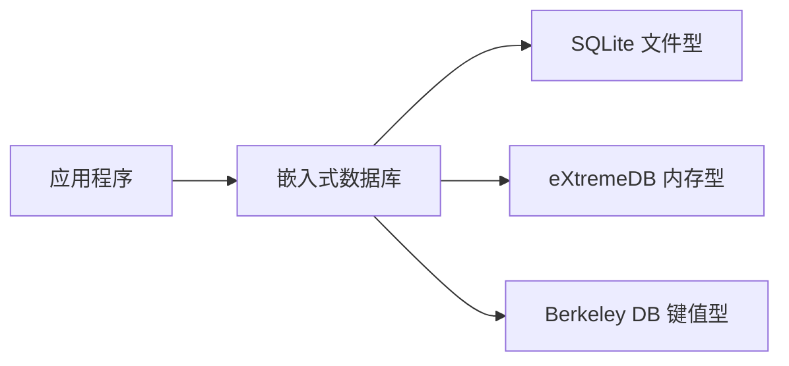

> 📌 **考试重点**：嵌入式数据库的特点、三种典型嵌入式数据库（SQLite/eXtremeDB/Berkeley DB）的类型是常考内容。

> 🔗 **真题关联**：2022年上半年选择题考查了 SQLite 数据库的文件型特点。

---

## 嵌入式中间件

嵌入式中间件是位于嵌入式操作系统和应用程序之间的软件层，为应用程序提供通用的服务和功能[^20]。

**嵌入式中间件的分类**：

- **消息中间件**：支持异步消息传递，如 MQTT、AMQP
- **对象中间件**：支持分布式对象调用，如 CORBA、DCOM、Java RMI
- **事务中间件**：支持分布式事务处理，如 Tuxedo
- **数据访问中间件**：提供统一的数据访问接口，如 ODBC、JDBC

**嵌入式中间件的特点**：

- 资源占用少，适合嵌入式环境
- 支持跨平台通信
- 提供标准化的接口和服务
- 简化应用程序开发

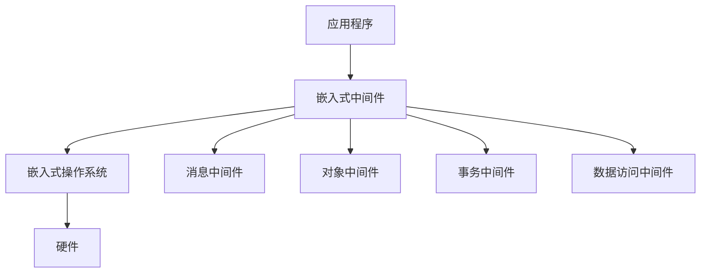

> 📌 **考试重点**：嵌入式中间件的分类、特点、典型技术是中间件的核心考点。

> 🔗 **真题关联**：2021年下半年选择题考查了嵌入式中间件中消息中间件的作用。

---

## 嵌入式软件开发环境

嵌入式软件开发通常采用交叉开发环境，包括宿主机和目标机两部分[^21]。

**交叉开发环境组成**：

- **宿主机（Host）**：开发人员的计算机，运行开发工具（编辑器、编译器、调试器）
- **目标机（Target）**：嵌入式设备，运行最终的应用程序
- **交叉编译器**：在宿主机上编译生成目标机可执行的代码
- **调试工具**：JTAG、BDM 等硬件调试接口
- **仿真器**：模拟目标机硬件环境，便于调试

**开发流程**：

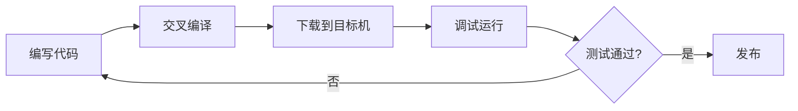

**常用开发工具**：

- **IDE**：Keil、IAR、Eclipse、VS Code
- **编译器**：GCC、ARM Compiler
- **调试器**：GDB、J-Link
- **版本控制**：Git、SVN

> 📌 **考试重点**：交叉开发环境的组成、宿主机与目标机的关系、开发流程是开发环境的核心考点。

> 🔗 **真题关联**：2020年上半年选择题考查了交叉编译器的作用。

---

## 嵌入式系统架构设计方法

嵌入式系统架构设计需要综合考虑硬件资源、实时性要求、功耗限制等因素[^22]。

**基于架构的嵌入式软件开发（ABSD）**：

- 以架构为中心的开发方法
- 强调架构设计在开发过程中的核心地位
- 支持架构的迭代和演化

**硬件/软件协同设计**：

- 硬件和软件并行设计
- 早期进行软硬件划分决策
- 支持系统级优化

**实时系统设计方法**：

- 时间触发架构（TTA）：基于时间触发任务调度
- 事件触发架构（ETA）：基于事件触发任务调度
- 混合架构：结合时间触发和事件触发

**低功耗设计方法**：

- 动态电压频率调整（DVFS）
- 时钟门控（Clock Gating）
- 电源门控（Power Gating）
- 睡眠模式管理

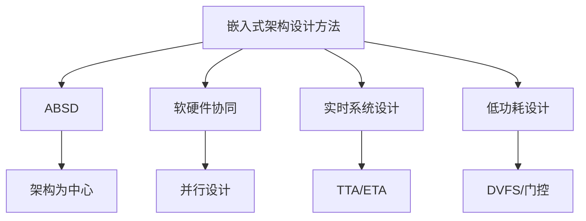

> 📌 **考试重点**：ABSD、软硬件协同设计、实时系统设计（TTA/ETA）、低功耗设计方法是架构设计的进阶考点。

> 🔗 **真题关联**：2023年下半年案例分析题考查了嵌入式系统低功耗设计方法。

---

## 嵌入式系统架构案例分析

**案例1：智能家居系统**

某智能家居系统采用嵌入式架构，实现家电控制、环境监测、安防报警等功能[^23]：

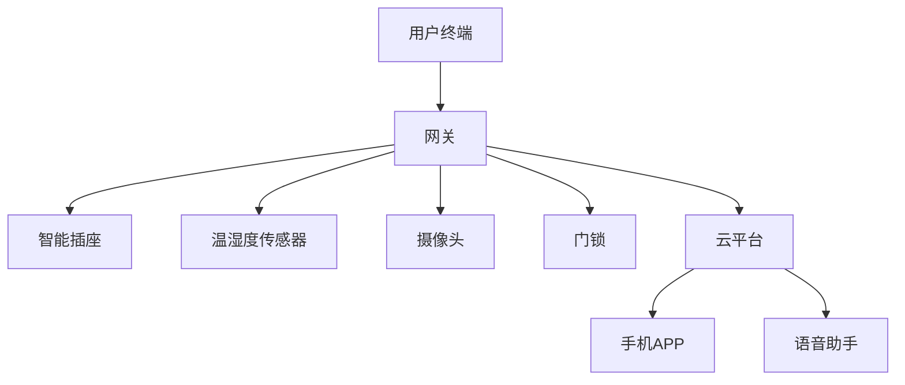

**技术特点**：

- 采用 ARM Cortex-M 系列 MCU
- 运行 FreeRTOS 实时操作系统
- 使用 MQTT 协议与云平台通信
- 支持 OTA 远程升级

**案例2：工业控制系统**

某工业控制系统采用嵌入式架构，实现生产线自动化控制[^24]：

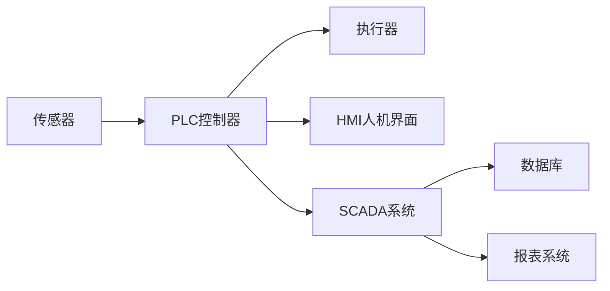

**技术特点**：

- 采用 PowerPC 处理器
- 运行 VxWorks 实时操作系统
- 支持 EtherCAT 工业以太网
- 满足 SIL3 安全等级

> 📌 **考试重点**：智能家居和工业控制系统的嵌入式架构设计、技术选型是案例分析的典型考题。

> 🔗 **真题关联**：2022年下半年案例分析题考查了智能家居系统的嵌入式架构设计。

---

## 嵌入式系统可靠性设计

嵌入式系统可靠性设计是确保系统在恶劣环境或故障条件下仍能正确运行的关键技术。可靠性设计涵盖容错设计、冗余技术、故障检测与恢复、看门狗机制等多个方面[^25]。

**容错设计**：容错设计是指系统在出现部分故障时仍能继续提供正确服务的能力。主要技术包括：

- **N版本程序设计**：多个独立团队用不同方法实现同一功能，通过表决机制输出结果
- **恢复块技术**：采用主块和备用块，主块执行后通过验收测试，失败则切换到备用块
- **防卫式程序设计**：在程序中加入断言检查、输入验证等防御性代码

**冗余技术**：冗余是提高系统可靠性的基本手段，包括：

- **硬件冗余**：双机热备、三模冗余（TMR）、冷备份等
- **软件冗余**：N版本程序、恢复块等
- **信息冗余**：校验码、纠错码（ECC）、奇偶校验等
- **时间冗余**：重复执行、超时重试等

**故障检测与恢复**：

- **故障检测**：心跳检测、自检程序、 watchdog 监控、健康状态监测
- **故障恢复**：前向恢复（继续执行）、后向恢复（回滚到检查点）、 graceful degradation（优雅降级）

**看门狗机制（Watchdog）**：看门狗是一种硬件或软件定时器，用于监控程序运行状态。当程序正常运行时，定期"喂狗"（重置定时器）；若程序跑飞或死锁，定时器超时触发系统复位[^26]。

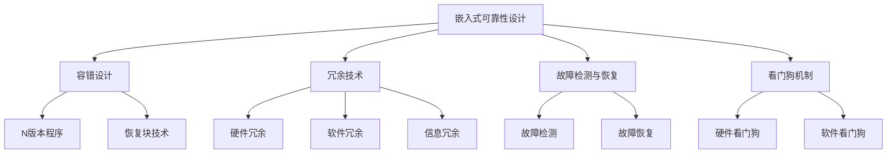

> 📌 **考试重点**：容错设计的三种技术（N版本程序、恢复块、防卫式程序设计）、冗余技术分类、看门狗机制原理是可靠性设计的核心考点。

> 🔗 **真题关联**：2021年下半年选择题考查了看门狗机制在嵌入式系统中的作用。

---

## 嵌入式系统安全性设计

嵌入式系统安全性设计旨在保护系统免受恶意攻击、未授权访问和数据泄露等威胁。安全性设计涉及安全启动、代码签名、加密存储、安全通信、侧信道攻击防护等多个层面[^27]。

**安全启动（Secure Boot）**：安全启动确保设备只执行经过授权的代码。启动时，Bootloader 验证下一阶段代码的数字签名，只有验证通过才继续加载执行，形成信任链（Chain of Trust）。根信任通常存储在不可篡改的硬件中，如 TPM 或 eFuse[^28]。

**代码签名**：代码签名使用私钥对固件/软件进行数字签名，设备使用公钥验证签名完整性。这防止了恶意固件替换和代码篡改攻击。常用算法包括 RSA、ECDSA 等。

**加密存储**：嵌入式系统中敏感数据（密钥、用户数据、配置信息）需要加密存储。常用技术包括：

- **全盘加密**：使用 AES 等对称加密算法加密整个存储介质
- **安全元件（SE）**：专用硬件芯片存储密钥和执行加密操作
- **可信执行环境（TEE）**：如 ARM TrustZone，提供与正常世界隔离的安全执行环境

**安全通信**：嵌入式设备与外部通信时需要保护数据机密性和完整性：

- **TLS/DTLS**：传输层安全协议，用于保护网络通信
- **安全协议**：如 MQTT over TLS、CoAP with DTLS
- **密钥协商**：ECDHE 等算法实现前向保密

**侧信道攻击防护**：侧信道攻击通过分析功耗、电磁泄漏、时序等信息获取密钥。防护措施包括：

- **功耗分析防护**：随机延迟、功耗均衡、掩码技术
- **电磁泄漏防护**：屏蔽、滤波、噪声注入
- **时序攻击防护**：恒定时间算法实现

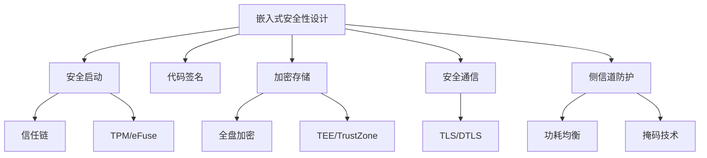

> 📌 **考试重点**：安全启动的信任链机制、TEE/TrustZone 原理、TLS/DTLS 在物联网通信中的应用、侧信道攻击防护方法是安全性设计的核心考点。

> 🔗 **真题关联**：2023年下半年选择题考查了嵌入式系统中可信执行环境（TEE）的作用。

---

## 嵌入式系统功耗管理

功耗管理是嵌入式系统设计的核心挑战之一，尤其在物联网、可穿戴设备和电池供电场景中。功耗管理技术包括动态电压频率调整（DVFS）、电源管理策略、低功耗模式和能量收集技术[^29]。

**动态电压频率调整（DVFS）**：DVFS 根据系统负载动态调整处理器的工作电压和频率。负载高时提高电压频率以提升性能，负载低时降低电压频率以节省功耗。功耗与电压的平方成正比（$P \propto CV^2f$），因此降低电压可显著减少功耗[^30]。

**电源管理策略**：

- **动态电源管理（DPM）**：根据设备使用情况动态关闭或开启组件
- **自适应电压调节（AVS）**：根据工艺偏差和温度自适应调整电压
- **电源域划分**：将芯片划分为多个独立电源域，按需供电
- **时钟门控（Clock Gating）**：关闭闲置模块的时钟信号

**低功耗模式**：现代嵌入式处理器通常支持多种低功耗模式：

- **运行模式（Run）**：全速运行，功耗最高
- **睡眠模式（Sleep）**：CPU 停止，外设继续运行，可快速唤醒
- **深度睡眠（Deep Sleep）**：CPU 和大部分外设停止，保留 RAM 和关键寄存器
- **待机模式（Standby）**：仅保留最低限度电路，唤醒时间较长
- **关机模式（Shutdown）**：仅保留实时时钟，功耗最低

**能量收集技术**：能量收集从环境中获取能量为嵌入式设备供电，减少或消除对电池的依赖：

- **太阳能**：光伏电池转换光能
- **热能**：热电发生器利用温差发电
- **振动能**：压电材料收集机械振动能量
- **射频能量**：收集环境中的无线电波能量

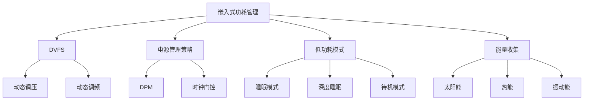

> 📌 **考试重点**：DVFS 原理（功耗与电压平方成正比）、低功耗模式分类（睡眠/深度睡眠/待机/关机）、能量收集技术类型是功耗管理的核心考点。

> 🔗 **真题关联**：2022年上半年选择题考查了 DVFS 技术在嵌入式低功耗设计中的应用原理。

---

## 参考文献

[^25]: 《系统架构设计师教程(第二版)》P.584-588 §16.8
[^26]: 《系统架构设计师教程(第二版)》P.588-590 §16.8.1
[^27]: 《系统架构设计师教程(第二版)》P.590-595 §16.9
[^28]: 《系统架构设计师教程(第二版)》P.591-593 §16.9.1
[^29]: 《系统架构设计师教程(第二版)》P.595-600 §16.10
[^30]: 《系统架构设计师教程(第二版)》P.596-597 §16.10.1
[^1]: 《系统架构设计师教程(第二版)》P.541 §16.1
[^2]: 《系统架构设计师教程(第二版)》P.542 §16.1.1
[^3]: 《系统架构设计师教程(第二版)》P.542-543 §16.1.2
[^4]: 《系统架构设计师教程(第二版)》P.543 §16.1.2
[^5]: 《系统架构设计师教程(第二版)》P.543-547 §16.1.2
[^6]: 《系统架构设计师教程(第二版)》P.548-549 §16.1.3
[^7]: 《系统架构设计师教程(第二版)》P.549 §16.2.1
[^8]: 《系统架构设计师教程(第二版)》P.549-550 §16.2.1
[^9]: 《系统架构设计师教程(第二版)》P.550 §16.2.1
[^10]: 《系统架构设计师教程(第二版)》P.549 §16.1.3
[^11]: 《系统架构设计师教程(第二版)》P.551 §16.2.2
[^12]: 《系统架构设计师教程(第二版)》P.551-552 §16.2.2
[^13]: 《系统架构设计师教程(第二版)》P.552 §16.2.2
[^14]: 《系统架构设计师教程(第二版)》P.553-554 §16.2.2
[^15]: 《系统架构设计师教程(第二版)》P.554-555 §16.2.2
[^16]: 《系统架构设计师教程(第二版)》P.554 §16.2.2
[^17]: 《系统架构设计师教程(第二版)》P.555 §16.2.2
[^18]: 《系统架构设计师教程(第二版)》P.556 §16.2.2
[^19]: 《系统架构设计师教程(第二版)》P.561 §16.3
[^20]: 《系统架构设计师教程(第二版)》P.562-564 §16.4
[^21]: 《系统架构设计师教程(第二版)》P.565-567 §16.5
[^22]: 《系统架构设计师教程(第二版)》P.568-572 §16.6
[^23]: 《系统架构设计师教程(第二版)》P.573-578 §16.7
[^24]: 《系统架构设计师教程(第二版)》P.578-583 §16.7
