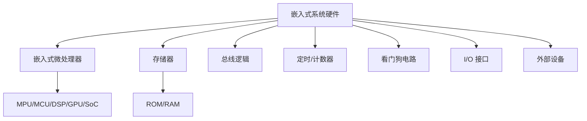
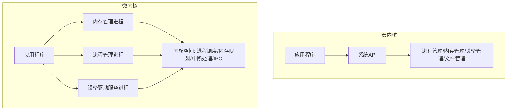

## 嵌入式系统特点

嵌入式系统（Embedded System）是为了特定应用而专门构建且将信息处理过程和物理过程紧密结合为一体的专用计算机系统[^1]。嵌入式系统架构设计具有以下特点：

1. **专用性强**：针对特定应用场景设计，软件和硬件紧密结合
2. **实时性要求高**：许多嵌入式系统需要对外部事件快速响应
3. **资源受限**：受限于内存、CPU、功耗等物理资源
4. **可靠性要求高**：常用于工业控制、医疗设备等关键领域
5. **功耗敏感**：尤其在物联网和移动设备中至关重要

嵌入式系统的发展大致经历了五个阶段：单片微型计算机（SCM）阶段、微控制器（MUC）阶段、片上系统（SoC）阶段、以 Internet 为基础的嵌入式系统阶段、在智能化和云技术推动下的嵌入式系统阶段[^2]。

---

## 嵌入式系统硬件体系结构

从传统意义上讲，嵌入式系统主要由嵌入式微处理器（控制器 MCU）、存储器（RAM/ROM）、内（外）总线逻辑、定时/计数器、看门狗电路、I/O 接口和外部设备等部件组成[^3]。

嵌入式处理器按类型可分为[^4]：

- **微处理器（MPU）**：将微处理器装配在专门设计的电路板上，只保留与嵌入式应用有关的母板功能
- **微控制器（MCU）**：又称单片机，单片化，体积小，功耗和成本下降，可靠性提高
- **信号处理器（DSP）**：对系统结构和指令进行特殊设计，适合于执行 DSP 算法
- **图形处理器（GPU）**：可执行渲染 3D 图形等图像的半导体芯片
- **片上系统（SoC）**：将大部分嵌入式系统功能集成到一块或几块芯片中

存储器按使用类型可分为只读存储器（ROM）和随机存储器（RAM）[^5]。ROM 包括 MASK ROM、PROM、EPROM、EEPROM、Flash Memory；RAM 包括 DRAM、SRAM、SDRAM、DDR SDRAM 等。

---

## 嵌入式软件架构

嵌入式系统智能化发展过程中，嵌入式软件架构逐步形成。典型的嵌入式软件架构包括[^6]：

- 应用软件
- 嵌入式（实时）操作系统（RTOS）
- 板级支持包（BSP）
- 硬件层

目前比较典型的嵌入式软件架构有两种：**层次化模式架构**和**递归模式架构**[^7]。

**层次化模式架构**主要设计思想是：当一个系统存在高层次的抽象，这些抽象的表现形式是一个个的抽象概念，而这些抽象概念需要具体的低层概念进行实现时，就可采用层次化模式。层次化模式可以分为封闭型和开放性。封闭型一层中的对象只能调用同一层或下一个底层的对象提供的方法；开放型一层中的对象可以调用同一层或低于该层任意一层的对象提供的方法[^8]。

**递归模式架构**解决的问题是：需要将一个非常复杂的系统进行分解，并且还要确保分解过程是可扩展的。递归模式实际上是对系统的抽象：系统中的交互协作可以在不同的层次上进行抽象，只不过每层反映的细节不同而已[^9]。

**GOA（Generic Open Architecture）** 架构是美国汽车工程学会（SAE）在 AS4893 标准中定义的通用开放式架构，主要特点包括可移植性、可互操作性、可剪裁性、易获得性[^10]。

---

## 嵌入式操作系统

嵌入式操作系统（Embedded Operating System，EOS）是指用于嵌入式系统的操作系统。嵌入式操作系统是一种用途广泛的系统软件，负责嵌入式系统的全部软、硬件资源分配、任务调度、控制、协调并行活动等工作[^11]。

与通用操作系统相比，嵌入式操作系统具备以下主要特点[^12]：

- 可剪裁性：支持开放性和可伸缩性的体系结构
- 可移植性：操作系统通常可运行在不同体系结构的处理器和开发板上
- 强实时性：实时性通常较强，可用于各种设备的控制
- 强紧凑性：由于资源受限，代码需要紧凑、精炼
- 高质量代码：广泛用于安全攸关系统，要求代码质量可靠
- 强定制性：可根据目标系统的不同需求进行专业化定制
- 标准接口：可提供设备统一的驱动接口
- 强稳定性、弱交互性：一旦运行就不需要用户过多干预
- 强确定性：任务调度和资源管理应确保在规定时间、容量内不发生任务超时和资源枯竭
- 可固化性：通常被固化在计算机系统的 ROM 中

嵌入式操作系统通常分为两类：一类是面向控制、通信等领域的嵌入式实时操作系统（如 VxWorks、Nucleus）；另一类是面向消费电子产品的非实时嵌入式操作系统（如 Android、iOS、WinCE）[^13]。

---

## 嵌入式操作系统内核架构

从内核架构来划分，嵌入式操作系统可分为**宏内核（Monolithic Kernel）**和**微内核（Micro Kernel）**[^14]。

**宏内核**：宏内核管理着用户程序和硬件之间的系统资源，在宏内核架构中，用户服务和内核服务在同一空间中实现。宏内核代码耦合度非常高，甚至内核的功能组件代码可以互相调用。如 VxWorks 5.5、VRTX 等嵌入式操作系统均采用宏内核。

**微内核**：内核管理着所有的系统资源，在微内核中用户服务和内核服务在不同的地址空间中实现。微内核中的执行速度相对较慢，但系统结构相当清晰，有利于协作开发；有良好的移植性，代码量非常少；有相当好的伸缩性、扩展性。如嵌入式 Linux、L4、WinCE 等。

---

## 嵌入式实时调度算法

嵌入式操作系统的任务实时调度问题是操作系统任务管理的核心技术。根据任务优先级的确定时机，调度算法分为静态调度和动态调度两类；根据任务在运行过程中能否被打断，分为抢占式调度和非抢占式调度[^15]。

典型强实时调度算法包括：

1. **最早截止时间优先（EDF）算法**：根据任务的开始截止时间来确定任务的优先级。截止时间愈早，其优先级愈高。该算法既可用于剥夺式调度，也可用于非剥夺式调度方式中[^16]。

2. **最低松弛度优先（LLF）算法**：根据任务紧急（或松弛）的程度，来确定任务的优先级。任务的紧急程度愈高，该任务被赋予的优先级就愈高。松弛度即进程的富裕时间，计算公式为：松弛度 = 必须完成时间 - 其本身的运行时间 - 当前时间[^17]。

3. **单调速率调度算法（RMS）**：一种静态优先级调度算法，是经典的周期性任务调度算法。RMS 的基本思路是任务的优先级与它的周期表现为单调函数的关系，任务的周期越短，优先级越高。单调速率调度可认为是最优的，因为如果一组进程不能由此算法调度，它不能由任何其他分配静态优先级的算法来调度[^18]。

---

## 嵌入式数据库

嵌入式数据库嵌入应用程序进程，无需独立服务。常见的嵌入式数据库包括 SQLite（文件型）、eXtremeDB（内存型）、Berkeley DB（键值型）等[^19]。

嵌入式数据库的特点：

- 嵌入应用程序进程，无需独立服务进程
- 资源占用少，适合资源受限环境
- 管理简单，部署方便
- 通常支持 SQL 或键值接口

---

## 参考文献

[^1]: 《系统架构设计师教程(第二版)》P.541 §16.1

[^2]: 《系统架构设计师教程(第二版)》P.542 §16.1.1

[^3]: 《系统架构设计师教程(第二版)》P.542-543 §16.1.2

[^4]: 《系统架构设计师教程(第二版)》P.543 §16.1.2

[^5]: 《系统架构设计师教程(第二版)》P.543-547 §16.1.2

[^6]: 《系统架构设计师教程(第二版)》P.548-549 §16.1.3

[^7]: 《系统架构设计师教程(第二版)》P.549 §16.2.1

[^8]: 《系统架构设计师教程(第二版)》P.549-550 §16.2.1

[^9]: 《系统架构设计师教程(第二版)》P.550 §16.2.1

[^10]: 《系统架构设计师教程(第二版)》P.549 §16.1.3

[^11]: 《系统架构设计师教程(第二版)》P.551 §16.2.2

[^12]: 《系统架构设计师教程(第二版)》P.551-552 §16.2.2

[^13]: 《系统架构设计师教程(第二版)》P.552 §16.2.2

[^14]: 《系统架构设计师教程(第二版)》P.553-554 §16.2.2

[^15]: 《系统架构设计师教程(第二版)》P.554-555 §16.2.2

[^16]: 《系统架构设计师教程(第二版)》P.554 §16.2.2

[^17]: 《系统架构设计师教程(第二版)》P.555 §16.2.2

[^18]: 《系统架构设计师教程(第二版)》P.556 §16.2.2

[^19]: 《系统架构设计师教程(第二版)》P.561 §16.3
