## 通信系统网络架构概述

通信系统（也称为通信网络）是利用各种通信线路将地理上分散的、具有独立功能的计算机系统和通信设备按不同的形式连接起来，依靠网络软件及通信协议实现资源共享和信息传递的系统[^1]。

当今通信网络从大的方面主要包括局域网、广域网、移动通信网等网络形式[^2]：

- **局域网（LAN）**：计算机局部区域网络，为单一机构所拥有的专用计算机网络。覆盖地理范围小，数据传输速率高，低误码率，可靠性高。
- **广域网（WAN）**：将分布于相比局域网络更广区域的计算机设备联接起来的网络。由通信子网与资源子网组成。
- **移动通信网**：为移动互联网提供强有力的支持，尤其是 5G 网络为个人用户、垂直行业等提供多样化的服务。
- **存储网络**：包括 DAS（直连式存储）、NAS（网络连接存储）、SAN（存储区域网络）三种方式[^3]。
- **软件定义网络（SDN）**：新型网络创新架构，核心思想是对网络设备的控制面与数据面进行分离。

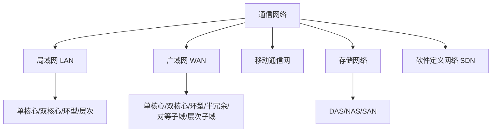

> 📌 **考试重点**：通信网络的五大分类（LAN/WAN/移动通信/存储网络/SDN）、各自特点是基础考点。

> 🔗 **真题关联**：2022年上半年选择题考查了局域网与广域网的区别。

---

## 局域网网络架构

局域网典型架构包括[^4]：

1. **单核心架构**：由一台核心二层或三层交换设备充当网络的核心设备，通过若干台接入交换设备将用户设备连接到网络中。优点是网络结构简单，可节省设备投资；不足是核心交换设备存在单点故障。

2. **双核心架构**：核心交换设备通常采用三层及以上交换机。核心交换设备之间互联，实现网关保护或负载均衡。核心交换设备具备保护能力，网络拓扑结构可靠。

3. **环型架构**：由多台核心交换设备连接成双 RPR（Resilient Packet Ring）动态弹性分组环，构建网络的核心。RPR 具备自愈保护功能，节省光纤资源，具备 MAC 层 50ms 自愈时间的能力。

4. **层次局域网架构**：由核心层交换设备、汇聚层交换设备和接入层交换设备，以及用户设备等组成。核心层设备提供高速数据转发功能；汇聚层设备提供充足接口，与接入层之间实现互访控制；接入层设备实现用户设备的接入。

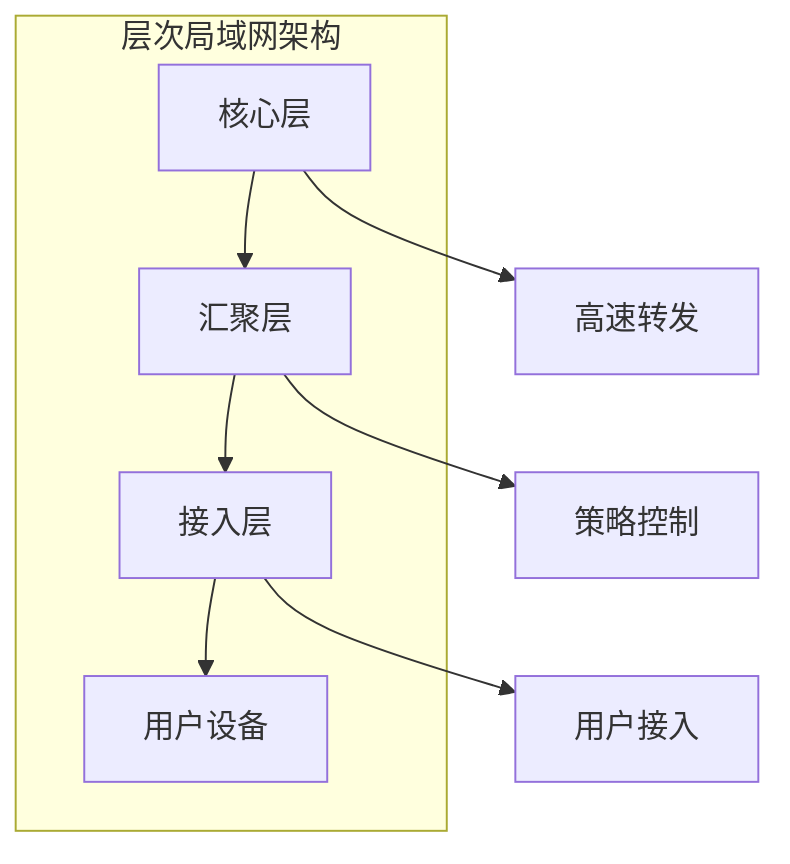

> 📌 **考试重点**：四种局域网架构（单核心/双核心/环型/层次）的特点、优缺点、适用场景是核心考点。

> 🔗 **真题关联**：2021年下半年选择题考查了层次局域网架构中核心层的功能。

---

## 广域网网络架构

广域网属于多级网络，通常由骨干网、分布网、接入网组成。在网络规模较小时，可仅由骨干网和接入网组成[^5]。

广域网典型架构包括：

1. **单核心广域网**：由一台核心路由设备和各局域网组成。核心路由设备采用三层及以上交换机。网络结构简单，节省设备投资，但核心路由设备存在单点故障。

2. **双核心广域网**：由两台核心路由设备和各局域网组成。核心路由设备之间实现网关保护或负载均衡。各局域网访问核心局域网，以及它们相互访问可有多条路径选择，可靠性更高。

3. **环型广域网**：采用三台以上核心路由器设备构成路由环路，用以连接各局域网。核心路由设备之间具备网关保护或负载均衡机制，同时具备环路控制功能。

4. **半冗余广域网**：由多台核心路由设备连接各局域网而形成。任意核心路由设备至少存在两条以上连接至其他路由设备的链路。结构灵活，方便扩展，可靠性高。

5. **对等子域广域网**：将广域网的路由设备划分成两个独立的子域，两个子域之间通过一条或多条链路互连。适合于广域网可以明显划分为两个区域，且区域内部访问较为独立的场景。

6. **层次子域广域网**：将大型广域网路由设备划分成多个较为独立的子域，多个子域之间存在层次关系，高层次子域连接多个低层次子域。具有较好扩展性[^6]。

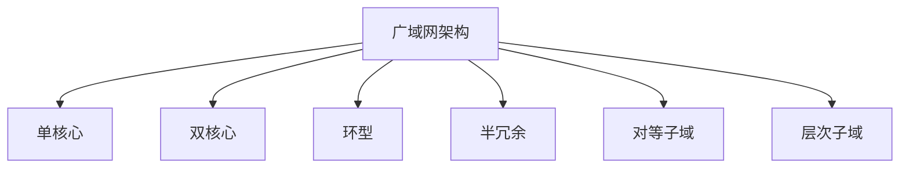

> 📌 **考试重点**：六种广域网架构的特点、优缺点、适用场景是广域网的核心考点。

> 🔗 **真题关联**：2023年上半年选择题考查了对等子域广域网的适用场景。

---

## 移动通信网架构

移动通信网为移动互联网提供强有力的支持，尤其是 5G 网络为个人用户、垂直行业等提供多样化的服务[^7]。

**移动通信技术演进**：

| 代际 | 技术 | 峰值速率 | 特点 |
|------|------|----------|------|
| 2G | GSM/CDMA | 200kbps | 语音+短信 |
| 3G | WCDMA/CDMA2000 | 2Mbps | 移动宽带 |
| 4G | LTE | 100Mbps | 全IP网络 |
| 5G | NR | 10Gbps | 低延迟/大连接 |

**5G 核心网（5GC）架构**：

- **服务化架构（SBA）**：基于微服务架构，支持网络功能灵活部署
- **网络切片**：为不同行业提供定制化网络服务
- **边缘计算（MEC）**：将计算能力下沉到网络边缘，降低延迟

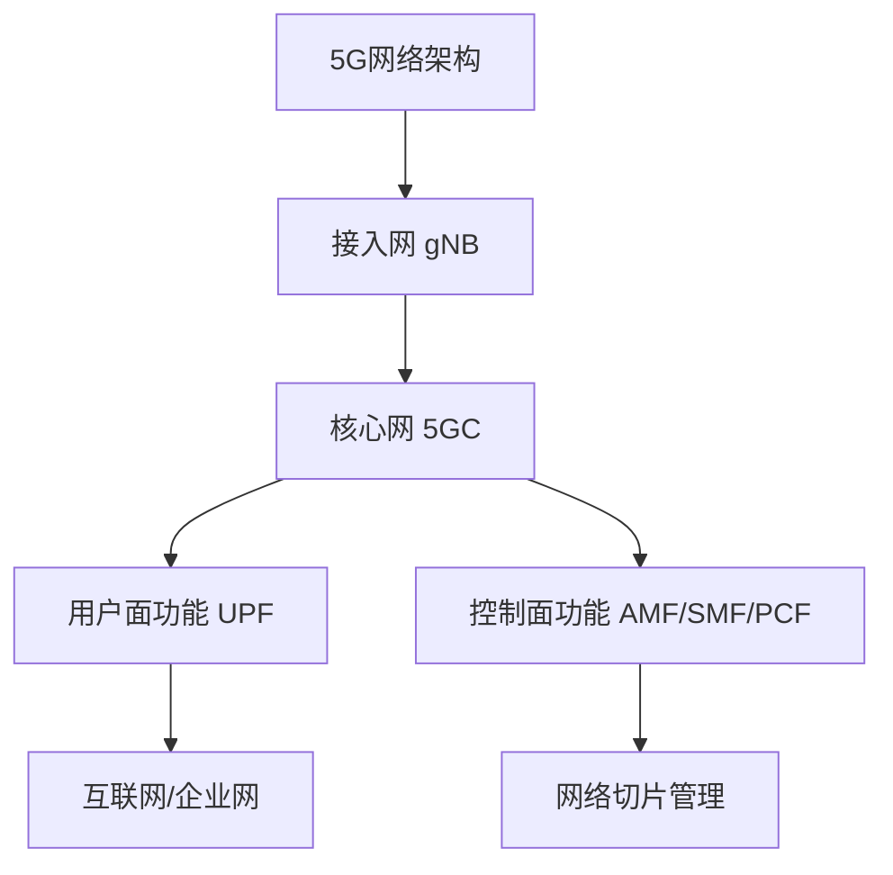

> 📌 **考试重点**：移动通信技术演进、5G 核心网架构（SBA/网络切片/MEC）是移动通信的核心考点。

> 🔗 **真题关联**：2022年下半年选择题考查了 5G 网络切片技术的应用。

---

## 存储网络架构

存储网络包括 DAS（直连式存储）、NAS（网络连接存储）、SAN（存储区域网络）三种方式[^8]。

| 存储方式 | 连接方式 | 优点 | 缺点 | 适用场景 |
|----------|----------|------|------|----------|
| DAS | 直接连接服务器 | 简单/低成本 | 扩展性差 | 小型应用 |
| NAS | 通过网络共享 | 文件级共享 | 性能受限 | 文件共享 |
| SAN | 专用存储网络 | 高性能/高可靠 | 成本高 | 数据库/虚拟化 |

**SAN 技术**：

- **FC SAN**：基于光纤通道，高性能但成本高
- **IP SAN**：基于 iSCSI 协议，利用现有 IP 网络
- **FCoE**：光纤通道 over 以太网，融合网络

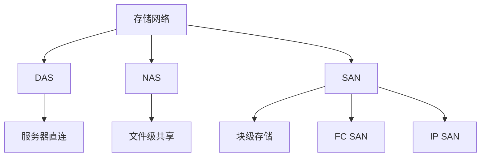

> 📌 **考试重点**：三种存储网络（DAS/NAS/SAN）的特点、优缺点、适用场景是存储网络的核心考点。

> 🔗 **真题关联**：2021年上半年选择题考查了 SAN 与 NAS 的区别。

---

## SDN软件定义网络

软件定义网络（Software Defined Network，SDN）是由美国斯坦福大学 CLean State 课题研究组提出的一种新型网络创新架构。其核心思想是通过对网络设备的控制面与数据面进行分离，控制面集中化管控，同时对外提供开放的可编程接口，为网络应用创新提供能力开放平台；而数据面则通用化、轻量化，高效转发，以提升网络的整体运行效能[^9]。

SDN 利用分层的思想，将网络分为控制层和数据层：

- **控制层**：包括可编程控制器，具有网络控制逻辑的中心，掌握网络的全局信息，方便运营商或网络管理人员配置网络和部署新协议等。
- **数据层**：包括哑交换机（与传统的二层交换机不同，专指用于转发数据的设备），仅提供简单的数据转发功能，可以快速处理匹配的数据包。

两层之间采用开放的统一接口（如 OpenFlow 等）进行交互。通过此接口控制器向转发设备下发统一标准的转发规则，转发设备仅需按照这些规则执行相应动作即可[^10]。

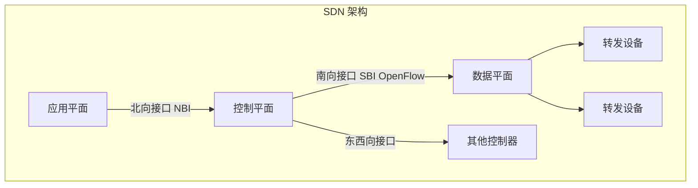

> 📌 **考试重点**：SDN 的核心思想（控制面与数据面分离）、三层架构（应用/控制/数据）、OpenFlow 协议是 SDN 的核心考点。

> 🔗 **真题关联**：2023年下半年选择题考查了 SDN 中控制平面与数据平面的职责划分。

---

## 网络高可用设计

网络可用性度量可从两个方面考虑：首先是网络不能频繁出现故障；其次是网络即使出现故障，应能迅速恢复。故障次数少和故障恢复时间短是衡量网络可用性的主要指标[^11]。

可用性公式：$A = MTBF / (MTBF + MTTR)$

其中：

- MTBF：平均无故障时间（Mean Time Between Failures）
- MTTR：平均故障修复时间（Mean Time To Repair）

提高网络可用性的途径：提高网络可靠性和缩短网络恢复时间。构建高可用网络，需要从耐久性、容错性及可维护性等方面进行网络规划设计[^12]。

网络高可用设计需从不同层次考虑：

- **核心层**：设备故障恢复时间 < 500ms；双主控切换时间 < 200ms
- **汇聚层**：设备故障恢复时间 < 1s
- **接入层**：接入-汇聚链路故障恢复时间 < 500ms；链路聚合故障恢复时间 < 1s

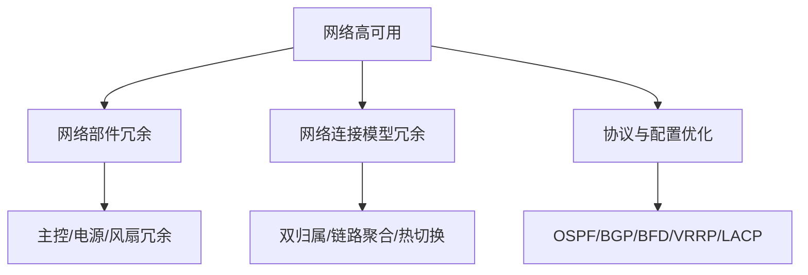

> 📌 **考试重点**：可用性公式、MTBF/MTTR 含义、各层故障恢复时间要求是网络高可用的核心考点。

> 🔗 **真题关联**：2022年上半年选择题考查了可用性公式中 MTBF 与 MTTR 的关系。

---

## IPv4与IPv6融合组网

目前国内外主流网络还是 IPv4 网络，IPv6 网络尚未规模化部署。面对 IPv4 网络巨大的投资成本，以及大量应用仍基于 IPv4 协议开发并提供业务的现状，网络演进还存在较长时间 IPv4 到 IPv6 过渡期或 IPv4 和 IPv6 网络共存期[^13]。

主要过渡技术包括：

1. **双协议栈**：IPv4/IPv6 双协议栈机制使 IPv6 网络节点具有一个 IPv6 协议栈和一个 IPv4 协议栈，同时支持 IPv4 和 IPv6 协议的处理。支持双协议栈的节点既能与支持 IPv4 协议的节点通信，又能与支持 IPv6 协议的节点通信[^14]。

2. **隧道技术**：在 IPv4 网络基础上实现 IPv6 网络的构建。常用隧道技术包括[^15]：
   - **ISATAP 隧道**：允许 IPv6 数据包通过 IPv4 网络上双栈节点传输
   - **6to4 隧道**：站点之间进行 IPv6 通信，每个站点应至少部署一台 6to4 路由器作为出入口
   - **4over6 隧道**：IPv4 网络向 IPv6 网络过渡过程中向纯 IPv6 主干网过渡的技术
   - **6over4 隧道**：双栈节点之间在组播使能的 IPv4 网络中传送 IPv6 分组

3. **网络地址翻译技术**：将 IPv4 地址和 IPv6 地址分别看作内部地址和外部地址（或者相反），以实现地址转换。相关协议包括 NAT-PT、SIIT 等[^16]。

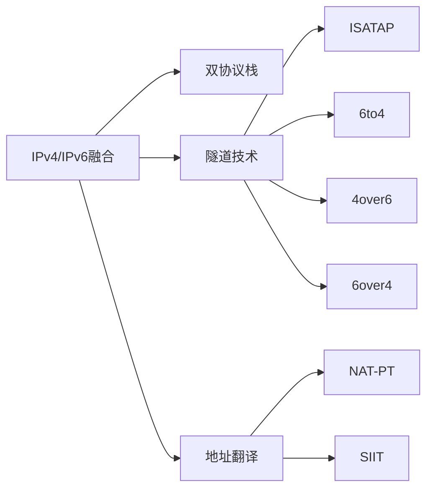

> 📌 **考试重点**：三种过渡技术（双协议栈/隧道/地址翻译）、四种隧道技术的特点是 IPv6 融合的核心考点。

> 🔗 **真题关联**：2021年下半年选择题考查了双协议栈技术的工作原理。

---

## 网络构建关键技术

网络需求分析是网络构建及开发过程的起始环节，主要围绕业务需求、用户需求、应用需求、计算机平台需求和网络需求五个方面来开展。通过上述需求分析，最终形成约束后续网络设计的网络需求规格说明书[^17]。

网络技术遴选包括：

- **局域网技术**：生成树协议（STP）、虚拟局域网（VLAN）、无线局域网、线路冗余设计、交换设备功能合理使用、服务器冗余设计
- **广域网技术**：远程接入技术、广域网互连技术（DDN、SDH、MSTP、VPN）
- **地址规划模型**：使用结构化网络层编址模型、通过中心授权机构管理地址、编址授权下发、为终端用户设备指派动态地址、私有地址合理使用
- **路由协议选择**：距离矢量协议和链路状态协议、度量值设置、协议顺序、层次化与非层次化、内部与外部、分类与无类、静态路由

**三层层次化模型**将网络分为核心层、汇聚层、接入层[^18]：

- 核心层：提供不同区域或下层的高速连接和最优传送路径
- 汇聚层：将网络业务连接到接入层，执行安全、流量负载、路由相关的策略
- 接入层：为终端用户访问网络提供接入能力

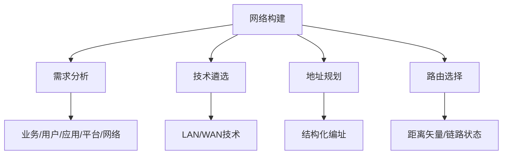

> 📌 **考试重点**：网络需求分析五个方面、三层层次化模型（核心/汇聚/接入）、路由协议选择是网络构建的核心考点。

> 🔗 **真题关联**：2023年上半年选择题考查了三层层次化模型中汇聚层的功能。

---

## 网络安全架构设计

网络安全架构设计是通信系统架构的重要组成部分，需要从多个层次保障网络安全[^19]。

**网络安全层次**：

- **物理层安全**：机房环境、设备物理防护、介质安全
- **网络层安全**：防火墙、入侵检测/防御系统（IDS/IPS）、VPN
- **系统层安全**：操作系统加固、漏洞管理、恶意代码防护
- **应用层安全**：Web 应用防火墙（WAF）、代码安全审计
- **数据层安全**：数据加密、备份恢复、数据脱敏

**防火墙部署模式**：

- **包过滤防火墙**：基于 IP 地址和端口进行过滤
- **状态检测防火墙**：基于连接状态进行过滤
- **应用代理防火墙**：基于应用层协议进行过滤
- **下一代防火墙（NGFW）**：集成入侵防御、应用识别等功能

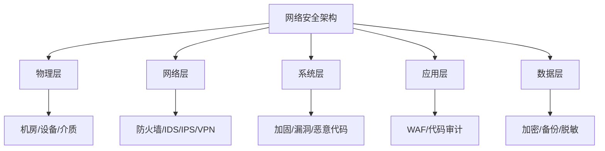

> 📌 **考试重点**：网络安全五个层次、防火墙四种部署模式、IDS/IPS 区别是网络安全的核心考点。

> 🔗 **真题关联**：2022年下半年案例分析题考查了企业网络安全架构设计。

---

## 绿色网络设计

绿色网络设计是在保证网络性能的前提下，降低网络能耗、减少碳排放的设计理念[^20]。

**绿色网络技术**：

- **设备休眠**：在业务低谷期关闭部分设备或端口
- **动态功率调整**：根据业务量动态调整设备功率
- **网络虚拟化**：通过虚拟化技术提高资源利用率
- **智能温控**：根据设备温度动态调整空调功率

**绿色网络指标**：

- **PUE（Power Usage Effectiveness）**：数据中心总能耗/IT 设备能耗，理想值为 1.0
- **DCIE（Data Center Infrastructure Efficiency）**：IT 设备能耗/数据中心总能耗
- **CADE（Corporate Average Datacenter Efficiency）**：企业数据中心平均效率

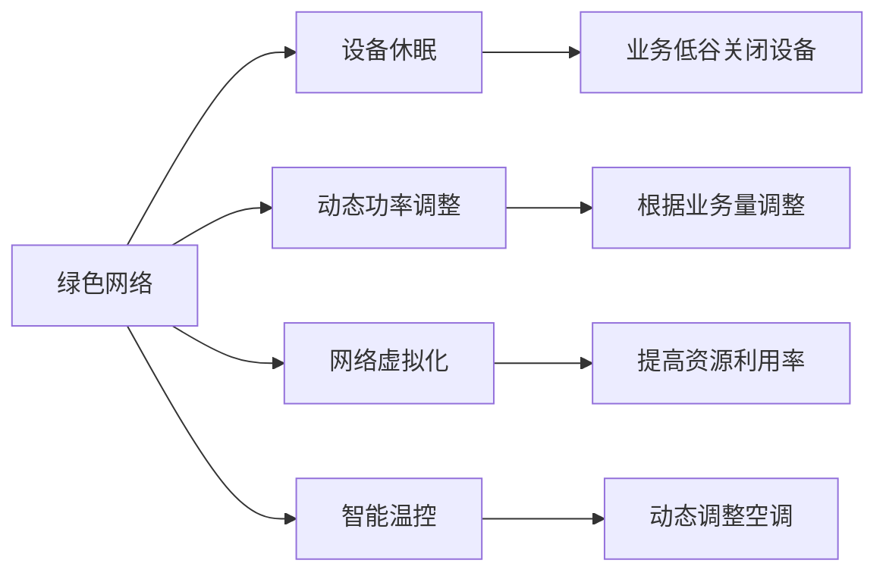

> 📌 **考试重点**：绿色网络技术（设备休眠/动态功率/虚拟化/温控）、PUE 指标是绿色网络的核心考点。

> 🔗 **真题关联**：2021年上半年选择题考查了 PUE 指标的计算方法。

---

## 通信网络构建案例分析

**案例1：企业园区网设计**

某大型企业园区网设计，支持 5000+ 员工办公和 10000+ 终端接入[^21]：

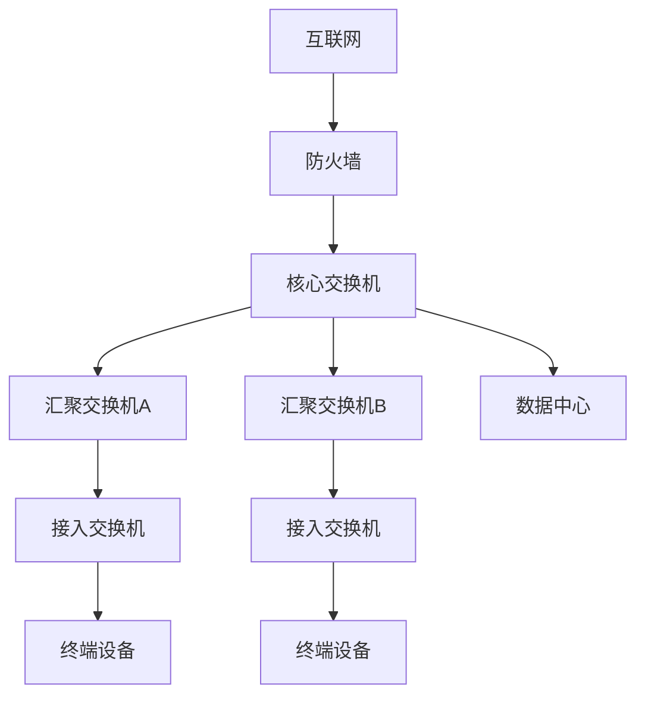

**设计要点**：

- 采用三层层次化架构（核心/汇聚/接入）
- 核心交换机双机热备，保证高可用
- VLAN 划分隔离不同部门
- 无线 AP 全覆盖，支持 802.11ax

**案例2：数据中心网络架构**

某数据中心网络采用 Spine-Leaf 架构，支持云计算和大数据应用[^22]：

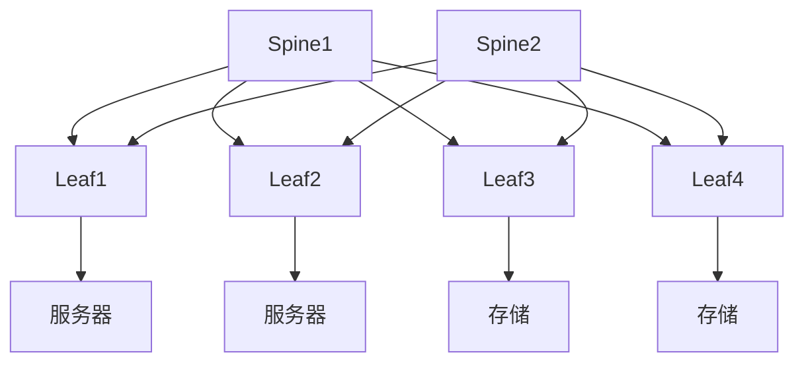

**设计要点**：

- Spine-Leaf 架构，支持横向扩展
- 全三层互联，消除二层环路
- 支持 VXLAN  overlay 网络
- 集成 SDN 控制器，实现网络自动化

> 📌 **考试重点**：企业园区网和数据中心网络的架构设计、技术选型是案例分析的典型考题。

> 🔗 **真题关联**：2023年下半年案例分析题考查了数据中心 Spine-Leaf 架构设计。

---

## 5G网络架构与应用

5G（第五代移动通信技术）是新一代蜂窝移动通信技术，具有高数据速率、低延迟、大连接数等显著特点。5G网络架构包括无线接入网（NG-RAN）和核心网（5GC）两大部分[^23]。

**5G NR无线接入网**：

- **gNB（下一代基站）**：5G NR基站，负责无线资源管理、调度等功能
- **CU/DU分离**：集中单元（CU）处理高层协议，分布单元（DU）处理物理层，实现灵活部署

**5G核心网服务化架构（SBA）**：

- **AMF（接入和移动性管理功能）**：负责用户接入认证、移动性管理
- **SMF（会话管理功能）**：负责会话管理、IP地址分配
- **UPF（用户面功能）**：负责数据包路由转发、QoS处理
- **PCF（策略控制功能）**：负责策略决策和计费规则

**网络切片**：在统一物理网络基础设施上，通过虚拟化技术构建多个逻辑隔离的端到端网络，满足不同行业差异化需求[^24]。

**边缘计算（MEC）**：将计算、存储、网络能力下沉到网络边缘，靠近数据源，降低传输延迟[^25]。

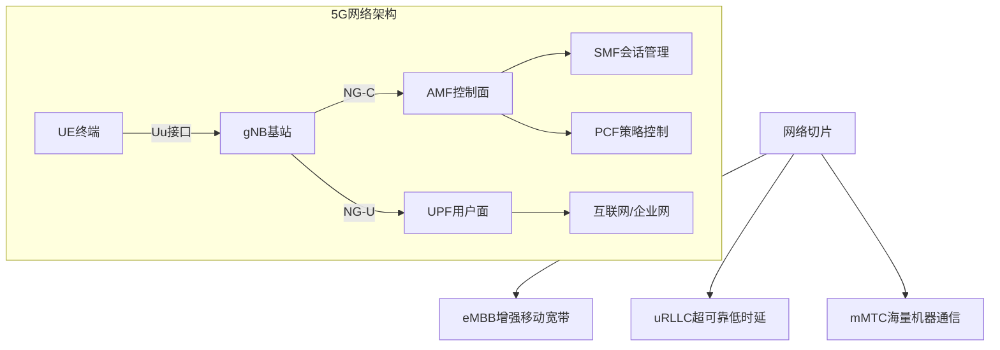

> 📌 **考试重点**：5G核心网SBA架构（AMF/SMF/UPF/PCF）、网络切片三种类型（eMBB/uRLLC/mMTC）、MEC边缘计算的优势是5G的核心考点。

> 🔗 **真题关联**：2023年下半年选择题考查了5G网络切片技术的应用场景。
---

## 网络虚拟化技术

网络功能虚拟化（NFV）是一种通过通用硬件和虚拟化技术来承载网络功能的架构方法，旨在替代传统专用网络设备[^26]。

**NFV核心概念**：

- **VNF（虚拟网络功能）**：以软件形式实现的传统网络功能，如虚拟防火墙（vFW）、虚拟路由器（vRouter）等
- **NFVI（NFV基础设施）**：提供VNF运行所需的计算、存储、网络资源
- **MANO（管理与编排）**：NFV的管理编排框架，负责VNF生命周期管理

**SDN与NFV关系**：

| 维度 | SDN | NFV |
|------|-----|-----|
| 关注点 | 控制面与数据面分离 | 网络功能软件化 |
| 目标 | 网络可编程、集中控制 | 降低设备成本、灵活部署 |
| 关系 | 互补协同，SDN可为NFV提供网络连接 |

**MANO管理与编排**：

- **VNFM（VNF管理器）**：负责VNF的实例化、扩容、缩容、终止
- **NFVO（NFV编排器）**：负责网络服务的编排和资源调度
- **VIM（虚拟化基础设施管理器）**：管理NFVI的计算、存储、网络资源

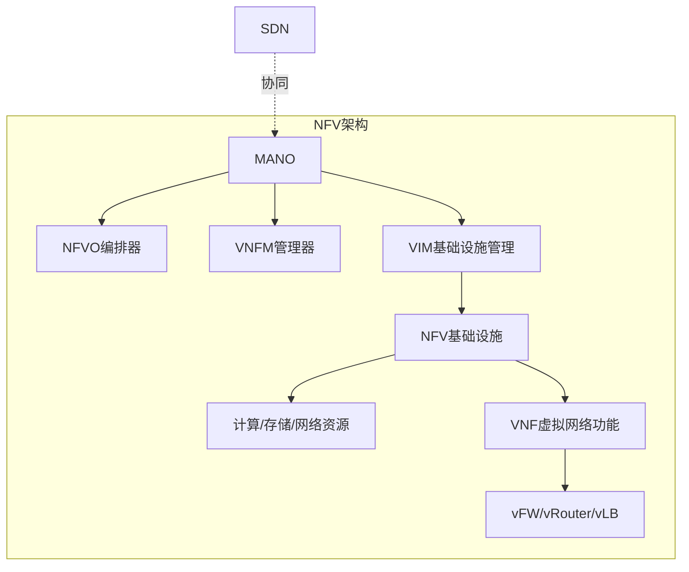

> 📌 **考试重点**：NFV三要素（VNF/NFVI/MANO）、SDN与NFV的区别与联系、MANO三层组件（NFVO/VNFM/VIM）是网络虚拟化的核心考点。

> 🔗 **真题关联**：2022年上半年选择题考查了NFV中VNF与传统网络设备的区别。
---

## 参考文献

[^1]: 《系统架构设计师教程(第二版)》P.599 §17.1

[^2]: 《系统架构设计师教程(第二版)》P.599-600 §17.2

[^3]: 《系统架构设计师教程(第二版)》P.609-611 §17.2.4

[^4]: 《系统架构设计师教程(第二版)》P.600-602 §17.2.1

[^5]: 《系统架构设计师教程(第二版)》P.603 §17.2.2

[^6]: 《系统架构设计师教程(第二版)》P.603-606 §17.2.2

[^7]: 《系统架构设计师教程(第二版)》P.607-608 §17.2.3

[^8]: 《系统架构设计师教程(第二版)》P.609-611 §17.2.4

[^9]: 《系统架构设计师教程(第二版)》P.611 §17.2.5

[^10]: 《系统架构设计师教程(第二版)》P.611-612 §17.2.5

[^11]: 《系统架构设计师教程(第二版)》P.612-613 §17.3.1

[^12]: 《系统架构设计师教程(第二版)》P.613-614 §17.3.1

[^13]: 《系统架构设计师教程(第二版)》P.614 §17.3.2

[^14]: 《系统架构设计师教程(第二版)》P.614 §17.3.2

[^15]: 《系统架构设计师教程(第二版)》P.614-616 §17.3.2

[^16]: 《系统架构设计师教程(第二版)》P.616 §17.3.2

[^17]: 《系统架构设计师教程(第二版)》P.617-618 §17.4.1

[^18]: 《系统架构设计师教程(第二版)》P.620-622 §17.4.2

[^19]: 《系统架构设计师教程(第二版)》P.622-625 §17.4.3

[^20]: 《系统架构设计师教程(第二版)》P.625-627 §17.4.4

[^21]: 《系统架构设计师教程(第二版)》P.627-630 §17.5

[^22]: 《系统架构设计师教程(第二版)》P.630-633 §17.5

[^23]: 《系统架构设计师教程(第二版)》P.607-608 §17.2.3

[^24]: 《系统架构设计师教程(第二版)》P.607-608 §17.2.3

[^25]: 《系统架构设计师教程(第二版)》P.607-608 §17.2.3

[^26]: 《系统架构设计师教程(第二版)》P.611-612 §17.2.5
