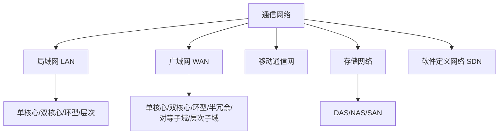
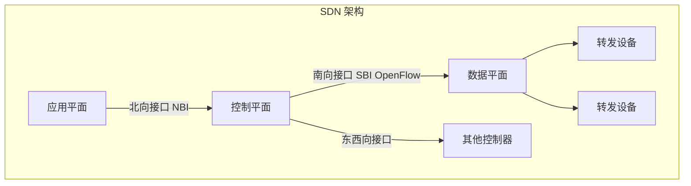
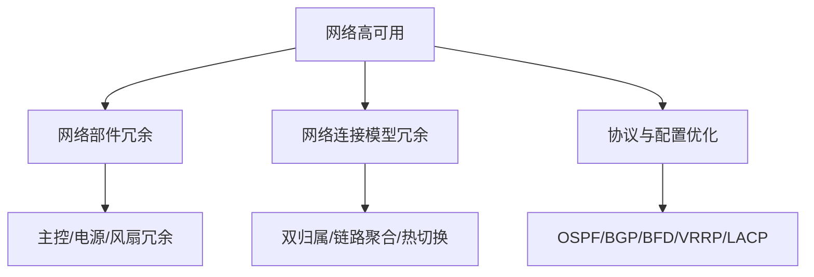

## 网络架构分类

通信系统（也称为通信网络）是利用各种通信线路将地理上分散的、具有独立功能的计算机系统和通信设备按不同的形式连接起来，依靠网络软件及通信协议实现资源共享和信息传递的系统[^1]。

当今通信网络从大的方面主要包括局域网、广域网、移动通信网等网络形式[^2]：

- **局域网（LAN）**：计算机局部区域网络，为单一机构所拥有的专用计算机网络。覆盖地理范围小，数据传输速率高，低误码率，可靠性高。
- **广域网（WAN）**：将分布于相比局域网络更广区域的计算机设备联接起来的网络。由通信子网与资源子网组成。
- **移动通信网**：为移动互联网提供强有力的支持，尤其是 5G 网络为个人用户、垂直行业等提供多样化的服务。
- **存储网络**：包括 DAS（直连式存储）、NAS（网络连接存储）、SAN（存储区域网络）三种方式[^3]。
- **软件定义网络（SDN）**：新型网络创新架构，核心思想是对网络设备的控制面与数据面进行分离。

---

## 局域网网络架构

局域网典型架构包括[^4]：

1. **单核心架构**：由一台核心二层或三层交换设备充当网络的核心设备，通过若干台接入交换设备将用户设备连接到网络中。优点是网络结构简单，可节省设备投资；不足是核心交换设备存在单点故障。

2. **双核心架构**：核心交换设备通常采用三层及以上交换机。核心交换设备之间互联，实现网关保护或负载均衡。核心交换设备具备保护能力，网络拓扑结构可靠。

3. **环型架构**：由多台核心交换设备连接成双 RPR（Resilient Packet Ring）动态弹性分组环，构建网络的核心。RPR 具备自愈保护功能，节省光纤资源，具备 MAC 层 50ms 自愈时间的能力。

4. **层次局域网架构**：由核心层交换设备、汇聚层交换设备和接入层交换设备，以及用户设备等组成。核心层设备提供高速数据转发功能；汇聚层设备提供充足接口，与接入层之间实现互访控制；接入层设备实现用户设备的接入。

---

## 广域网网络架构

广域网属于多级网络，通常由骨干网、分布网、接入网组成。在网络规模较小时，可仅由骨干网和接入网组成[^5]。

广域网典型架构包括：

1. **单核心广域网**：由一台核心路由设备和各局域网组成。核心路由设备采用三层及以上交换机。网络结构简单，节省设备投资，但核心路由设备存在单点故障。

2. **双核心广域网**：由两台核心路由设备和各局域网组成。核心路由设备之间实现网关保护或负载均衡。各局域网访问核心局域网，以及它们相互访问可有多条路径选择，可靠性更高。

3. **环型广域网**：采用三台以上核心路由器设备构成路由环路，用以连接各局域网。核心路由设备之间具备网关保护或负载均衡机制，同时具备环路控制功能。

4. **半冗余广域网**：由多台核心路由设备连接各局域网而形成。任意核心路由设备至少存在两条以上连接至其他路由设备的链路。结构灵活，方便扩展，可靠性高。

5. **对等子域广域网**：将广域网的路由设备划分成两个独立的子域，两个子域之间通过一条或多条链路互连。适合于广域网可以明显划分为两个区域，且区域内部访问较为独立的场景。

6. **层次子域广域网**：将大型广域网路由设备划分成多个较为独立的子域，多个子域之间存在层次关系，高层次子域连接多个低层次子域。具有较好扩展性[^6]。

---

## SDN 软件定义网络

软件定义网络（Software Defined Network，SDN）是由美国斯坦福大学 CLean State 课题研究组提出的一种新型网络创新架构。其核心思想是通过对网络设备的控制面与数据面进行分离，控制面集中化管控，同时对外提供开放的可编程接口，为网络应用创新提供能力开放平台；而数据面则通用化、轻量化，高效转发，以提升网络的整体运行效能[^7]。

SDN 利用分层的思想，将网络分为控制层和数据层：

- **控制层**：包括可编程控制器，具有网络控制逻辑的中心，掌握网络的全局信息，方便运营商或网络管理人员配置网络和部署新协议等。
- **数据层**：包括哑交换机（与传统的二层交换机不同，专指用于转发数据的设备），仅提供简单的数据转发功能，可以快速处理匹配的数据包。

两层之间采用开放的统一接口（如 OpenFlow 等）进行交互。通过此接口控制器向转发设备下发统一标准的转发规则，转发设备仅需按照这些规则执行相应动作即可[^8]。

---

## 网络高可用设计

网络可用性度量可从两个方面考虑：首先是网络不能频繁出现故障；其次是网络即使出现故障，应能迅速恢复。故障次数少和故障恢复时间短是衡量网络可用性的主要指标[^9]。

可用性公式：$A = MTBF / (MTBF + MTTR)$

其中：

- MTBF：平均无故障时间（Mean Time Between Failures）
- MTTR：平均故障修复时间（Mean Time To Repair）

提高网络可用性的途径：提高网络可靠性和缩短网络恢复时间。构建高可用网络，需要从耐久性、容错性及可维护性等方面进行网络规划设计[^10]。

网络高可用设计需从不同层次考虑：

- **核心层**：设备故障恢复时间 < 500ms；双主控切换时间 < 200ms
- **汇聚层**：设备故障恢复时间 < 1s
- **接入层**：接入-汇聚链路故障恢复时间 < 500ms；链路聚合故障恢复时间 < 1s

---

## IPv4 与 IPv6 融合

目前国内外主流网络还是 IPv4 网络，IPv6 网络尚未规模化部署。面对 IPv4 网络巨大的投资成本，以及大量应用仍基于 IPv4 协议开发并提供业务的现状，网络演进还存在较长时间 IPv4 到 IPv6 过渡期或 IPv4 和 IPv6 网络共存期[^11]。

主要过渡技术包括：

1. **双协议栈**：IPv4/IPv6 双协议栈机制使 IPv6 网络节点具有一个 IPv6 协议栈和一个 IPv4 协议栈，同时支持 IPv4 和 IPv6 协议的处理。支持双协议栈的节点既能与支持 IPv4 协议的节点通信，又能与支持 IPv6 协议的节点通信[^12]。

2. **隧道技术**：在 IPv4 网络基础上实现 IPv6 网络的构建。常用隧道技术包括[^13]：
   - **ISATAP 隧道**：允许 IPv6 数据包通过 IPv4 网络上双栈节点传输
   - **6to4 隧道**：站点之间进行 IPv6 通信，每个站点应至少部署一台 6to4 路由器作为出入口
   - **4over6 隧道**：IPv4 网络向 IPv6 网络过渡过程中向纯 IPv6 主干网过渡的技术
   - **6over4 隧道**：双栈节点之间在组播使能的 IPv4 网络中传送 IPv6 分组

3. **网络地址翻译技术**：将 IPv4 地址和 IPv6 地址分别看作内部地址和外部地址（或者相反），以实现地址转换。相关协议包括 NAT-PT、SIIT 等[^14]。

---

## 网络构建设计方法

网络需求分析是网络构建及开发过程的起始环节，主要围绕业务需求、用户需求、应用需求、计算机平台需求和网络需求五个方面来开展。通过上述需求分析，最终形成约束后续网络设计的网络需求规格说明书[^15]。

网络技术遴选包括：

- **局域网技术**：生成树协议（STP）、虚拟局域网（VLAN）、无线局域网、线路冗余设计、交换设备功能合理使用、服务器冗余设计
- **广域网技术**：远程接入技术、广域网互连技术（DDN、SDH、MSTP、VPN）
- **地址规划模型**：使用结构化网络层编址模型、通过中心授权机构管理地址、编址授权下发、为终端用户设备指派动态地址、私有地址合理使用
- **路由协议选择**：距离矢量协议和链路状态协议、度量值设置、协议顺序、层次化与非层次化、内部与外部、分类与无类、静态路由

**三层层次化模型**将网络分为核心层、汇聚层、接入层[^16]：

- 核心层：提供不同区域或下层的高速连接和最优传送路径
- 汇聚层：将网络业务连接到接入层，执行安全、流量负载、路由相关的策略
- 接入层：为终端用户访问网络提供接入能力

---

## 参考文献

[^1]: 《系统架构设计师教程(第二版)》P.599 §17.1

[^2]: 《系统架构设计师教程(第二版)》P.599-600 §17.2

[^3]: 《系统架构设计师教程(第二版)》P.609-611 §17.2.4

[^4]: 《系统架构设计师教程(第二版)》P.600-602 §17.2.1

[^5]: 《系统架构设计师教程(第二版)》P.603 §17.2.2

[^6]: 《系统架构设计师教程(第二版)》P.603-606 §17.2.2

[^7]: 《系统架构设计师教程(第二版)》P.611 §17.2.5

[^8]: 《系统架构设计师教程(第二版)》P.611-612 §17.2.5

[^9]: 《系统架构设计师教程(第二版)》P.612-613 §17.3.1

[^10]: 《系统架构设计师教程(第二版)》P.613-614 §17.3.1

[^11]: 《系统架构设计师教程(第二版)》P.614 §17.3.2

[^12]: 《系统架构设计师教程(第二版)》P.614 §17.3.2

[^13]: 《系统架构设计师教程(第二版)》P.614-616 §17.3.2

[^14]: 《系统架构设计师教程(第二版)》P.616 §17.3.2

[^15]: 《系统架构设计师教程(第二版)》P.617-618 §17.4.1

[^16]: 《系统架构设计师教程(第二版)》P.620-622 §17.4.2
