# 第18章 安全架构设计理论与实践

## 安全架构概述

安全架构是系统架构中专门负责保护系统免受威胁、确保系统安全运行的组成部分[^1]。安全架构设计的目标是在系统架构层面构建全面的安全防护体系，确保系统的机密性、完整性、可用性、可控性和不可否认性。

**安全架构的定义**：

安全架构是指为保护信息系统免受各种威胁而设计的系统结构和机制，包括安全策略、安全模型、安全机制和安全服务等多个层面[^2]。

**安全架构的范围**：

- **物理安全**：保护硬件设备和基础设施
- **网络安全**：保护网络通信和数据传输
- **系统安全**：保护操作系统和系统软件
- **应用安全**：保护应用程序和业务逻辑
- **数据安全**：保护数据的存储和处理

**安全威胁的类型**：

| 威胁类型 | 描述 | 示例 |
|----------|------|------|
| 中断 | 破坏系统可用性 | 拒绝服务攻击 |
| 截取 | 破坏系统机密性 | 窃听、嗅探 |
| 篡改 | 破坏系统完整性 | 数据篡改 |
| 伪造 | 破坏系统真实性 | 身份冒充 |

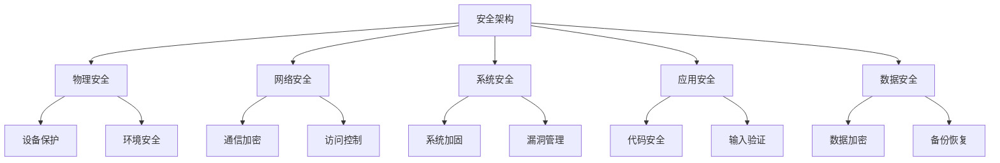

> 📌 **考试重点**：安全架构的定义、范围和威胁类型是基础考点，需理解各层面的安全需求。

> 🔗 **真题关联**：历年真题多次考查安全架构的基本概念，2023年上半年第1题考查了安全威胁的分类。

---

## 安全架构相关标准与组织

安全架构设计需要遵循相关的国际标准和组织规范[^3]。

**国际标准组织**：

- **ISO/IEC**：国际标准化组织/国际电工委员会，发布ISO/IEC 27000系列标准
- **NIST**：美国国家标准与技术研究院，发布SP 800系列安全指南
- **ITU-T**：国际电信联盟电信标准分局，发布X.800系列安全建议

**重要安全标准**：

| 标准 | 内容 | 应用 |
|------|------|------|
| ISO/IEC 27001 | 信息安全管理体系 | 企业安全管理 |
| ISO/IEC 27002 | 信息安全控制实践 | 安全控制实施 |
| NIST SP 800-53 | 安全控制目录 | 联邦系统安全 |
| Common Criteria | 信息技术安全评估 | 产品安全认证 |

**国内安全标准**：

- **GB/T 22239**：信息安全技术 网络安全等级保护基本要求
- **GB/T 25070**：信息安全技术 网络安全等级保护安全设计技术要求
- **GB/T 28448**：信息安全技术 网络安全等级保护测评要求

**等级保护制度**：

我国实行网络安全等级保护制度，将信息系统分为五个安全保护等级[^4]：

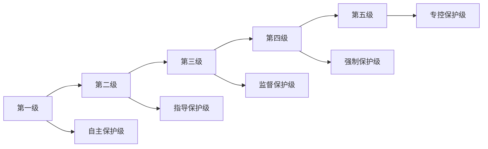

> 📌 **考试重点**：国内外主要安全标准和等级保护制度是常考知识点。

> 🔗 **真题关联**：2022年下半年第2题考查了等级保护的分级。

---

## 安全模型

安全模型是精确描述系统安全重要方面及其与系统行为之间关系的抽象框架，它将宽泛的安全策略转化为可执行、可验证的形式[^5]。信息系统的核心安全目标是控制主体（用户与进程）对客体（数据与程序）的访问，实现可用性、连续性、机密性、完整性与不可抵赖性的统一[^6]。

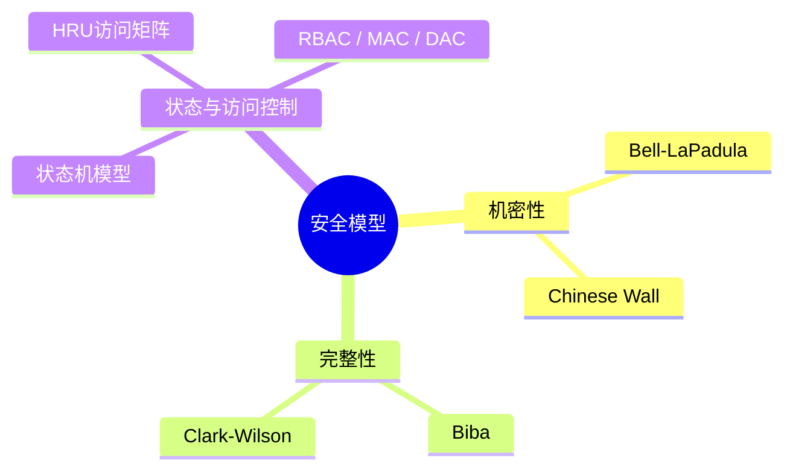

**主要安全模型**：

- **Bell-LaPadula（BLP）**：强制访问控制模型，以敏感度划分安全级别。核心规则为"不上读、不下写"，即低级别主体不能读取高级别客体，高级别主体不能向低级别客体写入，从而防止机密信息泄露[^7]。
- **Biba**：面向完整性保护，规则与 BLP 相反："不下读、不上写"，防止低完整性数据污染高完整性数据[^8]。
- **Clark-Wilson（CWM）**：通过转换过程（TP）与完整性验证过程（IVP）保证事务完整性，强调职责分离与审计，常用于银行系统[^9]。
- **Chinese Wall**：解决多边安全中的利益冲突问题，主体一旦访问某竞争方数据，便被限制访问同一利益冲突组内的其他数据[^10]。

**安全模型的分类**：

| 模型 | 保护目标 | 核心规则 | 应用场景 |
|------|----------|----------|----------|
| BLP | 机密性 | 不上读、不下写 | 军事系统 |
| Biba | 完整性 | 不下读、不上写 | 商业系统 |
| CWM | 完整性 | 职责分离、审计 | 银行系统 |
| Chinese Wall | 机密性 | 利益冲突隔离 | 咨询公司 |

> 📌 **考试重点**：四种安全模型的保护目标和核心规则是必考内容，需对比记忆。

> 🔗 **真题关联**：2024年上半年第3题考查了BLP模型的规则。

---

## 状态机模型

状态机模型是一种描述系统安全状态及其转换的抽象模型[^11]。

**状态机模型的基本概念**：

- **状态**：系统在某一时刻的安全状况
- **转换**：系统从一个状态到另一个状态的变化
- **安全状态**：满足安全策略的状态
- **安全转换**：保持系统安全性的状态转换

**状态机模型的类型**：

- **有限状态机（FSM）**：状态数量有限
- **下推自动机（PDA）**：具有栈结构
- **图灵机**：具有无限存储能力

**状态机模型的应用**：

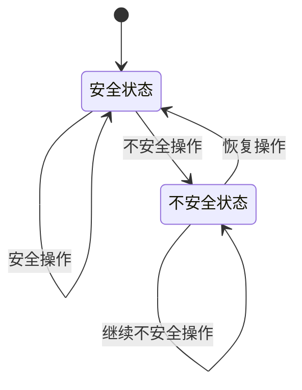

**状态机模型的验证**：

- **可达性分析**：检查是否可达不安全状态
- **不变性验证**：验证安全性质是否始终保持
- **活性验证**：验证系统是否能够正常进展

> 📌 **考试重点**：状态机模型的基本概念和验证方法是常考知识点。

> 🔗 **真题关联**：2023年下半年第4题考查了状态机模型的应用。

---

## 访问控制模型

访问控制是安全架构的核心机制，用于控制主体对客体的访问[^12]。

**访问控制的基本概念**：

- **主体（Subject）**：发起访问请求的实体（用户、进程）
- **客体（Object）**：被访问的资源（文件、数据）
- **访问权限（Access Right）**：主体对客体的操作权限

**访问控制模型的分类**：

| 模型 | 控制方式 | 特点 | 应用场景 |
|------|----------|------|----------|
| DAC | 自主访问控制 | 用户自主决定 | 个人系统 |
| MAC | 强制访问控制 | 系统强制实施 | 军事系统 |
| RBAC | 基于角色的访问控制 | 按角色分配权限 | 企业系统 |
| ABAC | 基于属性的访问控制 | 按属性动态决策 | 云环境 |

**自主访问控制（DAC）**：

- 资源所有者决定谁可以访问
- 通过访问控制表（ACL）实现
- 灵活性高，但安全性较低

**强制访问控制（MAC）**：

- 系统根据安全标签强制实施
- 主体和客体都有安全级别
- 安全性高，但灵活性较低

**基于角色的访问控制（RBAC）**：

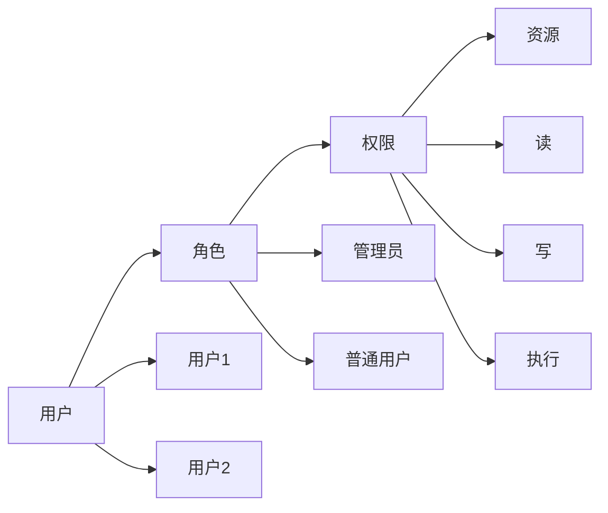

> 📌 **考试重点**：四种访问控制模型的特点和应用场景是高频考点。

> 🔗 **真题关联**：2022年上半年第5题考查了RBAC模型。

---

## 系统安全体系架构规划框架

系统安全体系架构规划框架是指导安全架构设计的系统性方法[^13]。

**安全体系架构的组成**：

- **安全策略**：定义安全目标和原则
- **安全模型**：描述安全机制和行为
- **安全机制**：实现安全功能的技术手段
- **安全服务**：提供的安全功能

**安全体系架构的设计原则**：

- **最小权限原则**：只授予必要的权限
- **纵深防御原则**：多层安全防护
- **默认拒绝原则**：默认拒绝所有访问
- **职责分离原则**：分离关键职责
- **审计原则**：记录和监控安全事件

**安全体系架构的规划流程**：

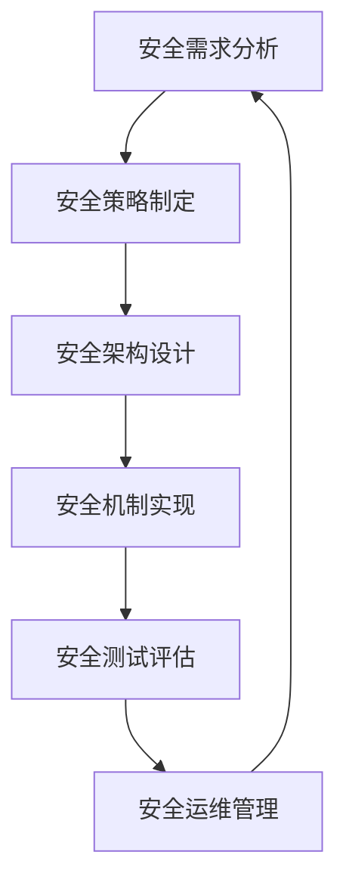

**安全体系架构的层次**：

| 层次 | 内容 | 技术 |
|------|------|------|
| 物理层 | 设备安全、环境安全 | 门禁、监控 |
| 网络层 | 通信安全、边界防护 | 防火墙、VPN |
| 系统层 | 操作系统安全 | 加固、补丁 |
| 应用层 | 应用程序安全 | 代码审计、输入验证 |
| 数据层 | 数据安全 | 加密、备份 |

> 📌 **考试重点**：安全体系架构的组成、设计原则和层次是核心考点。

> 🔗 **真题关联**：2023年上半年第6题考查了安全体系架构的设计原则。

---

## 信息安全整体架构设计（WPDRRC模型）

WPDRRC 是我国"八六三"信息安全专家组提出的信息系统安全保障体系建设模型，在 PDRR（保护、检测、响应、恢复）基础上增加了 **预警（Warning）** 与 **反击（Counter）** 两个环节，形成闭环的安全保障体系[^14]。该模型强调人员、策略与技术三大要素贯穿安全建设的全过程[^15]。

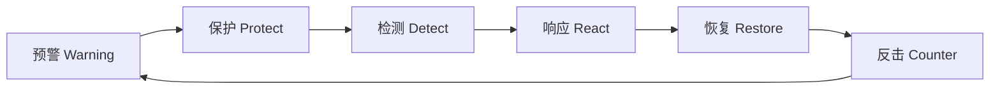

**六个环节的含义**：

- **预警**：通过远程安全评估模拟攻击，发现潜在薄弱环节，预测风险趋势[^16]。
- **保护**：采用加密、数字签名、访问控制、防火墙等技术实现网络与信息的主动防护[^17]。
- **检测**：通过入侵检测、脆弱性扫描、完整性校验等手段动态发现威胁与违规[^18]。
- **响应**：对安全事件进行报警、封堵、隔离与状态评估，快速将系统调整到安全状态[^19]。
- **恢复**：在系统遭受破坏后，通过冗余、备份、替换与修复尽快恢复业务[^20]。
- **反击**：利用取证与反制技术追踪攻击来源，形成依法打击能力[^21]。

**WPDRRC与其他模型的对比**：

| 模型 | 环节 | 特点 |
|------|------|------|
| PDR | 保护、检测、响应 | 基础模型 |
| PPDR | 策略、保护、检测、响应 | 强调策略 |
| PDRR | 保护、检测、响应、恢复 | 增加恢复 |
| MPDRR | 管理、保护、检测、响应、恢复 | 强调管理 |
| WPDRRC | 预警、保护、检测、响应、恢复、反击 | 最完整 |

> 📌 **考试重点**：WPDRRC模型的六个环节及其与其他模型的区别是必考内容。

> 🔗 **真题关联**：2024年下半年第7题考查了WPDRRC模型的环节。

---

## 网络安全体系架构设计

网络安全体系架构设计是保护网络通信安全的重要手段[^22]。

**OSI安全体系结构**：

OSI 安全体系结构由 ISO/IEC 7498-2 提出，从安全服务、安全机制与系统层次三个维度构建开放系统的安全框架[^23]。它为网络与信息系统安全设计提供了标准化的参考模型。

**五类安全服务**[^24]：

- **认证服务**：确认通信实体身份的真实性。
- **访问控制服务**：防止未授权使用资源。
- **数据机密性服务**：防止数据被非法泄露。
- **数据完整性服务**：防止数据被非法篡改、删除或破坏。
- **抗抵赖服务**：提供通信双方行为的不可否认证据。

**八种安全机制**[^25]：

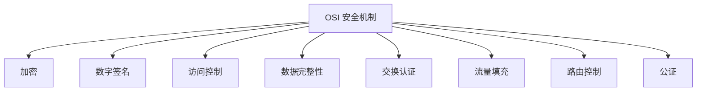

**安全服务与机制的关系**：

| 安全服务 | 对应机制 |
|----------|----------|
| 认证 | 加密、数字签名、交换认证 |
| 访问控制 | 访问控制 |
| 数据机密性 | 加密、流量填充、路由控制 |
| 数据完整性 | 加密、数字签名、数据完整性 |
| 抗抵赖 | 数字签名、公证 |

> 📌 **考试重点**：OSI安全体系的五类服务和八种机制是核心考点。

> 🔗 **真题关联**：2022年下半年第8题考查了OSI安全服务。

---

## 认证框架设计

认证是确认实体身份真实性的过程，是安全架构的基础[^26]。

**认证的基本概念**：

- **身份标识**：唯一标识实体的信息
- **认证凭证**：证明身份的证据
- **认证协议**：认证过程的规范

**认证的分类**：

| 类型 | 方式 | 特点 |
|------|------|------|
| 单向认证 | 一方认证另一方 | 简单，安全性较低 |
| 双向认证 | 双方互相认证 | 安全性高 |
| 第三方认证 | 通过可信第三方认证 | 可扩展性好 |

**常见的认证方式**：

- **口令认证**：基于用户名和密码
- **令牌认证**：基于硬件或软件令牌
- **生物认证**：基于指纹、虹膜等生物特征
- **证书认证**：基于数字证书
- **多因素认证**：结合多种认证方式

**认证协议**：

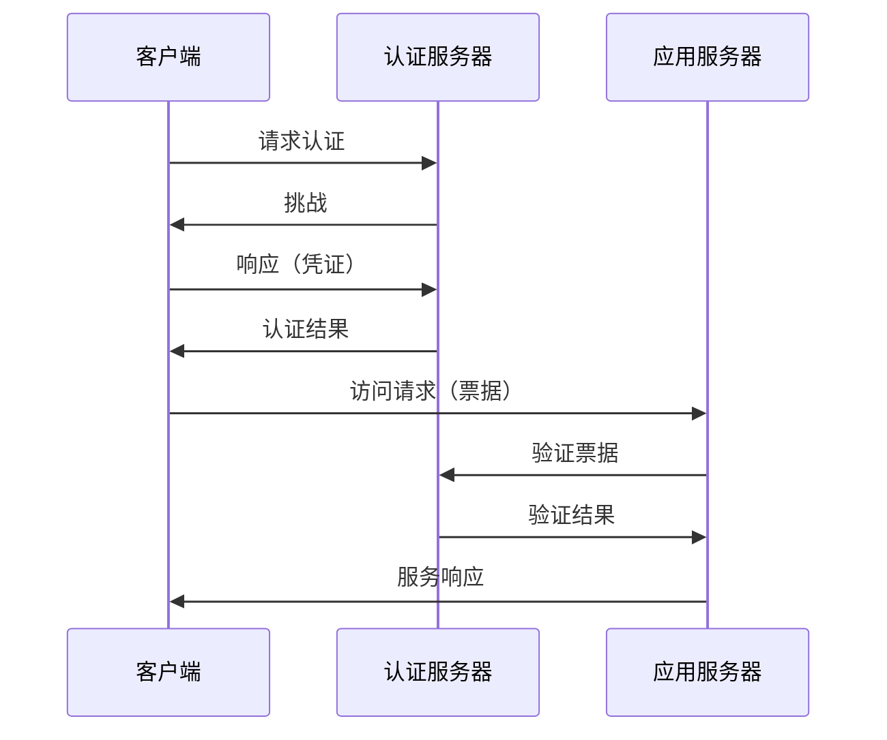

> 📌 **考试重点**：认证的分类和常见认证方式是常考知识点。

> 🔗 **真题关联**：2023年上半年第9题考查了多因素认证。

---

## 访问控制框架设计

访问控制框架是实现访问控制服务的系统性设计[^27]。

**访问控制框架的组成**：

- **访问控制策略**：定义访问规则
- **访问控制模型**：描述访问控制机制
- **访问控制机制**：实现访问控制功能
- **访问控制管理**：管理访问控制配置

**访问控制框架的设计原则**：

- **最小权限**：只授予必要的权限
- **职责分离**：分离关键职责
- **默认拒绝**：默认拒绝所有访问
- **审计跟踪**：记录访问行为

**访问控制框架的实现**：

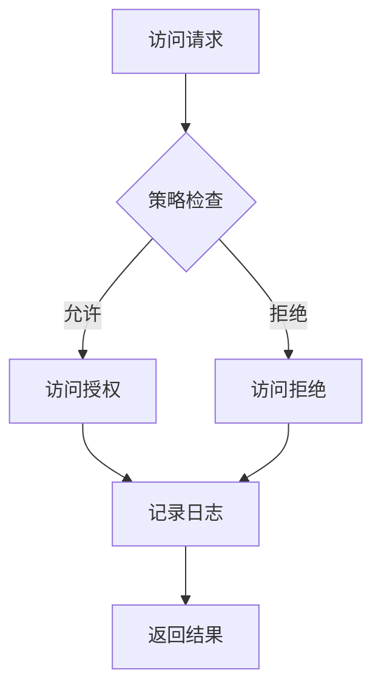

**访问控制框架的层次**：

| 层次 | 功能 | 技术 |
|------|------|------|
| 网络层 | 网络访问控制 | 防火墙、ACL |
| 系统层 | 系统资源控制 | 文件权限、进程隔离 |
| 应用层 | 应用功能控制 | 角色权限、功能授权 |
| 数据层 | 数据访问控制 | 数据加密、脱敏 |

> 📌 **考试重点**：访问控制框架的组成和设计原则是常考知识点。

> 🔗 **真题关联**：2024年上半年第10题考查了访问控制框架的设计。

---

## 机密性框架设计

机密性框架是保护数据不被非法泄露的系统性设计[^28]。

**机密性保护的目标**：

- 防止数据在存储时被泄露
- 防止数据在传输时被窃听
- 防止数据在处理时被泄露

**机密性保护的技术**：

| 技术 | 原理 | 应用 |
|------|------|------|
| 对称加密 | 加解密使用相同密钥 | 数据加密 |
| 非对称加密 | 加解密使用不同密钥 | 密钥交换 |
| 哈希函数 | 单向散列 | 数据完整性 |
| 数字签名 | 私钥签名、公钥验证 | 身份认证 |

**机密性框架的设计**：

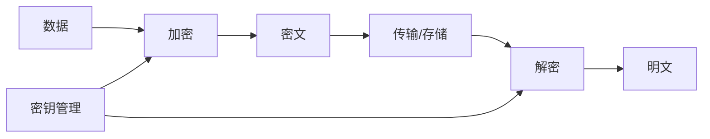

**密钥管理**：

- **密钥生成**：安全地生成密钥
- **密钥分发**：安全地分发密钥
- **密钥存储**：安全地存储密钥
- **密钥更新**：定期更新密钥
- **密钥销毁**：安全地销毁密钥

> 📌 **考试重点**：机密性保护的技术和密钥管理是核心考点。

> 🔗 **真题关联**：2022年上半年第11题考查了对称加密和非对称加密的区别。

---

## 完整性框架设计

完整性框架是保护数据不被非法篡改的系统性设计[^29]。

**完整性保护的目标**：

- 防止数据被非法修改
- 防止数据被非法删除
- 防止数据被非法插入
- 确保数据的准确性

**完整性保护的技术**：

- **哈希函数**：生成数据摘要
- **消息认证码（MAC）**：验证数据完整性
- **数字签名**：验证数据来源和完整性
- **校验和**：检测数据传输错误

**完整性框架的设计**：

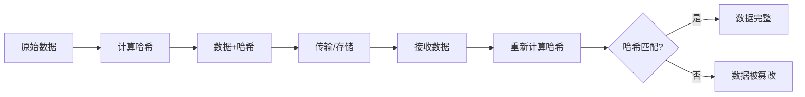

**完整性保护的层次**：

| 层次 | 保护对象 | 技术 |
|------|----------|------|
| 数据层 | 数据内容 | 哈希、MAC |
| 传输层 | 传输数据 | TLS、IPSec |
| 应用层 | 应用数据 | 数字签名 |
| 系统层 | 系统文件 | 文件完整性检查 |

> 📌 **考试重点**：完整性保护的技术和框架设计是常考知识点。

> 🔗 **真题关联**：2023年下半年第12题考查了哈希函数的应用。

---

## 抗抵赖框架设计

抗抵赖框架是防止通信双方否认其行为的系统性设计[^30]。

**抗抵赖的类型**：

- **源抗抵赖**：防止发送方否认发送行为
- **宿抗抵赖**：防止接收方否认接收行为
- **提交抗抵赖**：防止提交方否认提交行为
- **传输抗抵赖**：防止传输方否认传输行为

**抗抵赖的技术**：

- **数字签名**：使用私钥签名，证明发送方身份
- **时间戳**：记录操作时间，证明操作时间
- **公证**：通过可信第三方证明
- **审计日志**：记录所有操作行为

**抗抵赖框架的设计**：

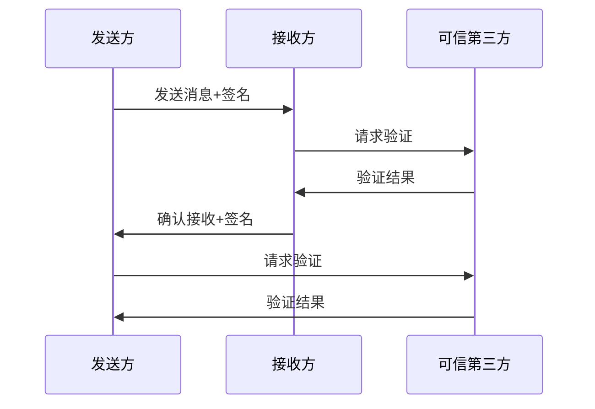

**抗抵赖框架的组成**：

| 组件 | 功能 | 技术 |
|------|------|------|
| 签名生成 | 生成数字签名 | 私钥签名 |
| 签名验证 | 验证数字签名 | 公钥验证 |
| 时间戳服务 | 提供时间证明 | 时间戳机构 |
| 公证服务 | 提供第三方证明 | 公证机构 |
| 审计服务 | 记录操作日志 | 审计系统 |

> 📌 **考试重点**：抗抵赖的类型和技术是常考知识点。

> 🔗 **真题关联**：2024年下半年第13题考查了数字签名的抗抵赖作用。

---

## 数据库系统的安全设计

数据库系统的安全设计是保护数据安全的重要环节[^31]。

**数据库安全的目标**：

- **机密性**：防止数据泄露
- **完整性**：防止数据篡改
- **可用性**：确保数据可用
- **可控性**：控制数据访问

**数据库安全的层次**：

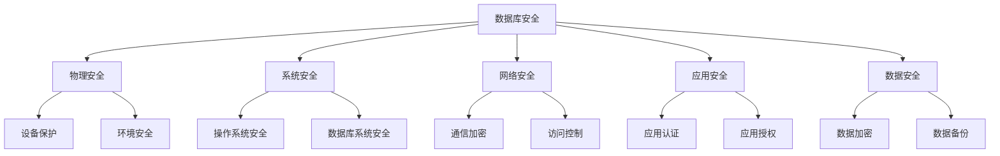

**数据库安全技术**：

| 技术 | 功能 | 实现 |
|------|------|------|
| 用户认证 | 验证用户身份 | 口令、证书 |
| 访问控制 | 控制数据访问 | 权限管理 |
| 视图机制 | 限制数据可见性 | 视图定义 |
| 审计功能 | 记录操作行为 | 审计日志 |
| 数据加密 | 保护数据内容 | 加密算法 |
| 备份恢复 | 防止数据丢失 | 备份策略 |

**数据库安全设计原则**：

- **最小权限**：只授予必要的权限
- **职责分离**：分离数据库管理职责
- **数据分类**：按敏感程度分类数据
- **审计跟踪**：记录所有数据操作

> 📌 **考试重点**：数据库安全的目标、层次和技术是核心考点。

> 🔗 **真题关联**：2022年下半年第14题考查了数据库安全技术。

---

## 系统架构的脆弱性分析

系统架构脆弱性是指系统中存在的设计瑕疵、实现缺陷或配置错误，这些弱点本身不会直接造成危害，但一旦被攻击者利用，就可能破坏安全策略并引发安全事件[^32]。安全"木桶理论"指出，系统整体安全水平由其最薄弱的环节决定，而非最强的防护措施[^33]。

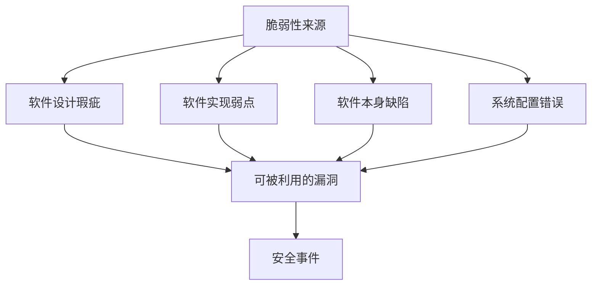

**脆弱性分类**：

- **ISO 分类法**：面向信息系统安全与隐私。
- **Landwehr 分类法**：从缺陷起因、引入时间与分布位置三个维度划分。
- **Aslam 分类法**：从软件生命周期角度分为编码故障与突发故障。
- **IBM 分类法**：融合脆弱性、威胁、攻击与检测方法，面向脆弱性检测工具开发[^34]。

**脆弱性生命周期**：

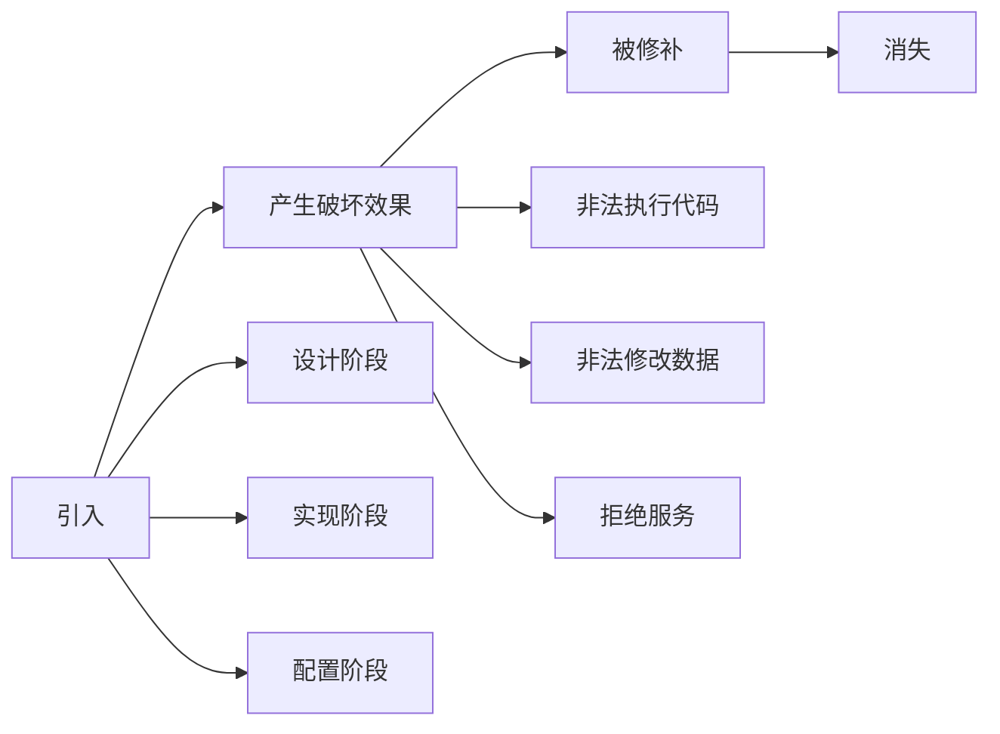

**脆弱性引入原因**：

- 输入验证错误
- 权限检查错误
- 边界检出错误
- 软件设计缺陷

**纵深防御策略**：

在架构层面，纵深防御是降低脆弱性影响的关键策略：通过多层、异构的防御措施，即使某一层被突破，也能限制攻击扩散并保留检测与响应能力[^35]。

> 📌 **考试重点**：脆弱性的分类、生命周期和纵深防御策略是高频考点。

> 🔗 **真题关联**：2023年上半年第15题考查了脆弱性的分类。

---

## 安全架构设计案例分析

安全架构设计案例分析是将理论知识应用于实际项目的过程[^36]。

**案例分析的步骤**：

1. **需求分析**：分析系统的安全需求
2. **威胁建模**：识别系统的安全威胁
3. **架构设计**：设计安全架构方案
4. **机制实现**：实现安全机制
5. **测试评估**：测试和评估安全效果

**典型安全架构案例**：

**案例1：电子商务系统安全架构**

- **安全需求**：保护用户隐私、交易安全
- **安全威胁**：数据泄露、支付欺诈
- **安全措施**：SSL/TLS加密、支付网关、风控系统

**案例2：政务系统安全架构**

- **安全需求**：等级保护、数据安全
- **安全威胁**：网络攻击、数据泄露
- **安全措施**：等级保护测评、数据加密、访问控制

**案例3：金融系统安全架构**

- **安全需求**：交易安全、资金安全
- **安全威胁**：欺诈交易、系统入侵
- **安全措施**：多重认证、实时监控、应急响应

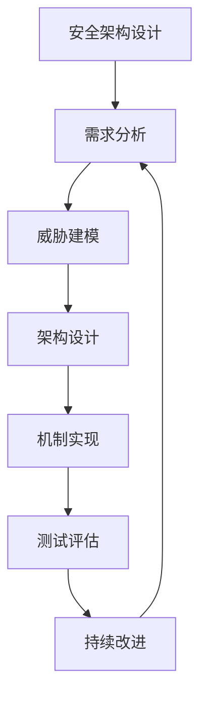

> 📌 **考试重点**：安全架构设计案例分析的步骤和典型应用是论文写作的重要素材。

> 🔗 **真题关联**：历年论文题多次考查安全架构设计，2024年上半年论文题考查了安全架构设计。

---

## 参考文献

[^1]: 《系统架构设计师教程(第二版)》P.638 §18.1

[^2]: 《系统架构设计师教程(第二版)》P.638 §18.1

[^3]: 《系统架构设计师教程(第二版)》P.639 §18.1

[^4]: 《系统架构设计师教程(第二版)》P.639 §18.1

[^5]: 《系统架构设计师教程(第二版)》P.638 §18.2

[^6]: 《系统架构设计师教程(第二版)》P.638 §18.2

[^7]: 《系统架构设计师教程(第二版)》P.640 §18.2.2

[^8]: 《系统架构设计师教程(第二版)》P.641 §18.2.3

[^9]: 《系统架构设计师教程(第二版)》P.642 §18.2.4

[^10]: 《系统架构设计师教程(第二版)》P.643 §18.2.5

[^11]: 《系统架构设计师教程(第二版)》P.644 §18.2.1

[^12]: 《系统架构设计师教程(第二版)》P.645 §18.2

[^13]: 《系统架构设计师教程(第二版)》P.646 §18.3

[^14]: 《系统架构设计师教程(第二版)》P.648 §18.4.1

[^15]: 《系统架构设计师教程(第二版)》P.648 §18.4.1

[^16]: 《系统架构设计师教程(第二版)》P.648 §18.4.1

[^17]: 《系统架构设计师教程(第二版)》P.649 §18.4.1

[^18]: 《系统架构设计师教程(第二版)》P.649 §18.4.1

[^19]: 《系统架构设计师教程(第二版)》P.649 §18.4.1

[^20]: 《系统架构设计师教程(第二版)》P.649 §18.4.1

[^21]: 《系统架构设计师教程(第二版)》P.649 §18.4.1

[^22]: 《系统架构设计师教程(第二版)》P.650 §18.5

[^23]: 《系统架构设计师教程(第二版)》P.653 §18.5.1

[^24]: 《系统架构设计师教程(第二版)》P.653 §18.5.1

[^25]: 《系统架构设计师教程(第二版)》P.653 §18.5.1

[^26]: 《系统架构设计师教程(第二版)》P.654 §18.5.2

[^27]: 《系统架构设计师教程(第二版)》P.655 §18.5.3

[^28]: 《系统架构设计师教程(第二版)》P.656 §18.5.4

[^29]: 《系统架构设计师教程(第二版)》P.657 §18.5.5

[^30]: 《系统架构设计师教程(第二版)》P.658 §18.5.6

[^31]: 《系统架构设计师教程(第二版)》P.660 §18.6

[^32]: 《系统架构设计师教程(第二版)》P.664 §18.7.1

[^33]: 《系统架构设计师教程(第二版)》P.664 §18.7.1

[^34]: 《系统架构设计师教程(第二版)》P.665-666 §18.7.2

[^35]: 《系统架构设计师教程(第二版)》P.668 §18.7.3

[^36]: 《系统架构设计师教程(第二版)》P.670 §18.8
