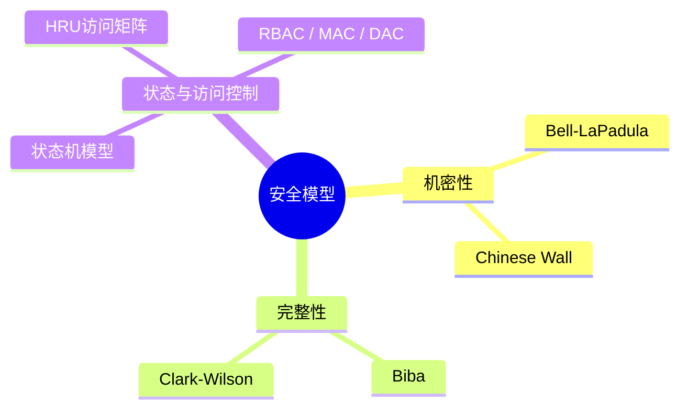
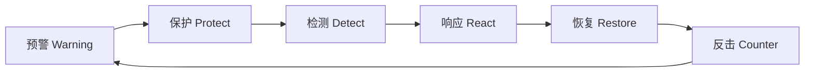
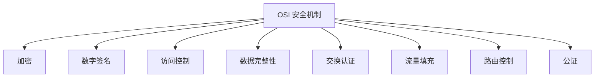
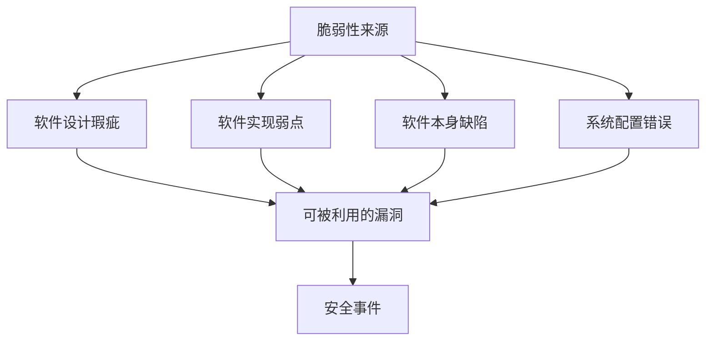

## 安全模型

安全模型是精确描述系统安全重要方面及其与系统行为之间关系的抽象框架，它将宽泛的安全策略转化为可执行、可验证的形式[^1]。信息系统的核心安全目标是控制主体（用户与进程）对客体（数据与程序）的访问，实现可用性、连续性、机密性、完整性与不可抵赖性的统一[^2]。

- **Bell-LaPadula（BLP）**：强制访问控制模型，以敏感度划分安全级别。核心规则为“不上读、不下写”，即低级别主体不能读取高级别客体，高级别主体不能向低级别客体写入，从而防止机密信息泄露[^3]。
- **Biba**：面向完整性保护，规则与 BLP 相反：“不下读、不上写”，防止低完整性数据污染高完整性数据[^4]。
- **Clark-Wilson（CWM）**：通过转换过程（TP）与完整性验证过程（IVP）保证事务完整性，强调职责分离与审计，常用于银行系统[^5]。
- **Chinese Wall**：解决多边安全中的利益冲突问题，主体一旦访问某竞争方数据，便被限制访问同一利益冲突组内的其他数据[^6]。

---

## WPDRRC 模型

WPDRRC 是我国“八六三”信息安全专家组提出的信息系统安全保障体系建设模型，在 PDRR（保护、检测、响应、恢复）基础上增加了 **预警（Warning）** 与 **反击（Counter）** 两个环节，形成闭环的安全保障体系[^7]。该模型强调人员、策略与技术三大要素贯穿安全建设的全过程[^8]。

六个环节的含义如下：

- **预警**：通过远程安全评估模拟攻击，发现潜在薄弱环节，预测风险趋势[^9]。
- **保护**：采用加密、数字签名、访问控制、防火墙等技术实现网络与信息的主动防护[^10]。
- **检测**：通过入侵检测、脆弱性扫描、完整性校验等手段动态发现威胁与违规[^11]。
- **响应**：对安全事件进行报警、封堵、隔离与状态评估，快速将系统调整到安全状态[^12]。
- **恢复**：在系统遭受破坏后，通过冗余、备份、替换与修复尽快恢复业务[^13]。
- **反击**：利用取证与反制技术追踪攻击来源，形成依法打击能力[^14]。

WPDRRC 与 PDR、PPDR、PDRR、MPDRR 等模型相比，是唯一同时覆盖预警、恢复、反击与管理能力的模型，更适合构建动态、可演进的整体安全架构[^15]。

---

## OSI 安全体系

OSI 安全体系结构由 ISO/IEC 7498-2 提出，从安全服务、安全机制与系统层次三个维度构建开放系统的安全框架[^16]。它为网络与信息系统安全设计提供了标准化的参考模型。

体系定义了 **五类安全服务**[^17]：

- **认证服务**：确认通信实体身份的真实性。
- **访问控制服务**：防止未授权使用资源。
- **数据机密性服务**：防止数据被非法泄露。
- **数据完整性服务**：防止数据被非法篡改、删除或破坏。
- **抗抵赖服务**：提供通信双方行为的不可否认证据。

为实现上述服务，OSI 安全体系定义了 **八种安全机制**[^18]：

这些机制可单独或组合地部署到 OSI 的七个层次中，形成认证框架、访问控制框架、机密性框架、完整性框架与抗抵赖框架[^19]。安全架构师在设计网络体系时，需根据业务风险在适当层次选择对应服务与机制，避免单一防护点失效导致整体安全崩溃[^20]。

---

## 系统架构脆弱性

系统架构脆弱性是指系统中存在的设计瑕疵、实现缺陷或配置错误，这些弱点本身不会直接造成危害，但一旦被攻击者利用，就可能破坏安全策略并引发安全事件[^21]。安全“木桶理论”指出，系统整体安全水平由其最薄弱的环节决定，而非最强的防护措施[^22]。

软件脆弱性可按不同维度分类：

- **ISO 分类法**：面向信息系统安全与隐私。
- **Landwehr 分类法**：从缺陷起因、引入时间与分布位置三个维度划分。
- **Aslam 分类法**：从软件生命周期角度分为编码故障与突发故障。
- **IBM 分类法**：融合脆弱性、威胁、攻击与检测方法，面向脆弱性检测工具开发[^23]。

脆弱性具有生命周期，包括引入、产生破坏效果、被修补和消失等阶段。典型引入原因包括输入验证错误、权限检查错误、边界检出错误与软件设计缺陷；破坏效果可能表现为非法执行代码、非法修改目标对象、访问数据对象或拒绝服务[^24]。

在架构层面，纵深防御是降低脆弱性影响的关键策略：通过多层、异构的防御措施，即使某一层被突破，也能限制攻击扩散并保留检测与响应能力[^25]。

---

## 参考文献

[^1]: 《系统架构设计师教程(第二版)》P.638 §18.2

[^2]: 《系统架构设计师教程(第二版)》P.638 §18.2

[^3]: 《系统架构设计师教程(第二版)》P.640 §18.2.2

[^4]: 《系统架构设计师教程(第二版)》P.641 §18.2.3

[^5]: 《系统架构设计师教程(第二版)》P.642 §18.2.4

[^6]: 《系统架构设计师教程(第二版)》P.643 §18.2.5

[^7]: 《系统架构设计师教程(第二版)》P.648 §18.4.1

[^8]: 《系统架构设计师教程(第二版)》P.648 §18.4.1

[^9]: 《系统架构设计师教程(第二版)》P.648 §18.4.1

[^10]: 《系统架构设计师教程(第二版)》P.649 §18.4.1

[^11]: 《系统架构设计师教程(第二版)》P.649 §18.4.1

[^12]: 《系统架构设计师教程(第二版)》P.649 §18.4.1

[^13]: 《系统架构设计师教程(第二版)》P.649 §18.4.1

[^14]: 《系统架构设计师教程(第二版)》P.649 §18.4.1

[^15]: 《系统架构设计师教程(第二版)》P.649 §18.4.1

[^16]: 《系统架构设计师教程(第二版)》P.653 §18.5.1

[^17]: 《系统架构设计师教程(第二版)》P.653 §18.5.1

[^18]: 《系统架构设计师教程(第二版)》P.653 §18.5.1

[^19]: 《系统架构设计师教程(第二版)》P.653-659 §18.5

[^20]: 《系统架构设计师教程(第二版)》P.653 §18.5.1

[^21]: 《系统架构设计师教程(第二版)》P.664 §18.7.1

[^22]: 《系统架构设计师教程(第二版)》P.664 §18.7.1

[^23]: 《系统架构设计师教程(第二版)》P.665-666 §18.7.2

[^24]: 《系统架构设计师教程(第二版)》P.666 §18.7.2

[^25]: 《系统架构设计师教程(第二版)》P.668 §18.7.3
