## 传统数据处理系统的问题

传统数据处理系统主要基于关系型数据库（RDBMS），在海量数据、高并发、多样性数据场景下面临诸多挑战[^1]。

**传统数据处理系统的局限性**：

- **扩展性不足**：关系型数据库主要采用纵向扩展（Scale-up），硬件成本高昂且存在上限
- **性能瓶颈**：面对 PB 级数据和百万级并发请求，传统数据库难以满足低延迟要求
- **数据类型单一**：主要支持结构化数据，难以处理半结构化和非结构化数据
- **高可用性不足**：主从复制模式存在数据延迟，故障切换时间较长
- **成本高昂**：商业数据库许可证费用昂贵，专有硬件投入大

**CAP 理论约束**：

在分布式系统中，一致性（Consistency）、可用性（Availability）、分区容错性（Partition Tolerance）三者不可兼得，最多只能同时满足两项[^2]。

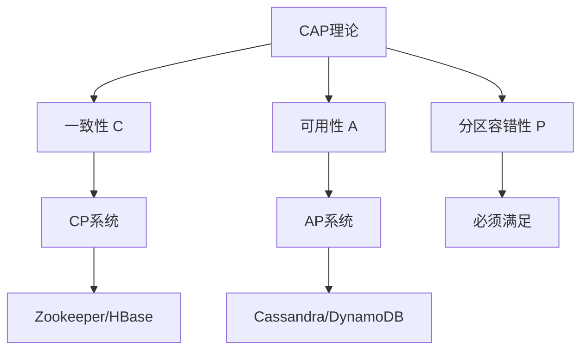

> 📌 **考试重点**：传统数据处理系统的局限性、CAP 理论的含义和典型系统是理解大数据架构的基础。

> 🔗 **真题关联**：2022年上半年选择题考查了 CAP 理论中三个属性的含义。

---

## 大数据特征（5V）

大数据是对传统数据管理系统难以处理的海量、高速增长、多样形态的数据集合的统称。教材将其特征归纳为 **5V**[^3]：

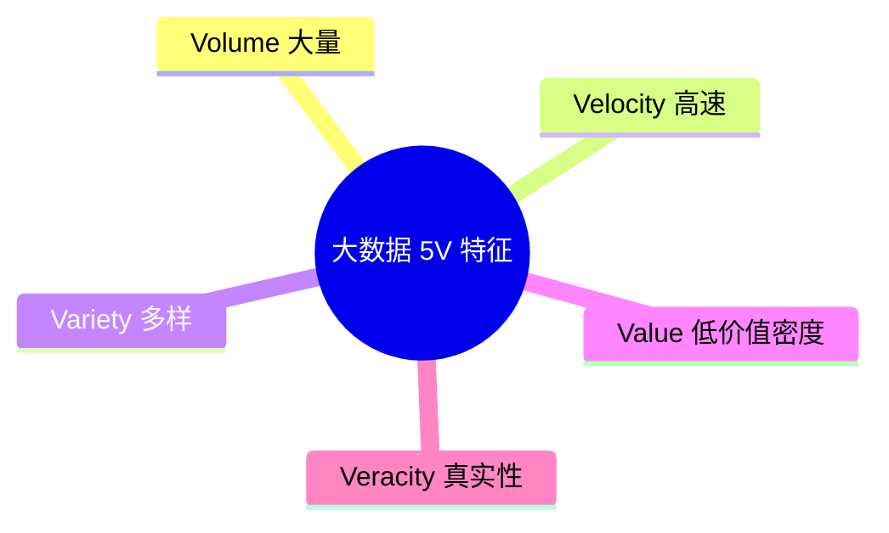

- **Volume（大量）**：数据规模从 TB 级跃升到 PB 级甚至更高，传统数据库与数据仓库在存储和计算能力上难以直接承载[^4]。
- **Velocity（高速）**：数据产生、传输与处理的速度极快，要求系统具备低延迟读取和更新能力，能够在毫秒到秒级完成响应[^5]。
- **Variety（多样）**：数据类型涵盖结构化、半结构化与非结构化数据，包括日志、文本、图像、音视频、传感器数据等，其中非结构化数据占比约 85%[^6]。
- **Value（低价值密度）**：海量原始数据中真正有价值的信息比例较低，需要通过数据挖掘、机器学习等手段进行"一次挖掘"获取粗糙知识，再与领域经验结合进行"二次挖掘"生成智能知识[^7]。
- **Veracity（真实性）**：数据来源复杂、质量参差不齐，存在不确定性、噪声与偏差，需要可信度评估与数据治理[^8]。

5V 特征决定了大数据系统不能简单依赖传统关系型数据库的纵向扩展，而需要采用分布式存储、并行计算、流处理与分层架构等新技术范式[^9]。

> 📌 **考试重点**：5V 特征的内涵、数据类型占比、低价值密度的含义是大数据的基础考点。

> 🔗 **真题关联**：2023年上半年选择题考查了大数据 5V 特征中 Value 的含义。

---

## 大数据处理系统架构分析

大数据处理系统的核心需求包括可扩展性、容错性、低延迟和高吞吐[^10]。

**架构设计原则**：

1. **水平扩展**：通过增加节点实现线性扩展，而非升级单机硬件
2. **容错性**：单点故障不影响整体系统，数据多副本存储
3. **数据局部性**：计算向数据移动，减少网络传输开销
4. **简单性**：系统组件职责单一，降低复杂度
5. **延迟与吞吐平衡**：根据业务需求选择批处理或流处理

**大数据处理系统分类**：

| 类型 | 特点 | 代表技术 |
|------|------|----------|
| 批处理系统 | 高吞吐、高延迟 | Hadoop MapReduce |
| 流处理系统 | 低延迟、实时性 | Flink、Storm |
| 混合系统 | 批流一体 | Spark |

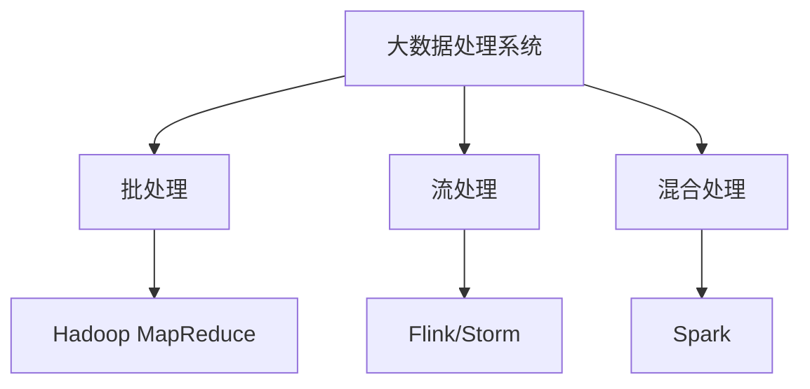

> 📌 **考试重点**：大数据处理系统的核心需求、架构设计原则、三类处理系统的特点是架构分析的核心考点。

> 🔗 **真题关联**：2021年下半年选择题考查了大数据处理系统中水平扩展与垂直扩展的区别。

---

## Lambda架构

Lambda 架构由 Nathan Marz 提出，旨在用一个统一的框架满足大数据系统对高容错、低延迟、可扩展和可调试的要求[^11]。它整合了离线批处理与实时流处理，通过读写分离与复杂性隔离原则实现海量数据的可靠处理。

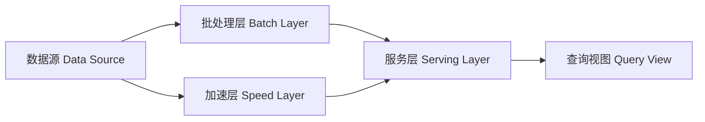

Lambda 架构由三层组成：

- **批处理层（Batch Layer）**：负责存储全量主数据集，数据需满足原始、不可变、真实三个属性。该层通过 MapReduce 等批处理作业预先计算完整视图，结果精确但延迟较高[^12]。
- **加速层（Speed Layer）**：只处理最近到达的增量数据流，快速生成实时视图，延迟低但结果可能为近似值。最终由下一批批处理结果覆盖，实现"最终精度"[^13]。
- **服务层（Serving Layer）**：合并批处理视图与实时视图，向上层提供统一查询接口[^14]。

Lambda 适合机器学习、物联网、实时推荐等需要同时兼顾历史全量分析与实时增量处理的场景。其主要缺点是需要维护批处理与流处理两套代码，开发和运维成本较高[^15]。

> 📌 **考试重点**：Lambda 架构的三层组成、各层职责、适用场景、优缺点是核心考点。

> 🔗 **真题关联**：2022年下半年案例分析题考查了 Lambda 架构在实时推荐系统中的应用。

---

## Kappa架构

Kappa 架构由 Jay Kreps 提出，是对 Lambda 架构的简化。它删除了批处理层，将消息队列（如 Kafka）作为唯一的数据源，所有计算都通过流处理引擎完成[^16]。

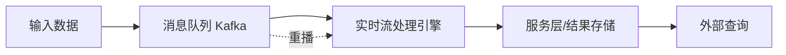

Kappa 架构的核心理念包括：

- **数据不可变**：所有数据以追加日志形式存储，不直接修改或删除历史记录，便于故障恢复与重新计算[^17]。
- **统一流处理**：离线分析与实时计算共用同一套流处理代码，避免 Lambda 中两套系统带来的数据口径不一致与维护负担[^18]。
- **重新处理（Backfill）**：当业务逻辑需要更新时，可将消息队列的 offset 重置为零，重新处理历史数据生成新的视图，然后切换查询到新视图[^19]。

Kappa 更适合增量数据写入、时序数据、日志分析等场景，典型技术栈包括 Kafka、Flink、Pulsar 等。其局限性在于：消息队列长期存储成本较高，且对历史数据的任意探索性分析不如批处理直接高效[^20]。

> 📌 **考试重点**：Kappa 架构的核心理念（数据不可变/统一流处理/重新处理）、与 Lambda 的区别是核心考点。

> 🔗 **真题关联**：2023年上半年选择题考查了 Kappa 架构中重新处理（Backfill）的含义。

---

## Lambda与Kappa对比

Lambda 与 Kappa 是两种主流的大数据处理架构模式，选择哪种架构取决于业务场景、数据特征与团队能力。教材从多个维度给出了对比[^21]。

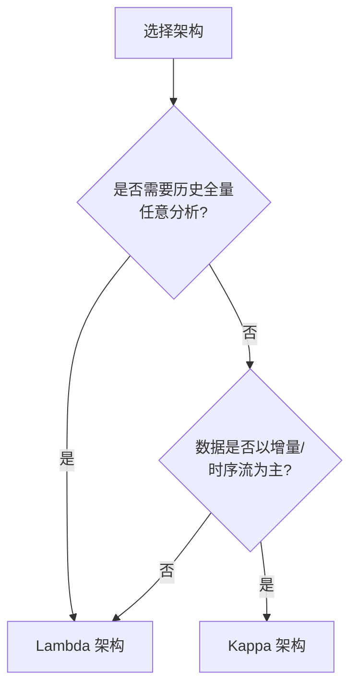

| 对比维度 | Lambda 架构                  | Kappa 架构                   |
| -------- | ---------------------------- | ---------------------------- |
| 处理模式 | 批处理 + 流处理              | 纯流处理                     |
| 代码维护 | 两套代码，维护复杂           | 一套代码，维护简单           |
| 数据口径 | 可能存在批/流差异            | 统一口径                     |
| 实时性   | 流层提供低延迟               | 依赖流处理延迟               |
| 历史分析 | 批处理层直接高效             | 需重播日志，成本较高         |
| 适用场景 | 机器学习、数据探索、历史分析 | 日志分析、时序数据、实时决策 |

Lambda 适合需要同时满足高精确历史计算与低延迟实时查询的复杂场景，如广告平台、奥运大数据等[^22]。Kappa 适合数据天然按时间流式产生、对实时性要求高的场景，如证券日志分析、电商智能决策等[^23]。架构师应结合数据生命周期、查询模式与运维成本进行综合选择，避免为追求技术统一而牺牲业务所需的计算精度[^24]。

> 📌 **考试重点**：Lambda 与 Kappa 的对比维度、选择依据、适用场景是案例分析的常考内容。

> 🔗 **真题关联**：2021年下半年案例分析题考查了 Lambda 与 Kappa 架构的选择决策。

---

## 大数据技术栈

大数据技术栈涵盖数据采集、存储、计算、查询与可视化等多个层次，形成了围绕 Hadoop 生态、Spark、Flink 与 Kafka 等核心组件的完整技术体系[^25]。

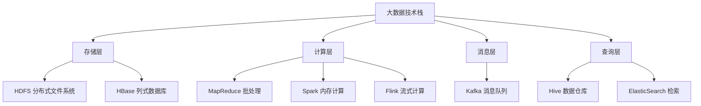

关键组件及其作用：

- **Hadoop**：包含 HDFS（分布式存储）与 MapReduce（分布式批处理），是大数据生态的基础平台，适合 PB 级数据的离线批处理[^26]。
- **Spark**：基于内存的分布式计算框架，相比 MapReduce 在迭代计算与交互式查询场景下具有更高的性能[^27]。
- **Flink**：以流处理为核心的计算引擎，支持低延迟、高吞吐的实时数据处理，并提供精确一次（Exactly-Once）语义[^28]。
- **Kafka**：高吞吐分布式消息队列，常用于数据采集、流式数据缓存与事件驱动架构[^29]。
- **HBase**：基于 HDFS 的列式 NoSQL 数据库，适合海量数据的随机读写与半结构化数据存储[^30]。

架构师在选型时，需结合 5V 特征与业务延迟要求，合理组合批处理与流处理组件，避免过度堆叠导致运维复杂[^31]。

> 📌 **考试重点**：大数据技术栈各层组件、Hadoop/Spark/Flink/Kafka/HBase 的特点是技术选型的核心考点。

> 🔗 **真题关联**：2022年上半年选择题考查了 Spark 与 MapReduce 在性能上的区别。

---

## 实时流处理架构

实时流处理架构是大数据架构的重要组成部分，用于处理持续到达的数据流[^32]。

**流处理引擎**：

- **Flink**：支持低延迟、高吞吐的流处理，提供 Exactly-Once 语义
- **Spark Streaming**：基于微批处理的流处理，延迟相对较高
- **Storm**：早期流处理引擎，延迟低但功能相对简单
- **Kafka Streams**：与 Kafka 紧密集成的轻量级流处理库

**流处理关键概念**：

- **事件时间（Event Time）**：数据产生的时间，而非处理时间
- **窗口计算**：将数据流划分为有限大小的窗口进行处理
  - 滚动窗口（Tumbling Window）
  - 滑动窗口（Sliding Window）
  - 会话窗口（Session Window）
- **状态管理**：维护流处理过程中的状态，支持容错和恢复
- **Exactly-Once 语义**：保证每条数据只被处理一次

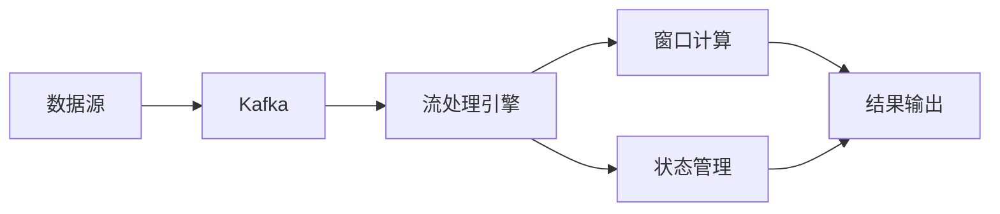

> 📌 **考试重点**：流处理引擎对比、事件时间 vs 处理时间、窗口计算类型、Exactly-Once 语义是流处理的核心考点。

> 🔗 **真题关联**：2023年下半年选择题考查了 Flink 的 Exactly-Once 语义实现机制。

---

## 批处理架构

批处理架构是大数据处理的传统模式，适用于对历史全量数据进行分析[^33]。

**MapReduce 编程模型**：

- **Map 阶段**：将输入数据映射为键值对
- **Shuffle 阶段**：对键值对进行排序和分组
- **Reduce 阶段**：对分组后的数据进行聚合计算

**Spark 内存计算**：

- **RDD（弹性分布式数据集）**：Spark 的基本数据抽象
- **DataFrame/DataSet**：结构化数据 API，支持 SQL 查询
- **Spark SQL**：支持标准 SQL 查询
- **Spark MLlib**：机器学习库

**批处理优化技术**：

- **数据分区**：将数据划分为多个分区，并行处理
- **数据缓存**：将中间结果缓存到内存，避免重复计算
- **广播变量**：将小数据集广播到所有节点，减少数据传输
- **数据倾斜处理**：识别和解决数据分布不均问题

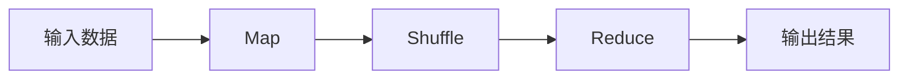

> 📌 **考试重点**：MapReduce 三阶段、Spark RDD/DataFrame、批处理优化技术是批处理的核心考点。

> 🔗 **真题关联**：2021年上半年选择题考查了 MapReduce 中 Shuffle 阶段的作用。

---

## 数据湖与数据仓库

数据湖（Data Lake）与数据仓库（Data Warehouse）是两种主流的数据存储架构[^34]。

| 维度 | 数据仓库 | 数据湖 |
|------|----------|--------|
| 数据类型 | 结构化 | 结构化/半结构化/非结构化 |
| Schema | 写入时确定 | 读取时确定 |
| 用户 | 业务分析师 | 数据科学家/工程师 |
| 成本 | 较高 | 较低 |
| 灵活性 | 较低 | 较高 |

**湖仓一体（Lakehouse）架构**：

结合数据湖的灵活性和数据仓库的可靠性，典型技术包括：

- **Delta Lake**：在数据湖之上提供 ACID 事务支持
- **Apache Iceberg**：开放表格式，支持大规模数据集
- **Apache Hudi**：支持增量数据处理和实时分析

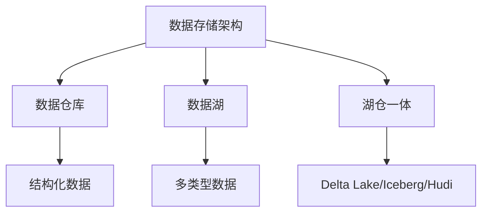

> 📌 **考试重点**：数据湖与数据仓库的区别、湖仓一体架构、Delta Lake/Iceberg/Hudi 是数据存储的核心考点。

> 🔗 **真题关联**：2022年下半年选择题考查了数据湖与数据仓库在 Schema 设计上的区别。

---

## 大数据架构案例分析

**案例1：电商推荐系统**

某电商平台构建实时推荐系统，基于用户行为数据实现个性化推荐[^35]：

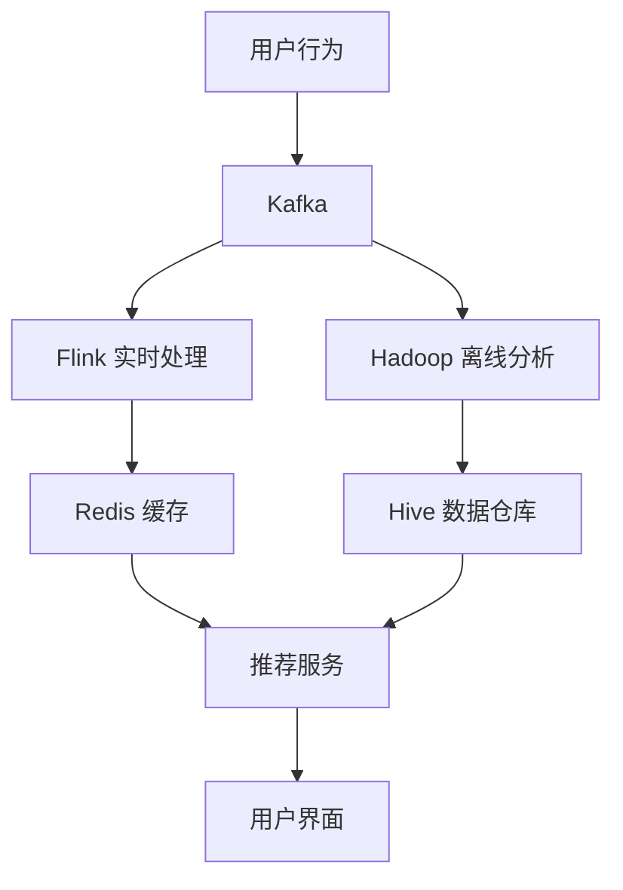

**技术方案**：

- 实时流：Kafka + Flink + Redis，实现毫秒级推荐
- 离线批处理：Hadoop + Hive，实现全量用户画像
- 模型训练：Spark MLlib，定期更新推荐模型

**案例2：实时风控系统**

某金融机构构建实时风控系统，识别欺诈交易[^36]：

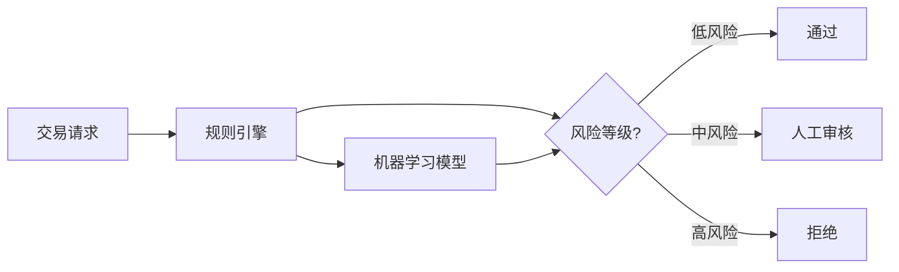

**技术方案**：

- 实时计算：Flink 处理交易流，毫秒级响应
- 规则引擎：Drools 实现复杂业务规则
- 机器学习：XGBoost 模型识别异常模式
- 特征存储：Redis 存储用户实时特征

> 📌 **考试重点**：电商推荐系统和实时风控系统的架构设计、技术选型是案例分析的典型考题。

> 🔗 **真题关联**：2023年下半年案例分析题考查了实时风控系统的架构设计。

---

## 大数据采集与预处理

大数据采集与预处理是大数据处理流程的首要环节，决定了后续分析的质量与可靠性[^37]。原始数据往往存在格式不统一、缺失值、噪声等问题，必须经过系统化的采集与预处理才能进入分析阶段。

**数据采集技术**：

- **Flume**：Apache 开源的分布式、可靠、高可用的海量日志采集系统，支持自定义数据源和 Sink，适用于日志聚合场景
- **Logstash**：Elastic Stack 的数据收集引擎，支持多种输入/输出插件，具备强大的过滤和转换能力
- **Scribe**：Facebook 开源的日志收集系统，采用 Thrift 协议传输，适合大规模分布式日志汇聚

**数据清洗与转换**：

- **数据清洗**：处理缺失值（删除/填充/插值）、去除重复记录、纠正错误数据、处理异常值
- **数据转换**：格式标准化、编码统一、单位换算、数据类型转换、特征工程
- **数据归约**：维度归约（PCA）、数量归约（抽样/聚类）、数据压缩

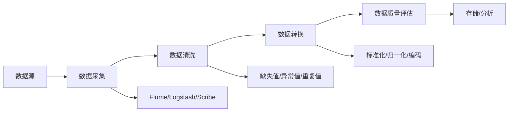

> 📌 **考试重点**：数据采集工具（Flume/Logstash/Scribe）的特点、数据清洗的主要步骤、数据转换的常见方法是数据采集与预处理的核心考点。

> 🔗 **真题关联**：2022年上半年选择题考查了数据清洗中缺失值处理的常用方法。

---

## 大数据存储技术

大数据存储技术需要解决海量数据的高效存储、快速访问和高可用性问题[^38]。传统关系型数据库在 PB 级数据场景下难以满足需求，因此发展出了多种分布式存储方案。

**分布式文件系统**：

- **HDFS（Hadoop Distributed File System）**：Hadoop 生态的核心存储组件，采用主从架构（NameNode + DataNode），支持数据多副本存储，适合大文件顺序读取，不适合小文件和随机读写
- **Ceph**：统一的分布式存储系统，支持对象存储、块存储和文件系统存储，采用 CRUSH 算法实现数据分布，无单点故障

**NoSQL 数据库**：

- **HBase**：基于 HDFS 的列式分布式数据库，适合海量数据的随机读写，支持动态列扩展，典型应用于时序数据和日志存储
- **MongoDB**：文档型数据库，以 JSON-like 的 BSON 格式存储数据，支持丰富的查询语言和灵活的 Schema 设计
- **Cassandra**：宽列存储数据库，采用去中心化架构（DHT 环），具备高可用和线性扩展能力，适合写入密集型场景

**对象存储**：

对象存储以扁平化的方式存储非结构化数据（图片、视频、文档等），通过 REST API 访问，典型代表包括 Amazon S3、阿里云 OSS、MinIO 等。对象存储具有高扩展性、低成本和高持久性的特点[^39]。

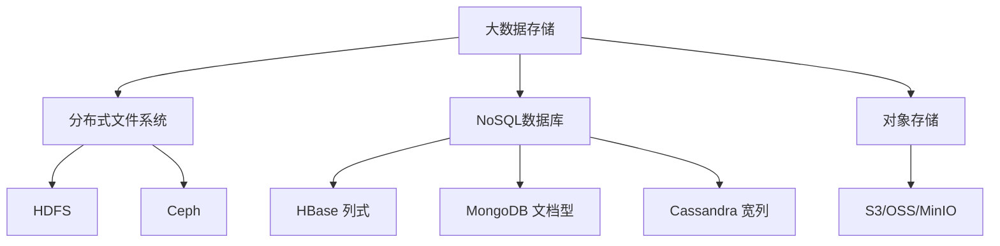

> 📌 **考试重点**：HDFS 的架构特点（NameNode/DataNode）、NoSQL 数据库的分类与选型（列式/文档型/宽列）、对象存储的适用场景是存储技术的核心考点。

> 🔗 **真题关联**：2023年下半年选择题考查了 HDFS 中 NameNode 与 DataNode 的职责分工。

---

## 大数据架构设计原则

大数据架构设计需要遵循一系列核心原则，以确保系统具备良好的扩展性、性能和可靠性[^40]。这些原则贯穿于数据采集、存储、计算和服务的全生命周期。

**数据分区策略**：

- **范围分区（Range Partitioning）**：按数据范围（如时间区间、ID 范围）划分，适合范围查询，但可能导致热点问题
- **哈希分区（Hash Partitioning）**：按哈希值均匀分布数据，避免热点，但范围查询需扫描全部分区
- **列表分区（List Partitioning）**：按离散值列表划分，适合类别型数据
- **复合分区**：结合多种分区策略，如先按时间范围分区再按哈希分区

**数据本地化**：

数据本地化（Data Locality）是指将计算任务调度到数据所在的节点执行，减少网络传输开销[^41]。Hadoop MapReduce 的 "移动计算而非移动数据" 理念是典型实践，通过将计算逻辑发送到数据节点，显著提升处理效率。

**数据压缩**：

数据压缩可减少存储空间和网络传输量，常见压缩格式包括 Gzip、Snappy、LZO、Zstandard 等。选择压缩算法需在压缩比、压缩/解压速度和是否可切分之间权衡[^42]。

**数据备份与恢复**：

- **多副本机制**：HDFS 默认 3 副本，Cassandra 可配置副本因子
- **异地容灾**：跨数据中心复制，防止区域性故障
- **快照与增量备份**：定期全量快照结合增量日志备份，缩短恢复时间
- **故障自动检测与恢复**：通过心跳机制检测节点故障，自动触发数据重平衡

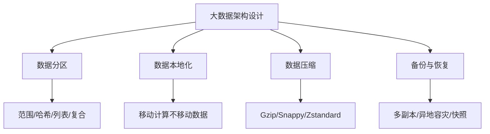

> 📌 **考试重点**：数据分区策略的对比与选型、数据本地化的核心理念、压缩算法的权衡因素、备份恢复机制的设计是架构设计原则的核心考点。

> 🔗 **真题关联**：2021年下半年案例分析题考查了大数据系统中数据分区策略的选择与数据本地化优化方案。

---
## 参考文献

[^1]: 《系统架构设计师教程(第二版)》P.676 §19.1

[^2]: 《系统架构设计师教程(第二版)》P.676 §19.1

[^3]: 《系统架构设计师教程(第二版)》P.678 §19.2

[^4]: 《系统架构设计师教程(第二版)》P.676 §19.1

[^5]: 《系统架构设计师教程(第二版)》P.679 §19.2.2

[^6]: 《系统架构设计师教程(第二版)》P.678 §19.2.1

[^7]: 《系统架构设计师教程(第二版)》P.678 §19.2.1

[^8]: 《系统架构设计师教程(第二版)》P.678 §19.2.1

[^9]: 《系统架构设计师教程(第二版)》P.679 §19.2.2

[^10]: 《系统架构设计师教程(第二版)》P.679 §19.2.2

[^11]: 《系统架构设计师教程(第二版)》P.680 §19.3.1

[^12]: 《系统架构设计师教程(第二版)》P.681 §19.3.3

[^13]: 《系统架构设计师教程(第二版)》P.681 §19.3.3

[^14]: 《系统架构设计师教程(第二版)》P.681 §19.3.3

[^15]: 《系统架构设计师教程(第二版)》P.685 §19.3.5

[^16]: 《系统架构设计师教程(第二版)》P.686 §19.4.1

[^17]: 《系统架构设计师教程(第二版)》P.687 §19.4.1

[^18]: 《系统架构设计师教程(第二版)》P.687 §19.4.2

[^19]: 《系统架构设计师教程(第二版)》P.688 §19.4.3

[^20]: 《系统架构设计师教程(第二版)》P.688 §19.4.4

[^21]: 《系统架构设计师教程(第二版)》P.690 §19.5.1

[^22]: 《系统架构设计师教程(第二版)》P.692-694 §19.6

[^23]: 《系统架构设计师教程(第二版)》P.695-700 §19.6

[^24]: 《系统架构设计师教程(第二版)》P.692 §19.5.2

[^25]: 《系统架构设计师教程(第二版)》P.680 §19.3.1

[^26]: 《系统架构设计师教程(第二版)》P.684 §19.3.4

[^27]: 《系统架构设计师教程(第二版)》P.684 §19.3.4

[^28]: 《系统架构设计师教程(第二版)》P.699 §19.6.3

[^29]: 《系统架构设计师教程(第二版)》P.688 §19.4.3

[^30]: 《系统架构设计师教程(第二版)》P.684 §19.3.4

[^31]: 《系统架构设计师教程(第二版)》P.685 §19.3.5

[^32]: 《系统架构设计师教程(第二版)》P.694-698 §19.6.2

[^33]: 《系统架构设计师教程(第二版)》P.683-684 §19.3.4

[^34]: 《系统架构设计师教程(第二版)》P.698-699 §19.6.4

[^35]: 《系统架构设计师教程(第二版)》P.692-694 §19.6

[^36]: 《系统架构设计师教程(第二版)》P.695-700 §19.6

[^37]: 《系统架构设计师教程(第二版)》P.676-677 §19.1

[^38]: 《系统架构设计师教程(第二版)》P.680 §19.3.1

[^39]: 《系统架构设计师教程(第二版)》P.684 §19.3.4

[^40]: 《系统架构设计师教程(第二版)》P.679 §19.2.2

[^41]: 《系统架构设计师教程(第二版)》P.683 §19.3.4

[^42]: 《系统架构设计师教程(第二版)》P.684 §19.3.4
