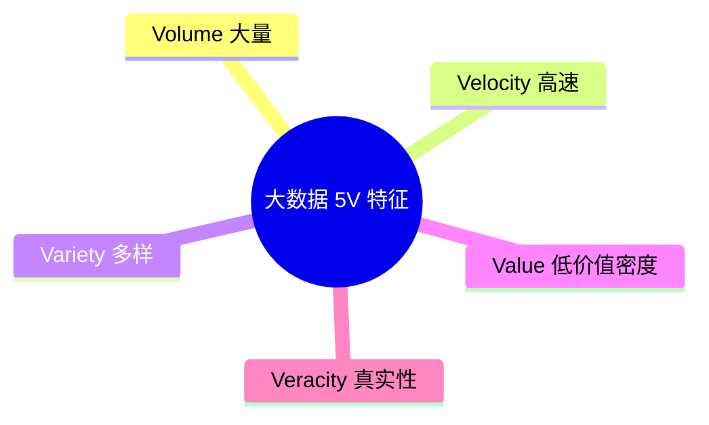
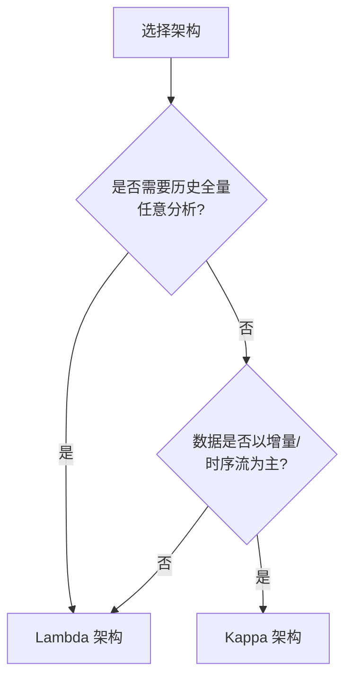
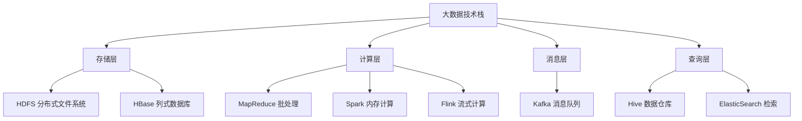

## 大数据特征（5V）

大数据是对传统数据管理系统难以处理的海量、高速增长、多样形态的数据集合的统称。教材将其特征归纳为 **5V**[^1]：

- **Volume（大量）**：数据规模从 TB 级跃升到 PB 级甚至更高，传统数据库与数据仓库在存储和计算能力上难以直接承载[^2]。
- **Velocity（高速）**：数据产生、传输与处理的速度极快，要求系统具备低延迟读取和更新能力，能够在毫秒到秒级完成响应[^3]。
- **Variety（多样）**：数据类型涵盖结构化、半结构化与非结构化数据，包括日志、文本、图像、音视频、传感器数据等，其中非结构化数据占比约 85%[^4]。
- **Value（低价值密度）**：海量原始数据中真正有价值的信息比例较低，需要通过数据挖掘、机器学习等手段进行“一次挖掘”获取粗糙知识，再与领域经验结合进行“二次挖掘”生成智能知识[^5]。
- **Veracity（真实性）**：数据来源复杂、质量参差不齐，存在不确定性、噪声与偏差，需要可信度评估与数据治理[^6]。

5V 特征决定了大数据系统不能简单依赖传统关系型数据库的纵向扩展，而需要采用分布式存储、并行计算、流处理与分层架构等新技术范式[^7]。

---

## Lambda 架构

Lambda 架构由 Nathan Marz 提出，旨在用一个统一的框架满足大数据系统对高容错、低延迟、可扩展和可调试的要求[^8]。它整合了离线批处理与实时流处理，通过读写分离与复杂性隔离原则实现海量数据的可靠处理。

Lambda 架构由三层组成：

- **批处理层（Batch Layer）**：负责存储全量主数据集，数据需满足原始、不可变、真实三个属性。该层通过 MapReduce 等批处理作业预先计算完整视图，结果精确但延迟较高[^9]。
- **加速层（Speed Layer）**：只处理最近到达的增量数据流，快速生成实时视图，延迟低但结果可能为近似值。最终由下一批批处理结果覆盖，实现“最终精度”[^10]。
- **服务层（Serving Layer）**：合并批处理视图与实时视图，向上层提供统一查询接口[^11]。

Lambda 适合机器学习、物联网、实时推荐等需要同时兼顾历史全量分析与实时增量处理的场景。其主要缺点是需要维护批处理与流处理两套代码，开发和运维成本较高[^12]。

---

## Kappa 架构

Kappa 架构由 Jay Kreps 提出，是对 Lambda 架构的简化。它删除了批处理层，将消息队列（如 Kafka）作为唯一的数据源，所有计算都通过流处理引擎完成[^13]。

Kappa 架构的核心理念包括：

- **数据不可变**：所有数据以追加日志形式存储，不直接修改或删除历史记录，便于故障恢复与重新计算[^14]。
- **统一流处理**：离线分析与实时计算共用同一套流处理代码，避免 Lambda 中两套系统带来的数据口径不一致与维护负担[^15]。
- **重新处理（Backfill）**：当业务逻辑需要更新时，可将消息队列的 offset 重置为零，重新处理历史数据生成新的视图，然后切换查询到新视图[^16]。

Kappa 更适合增量数据写入、时序数据、日志分析等场景，典型技术栈包括 Kafka、Flink、Pulsar 等。其局限性在于：消息队列长期存储成本较高，且对历史数据的任意探索性分析不如批处理直接高效[^17]。

---

## Lambda 与 Kappa 对比

Lambda 与 Kappa 是两种主流的大数据处理架构模式，选择哪种架构取决于业务场景、数据特征与团队能力。教材从多个维度给出了对比[^18]。

| 对比维度 | Lambda 架构                  | Kappa 架构                   |
| -------- | ---------------------------- | ---------------------------- |
| 处理模式 | 批处理 + 流处理              | 纯流处理                     |
| 代码维护 | 两套代码，维护复杂           | 一套代码，维护简单           |
| 数据口径 | 可能存在批/流差异            | 统一口径                     |
| 实时性   | 流层提供低延迟               | 依赖流处理延迟               |
| 历史分析 | 批处理层直接高效             | 需重播日志，成本较高         |
| 适用场景 | 机器学习、数据探索、历史分析 | 日志分析、时序数据、实时决策 |

Lambda 适合需要同时满足高精确历史计算与低延迟实时查询的复杂场景，如广告平台、奥运大数据等[^19]。Kappa 适合数据天然按时间流式产生、对实时性要求高的场景，如证券日志分析、电商智能决策等[^20]。架构师应结合数据生命周期、查询模式与运维成本进行综合选择，避免为追求技术统一而牺牲业务所需的计算精度[^21]。

---

## 大数据技术栈

大数据技术栈涵盖数据采集、存储、计算、查询与可视化等多个层次，形成了围绕 Hadoop 生态、Spark、Flink 与 Kafka 等核心组件的完整技术体系[^22]。

关键组件及其作用：

- **Hadoop**：包含 HDFS（分布式存储）与 MapReduce（分布式批处理），是大数据生态的基础平台，适合 PB 级数据的离线批处理[^23]。
- **Spark**：基于内存的分布式计算框架，相比 MapReduce 在迭代计算与交互式查询场景下具有更高的性能[^24]。
- **Flink**：以流处理为核心的计算引擎，支持低延迟、高吞吐的实时数据处理，并提供精确一次（Exactly-Once）语义[^25]。
- **Kafka**：高吞吐分布式消息队列，常用于数据采集、流式数据缓存与事件驱动架构[^26]。
- **HBase**：基于 HDFS 的列式 NoSQL 数据库，适合海量数据的随机读写与半结构化数据存储[^27]。

架构师在选型时，需结合 5V 特征与业务延迟要求，合理组合批处理与流处理组件，避免过度堆叠导致运维复杂[^28]。

---

## 参考文献

[^1]: 《系统架构设计师教程(第二版)》P.678 §19.2

[^2]: 《系统架构设计师教程(第二版)》P.676 §19.1

[^3]: 《系统架构设计师教程(第二版)》P.679 §19.2.2

[^4]: 《系统架构设计师教程(第二版)》P.678 §19.2.1

[^5]: 《系统架构设计师教程(第二版)》P.678 §19.2.1

[^6]: 《系统架构设计师教程(第二版)》P.678 §19.2.1

[^7]: 《系统架构设计师教程(第二版)》P.679 §19.2.2

[^8]: 《系统架构设计师教程(第二版)》P.680 §19.3.1

[^9]: 《系统架构设计师教程(第二版)》P.681 §19.3.3

[^10]: 《系统架构设计师教程(第二版)》P.681 §19.3.3

[^11]: 《系统架构设计师教程(第二版)》P.681 §19.3.3

[^12]: 《系统架构设计师教程(第二版)》P.685 §19.3.5

[^13]: 《系统架构设计师教程(第二版)》P.686 §19.4.1

[^14]: 《系统架构设计师教程(第二版)》P.687 §19.4.1

[^15]: 《系统架构设计师教程(第二版)》P.687 §19.4.2

[^16]: 《系统架构设计师教程(第二版)》P.688 §19.4.3

[^17]: 《系统架构设计师教程(第二版)》P.688 §19.4.4

[^18]: 《系统架构设计师教程(第二版)》P.690 §19.5.1

[^19]: 《系统架构设计师教程(第二版)》P.692-694 §19.6

[^20]: 《系统架构设计师教程(第二版)》P.695-700 §19.6

[^21]: 《系统架构设计师教程(第二版)》P.692 §19.5.2

[^22]: 《系统架构设计师教程(第二版)》P.680 §19.3.1

[^23]: 《系统架构设计师教程(第二版)》P.684 §19.3.4

[^24]: 《系统架构设计师教程(第二版)》P.684 §19.3.4

[^25]: 《系统架构设计师教程(第二版)》P.699 §19.6.3

[^26]: 《系统架构设计师教程(第二版)》P.688 §19.4.3

[^27]: 《系统架构设计师教程(第二版)》P.684 §19.3.4

[^28]: 《系统架构设计师教程(第二版)》P.685 §19.3.5
