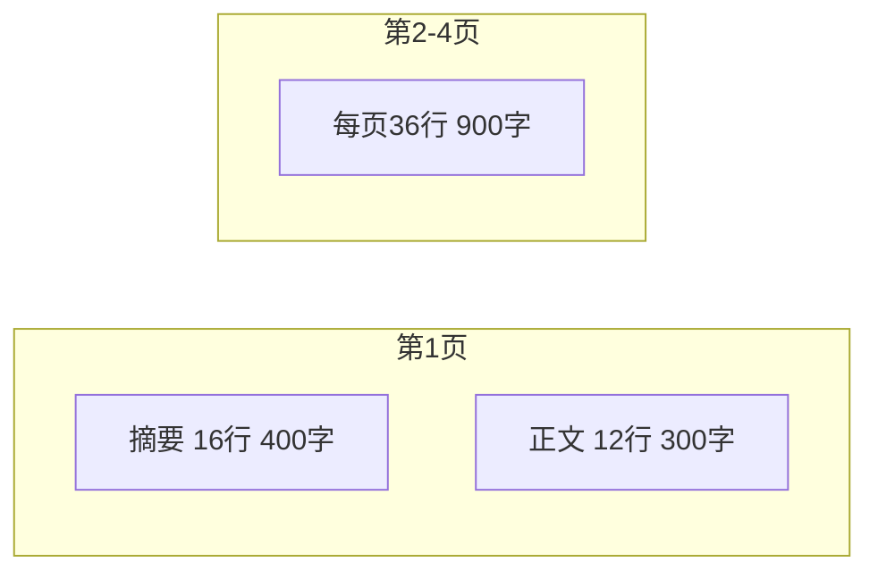
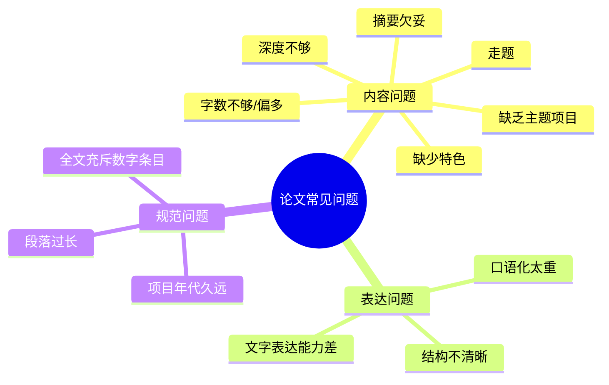
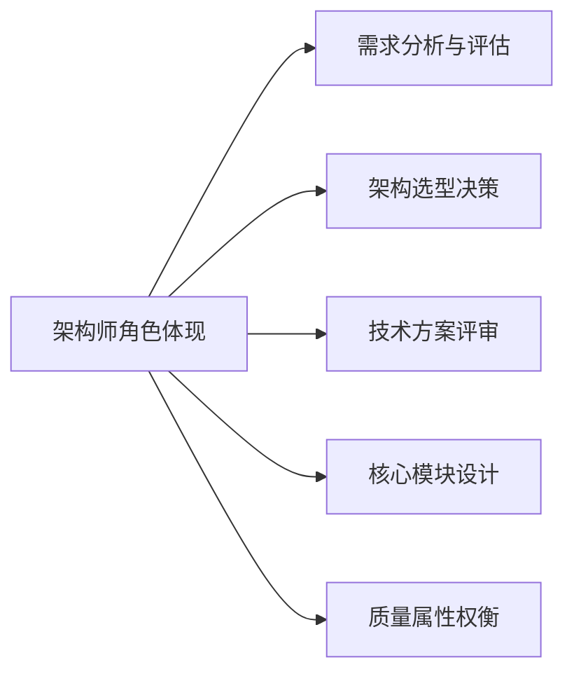

## 论文格式要求

系统架构设计师论文考试要求考生在规定时间内完成一篇结构完整、内容充实的技术论文。考试时间为 120 分钟，备选题目通常包含 4 道，考生可从中任选 1 题作答[^1]。

论文答题纸采用方格稿纸格式，摘要与正文分开撰写：

- **摘要**：300～400 字，位于第 1 页上半部分，共 16 行（每行 25 格）[^2]。
- **正文**：2000～3000 字，建议最佳字数约 2500 字，分布于第 1 页下半部分及第 2～4 页[^3]。

格式注意事项：

- 文字需写在格子里，每个格子一个字或标点；英文字母按书写习惯连续书写[^4]。
- 建议使用黑色中性笔，避免劣质纸张导致墨迹渗透影响卷面[^5]。
- 答题时不要忘记在指定位置画圈选题、填写考号，否则可能被视为无效答卷[^6]。

准确把握字数与格式是论文通过的基础条件。摘要少于 120 字可能被判不及格，正文超过 3000 字则无法在答题纸上完整呈现[^7]。

---

## 论文写作步骤

论文写作是一项需要提前准备的综合能力测试。临场应按照固定时间分配与步骤进行，以确保在 120 分钟内完成全部内容[^8]。

标准写作流程：

1. **选择题目**：挑选自己最熟悉、把握最大的题目，并确保所选项目与论题相符[^9]。
2. **论文构思**：确定论点、项目素材与章节划分，草拟简单提纲，规划字数分配[^10]。
3. **撰写摘要**：用简洁明了的语言概括正文核心内容，避免空泛口号[^11]。
4. **撰写正文**：按提纲展开，结合项目实际论述技术方案、实施过程与效果，注意控制篇幅与前后一致性[^12]。
5. **检查修改**：重点检查是否有遗漏、错字、格式不整或前后矛盾，保持卷面整洁[^13]。

时间管理是论文写作的关键。构思阶段宁可多花几分钟，避免正文写到中途发现偏题或素材不足，导致无法收尾[^14]。

---

## 摘要写法

摘要是论文的“门面”，直接影响阅卷专家对论文的第一印象。摘要应控制在 300～400 字，凡未写摘要、摘要过于简略或缺乏实质性内容的论文将被扣 5～10 分；摘要少于 120 字可能被判不及格[^15]。

摘要应高度概括正文全貌，使读者不看正文即可了解文章核心内容。教材提供了几种常见写法模板[^16]：

1. **标准式**：本文讨论……系统项目的……（论文主题）。该系统……（项目背景、简单功能介绍）。在本文中首先讨论了……（技术、方法、工具、措施、手段），最后……（不足之处/改进/特色）。在本项目开发过程中，我担任了……（角色）[^17]。
2. **成果式**：根据……需求，我所在的……组织了……项目的开发。该项目……（项目背景、功能介绍）。在该项目中，我担任……（角色）。通过采取……（技术、方法、工具），使项目圆满完成，得到用户好评[^18]。
3. **时间式**：……年……月，我参加了……项目的开发，担任……（角色）。该项目……（项目背景、功能介绍）。本文结合作者的实践，以……项目为例，讨论……（论文主题），包括……[^19]。

写作要点：

- 不要只谈大道理，必须涉及具体项目与技术措施。
- 不要在摘要中过度“戴帽子”，若字数不足可适当增加 50 字左右的重要性描述。
- 每个技术要点用一两句话概括，与正文内容保持一致[^20]。

---

## 正文结构

正文是论文的主体，字数要求在 2000～3000 字之间，最佳约 2500 字。正文结构应清晰、层次分明，通常可分为项目概述、核心论述与效果评估三大部分[^21]。

**1. 项目概述（约 300 字）**
用精练语言说明项目背景、意义、规模、开发过程以及自己在项目中的角色。这部分是阅卷专家快速了解论文价值的关键，应做到开门见山、重点突出[^22]。

**2. 核心论述（约 1500 字）**
围绕论文题目要求，详细阐述技术方案、架构设计过程、遇到的问题与解决方法。这是论文的核心，必须结合自己的实际工作展开，避免泛泛而谈或罗列教科书内容[^23]。

**3. 效果评估（约 200 字）**
总结项目实施效果，包括性能提升、质量改进、成本优化或业务价值。同时可适当提及不足与改进方向，体现思考的深度[^24]。

写作技巧：

- **以自我为中心**：明确“我”做了什么，而不是项目组整体做了什么。
- **站在架构师角度**：关注架构决策、接口设计、质量属性与权衡，而非具体代码实现。
- **忠实于论点**：紧扣题目三问，避免节外生枝或偏离主题。
- **图文并茂**：在紧要处绘制架构草图，可直观展示设计思路，提升阅卷专家认可度[^25]。

---

## 常见问题

论文写作中常见的问题直接影响最终得分。教材归纳了十余类典型问题，考生应在平时练习中主动规避[^26]。

重点问题说明：

- **走题**：未仔细阅读题目三问，仅按三段论或通用模板写作，导致内容与题目要求不符[^27]。
- **字数问题**：摘要少于 300 字或正文少于 2000 字显得内容不足；正文超过 3000 字则无法在答题纸完成[^28]。
- **摘要欠妥**：摘要中“戴帽子”过多，缺乏实质性内容，无法概括正文重点[^29]。
- **深度不够**：列举过多技术措施但每个都浅尝辄止，建议选择 2～3 个有特色的措施深入展开[^30]。
- **缺少主题项目**：论文必须说明作者参与的具体项目、时间与角色，避免笼统说“我从事银行软件”[^31]。
- **口语化与段落过长**：应使用书面语言，每个自然段不宜超过 8 行，避免给阅卷专家造成疲劳感[^32]。

---

## 项目背景描述要点

项目背景是论文第一部分的重要内容，其目的是让阅卷专家快速了解作者所参与项目的真实性、规模与复杂度。项目背景应具体、真实，但不宜过度展开技术细节[^33]。

项目背景通常需交代以下要素：

- **项目名称与甲方**：说明项目所属单位或客户类型，避免使用真实敏感名称[^34]。
- **项目周期**：说明项目起止时间，一般以近 3 年内完成的项目为佳[^35]。
- **投资规模与团队规模**：体现项目的复杂度与影响力[^36]。
- **技术栈选择理由**：简要说明为何选用某种架构风格、技术平台或工具[^37]。
- **项目功能定位**：用 1～2 句话说明系统的主要业务目标[^38]。

写作时应注意：

- 项目背景是为后续架构设计论述做铺垫，不要占用过多篇幅。
- 所描述的项目应与论文题目主题高度相关，避免生搬硬套。
- 突出自己作为架构师参与的实际工作内容，而非项目经理或开发人员的泛泛职责[^39]。

---

## 架构师角色体现

系统架构设计师论文的核心在于体现作者以架构师身份参与项目的能力，而非项目经理或程序员视角。论文必须清楚展示架构师的决策、权衡与引领作用[^40]。

具体可从以下方面展开：

- **需求分析与评估**：如何识别功能需求与非功能需求（性能、可用性、安全性、可扩展性等），并将其转化为架构目标[^41]。
- **架构选型决策**：在多个候选方案中进行比较，说明选择某种架构风格、技术栈或部署模式的理由与取舍[^42]。
- **技术方案评审**：组织或参与技术评审，识别关键技术风险，制定应对策略[^43]。
- **核心模块设计**：设计系统的分层结构、接口规范、数据流与关键组件，并用图表辅助说明[^44]。
- **质量属性权衡**：在可用性、性能、安全性、可修改性之间进行权衡，说明决策依据[^45]。

写作时应避免：

- 仅描述项目进度与团队管理，那是项目经理视角。
- 仅描述编码实现细节，那是程序员视角。
- 使用过多的“我”，建议用“我们”体现团队协作，但需突出自己的贡献与决策作用[^46]。

---

## 参考文献

[^1]: 《系统架构设计师教程(第二版)》P.703 §20.1.2

[^2]: 《系统架构设计师教程(第二版)》P.703 §20.1.2

[^3]: 《系统架构设计师教程(第二版)》P.703 §20.1.2

[^4]: 《系统架构设计师教程(第二版)》P.703 §20.1.2

[^5]: 《系统架构设计师教程(第二版)》P.703 §20.1.2

[^6]: 《系统架构设计师教程(第二版)》P.705 §20.2.1

[^7]: 《系统架构设计师教程(第二版)》P.711 §20.4

[^8]: 《系统架构设计师教程(第二版)》P.705 §20.2.1

[^9]: 《系统架构设计师教程(第二版)》P.705 §20.2.1

[^10]: 《系统架构设计师教程(第二版)》P.705 §20.2.1

[^11]: 《系统架构设计师教程(第二版)》P.708 §20.3.1

[^12]: 《系统架构设计师教程(第二版)》P.705 §20.2.1

[^13]: 《系统架构设计师教程(第二版)》P.705 §20.2.1

[^14]: 《系统架构设计师教程(第二版)》P.711 §20.4

[^15]: 《系统架构设计师教程(第二版)》P.708 §20.3.1

[^16]: 《系统架构设计师教程(第二版)》P.708 §20.3.1

[^17]: 《系统架构设计师教程(第二版)》P.708 §20.3.1

[^18]: 《系统架构设计师教程(第二版)》P.708 §20.3.1

[^19]: 《系统架构设计师教程(第二版)》P.708 §20.3.1

[^20]: 《系统架构设计师教程(第二版)》P.708 §20.3.1

[^21]: 《系统架构设计师教程(第二版)》P.709 §20.3.2

[^22]: 《系统架构设计师教程(第二版)》P.709 §20.3.2

[^23]: 《系统架构设计师教程(第二版)》P.709 §20.3.2

[^24]: 《系统架构设计师教程(第二版)》P.709 §20.3.2

[^25]: 《系统架构设计师教程(第二版)》P.709 §20.3.2

[^26]: 《系统架构设计师教程(第二版)》P.711 §20.4

[^27]: 《系统架构设计师教程(第二版)》P.711 §20.4

[^28]: 《系统架构设计师教程(第二版)》P.711 §20.4

[^29]: 《系统架构设计师教程(第二版)》P.711 §20.4

[^30]: 《系统架构设计师教程(第二版)》P.711 §20.4

[^31]: 《系统架构设计师教程(第二版)》P.712 §20.4

[^32]: 《系统架构设计师教程(第二版)》P.712 §20.4

[^33]: 《系统架构设计师教程(第二版)》P.705 §20.2.2

[^34]: 《系统架构设计师教程(第二版)》P.712 §20.4

[^35]: 《系统架构设计师教程(第二版)》P.712 §20.4

[^36]: 《系统架构设计师教程(第二版)》P.709 §20.3.2

[^37]: 《系统架构设计师教程(第二版)》P.705 §20.2.2

[^38]: 《系统架构设计师教程(第二版)》P.708 §20.3.1

[^39]: 《系统架构设计师教程(第二版)》P.709 §20.3.2

[^40]: 《系统架构设计师教程(第二版)》P.709 §20.3.2

[^41]: 《系统架构设计师教程(第二版)》P.709 §20.3.2

[^42]: 《系统架构设计师教程(第二版)》P.705 §20.2.2

[^43]: 《系统架构设计师教程(第二版)》P.709 §20.3.2

[^44]: 《系统架构设计师教程(第二版)》P.709 §20.3.2

[^45]: 《系统架构设计师教程(第二版)》P.709 §20.3.2

[^46]: 《系统架构设计师教程(第二版)》P.712 §20.4
