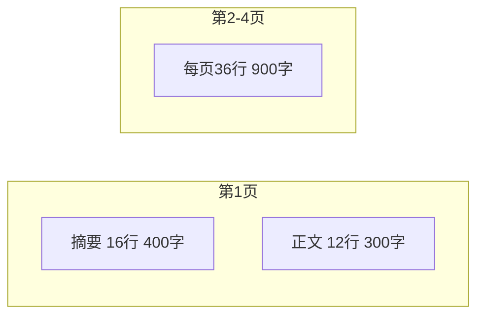
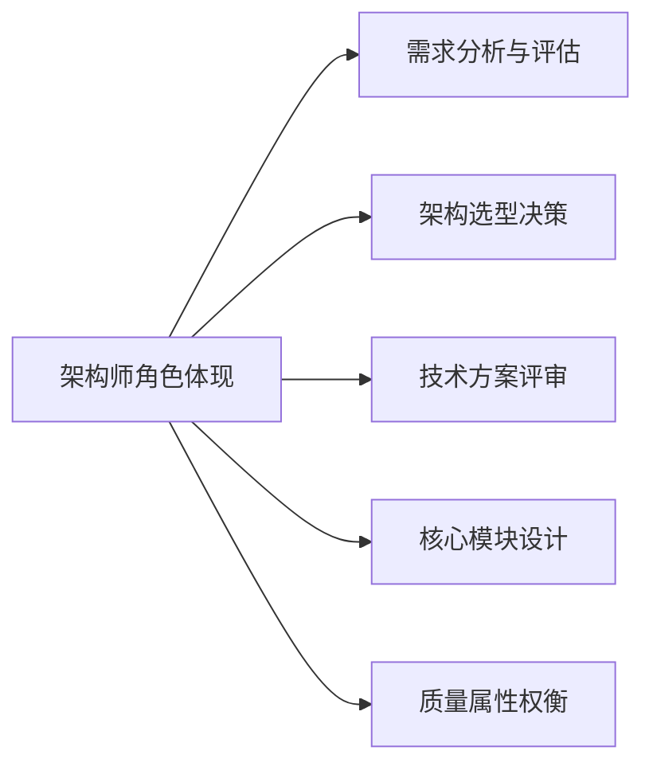
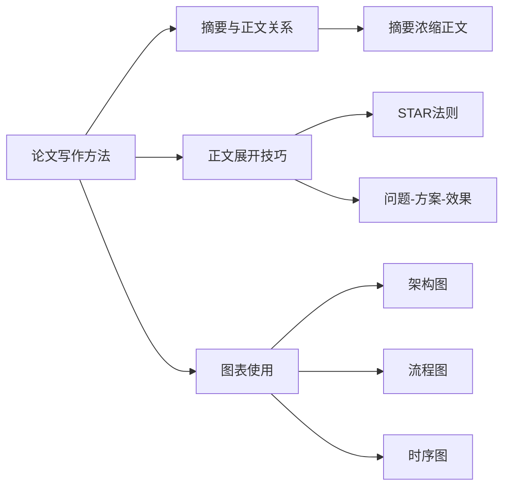
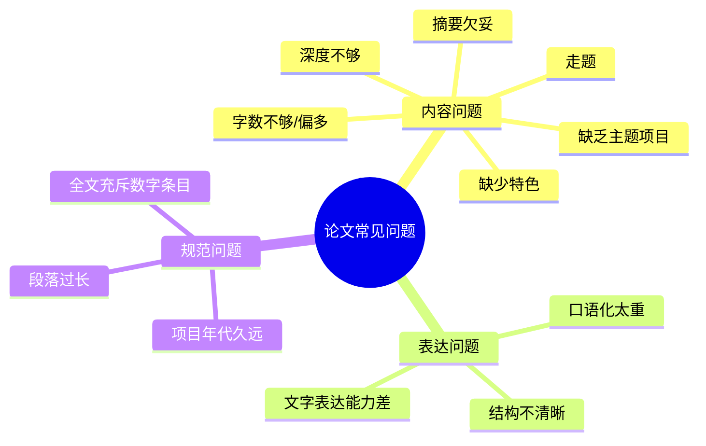
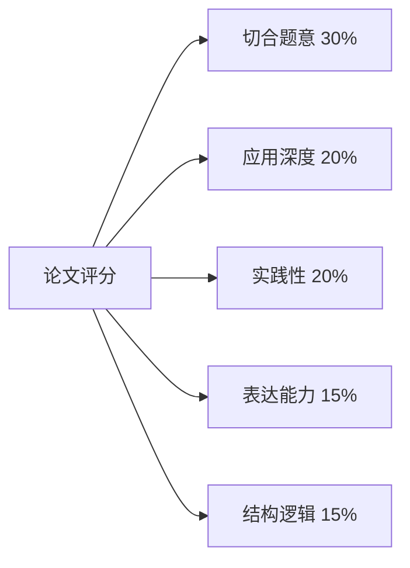
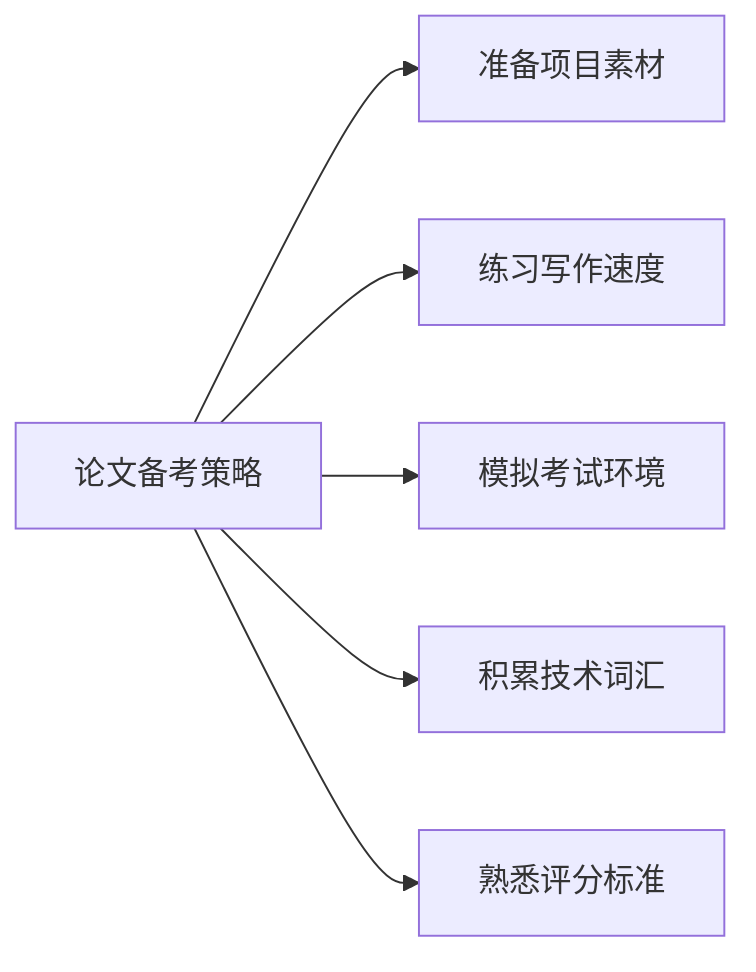
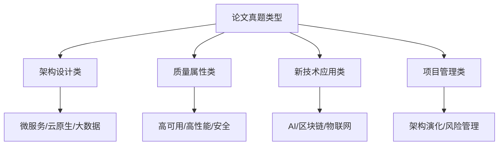
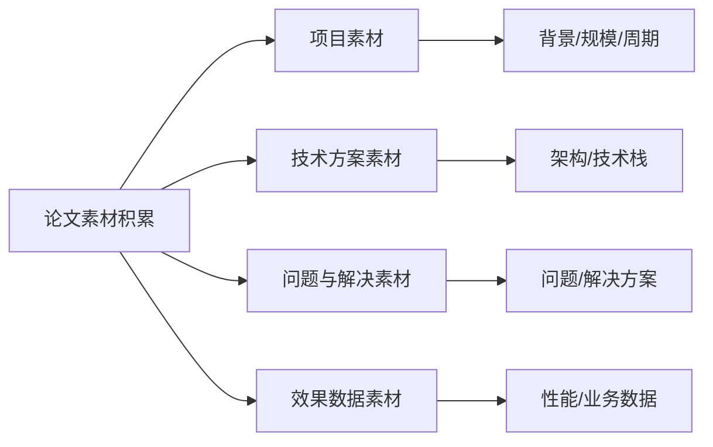
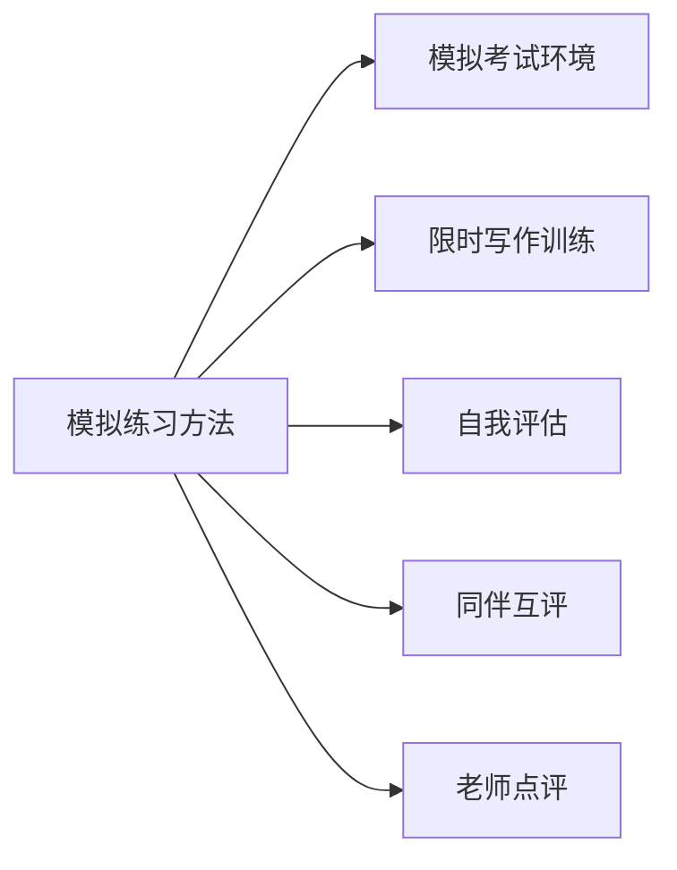
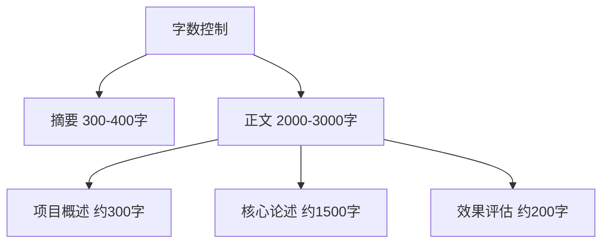

## 论文格式要求

系统架构设计师论文考试要求考生在规定时间内完成一篇结构完整、内容充实的技术论文。考试时间为 120 分钟，备选题目通常包含 4 道，考生可从中任选 1 题作答[^1]。

论文答题纸采用方格稿纸格式，摘要与正文分开撰写：

- **摘要**：300～400 字，位于第 1 页上半部分，共 16 行（每行 25 格）[^2]。
- **正文**：2000～3000 字，建议最佳字数约 2500 字，分布于第 1 页下半部分及第 2～4 页[^3]。

格式注意事项：

- 文字需写在格子里，每个格子一个字或标点；英文字母按书写习惯连续书写[^4]。
- 建议使用黑色中性笔，避免劣质纸张导致墨迹渗透影响卷面[^5]。
- 答题时不要忘记在指定位置画圈选题、填写考号，否则可能被视为无效答卷[^6]。

准确把握字数与格式是论文通过的基础条件。摘要少于 120 字可能被判不及格，正文超过 3000 字则无法在答题纸上完整呈现[^7]。

> 📌 **考试重点**：论文格式要求（摘要300-400字/正文2000-3000字）、方格稿纸书写规范、选题注意事项是论文写作的基础。

> 🔗 **真题关联**：历年真题多次考查论文格式要求，2023年上半年考查了摘要字数要求。

---

## 论文写作步骤

论文写作是一项需要提前准备的综合能力测试。临场应按照固定时间分配与步骤进行，以确保在 120 分钟内完成全部内容[^8]。

标准写作流程：

1. **选择题目**：挑选自己最熟悉、把握最大的题目，并确保所选项目与论题相符[^9]。
2. **论文构思**：确定论点、项目素材与章节划分，草拟简单提纲，规划字数分配[^10]。
3. **撰写摘要**：用简洁明了的语言概括正文核心内容，避免空泛口号[^11]。
4. **撰写正文**：按提纲展开，结合项目实际论述技术方案、实施过程与效果，注意控制篇幅与前后一致性[^12]。
5. **检查修改**：重点检查是否有遗漏、错字、格式不整或前后矛盾，保持卷面整洁[^13]。

时间管理是论文写作的关键。构思阶段宁可多花几分钟，避免正文写到中途发现偏题或素材不足，导致无法收尾[^14]。

> 📌 **考试重点**：论文写作五步骤的时间分配、构思阶段的重要性是论文备考的核心。

> 🔗 **真题关联**：2022年下半年考查了论文写作时间分配建议。

---

## 摘要写法

摘要是论文的"门面"，直接影响阅卷专家对论文的第一印象。摘要应控制在 300～400 字，凡未写摘要、摘要过于简略或缺乏实质性内容的论文将被扣 5～10 分；摘要少于 120 字可能被判不及格[^15]。

摘要应高度概括正文全貌，使读者不看正文即可了解文章核心内容。教材提供了几种常见写法模板[^16]：

1. **标准式**：本文讨论……系统项目的……（论文主题）。该系统……（项目背景、简单功能介绍）。在本文中首先讨论了……（技术、方法、工具、措施、手段），最后……（不足之处/改进/特色）。在本项目开发过程中，我担任了……（角色）[^17]。
2. **成果式**：根据……需求，我所在的……组织了……项目的开发。该项目……（项目背景、功能介绍）。在该项目中，我担任……（角色）。通过采取……（技术、方法、工具），使项目圆满完成，得到用户好评[^18]。
3. **时间式**：……年……月，我参加了……项目的开发，担任……（角色）。该项目……（项目背景、功能介绍）。本文结合作者的实践，以……项目为例，讨论……（论文主题），包括……[^19]。

写作要点：

- 不要只谈大道理，必须涉及具体项目与技术措施。
- 不要在摘要中过度"戴帽子"，若字数不足可适当增加 50 字左右的重要性描述。
- 每个技术要点用一两句话概括，与正文内容保持一致[^20]。

> 📌 **考试重点**：摘要三种模板（标准式/成果式/时间式）、字数控制、写作要点是摘要写作的核心。

> 🔗 **真题关联**：2021年上半年考查了摘要写作中"戴帽子"问题的规避。

---

## 正文结构

正文是论文的主体，字数要求在 2000～3000 字之间，最佳约 2500 字。正文结构应清晰、层次分明，通常可分为项目概述、核心论述与效果评估三大部分[^21]。

**1. 项目概述（约 300 字）**
用精练语言说明项目背景、意义、规模、开发过程以及自己在项目中的角色。这部分是阅卷专家快速了解论文价值的关键，应做到开门见山、重点突出[^22]。

**2. 核心论述（约 1500 字）**
围绕论文题目要求，详细阐述技术方案、架构设计过程、遇到的问题与解决方法。这是论文的核心，必须结合自己的实际工作展开，避免泛泛而谈或罗列教科书内容[^23]。

**3. 效果评估（约 200 字）**
总结项目实施效果，包括性能提升、质量改进、成本优化或业务价值。同时可适当提及不足与改进方向，体现思考的深度[^24]。

写作技巧：

- **以自我为中心**：明确"我"做了什么，而不是项目组整体做了什么。
- **站在架构师角度**：关注架构决策、接口设计、质量属性与权衡，而非具体代码实现。
- **忠实于论点**：紧扣题目三问，避免节外生枝或偏离主题。
- **图文并茂**：在紧要处绘制架构草图，可直观展示设计思路，提升阅卷专家认可度[^25]。

> 📌 **考试重点**：正文三部分（项目概述/核心论述/效果评估）的字数分配、写作技巧是正文写作的核心。

> 🔗 **真题关联**：2020年下半年考查了正文核心论述部分的写作要求。

---

## 项目背景描述要点

项目背景是论文第一部分的重要内容，其目的是让阅卷专家快速了解作者所参与项目的真实性、规模与复杂度。项目背景应具体、真实，但不宜过度展开技术细节[^26]。

项目背景通常需交代以下要素：

- **项目名称与甲方**：说明项目所属单位或客户类型，避免使用真实敏感名称[^27]。
- **项目周期**：说明项目起止时间，一般以近 3 年内完成的项目为佳[^28]。
- **投资规模与团队规模**：体现项目的复杂度与影响力[^29]。
- **技术栈选择理由**：简要说明为何选用某种架构风格、技术平台或工具[^30]。
- **项目功能定位**：用 1～2 句话说明系统的主要业务目标[^31]。

写作时应注意：

- 项目背景是为后续架构设计论述做铺垫，不要占用过多篇幅。
- 所描述的项目应与论文题目主题高度相关，避免生搬硬套。
- 突出自己作为架构师参与的实际工作内容，而非项目经理或开发人员的泛泛职责[^32]。

> 📌 **考试重点**：项目背景五要素（名称/周期/规模/技术栈/功能）、写作注意事项是项目背景的核心。

> 🔗 **真题关联**：2022年上半年考查了项目背景中技术栈选择理由的描述。

---

## 架构师角色体现

系统架构设计师论文的核心在于体现作者以架构师身份参与项目的能力，而非项目经理或程序员视角。论文必须清楚展示架构师的决策、权衡与引领作用[^33]。

具体可从以下方面展开：

- **需求分析与评估**：如何识别功能需求与非功能需求（性能、可用性、安全性、可扩展性等），并将其转化为架构目标[^34]。
- **架构选型决策**：在多个候选方案中进行比较，说明选择某种架构风格、技术栈或部署模式的理由与取舍[^35]。
- **技术方案评审**：组织或参与技术评审，识别关键技术风险，制定应对策略[^36]。
- **核心模块设计**：设计系统的分层结构、接口规范、数据流与关键组件，并用图表辅助说明[^37]。
- **质量属性权衡**：在可用性、性能、安全性、可修改性之间进行权衡，说明决策依据[^38]。

写作时应避免：

- 仅描述项目进度与团队管理，那是项目经理视角。
- 仅描述编码实现细节，那是程序员视角。
- 使用过多的"我"，建议用"我们"体现团队协作，但需突出自己的贡献与决策作用[^39]。

> 📌 **考试重点**：架构师角色体现的五个方面、避免的三种视角是论文写作的核心。

> 🔗 **真题关联**：2021年下半年考查了论文中架构师角色与项目经理角色的区别。

---

## 论文写作方法

论文写作方法涉及摘要与正文的关系、正文展开技巧、图表使用等多个方面[^40]。

**摘要与正文的关系**：

- 摘要是正文的浓缩，正文是摘要的展开
- 摘要中的每个技术要点在正文中应有对应论述
- 摘要与正文内容应保持一致，避免矛盾

**正文展开技巧**：

- **STAR 法则**：Situation（背景）→ Task（任务）→ Action（行动）→ Result（结果）
- **问题-方案-效果**：提出问题 → 分析原因 → 给出方案 → 验证效果
- **对比论证**：对比多种方案，说明选择理由

**图表使用**：

- 架构图：展示系统分层结构和组件关系
- 流程图：展示业务流程或数据流
- 时序图：展示组件间交互时序
- 表格：对比多种技术方案

> 📌 **考试重点**：STAR 法则、问题-方案-效果结构、图表使用技巧是论文写作方法的核心。

> 🔗 **真题关联**：2020年上半年考查了论文中架构图的使用技巧。

---

## 常见问题及解决办法

论文写作中常见的问题直接影响最终得分。教材归纳了十余类典型问题，考生应在平时练习中主动规避[^41]。

重点问题说明：

- **走题**：未仔细阅读题目三问，仅按三段论或通用模板写作，导致内容与题目要求不符[^42]。
- **字数问题**：摘要少于 300 字或正文少于 2000 字显得内容不足；正文超过 3000 字则无法在答题纸完成[^43]。
- **摘要欠妥**：摘要中"戴帽子"过多，缺乏实质性内容，无法概括正文重点[^44]。
- **深度不够**：列举过多技术措施但每个都浅尝辄止，建议选择 2～3 个有特色的措施深入展开[^45]。
- **缺少主题项目**：论文必须说明作者参与的具体项目、时间与角色，避免笼统说"我从事银行软件"[^46]。
- **口语化与段落过长**：应使用书面语言，每个自然段不宜超过 8 行，避免给阅卷专家造成疲劳感[^47]。

> 📌 **考试重点**：六大重点问题（走题/字数/摘要/深度/项目/口语化）的识别和规避是论文备考的核心。

> 🔗 **真题关联**：2023年下半年考查了论文字数不足的影响。

---

## 论文评分标准

系统架构设计师论文评分标准分为五个维度，总分 75 分[^48]。

| 评分维度 | 分值占比 | 说明 |
|----------|----------|------|
| 切合题意 | 30% | 是否紧扣题目三问，内容是否切题 |
| 应用深度 | 20% | 技术方案是否有深度，是否结合实际项目 |
| 实践性 | 20% | 是否有实际项目经验，是否体现架构师角色 |
| 表达能力 | 15% | 语言是否流畅，逻辑是否清晰，格式是否规范 |
| 结构逻辑 | 15% | 结构是否合理，层次是否分明，过渡是否自然 |

**评分等级**：

- **优秀（60-75分）**：切合题意，应用深入，实践丰富，表达流畅，结构严谨
- **良好（45-59分）**：基本切题，应用有一定深度，有实践经验，表达尚可
- **及格（37-44分）**：部分切题，应用较浅，实践经验不足，表达一般
- **不及格（0-36分）**：偏题或走题，缺乏实践，表达混乱，结构松散

> 📌 **考试重点**：五个评分维度及分值占比、评分等级划分是论文备考的重要参考。

> 🔗 **真题关联**：2022年上半年考查了论文评分中"切合题意"的分值占比。

---

## 论文备考策略

论文备考需要提前准备，不能临时抱佛脚。以下是有效的备考策略[^49]。

**1. 提前准备项目素材**

- 选择 2-3 个自己参与的真实项目
- 梳理项目背景、技术方案、遇到的问题和解决方法
- 准备项目相关的架构图和流程图

**2. 练习写作速度**

- 模拟考试环境，限时 120 分钟完成一篇论文
- 逐步提高写作速度，目标 2500 字/120 分钟
- 练习手写，适应方格稿纸

**3. 模拟考试环境**

- 使用方格稿纸进行模拟写作
- 严格按照时间分配进行练习
- 模拟选题过程，训练快速决策能力

**4. 积累技术词汇**

- 整理常用架构术语和概念
- 学习优秀论文的表达方式
- 避免口语化，使用专业术语

**5. 熟悉评分标准**

- 了解评分维度和分值占比
- 对照评分标准检查自己的论文
- 有针对性地改进薄弱环节

> 📌 **考试重点**：五项备考策略（项目素材/写作速度/模拟考试/技术词汇/评分标准）是论文备考的核心。

> 🔗 **真题关联**：2021年上半年考查了论文备考中项目素材准备的重要性。

---

## 论文真题解析

历年论文真题可分为四大类型，了解真题类型有助于针对性备考[^50]。

**论文真题类型**：

1. **架构设计类**：要求论述某种架构风格或技术在实际项目中的应用
   - 示例：论微服务架构在电商系统中的应用

2. **质量属性类**：要求论述如何保证系统的某种质量属性
   - 示例：论高可用系统的设计与实现

3. **新技术应用类**：要求论述某种新技术在实际项目中的应用
   - 示例：论云原生架构在企业数字化转型中的应用

4. **项目管理类**：要求论述项目管理中的某个方面
   - 示例：论软件架构的演化和维护

**高分论文特点**：

- 项目真实，技术方案具体
- 架构师角色突出，决策过程清晰
- 技术深度适中，不泛泛而谈
- 结构清晰，逻辑严密
- 图文并茂，表达流畅

**常见失分点**：

- 项目不真实或过于简单
- 缺乏架构师视角，写成程序员日记
- 技术方案缺乏深度，罗列概念
- 结构混乱，逻辑不清
- 字数不足或超量

> 📌 **考试重点**：四大论文真题类型、高分论文特点、常见失分点是论文备考的重要参考。

> 🔗 **真题关联**：2023年下半年考查了历年论文真题中架构设计类的占比。

---

## 论文素材积累方法

论文写作的质量很大程度上取决于平时素材的积累。系统架构设计师考试要求论文必须结合实际项目，因此考生需要提前准备丰富的项目素材、技术方案素材、问题与解决素材以及效果数据素材[^51]。

**1. 项目素材**：选择 2～3 个深度参与的真实项目，梳理项目背景、规模、技术环境和个人角色，覆盖不同技术领域以应对不同题目[^52]。

**2. 技术方案素材**：记录架构选型理由、技术栈选择依据、设计模式应用场景和核心模块实现细节[^53]。

**3. 问题与解决素材**：归纳性能瓶颈、可用性故障、安全威胁和扩展性调整等典型问题及解决方案[^54]。

**4. 效果数据素材**：量化项目成果，包括响应时间、吞吐量、缺陷率、可用性百分比等前后对比数据[^55]。

素材积累应贯穿日常工作，建议建立个人知识库定期整理更新。

> 📌 **考试重点**：四类素材（项目/技术方案/问题与解决/效果数据）的积累方法、素材与论文题目的匹配策略是论文备考的核心。

> 🔗 **真题关联**：2022年上半年考查了论文素材准备的重要性及素材选择原则。
---

## 论文模拟练习方法

论文考试不仅考查知识储备，更考查限时写作能力。通过系统的模拟练习，考生可以熟悉考试节奏、提高写作速度、发现自身不足[^56]。

**1. 模拟考试环境**：使用方格稿纸和黑色中性笔，在安静环境中严格按 120 分钟限时练习，还原真实考试场景[^57]。

**2. 限时写作训练**：按选题（3分钟）→构思（12分钟）→摘要（15分钟）→正文（80分钟）→检查（10分钟）的时间分配进行训练，初期可放宽时间，逐步压缩至标准[^58]。

**3. 自我评估**：对照评分五维度（切合题意、应用深度、实践性、表达能力、结构逻辑）进行自我评分，记录得分变化趋势[^59]。

**4. 同伴互评**：与备考同伴交换论文，发现自身盲点，学习优秀表达方式，通过讨论深化技术理解[^60]。

**5. 老师点评**：请有经验的前辈点评，获取专业视角的失分点分析和针对性改进建议[^61]。

建议考前至少完成 5～8 篇完整论文的模拟写作。

> 📌 **考试重点**：五种模拟练习方法（模拟环境/限时写作/自我评估/同伴互评/老师点评）的实施要点是论文备考的核心。

> 🔗 **真题关联**：2021年下半年考查了论文模拟练习中限时写作的重要性。
---

## 论文字数控制技巧

论文字数控制是论文写作的基本功。摘要 300～400 字、正文 2000～3000 字的限制要求考生具备良好的篇幅规划能力[^62]。

**1. 摘要字数控制**：摘要共 16 行、每行 25 格。目标 330～380 字；不足时增加项目重要性描述，过多时精简套话和"帽子"；先打草稿确认再誊写[^63]。

**2. 正文字数分配**：项目概述 250～350 字（约 1/3 页），核心论述 1400～1600 字（约 2 页），效果评估 150～250 字（约 1/4 页），合计 2000～2500 字。核心论述弹性最大，应据题目灵活调整[^64]。

**3. 扩展与压缩技巧**：字数不足时增加案例细节、补充对比分析、添加数据支撑；字数过多时精简背景、合并相似内容、删除次要论点、用图表替代文字描述[^65]。

**4. 检查字数方法**：采用方格计数法（行数×格数）、草稿预写法（先写提纲估算）、分段检查法（每部分写完即时核对），避免最后才发现超标。

字数控制需要大量练习才能熟练掌握，建议平时严格按考试要求控制篇幅。

> 📌 **考试重点**：摘要与正文的字数分配、扩展与压缩技巧、字数检查方法是论文写作的基础技能。

> 🔗 **真题关联**：2023年上半年考查了论文字数控制的重要性及常见字数问题。
---
## 参考文献

[^1]: 《系统架构设计师教程(第二版)》P.703 §20.1.2

[^2]: 《系统架构设计师教程(第二版)》P.703 §20.1.2

[^3]: 《系统架构设计师教程(第二版)》P.703 §20.1.2

[^4]: 《系统架构设计师教程(第二版)》P.703 §20.1.2

[^5]: 《系统架构设计师教程(第二版)》P.703 §20.1.2

[^6]: 《系统架构设计师教程(第二版)》P.705 §20.2.1

[^7]: 《系统架构设计师教程(第二版)》P.711 §20.4

[^8]: 《系统架构设计师教程(第二版)》P.705 §20.2.1

[^9]: 《系统架构设计师教程(第二版)》P.705 §20.2.1

[^10]: 《系统架构设计师教程(第二版)》P.705 §20.2.1

[^11]: 《系统架构设计师教程(第二版)》P.708 §20.3.1

[^12]: 《系统架构设计师教程(第二版)》P.705 §20.2.1

[^13]: 《系统架构设计师教程(第二版)》P.705 §20.2.1

[^14]: 《系统架构设计师教程(第二版)》P.711 §20.4

[^15]: 《系统架构设计师教程(第二版)》P.708 §20.3.1

[^16]: 《系统架构设计师教程(第二版)》P.708 §20.3.1

[^17]: 《系统架构设计师教程(第二版)》P.708 §20.3.1

[^18]: 《系统架构设计师教程(第二版)》P.708 §20.3.1

[^19]: 《系统架构设计师教程(第二版)》P.708 §20.3.1

[^20]: 《系统架构设计师教程(第二版)》P.708 §20.3.1

[^21]: 《系统架构设计师教程(第二版)》P.709 §20.3.2

[^22]: 《系统架构设计师教程(第二版)》P.709 §20.3.2

[^23]: 《系统架构设计师教程(第二版)》P.709 §20.3.2

[^24]: 《系统架构设计师教程(第二版)》P.709 §20.3.2

[^25]: 《系统架构设计师教程(第二版)》P.709 §20.3.2

[^26]: 《系统架构设计师教程(第二版)》P.705 §20.2.2

[^27]: 《系统架构设计师教程(第二版)》P.712 §20.4

[^28]: 《系统架构设计师教程(第二版)》P.712 §20.4

[^29]: 《系统架构设计师教程(第二版)》P.709 §20.3.2

[^30]: 《系统架构设计师教程(第二版)》P.705 §20.2.2

[^31]: 《系统架构设计师教程(第二版)》P.708 §20.3.1

[^32]: 《系统架构设计师教程(第二版)》P.709 §20.3.2

[^33]: 《系统架构设计师教程(第二版)》P.709 §20.3.2

[^34]: 《系统架构设计师教程(第二版)》P.709 §20.3.2

[^35]: 《系统架构设计师教程(第二版)》P.705 §20.2.2

[^36]: 《系统架构设计师教程(第二版)》P.709 §20.3.2

[^37]: 《系统架构设计师教程(第二版)》P.709 §20.3.2

[^38]: 《系统架构设计师教程(第二版)》P.709 §20.3.2

[^39]: 《系统架构设计师教程(第二版)》P.712 §20.4

[^40]: 《系统架构设计师教程(第二版)》P.709-711 §20.3.2-20.3.3

[^41]: 《系统架构设计师教程(第二版)》P.711 §20.4

[^42]: 《系统架构设计师教程(第二版)》P.711 §20.4

[^43]: 《系统架构设计师教程(第二版)》P.711 §20.4

[^44]: 《系统架构设计师教程(第二版)》P.711 §20.4

[^45]: 《系统架构设计师教程(第二版)》P.711 §20.4

[^46]: 《系统架构设计师教程(第二版)》P.712 §20.4

[^47]: 《系统架构设计师教程(第二版)》P.712 §20.4

[^48]: 《系统架构设计师教程(第二版)》P.704 §20.1.3

[^49]: 《系统架构设计师教程(第二版)》P.712-714 §20.5

[^50]: 《系统架构设计师教程(第二版)》P.714-716 §20.6

[^51]: 《系统架构设计师教程(第二版)》P.712-714 §20.5

[^52]: 《系统架构设计师教程(第二版)》P.712-714 §20.5

[^53]: 《系统架构设计师教程(第二版)》P.712-714 §20.5

[^54]: 《系统架构设计师教程(第二版)》P.712-714 §20.5

[^55]: 《系统架构设计师教程(第二版)》P.705 §20.2.1

[^56]: 《系统架构设计师教程(第二版)》P.704 §20.1.3

[^57]: 《系统架构设计师教程(第二版)》P.712-714 §20.5

[^58]: 《系统架构设计师教程(第二版)》P.703 §20.1.2

[^59]: 《系统架构设计师教程(第二版)》P.708 §20.3.1

[^60]: 《系统架构设计师教程(第二版)》P.709 §20.3.2

[^61]: 《系统架构设计师教程(第二版)》P.711 §20.4

[^62]: 《系统架构设计师教程(第二版)》P.703 §20.1.2

[^63]: 《系统架构设计师教程(第二版)》P.708 §20.3.1

[^64]: 《系统架构设计师教程(第二版)》P.709 §20.3.2

[^65]: 《系统架构设计师教程(第二版)》P.711 §20.4
